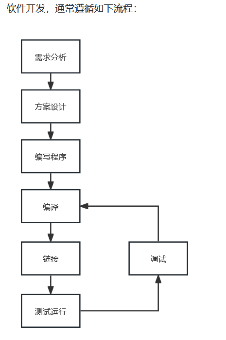
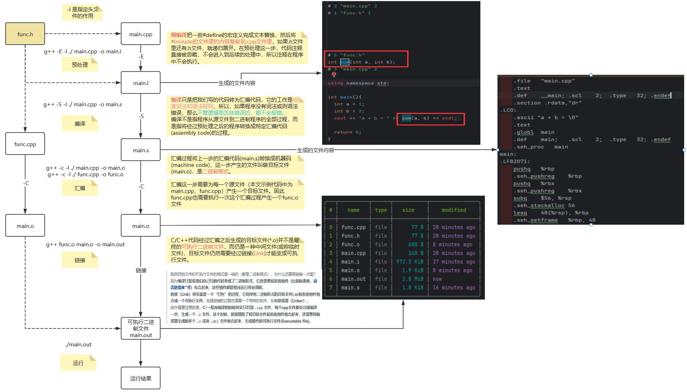
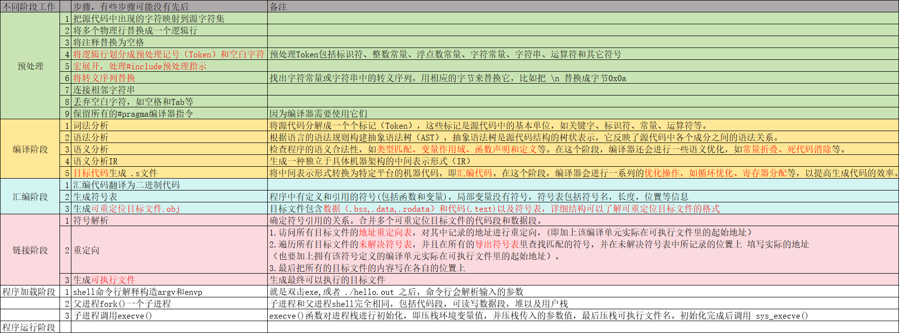

# 软件开发流程

# 编译和链接过程

首先，可以根据如下图对单个cpp文件进行逐步编译和链接，理解大致流程

实验代码：[c_complie](../../code/00_foreword/c_complie/main.cpp)

编译过程的详细过程可以参考表格：[编译过程.xlsx](../../code/00_foreword/%E7%BC%96%E8%AF%91%E8%BF%87%E7%A8%8B.xlsx)

