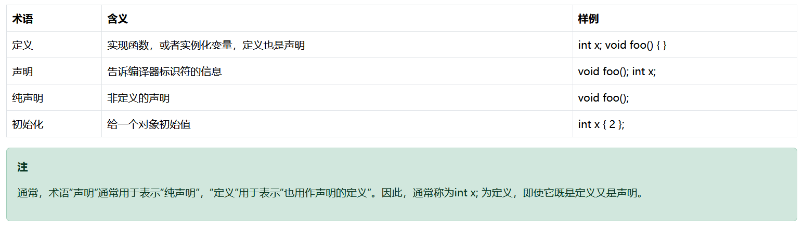

### 前向声明与单定义规则

#### 前向声明

前向声明是C++编程中的一种机制，它允许你在实际定义之前告诉编译器某个函数、变量或类型的名称和类型信息。这对于解决函数调用顺序的问题特别有用。

**示例问题**：

```cpp
#include <iostream>

int main() {
    std::cout << "The sum of 3 and 4 is: " << add(3, 4) << '\n'; // 编译错误：add未定义
    return 0;
}

int add(int x, int y) {
    return x + y;
}
```

上述代码在`main`函数调用`add`函数时会报错，因为编译器在处理`main`函数时还不知道`add`函数的存在。

**解决方案**：

1. **重新排序函数定义**：
   将`add`函数的定义移到`main`函数之前。

   ```cpp
   #include <iostream>

   int add(int x, int y) {
       return x + y;
   }

   int main() {
       std::cout << "The sum of 3 and 4 is: " << add(3, 4) << '\n';
       return 0;
   }
   ```

2. **使用前向声明**：
   在`main`函数之前添加`add`函数的前向声明。

   ```cpp
   #include <iostream>

   int add(int x, int y); // 函数前向声明

   int main() {
       std::cout << "The sum of 3 and 4 is: " << add(3, 4) << '\n';
       return 0;
   }

   int add(int x, int y) { // 函数定义
       return x + y;
   }
   ```



#### 单定义规则（ODR）

单定义规则（One Definition Rule, ODR）是C++中的一个重要概念，确保程序中的每个标识符（如函数、变量、类型等）有且仅有一个定义，同时可以有多个声明。

- **同一作用域内只能有一个定义**：例如，在同一个文件的同一作用域内，不能重复定义相同的函数或变量。

  ```cpp
  int add(int x, int y) { return x + y; } // 第一次定义
  int add(int x, int y) { return x + y; } // 违反ODR
  ```

- **整个程序中只能有一个定义**：对于链接可见的标识符（如全局变量），在整个程序的所有源文件中只能有一个定义。

- **类型、模板、内联函数和内联变量可以在多个文件中定义**，只要这些定义完全一致。

**违反ODR的例子**：

```cpp
int add(int x, int y) {
    return x + y;
}

int add(int x, int y) { // 违反了ODR
    return x + y;
}

int main() {
    int x;
    int x; // 违反了ODR
}
```

这种情况下，编译器会报告错误，如`error C2084: function 'int add(int,int)' already has a body`。

#### 总结

- **前向声明**解决了函数调用顺序的问题，使得编译器能够在定义之前知道函数的存在。
- **单定义规则（ODR）**确保了每个标识符在程序中有且仅有一个定义，避免了重定义错误和潜在的逻辑错误。
- 使用前向声明和遵循ODR可以帮助编写更清晰、更有效的代码，减少编译和链接阶段的错误。