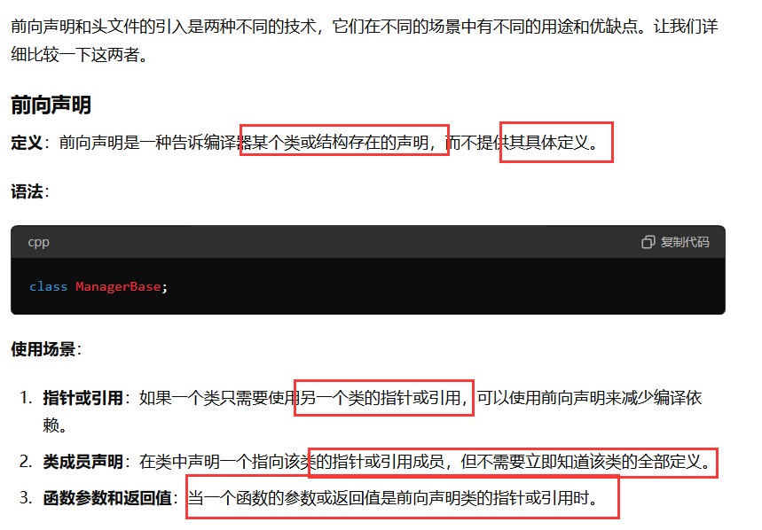
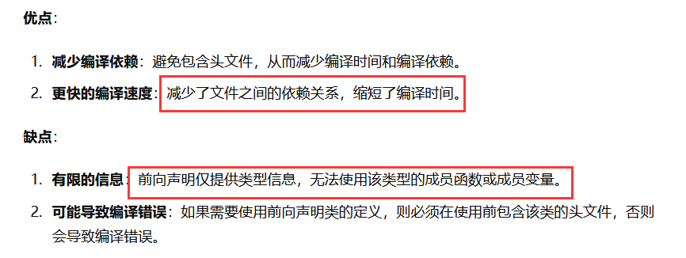
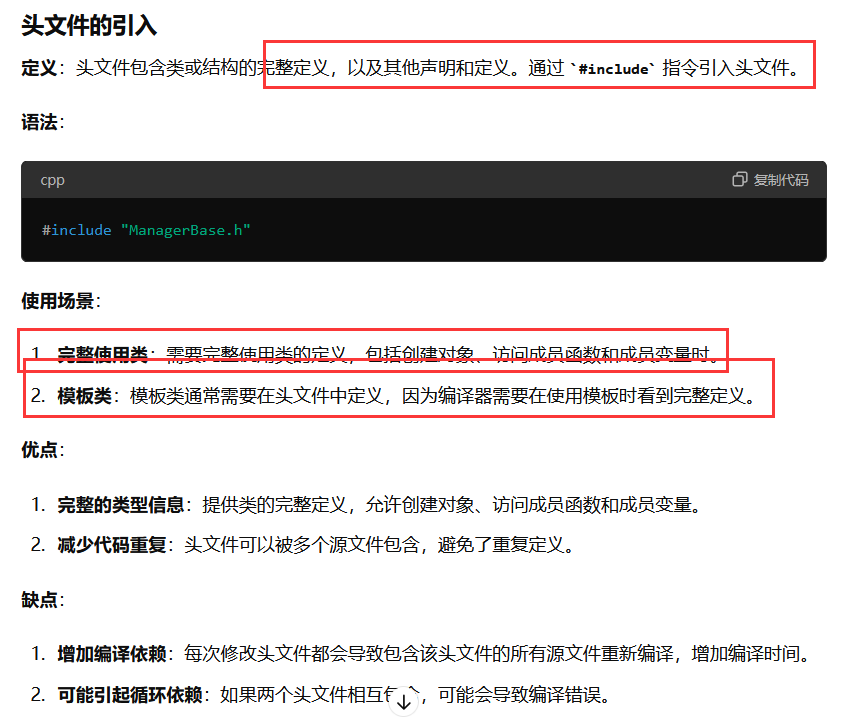
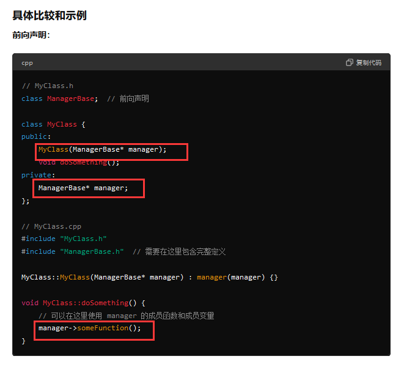
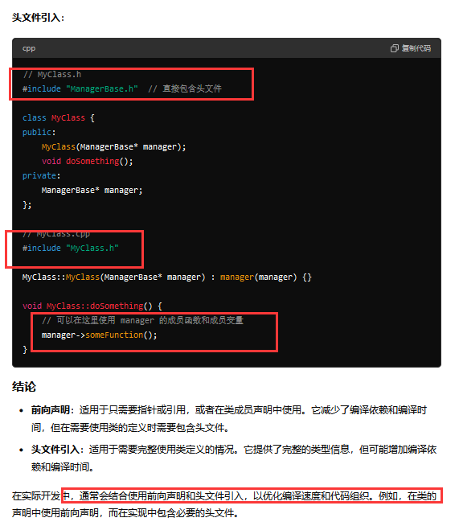
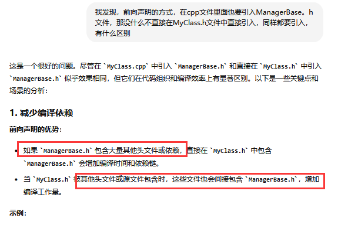
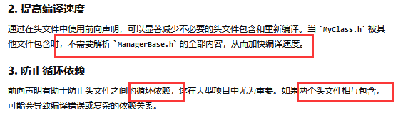
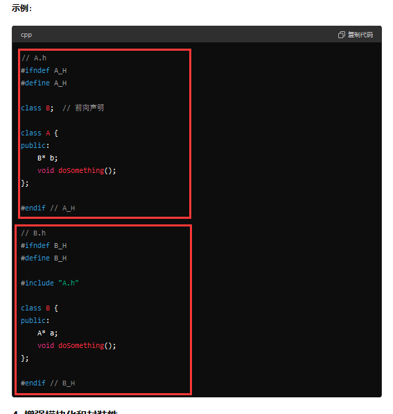
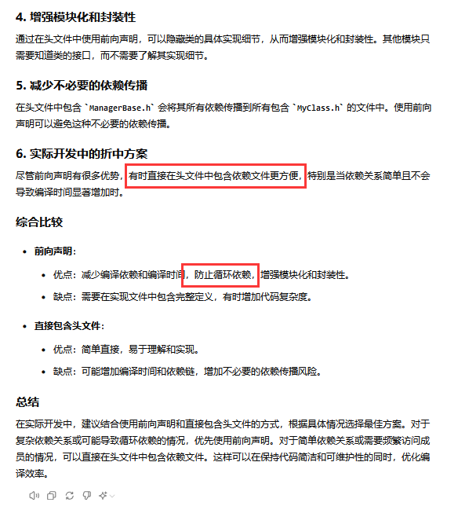

### 尖括号与双引号及头文件使用的最佳实践总结

#### 尖括号与双引号的使用
- **尖括号 (`<>`)**：用于引用标准库或第三方库提供的头文件。预处理器会在系统目录中搜索这些文件，而不查找当前项目的源代码目录。
- **双引号 (`""`)**：用于包含用户自定义的头文件。预处理器首先在当前目录中查找这些文件，如果找不到，则会转到系统目录进行搜索。

**规则**：
- 使用双引号来包含预计位于当前项目目录中的头文件。
- 使用尖括号来引用编译器、操作系统或第三方库附带的标准头文件。

#### 标准库头文件命名规则
- **无`.h`扩展名**：C++标准库头文件（如`iostream`）不使用`.h`后缀，以区分它们与C语言兼容版本的头文件（如`iostream.h`）。这是为了将所有标识符置于`std`命名空间内，避免命名冲突。
- **从C继承的库**：C++中保留了C语言的库，并通过添加`c`前缀（如`cstdlib`对应`stdlib.h`）将其标识符移至`std`命名空间。

**最佳实践**：
- 使用不带`.h`扩展名的标准库头文件。
- 用户自定义的头文件应继续使用`.h`扩展名，并且优先使用`std`命名空间中的标识符。

#### 包含其他目录中的头文件
- **推荐方法**：通过配置编译器或IDE设置（如Visual Studio的VC++目录选项、GCC/G++的`-I`选项等），指定额外的头文件搜索路径，而不是直接在`#include`指令中使用相对路径。
- **优点**：简化目录结构调整后的维护工作，只需更新编译器或IDE设置即可。

#### 头文件的最佳实践
- **递归包含**：虽然头文件可以包含其他头文件，但不应依赖于这种递归包含的头文件。每个文件应该显式地包含其所需的头文件，以确保代码的可移植性和未来的可维护性。
- **包含顺序**：
    - 首先包含与当前源文件对应的头文件。
    - 接着是本项目中的其他头文件。
    - 然后是第三方库的头文件。
    - 最后是标准库的头文件。
    - 同一分组内的头文件按字母顺序排列。

- **头文件保护**：使用条件编译指令防止重复包含同一头文件（将在后续课程详细介绍）。
- **独立性**：每个头文件应尽可能独立，只包含完成其功能所需的声明和定义。
- **文档**：在头文件中提供关于代码用途的文档说明，有助于理解和维护代码。

通过遵循上述指南，可以有效地管理头文件的组织结构，提高代码的清晰度、可维护性和跨平台兼容性。同时，合理利用编译器或IDE的功能，能够进一步优化开发流程，减少因目录结构调整带来的额外工作量。

---

### 头文件保护与重复定义问题详解

#### 重复定义问题

在C++中，根据单定义规则（One Definition Rule, ODR），每个变量或函数标识符在同一程序中只能有一个定义。如果违反此规则，例如在一个程序中多次定义同一个变量或函数，会导致编译错误。

**示例：**

```cpp
int main() {
    int x; // 变量x的定义
    int x; // 编译失败: 重复定义
    return 0;
}
```

同样的规则适用于函数定义：

```cpp
#include <iostream>

int foo() { // 函数foo的定义
    return 5;
}

int foo() { // 编译失败: 重复定义
    return 5;
}

int main() {
    std::cout << foo();
    return 0;
}
```

当使用头文件时，尤其是多个源文件包含相同的头文件时，很容易出现重复定义的问题。这是因为头文件中的内容会被复制到所有包含它的源文件中，导致同一定义出现在多个地方。

#### 头文件保护

为了避免上述问题，可以使用头文件保护（也称为包含保护）。头文件保护是通过条件编译指令来实现的，确保头文件的内容不会被多次包含到同一个翻译单元中。

**基本格式：**

```cpp
#ifndef UNIQUE_IDENTIFIER_H
#define UNIQUE_IDENTIFIER_H

// 头文件内容

#endif // UNIQUE_IDENTIFIER_H
```

**工作原理：**
1. 预处理器检查`UNIQUE_IDENTIFIER_H`是否已定义。
2. 如果未定义，则定义它，并包含头文件的内容。
3. 如果已定义，则跳过头文件的内容，避免重复包含。

**示例：**

假设我们有以下头文件 `square.h` 和 `wave.h`：

```cpp
// square.h
#ifndef SQUARE_H
#define SQUARE_H

int getSquareSides() {
    return 4;
}

#endif // SQUARE_H

// wave.h
#ifndef WAVE_H
#define WAVE_H

#include "square.h"

#endif // WAVE_H
```

然后，在 `main.cpp` 中：

```cpp
#include "square.h"
#include "wave.h"

int main() {
    return 0;
}
```

经过预处理后，`main.cpp` 实际上只包含了一次 `getSquareSides` 的定义，从而避免了重复定义错误。

#### 使用`#pragma once`

除了传统的头文件保护方法外，现代编译器还支持使用 `#pragma once` 来简化这一过程。只需在头文件的开头添加 `#pragma once` 即可防止该头文件被多次包含。

**示例：**

```cpp
#pragma once

int getSquareSides() {
    return 4;
}
```

尽管 `#pragma once` 更简洁且不易出错，但它不是C++标准的一部分，因此某些编译器可能不支持。相比之下，传统的头文件保护方法更为通用和兼容。

#### 最佳实践

- **避免在头文件中定义函数**：尽量将函数定义放在源文件（.cpp）中，而在头文件中仅进行声明。这样可以减少重复定义的风险。
- **使用头文件保护或`#pragma once`**：无论选择哪种方式，都应确保头文件不会被多次包含，以维护代码的一致性和正确性。
- **保持唯一标识符**：为头文件保护选择一个唯一的标识符，通常基于文件名，但也可以加入项目名称或其他信息，以避免不同项目间的冲突。

通过遵循这些最佳实践，可以有效避免由于重复定义导致的编译和链接错误，同时提高代码的可维护性和可移植性。


---

















