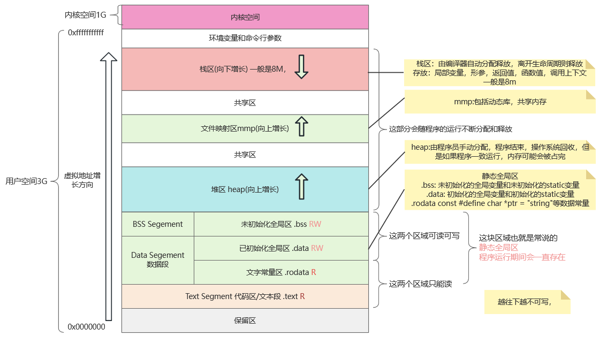
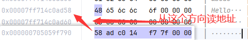

# 内存管理
## 1.内存模型
首先这里给出内存模型逻辑图

## 2.不同的变量类型
### 2.1 全局变量和静态变量

- 存储区：全局/静态区（静态区）
- 说明：全局变量（包括文件级和函数级的）和使用 `static` 关键字声明的变量存储在静态区中。它们在程序启动时被分配，并在程序结束时销毁，具有整个程序的生命周期。
~~~c++
int globalVar; // 全局变量
int main()
{
     static int staticVar; // 静态变量
     return 0;
}
~~~
### 2.2 局部变量
- 存储区：栈区（Stack）
- 说明：局部变量是在函数或代码块内部声明的变量。它们在函数执行时分配，在函数退出后销毁。栈区的分配和释放速度很快，但栈区的大小有限。
~~~c++
void func() {
  int localVar; // 局部变量
}
~~~
### 2.3 动态分配的变量
- 存储区：堆区（Heap）
- 说明：通过 new、malloc等动态分配的变量存储在堆区中。堆区的内存由程序员手动管理，使用 new分配后需要手动 delete，malloc分配后需要 free释放，否则可能会导致内存泄漏。
~~~c++
    int* p = new int; // 动态分配的变量
    delete p;
    //指针变量p作为局部变量存储在栈区，p通过new分配的内存空间在堆区
~~~
### 2.4 常量
- 存储区：常量存储区（常量区）
- 说明：字符串常量和const修饰的全局变量等通常存储在常量区。这个区域是只读的，无法修改。
~~~c++
    const int constVar = 100; // 常量
//constVar是一个const修饰的局部变量，存储在栈区，100存储在程序的只读数据段（常量区）
    const char* str = "Hello"; // 字符串常量
//str是一个局部变量，存储在栈区，它保存的是字符串常量“hello”的地址，“hello”存储在产量区（也称只读数据区），因为他是不可修改的字符串的字面值
~~~

### 2.5 函数参数
- 存储区：栈区（Stack）
- 说明：函数参数在函数调用时压入栈中，当函数返回时这些参数被销毁。

# 参考资料
https://blog.csdn.net/weixin_45888152/article/details/125691444

https://zhuanlan.zhihu.com/p/344377490

https://blog.csdn.net/jirryzhang/article/details/79518408

https://blog.csdn.net/wangchen_0/article/details/142314299

https://blog.csdn.net/fengzhirui_/article/details/132911238
