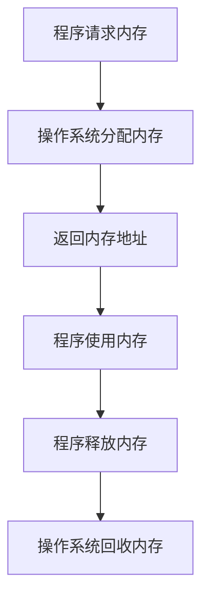

### 动态内存分配与 `new` 和 `delete` 详解

在C++中，动态内存分配是一种在程序运行时从操作系统请求内存的机制。与静态内存分配和自动内存分配不同，动态内存分配允许程序在运行时根据需要分配和释放内存。本文将详细介绍动态内存分配的必要性、工作原理、使用方法以及相关的最佳实践。

---

## 1. 为什么需要动态内存分配？

C++支持三种基本类型的内存分配：

1. **静态内存分配**：用于静态和全局变量。这些变量的内存在程序启动时分配，并在程序结束时释放。
2. **自动内存分配**：用于函数参数和局部变量。这些变量的内存在进入块时分配，在退出块时释放。
3. **动态内存分配**：在程序运行时从堆（heap）中分配内存，由程序员显式管理。

### 静态和自动分配的局限性
- **编译时需知道大小**：静态和自动分配要求在编译时知道变量或数组的大小。
- **内存浪费**：如果分配的内存远大于实际需要，会导致内存浪费。
- **栈内存有限**：自动分配的内存来自栈，栈的大小通常较小（如1MB,window，linux则是8MB），容易导致栈溢出。
- **人为限制**：如果分配的数组大小不足，可能导致数组溢出或人为限制。

### 动态分配的优势
- **运行时决定大小**：可以根据实际需求分配内存。
- **堆内存更大**：堆的大小通常远大于栈，适合处理大量数据。
- **灵活性**：可以动态调整内存分配，避免浪费。

---

## 2. 动态内存分配的工作原理

### 内存分区
程序运行时，内存被划分为多个区域：
- **代码区**：存储程序的指令。
- **栈区**：存储局部变量和函数调用信息。
- **堆区**：用于动态内存分配，由程序员管理。

### 动态分配的过程
1. **请求内存**：使用 `new` 运算符从堆中请求内存。
2. **返回地址**：操作系统返回分配内存的起始地址。
3. **使用内存**：通过指针访问和操作分配的内存。
4. **释放内存**：使用 `delete` 运算符将内存归还给操作系统。

---

## 3. 动态分配单个变量

### 使用 `new` 分配内存
```cpp
int* ptr = new int; // 动态分配一个整数
*ptr = 7;           // 为分配的内存赋值
```

### 初始化动态分配的变量
```cpp
int* ptr1 = new int(5); // 直接初始化
int* ptr2 = new int{6}; // 统一初始化
```

### 使用 `delete` 释放内存
```cpp
delete ptr;  // 释放内存
ptr = nullptr; // 将指针置为空，避免悬空指针
```

---

## 4. 动态分配的内存管理

### 悬空指针
悬空指针是指指向已释放内存的指针。解引用或删除悬空指针会导致未定义行为。

#### 示例
```cpp
int* ptr = new int;
*ptr = 7;
delete ptr; // 释放内存
// ptr 现在是悬空指针
*ptr = 10;  // 未定义行为
```

### 内存泄漏
内存泄漏是指程序丢失了对动态分配内存的引用，导致无法释放该内存。

#### 示例
```cpp
void doSomething() {
    int* ptr = new int; // 动态分配内存
    // 忘记释放内存
} // ptr 超出作用域，内存泄漏
```

### 避免内存泄漏
- 在指针重新赋值前释放内存。
- 使用智能指针（如 `std::unique_ptr` 或 `std::shared_ptr`）自动管理内存。

---

## 5. `new` 和 `delete` 的最佳实践

### 1. 检查 `new` 是否成功
使用 `std::nothrow` 避免 `new` 失败时抛出异常。
```cpp
int* ptr = new (std::nothrow) int;
if (!ptr) {
    std::cerr << "内存分配失败\n";
}
```

### 2. 删除指针后置为空
```cpp
delete ptr;
ptr = nullptr;
```

### 3. 避免多个指针指向同一内存
如果必须这样做，明确哪个指针负责释放内存。

### 4. 使用智能指针
现代C++推荐使用智能指针自动管理动态内存。
```cpp
#include <memory>
std::unique_ptr<int> ptr = std::make_unique<int>(10);
```

---

## 6. 动态分配数组

### 使用 `new[]` 分配数组
```cpp
int* arr = new int[10]; // 动态分配包含10个整数的数组
```

### 使用 `delete[]` 释放数组
```cpp
delete[] arr; // 释放数组内存
```

---

## 7. 动态内存分配的优缺点

### 优点
- 灵活性：运行时决定内存大小。
- 大内存支持：适合处理大量数据。

### 缺点
- 手动管理：容易导致内存泄漏或悬空指针。
- 性能开销：访问堆内存比栈内存慢。

---

## 8. 总结

动态内存分配是C++中强大的工具，但也需要谨慎使用。以下是关键点：
- 使用 `new` 和 `delete` 分配和释放内存。
- 避免悬空指针和内存泄漏。
- 遵循最佳实践，如删除后置空指针和使用智能指针。

---

### 表格：静态、自动与动态内存分配对比

| **特性**            | **静态分配**               | **自动分配**              | **动态分配**               |
|---------------------|---------------------------|-----------------------|---------------------------|
| **内存区域**         | 数据段                    | 栈   win 1MB,linux 8MB | 堆                        |
| **生命周期**         | 程序运行期间              | 块作用域内                 | 直到显式释放              |
| **大小确定时间**     | 编译时                   | 编译时                   | 运行时                   |
| **管理方式**         | 自动                      | 自动                    | 手动                      |
| **优点**             | 简单、高效                | 简单、高效                 | 灵活、支持大内存          |
| **缺点**             | 固定大小、可能浪费内存    | 栈大小有限、作用域限制           | 手动管理、容易出错        |

---

### Mermaid 图：动态内存分配流程



通过以上内容，您可以全面了解C++中动态内存分配的相关知识点及其使用方法。