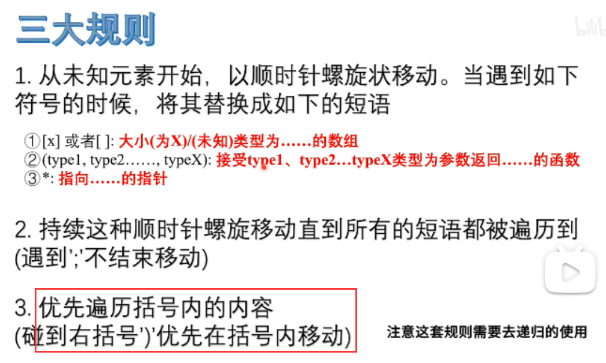
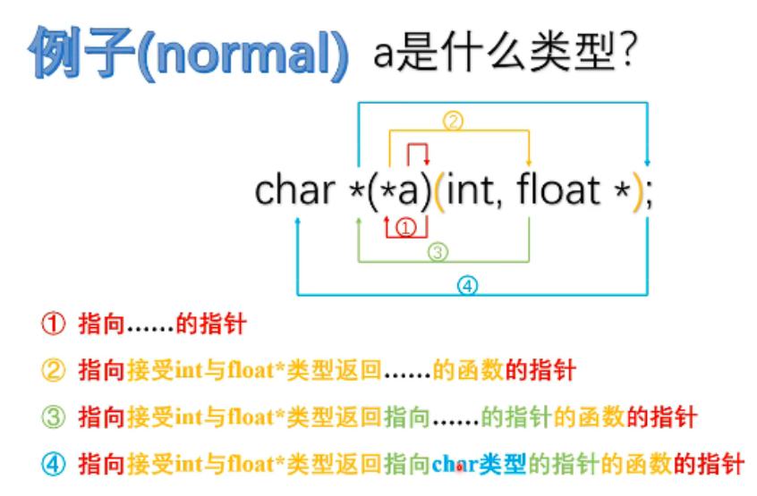
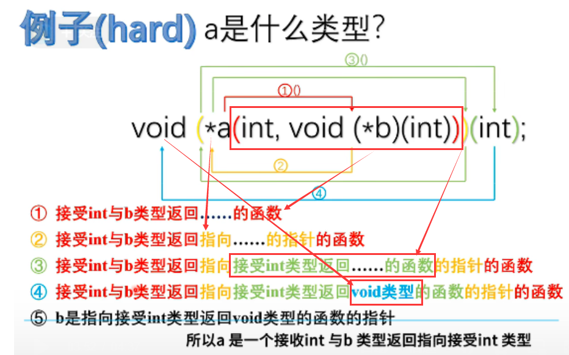
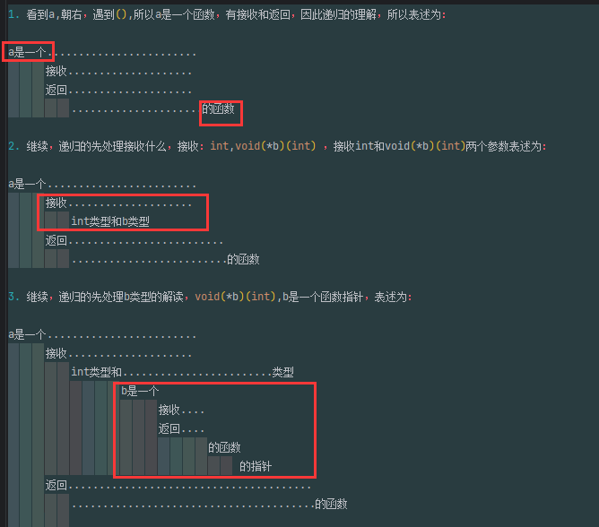
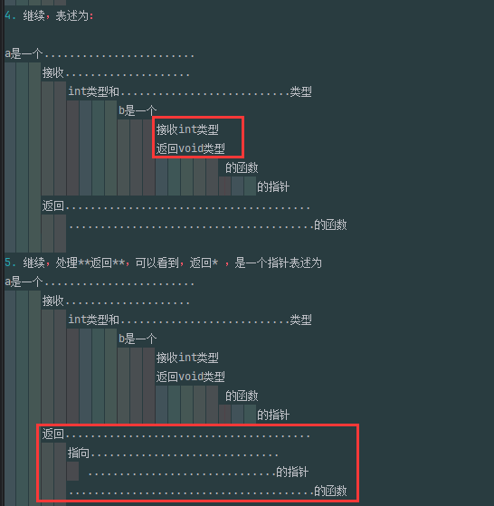
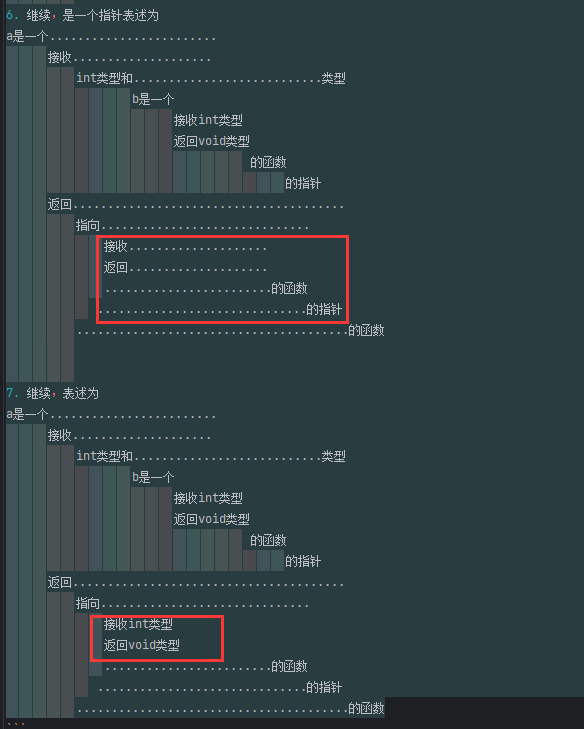
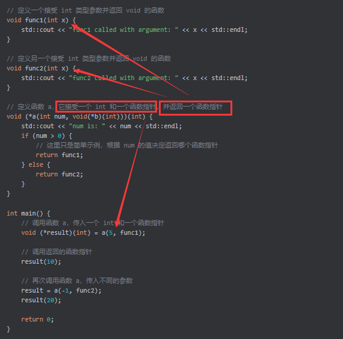

### 函数指针

函数指针是指向函数的指针，允许以一种更加动态的方式调用函数或将函数作为参数传递给其他函数。

#### 定义函数指针

- **基本语法**：

  ```cpp
  // fcnPtr 是一个指针，指向无参数返回int的函数,和定义多维数组的 int (*pointerToArray) [] 相似
  int (*fcnPtr)();
  ```

  这里需要注意的是，由于优先级的原因，`*fcnPtr` 需要括号，以避免被解释为返回指针的函数声明。

- **常量函数指针**：

  ```cpp
  int (*const fcnPtr)(); // const 指的是指针本身不可变
  ```


#### 螺旋法则

- **解析复杂声明**：可以使用“螺旋法则”或其他方法来解析这些声明：
- [螺旋法则](https://c-faq.com/decl/spiral.anderson.html)






理解这个声明：

注意递归的理解：

```c
1. 看到a,朝右，遇到),查看到()中是*a，所以表述为：

a是一个指向...的指针

2. 继续，剩余 char * (int,float *); 继续朝右, (int,float *)是一个函数，表述为：

a是一个指向.........................的指针
          接收int,float*类型
          返回...
          ...................的函数

3. 继续，剩余char * ，向左，然后是* 是一个指针，表述为：

a是一个指向.........................的指针
          接收int,float*类型
          返回指向...的指针
          ...................的函数
          
4. 继续，剩余 char,表述为：

a是一个指向..........................的指针
          接收int,float*类型
          返回指向........的指针
                 char类型
          ................... 的函数

最后，合并表述：a是一个指向 接收int,float*类型,返回指向char类型的指针的函数的指针
```



理解声明，递归的理解，红色框为每次关注的重点：








```c
1. 看到a,朝右，遇到(),所以a是一个函数，有接收和返回，因此递归的理解，所以表述为：

a是一个........................
      接收....................
      返回....................
          .....................的函数

2. 继续，递归的先处理接收什么，接收：int,void(*b)(int) ，接收int和void(*b)(int)两个参数表述为：

a是一个........................
      接收....................
          int类型和b类型
      返回.........................
          .........................的函数

3. 继续，递归的先处理b类型的解读，void(*b)(int),b是一个函数指针，表述为：

a是一个........................
      接收....................
          int类型和........................类型
                  b是一个
                        接收....
                        返回....
                                的函数
                                     的指针
      返回.......................................
          .......................................的函数
          
4. 继续，表述为：

a是一个........................
      接收....................
          int类型和...........................类型
                  b是一个
                        接收int类型
                        返回void类型
                                   的函数
                                        的指针
      返回.......................................
          .......................................的函数
          
5. 继续，处理**返回**，可以看到，返回* ，是一个指针表述为
a是一个........................
      接收....................
          int类型和...........................类型
                  b是一个
                        接收int类型
                        返回void类型
                                   的函数
                                        的指针
      返回.......................................
          指向..............................
             ..............................的指针
          .......................................的函数

          
6. 继续，是一个指针表述为
a是一个........................
      接收....................
          int类型和...........................类型
                  b是一个
                        接收int类型
                        返回void类型
                                   的函数
                                        的指针
      返回.......................................
          指向..............................
              接收....................
              返回....................
              ........................的函数
             ..............................的指针
          .......................................的函数

          
7. 继续，表述为
a是一个........................
      接收....................
          int类型和...........................类型
                  b是一个
                        接收int类型
                        返回void类型
                                   的函数
                                        的指针
      返回.......................................
          指向..............................
              接收int类型
              返回void类型
              ........................的函数
             ..............................的指针
          .......................................的函数
```

总结表述：a是一个，接收int类型和指向接收int类型，返回void类型的函数指针，返回指向接收int类型返回void类型的函数指针的函数

> 最终理解为：
```c
a是一个函数,
          ,接收:int类型和一个函数指针，这个函数指针的类型是:接收int类型，返回void类型的函数
          ,返回一个函数指针，这个函数指针的类型是：接收int类型，返回void类型的的函数
```


给出案例：

### 1. 语法分析
- `a` 是一个函数，它接受两个参数：
  - 第一个参数是 `int` 类型。
  - 第二个参数是一个函数指针 `void(*b)(int)`，这个函数指针指向一个接受 `int` 类型参数并返回 `void` 的函数。
- 函数 `a` 返回一个函数指针，该返回的函数指针指向一个接受 `int` 类型参数并返回 `void` 的函数。

### 2. 使用案例

```cpp
#include <iostream>

// 定义一个接受 int 类型参数并返回 void 的函数
void func1(int x) {
    std::cout << "func1 called with argument: " << x << std::endl;
}

// 定义另一个接受 int 类型参数并返回 void 的函数
void func2(int x) {
    std::cout << "func2 called with argument: " << x << std::endl;
}

// 定义函数 a，它接受一个 int 和一个函数指针，并返回一个函数指针
void (*a(int num, void(*b)(int)))(int) {
    std::cout << "num is: " << num << std::endl;
    if (num > 0) {
        // 这里只是简单示例，根据 num 的值决定返回哪个函数指针
        return func1;
    } else {
        return func2;
    }
}

int main() {
    // 调用函数 a，传入一个 int 和一个函数指针
    void (*result)(int) = a(5, func1);

    // 调用返回的函数指针
    result(10);

    // 再次调用函数 a，传入不同的参数
    result = a(-1, func2);
    result(20);

    return 0;
}
```


### 3. 代码解释
- **`func1` 和 `func2`**：这两个函数都是接受一个 `int` 类型参数并返回 `void` 的函数，用于作为函数指针的目标。
- **`a` 函数**：该函数接受一个 `int` 类型的参数 `num` 和一个函数指针 `b`，根据 `num` 的值决定返回 `func1` 或 `func2` 的函数指针。
- **`main` 函数**：
  - 第一次调用 `a` 函数，传入 `5` 和 `func1`，返回的函数指针存储在 `result` 中，然后调用 `result(10)` 执行返回的函数。
  - 第二次调用 `a` 函数，传入 `-1` 和 `func2`，再次更新 `result` 并调用 `result(20)`。

通过这个案例，我们可以看到如何使用 `void (*a(int, void(*b)(int)))(int);` 这种复杂的函数指针声明。

#### 赋值与初始化

- **赋值**：

  ```cpp
  int foo() { return 5; }
  int goo() { return 6; }

  int main()
  {
      int (*fcnPtr)() = &foo; // fcnPtr 指向 foo
      fcnPtr = &goo; // fcnPtr 现在指向 goo
      return 0;
  }
  ```

- **注意**：`&` 可以省略，因为 C++ 会隐式将函数转换为函数指针。

  ```cpp
  int (*fcnPtr5)() = foo; // 隐式转换
  ```

- **初始化为 `nullptr`**：

  ```cpp
  int (*fcnPtr)() = nullptr; // 有效
  ```

#### 使用函数指针调用函数

- **显式解引用**：

  ```cpp
  int foo(int x) { return x; }
  int main()
  {
      int (*fcnPtr)(int) = &foo; // 使用foo初始化fcnPtr
      (*fcnPtr)(5); // 通过显式解引用调用 foo(5)
      return 0;
  }
  ```

- **隐式解引用**：

  ```cpp
  int foo(int x) { return x; }
  int main()
  {
      int (*fcnPtr)(int) = &foo; // 使用foo初始化fcnPtr
      fcnPtr(5); // 通过隐式解引用调用 foo(5)
      return 0;
  }
  ```

  注意：现代编译器支持隐式解引用，但较旧的编译器可能不支持。

- **安全调用**：检查指针是否为 `nullptr`：

  ```cpp
  if (fcnPtr) 
      fcnPtr(5);
  ```

#### 默认参数与函数指针

通过函数指针调用的函数不会应用默认参数，因为这个解析发生在运行时。

```cpp
void print(int x);
void print(int x, int y = 10);

int main()
{
    using fnptr = void(*)(int); // 定义函数指针类型别名
    fnptr pi = print; // pi 指向 print
    pi(1); // 调用 print(int)
    return 0;
}
```

#### 函数作为参数

- **回调函数**：最常见的用途是将函数作为参数传递给另一个函数，例如排序算法：

  ```cpp
  #include <utility>

  void selectionSort(int* array, int size, bool (*comparisonFcn)(int, int))
  {
      for (int startIndex{ 0 }; startIndex < (size - 1); ++startIndex)
      {
          int bestIndex{ startIndex };
          for (int currentIndex{ startIndex + 1 }; currentIndex < size; ++currentIndex)
          {
              if (comparisonFcn(array[bestIndex], array[currentIndex]))
                  bestIndex = currentIndex;
          }
          std::swap(array[startIndex], array[bestIndex]);
      }
  }

  bool ascending(int x, int y) { return x > y; }
  bool descending(int x, int y) { return x < y; }

  int main()
  {
      int array[9]{ 3, 7, 9, 5, 6, 1, 8, 2, 4 };
      selectionSort(array, 9, descending); // 降序排序
      // 这里可以添加打印数组的代码来展示结果
      return 0;
  }
  ```

#### 使用 `std::function`

`std::function` 提供了更简洁和类型安全的方式来处理函数指针：

```cpp
#include <functional>

bool validate(int x, int y, std::function<bool(int, int)> fcn);

int main()
{
    std::function<int()> fcnPtr{ &foo }; 
    fcnPtr = &goo; 
    std::cout << fcnPtr() << '\n'; 

    return 0;
}
```

#### 类型推导与 `auto`

`auto` 可以用来简化函数指针的声明：

```cpp
auto fcnPtr{ &foo }; // 使用 auto 推导类型
```

#### 结论

函数指针在需要动态调用函数或将函数作为参数时非常有用，但其语法复杂。使用 `std::function` 和类型别名可以大大提高代码的可读性和安全性。