# 0、探究内存布局的前置知识

## gdb调试

### 1. 编译带调试信息的程序

```bash
g++ -g -O0 -o basic basic.cpp
```

### 2. 启动 GDB 调试会话

```bash
gdb ./basic
```

### 3. 设置断点并运行程序

```gdb
(gdb) break main
(gdb) b main
(gdb) run  //运行
(gdb) next //单步执行

```

### 4. 查看对象内存布局

在程序暂停后执行以下命令：

```c
(gdb) p sizeof(Basic)          # 查看对象总大小
$1 = 16                        # 输出结果（64位系统）


(gdb) p &temp                  # 获取对象首地址
$2 = (Basic *) 0x7fffffffe350


(gdb) p &temp.a                # 查看成员a的地址
$3 = (int *) 0x7fffffffe350    # 偏移量0


(gdb) ptype /o Basic           # 查看类内存布局和大小
/* offset    |  size */  type = class Basic {
   0        |    4       int a;
   8        |    8       double b;

                           /* total size 16, align 8 */
                         }


(gdb) p &temp.setB             #查看函数符号地址
$4 = (void (*)(Basic * const, double)) 0x7ff70b7926c0 <Basic::setB(double)>


(gdb) p &Basic::setB(double)   #查看类函数符号地址
$5 = (void (*)(Basic * const, double)) 0x7ff70b7926c0 <Basic::setB(double)>
(gdb) p &Basic::setB           #查看类函数符号地址
$5 = (void (*)(Basic * const, double)) 0x7ff70b7926c0 <Basic::setB(double)>

(gdb) info target              #查看可执行文件或共享库的结构


```


### 5. 查看对象虚函数表信息

```c
#对象信息.这里包含了实例对象的结构， <>里面的表示继承这个类，这个信息是结构化的
(gdb) p b1
$6 = (Base1) {_vptr.Base1 = 0x555555557d20 <vtable for Base1+16>, b1_int = 1, 
  b1_double = 1.1000000000000001}
(gdb) p d1
$7 = (Derived1) {<Base1> = {_vptr.Base1 = 0x555555557d00 <vtable for Derived1+16>, b1_int = 1, 
    b1_double = 1.1000000000000001}, d1_int = 3, d1_double = 3.2999999999999998}
(gdb) p d2
$8 = (Derived2) {<Derived1> = {<Base1> = {_vptr.Base1 = 0x555555557ce0 <vtable for Derived2+16>, 
      b1_int = 1, b1_double = 1.1000000000000001}, d1_int = 3, d1_double = 3.2999999999999998}, 
  d2_int = 4, d2_double = 4.4000000000000004}
  
#虚表信息的地址和存储信息和下面的结合查看   
(gdb) info vtbl b1
vtable for 'Base1' @ 0x555555557d20 (subobject @ 0x7fffffffe170):
[0]: 0x55555555580a <Base1::vir_display() const>
[1]: 0x55555555585a <Base1::vir_Base1() const>
(gdb) info vtbl d1
vtable for 'Derived1' @ 0x555555557d00 (subobject @ 0x7fffffffe190):
[0]: 0x5555555558dc <Derived1::vir_display() const>
[1]: 0x55555555585a <Base1::vir_Base1() const>
(gdb) info vtbl d2
vtable for 'Derived2' @ 0x555555557ce0 (subobject @ 0x7fffffffe1c0):
[0]: 0x555555555968 <Derived2::vir_display() const>
[1]: 0x55555555585a <Base1::vir_Base1() const>

# 查看虚函数表位置的信息
(gdb) set $addr = 0x555555557cb8
(gdb)  while $addr < 0x555555557cb8 + 32 * 8
 >x/1xg $addr
 >set $addr = $addr + 8
 >end
0x555555557cb8 <_ZTV7Derived>:  0x0000000000000000
0x555555557cc0 <_ZTV7Derived+8>:        0x0000555555557d18
0x555555557cc8 <_ZTV7Derived+16>:       0x0000555555555926
0x555555557cd0 <_ZTV7Derived+24>:       0xffffffffffffffe8
0x555555557cd8 <_ZTV7Derived+32>:       0x0000555555557d18
0x555555557ce0 <_ZTV7Derived+40>:       0x00005555555559bb
```


### 5. 查看可执行文件或共享库的结构

```c++
(gdb) info target
Symbols from "/home/skg/workspace/jm_other/cplus/code1".
Local exec file:
        `/home/skg/workspace/jm_other/cplus/code1', file type elf64-x86-64.
        Entry point: 0x10a0

        0x0000000000000318 - 0x0000000000000334 is .interp
        0x0000000000000338 - 0x0000000000000358 is .note.gnu.property
        0x0000000000000358 - 0x000000000000037c is .note.gnu.build-id
        0x000000000000037c - 0x000000000000039c is .note.ABI-tag
        0x00000000000003a0 - 0x00000000000003c4 is .gnu.hash
        0x00000000000003c8 - 0x00000000000004b8 is .dynsym
        0x00000000000004b8 - 0x00000000000005a8 is .dynstr
        0x00000000000005a8 - 0x00000000000005bc is .gnu.version
        0x00000000000005c0 - 0x0000000000000610 is .gnu.version_r
        0x0000000000000610 - 0x0000000000000700 is .rela.dyn
        0x0000000000000700 - 0x0000000000000748 is .rela.plt
        0x0000000000001000 - 0x000000000000101b is .init
        0x0000000000001020 - 0x0000000000001060 is .plt
        0x0000000000001060 - 0x0000000000001070 is .plt.got
        0x0000000000001070 - 0x00000000000010a0 is .plt.sec
        0x00000000000010a0 - 0x0000000000001305 is .text
        0x0000000000001308 - 0x0000000000001315 is .fini
        0x0000000000002000 - 0x0000000000002020 is .rodata
        0x0000000000002020 - 0x000000000000207c is .eh_frame_hdr
        0x0000000000002080 - 0x00000000000021e8 is .eh_frame
        0x0000000000003d88 - 0x0000000000003d98 is .init_array
        0x0000000000003d98 - 0x0000000000003da0 is .fini_array
        0x0000000000003da0 - 0x0000000000003fa0 is .dynamic
        0x0000000000003fa0 - 0x0000000000004000 is .got
        0x0000000000004000 - 0x0000000000004010 is .data
        0x0000000000004010 - 0x0000000000004018 is .bss

```

以下是表格汇总，解释了每个段（Section）的含义及其在可执行文件或共享库中的作用：

| **地址范围**                                | **段名称**              | **含义**                                             |
|-----------------------------------------|----------------------|----------------------------------------------------|
| 0x0000000000000318 - 0x0000000000000334 | `.interp`            | 包含程序解释器的路径（通常是动态链接器 `/lib/ld-linux.so`），用于加载和运行程序。 |
| 0x0000000000000338 - 0x0000000000000358 | `.note.gnu.property` | 包含 GNU 特定的属性信息，用于描述二进制文件的特性（如栈保护、硬件特性等）。           |
| 0x0000000000000358 - 0x000000000000037c | `.note.gnu.build-id` | 包含 GNU 构建 ID，用于唯一标识二进制文件的构建版本。                     |
| 0x000000000000037c - 0x000000000000039c | `.note.ABI-tag`      | 包含 ABI（应用程序二进制接口）的版本信息，用于兼容性检查。                    |
| 0x00000000000003a0 - 0x00000000000003c4 | `.gnu.hash`          | GNU 扩展的哈希表，用于加速动态符号表的查找。                           |
| 0x00000000000003c8 - 0x00000000000004b8 | `.dynsym`            | 动态符号表，包含动态链接时需要的符号信息（如函数和变量名）。                     |
| 0x00000000000004b8 - 0x00000000000005a8 | `.dynstr`            | 动态字符串表，包含 `.dynsym` 中符号的名称字符串。                     |
| 0x00000000000005a8 - 0x00000000000005bc | `.gnu.version`       | 包含符号的版本信息，用于动态链接时的版本控制。                            |
| 0x00000000000005c0 - 0x0000000000000610 | `.gnu.version_r`     | 包含符号版本引用的信息，用于动态链接时的版本控制。                          |
| 0x0000000000000610 - 0x0000000000000700 | `.rela.dyn`          | 动态重定位表，包含需要动态重定位的地址信息（如全局变量和函数指针）。                 |
| 0x0000000000000700 - 0x0000000000000748 | `.rela.plt`          | 过程链接表（PLT）的重定位信息，用于动态链接函数调用。                       |
| 0x0000000000001000 - 0x000000000000101b | `.init`              | 包含程序的初始化代码，在程序启动时执行。                               |
| 0x0000000000001020 - 0x0000000000001060 | `.plt`               | 过程链接表（PLT），用于动态链接函数调用。                             |
| 0x0000000000001060 - 0x0000000000001070 | `.plt.got`           | 全局偏移表（GOT）的过程链接表部分，用于动态链接函数调用。                     |
| 0x0000000000001070 - 0x00000000000010a0 | `.plt.sec`           | 安全增强的过程链接表（PLT），用于防止某些攻击（如 PLT/GOT 劫持）。            |
| 0x00000000000010a0 - 0x0000000000001305 | `.text`              | 包含程序的主要代码段（如函数和指令）。                                |
| 0x0000000000001308 - 0x0000000000001315 | `.fini`              | 包含程序的终止代码，在程序退出时执行。                                |
| 0x0000000000002000 - 0x0000000000002020 | `.rodata`            | 只读数据段，包含常量数据（如字符串常量）。                              |
| 0x0000000000002020 - 0x000000000000207c | `.eh_frame_hdr`      | 异常处理帧头表，用于支持 C++ 异常处理。                             |
| 0x0000000000002080 - 0x00000000000021e8 | `.eh_frame`          | 异常处理帧表，包含异常处理的相关信息。                                |
| 0x0000000000003d88 - 0x0000000000003d98 | `.init_array`        | 初始化函数指针数组，包含在程序启动时执行的函数指针。                         |
| 0x0000000000003d98 - 0x0000000000003da0 | `.fini_array`        | 终止函数指针数组，包含在程序退出时执行的函数指针。                          |
| 0x0000000000003da0 - 0x0000000000003fa0 | `.dynamic`           | 动态链接信息表，包含动态链接器所需的信息（如依赖库、符号表地址等）。                 |
| 0x0000000000003fa0 - 0x0000000000004000 | `.got`               | 全局偏移表（GOT），包含动态链接时使用的全局变量和函数地址。                    |
| 0x0000000000004000 - 0x0000000000004010 | `.data`              | 可读写数据段，包含已初始化的全局变量和静态变量。                           |
| 0x0000000000004010 - 0x0000000000004018 | `.bss`               | 未初始化数据段，包含未初始化的全局变量和静态变量。                          |

### 6. 将C++代码转为汇编代码

命令：

```gdb
(gdb) disas /m Basic::setB(double)
```

## 内存管理的可视化

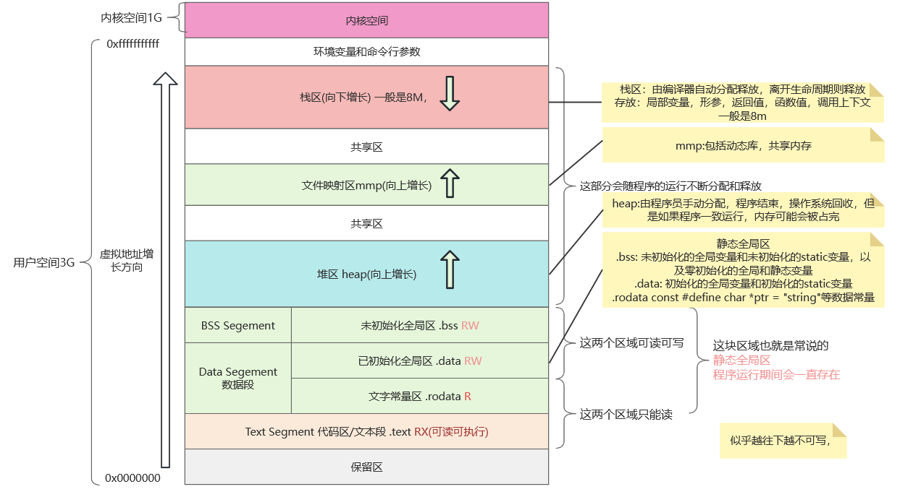

# 一、简单类内存布局

## 代码样例：

```cpp
#include <iostream>
using namespace std;

class Basic {
public:
  int a;
  double b;
};

int main() {
  Basic temp;
  temp.a = 10;
  return 0;
}
```

## 内存布局：

> <span style="color:red">类大小,这里有内存对齐

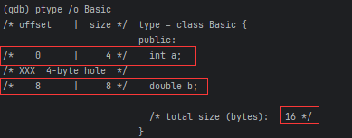

> <span style="color:red">类实例对象的成员大小

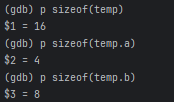


---

# 二、包含成员函数的类内存布局

## 代码样例：

```cpp
#include <iostream>

class Basic {
public:
  int a;
  double b;

  void setB(double value) {
    b = value; // 直接访问成员变量b
  }
};

int main() {
  using MemberFunc = void (Basic::*)(double);
  Basic obj1, obj2;
  obj1.a = 10;
  obj1.setB(3.14);
  obj2.a = 12;
  obj2.setB(3.15);
  return 0;
}
```

## 内存布局：

> <span style="color:red">类大小:和没有成员函数的类大小是一样的 

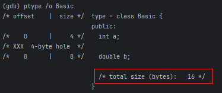

> <span style="color:red">类成员函数地址，类实例对象的成员函数地址:两者是相同的

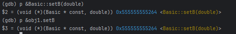

> <span style="color:red">不同类实例对象的地址：实例对象地址不一样，且地址比较高，应该是再栈中存储的。或者new出来的是再堆中

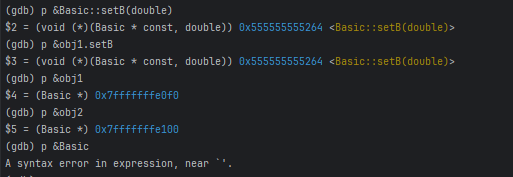

> <span style="color:red">成员函数在.text段:可以看到函数在代码段

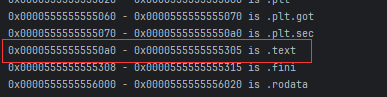


---

# 三、包含公共保护私有成员类内存布局

## 代码样例：

```cpp
#include <iostream>
using namespace std;
class Basic {
private:
    int private_c=1;
    double private_d=1;

    void secret(int temp) { private_d = temp + private_c; }

public:
    int public_a;
    double public_b;

    void setB(double value) {
    public_b = value; // 直接访问成员变量b
    secret(public_b);
    }
    // 暴露私有成员方法的地址
    static void (Basic::*getSecretPtr())(int) {
      return &Basic::secret;
    }

protected:
    int protect_f;
    double protect_g;
    void protectedFun() { cout << "protected function"; }
};

int main() {
    Basic temp;
    temp.public_a = 10;
    cout<<"&temp"<<&temp<<"\n";
    temp.setB(3.14);
    //--------------------------
    //运行期修改成员变量的值
    int* pA = reinterpret_cast<int*>(reinterpret_cast<char*>(&temp) + 16);
    *pA = 12; // 直接修改a的值
    //---------------------------
    //运行期通过函数指针绕过private访问私有成员函数
    void (Basic::*funcPtr)(int) = Basic::getSecretPtr();
    // 调用私有成员函数,修改private_d的值
    (temp.*funcPtr)(10);
    return 0;
}
```

## 内存布局：

> <span style="color:red">public,protect,private变量的存储顺序:按照声明顺序 

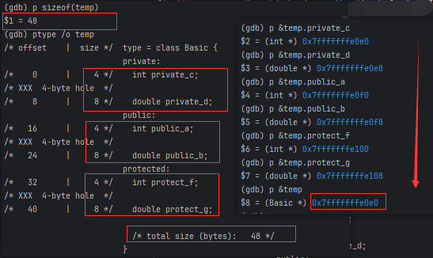

> <span style="color:red">编译器和运行期的可见性：

那么运行期是否有保护呢？我们来验证下。前面已经验证 private 成员变量也是根据偏移来找到内存位置的，我们可以在代码中直接根据偏移找到内存位置并更改里面的值。

```c++
int* pA = reinterpret_cast<int*>(reinterpret_cast<char*>(&temp) + 16);
*pA = 12; // 直接修改c的值
```

这里修改后，可以增加一个show方法打印所有成员的值，发现这里temp.c 确实被改为了
12。可见成员变量在运行期并没有做限制，知道地址就可以绕过编译器的限制进行读写了。那么私有的方法呢？

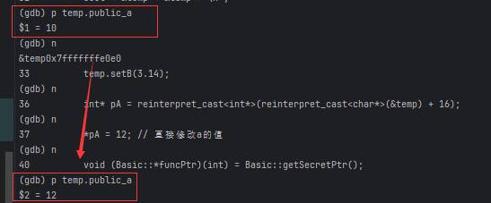

私有方法和普通成员方法一样存储在文本段，我们拿到其地址后，可以通过这个地址调用吗？这里需要一些骚操作，我们在类定义中添加额外的接口来暴露私有成员方法的地址，然后通过成员函数指针来调用私有成员函数。整体代码如下：

```c++
class Basic {
...
public:
    // 暴露私有成员方法的地址
    static void (Basic::*getSecretPtr())(int) {
        return &Basic::secret;
    }

...
}

int main() {
    // ...
   void (Basic::*funcPtr)(int) = Basic::getSecretPtr();
    // 调用私有成员函数
    (temp.*funcPtr)(10);
    // ...
}
```

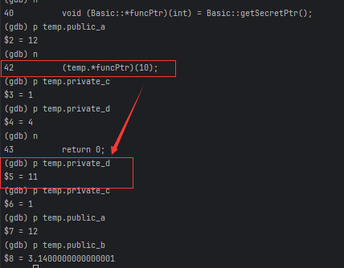

> <span style="color:red">编译器和运行期的可见性 总结

| **特性** | **编译期**      | **运行期**      |
|--------|--------------|--------------|
| 成员变量   | ✅ 阻止直接访问     | ❌ 允许内存覆盖     |
| 成员函数   | ✅ 阻止直接调用     | ❌ 允许函数指针绕过   |
| 内存布局   | ✅ 固定（按ABI规范） | ❌ 无保护（取决于实现） |

**最佳实践**：  
- 严格遵守封装原则，通过公共接口访问私有成员。
- 若需运行时保护，考虑使用其他语言（如Java/C#）或手动实现安全层。

---

# 四、包含静态全局类内存布局

## 代码样例：

```cpp
#include <iostream>

class Basic {
  // ...
public:
  static float alias;
  static float alias_00;
  static int alias_0;
  static void show() {
    std::cout << alias << std::endl;
  }
};
float Basic::alias_00 = 0.0;
int Basic::alias_0 = 0;
float Basic::alias = 0.233;
int gobal = 100;
int gobal_0 = 0;
int main() {
  // ...
  Basic temp{};
  temp.show();
  return 0;
}
```

## 内存布局：

> <span style="color:red">查看变量内存布局

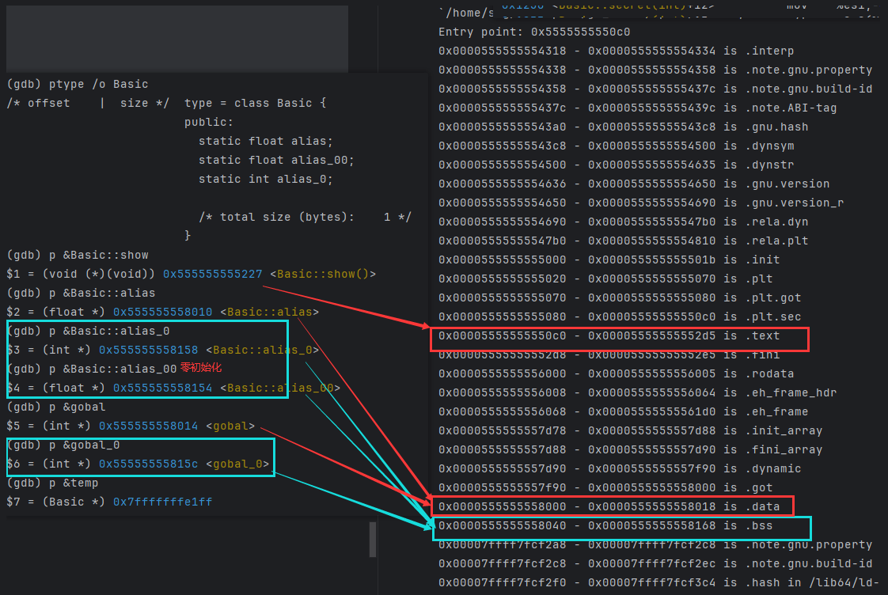

> <span style="color:red">静态成员变量

##### **1. 核心特性**
- **共享性**：所有类实例共享同一份数据
- **生命周期**：从程序启动到终止（与全局变量同级）
- **存储分类**：
    - **`.data` 段**：存放**显式初始化且非零值**的静态成员变量
      ```cpp
      float Basic::alias = 0.233;  // 存储在 .data 段
      ```
    - **`.bss` 段**：存放**未初始化**或**显式初始化为零**的静态成员变量
      ```cpp
      float Basic::alias = 0;      // 存储在 .bss 段
      ```

##### **2. 存储分离机制（.data 与 .bss 段）**
| 对比项          | .data 段                          | .bss 段                          |
|-----------------|-----------------------------------|----------------------------------|
| **磁盘空间占用** | 存储实际初始值，占用文件空间       | 仅记录内存大小，不占用文件空间    |
| **加载效率**     | 需从磁盘读取初始数据               | 由操作系统快速分配清零内存        |
| **典型场景**     | 非零初始化的全局/静态变量          | 零初始化的全局/静态变量           |

##### **3. 初始化要求**
- **必须类外定义**（语法强制要求）
  ```cpp
  class Basic {
      static float alias;  // 类内声明
  };
  float Basic::alias = 0.233;  // 类外定义（必须）
  ```

> <span style="color:red">静态成员方法

##### **1. 核心特性**
- **无 `this` 指针**：不依赖实例，无法直接访问非静态成员
- **存储位置**：与普通成员函数一致，存放在 **`.text` 代码段**
- **调用方式**：可通过类名或实例调用
  ```cpp
  Basic::show();  // 推荐方式
  temp.show();    // 合法但语义不推荐
  ```

##### **2. 实现原理**
- **编译后行为**：与全局函数类似，但作用域限定在类内
- **典型应用场景**：
    - 工厂方法（`create()`）
    - 单例模式实例获取（`getInstance()`）
    - 工具函数（如数学计算 `Math::sqrt()`）

---

> <span style="color:red">静态成员与普通成员对比

| 对比项         | 静态成员变量                | 静态成员方法                | 普通成员变量/方法           |
|----------------|----------------------------|----------------------------|----------------------------|
| **存储位置**   | `.data` 或 `.bss` 段       | `.text` 段                 | 实例内存中 / `.text` 段     |
| **依赖实例**   | ❌ 不依赖                  | ❌ 不依赖                  | ✅ 依赖                    |
| **内存共享性** | ✅ 所有实例共享            | -                         | ❌ 每个实例独立             |
| **初始化方式** | 必须类外定义               | 类内直接实现               | 类内声明，构造时初始化      |


---

# 五、传统单继承对象内存布局

## 代码样例：

```cpp
#include <iostream>
using namespace std;

class Base {
public:
  int publicVar = 10;
  void publicFunc() { cout << "Base publicFunc" << endl; }
protected:
  int protectedVar = 20;
  void protectedFunc() { cout << "Base protectedFunc" << endl; }
private:
  int privateVar = 30;
};

class Derived : public Base {
public:
  void accessMembers() {
    publicVar = 100;          // 合法：访问公有成员
    protectedFunc();          // 合法：访问基类保护成员
                     // privateVar = 200;      // 非法：不能访问基类私有成员
  }
  double myVar = 1.1;
  static int staticMember;
};
int Derived::staticMember = 50;  // 静态成员定义

int main() {
    Base b;
  b.publicFunc();             
  //-------------------
  Derived d;
  d.publicFunc();              // 输出: Base publicFunc
  d.accessMembers();
  cout << Derived::staticMember << endl; // 输出: 50
  return 0;
}
```

## 内存布局：

> <span style="color:red">继承意味着派生类会包含基类的所有成员，包括私有成员，**但访问权限不同**。**私有成员虽然被继承，但派生类不能直接访问它们**。

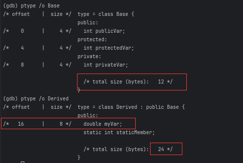


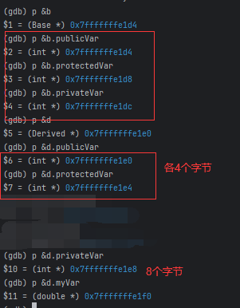


如上面几个图，可以看到内存对齐后的子类是24个字节，如果没有doule的myVar，那么内存大小也应该是12。

> <span style="color:red">参考上图变量内存地址，派生类内存布局类似这样：

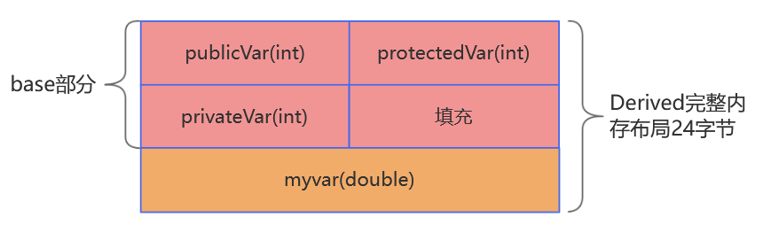


---

# 六、传统多继承对象内存布局

## 代码样例：

```cpp
#include <iostream>
#include <cstddef>  // 用于offsetof宏
using namespace std;

// 基类1：包含int类型成员
class Base1 {
public:
  int a = 10;  // 4字节
  void func1() { cout << "Base1::func1 | a地址: " << &a << endl; }
};

// 基类2：包含double类型成员
class Base2 {
protected:
  double b = 20.5; // 8字节
  void func2() { cout << "Base2::func2 | b地址: " << &b << endl; }
};

// 派生类：多重继承，添加char类型成员
class Derived : public Base1, private Base2 {
public:
  char c = 'D'; // 1字节（实际占4字节因内存对齐）
  void callBase2() {
    func2();
    cout << "在Derived中访问b: " << b << endl; // 允许访问基类protected成员
  }

  // 打印内存布局关键信息
  void printMemoryLayout() {
    cout << "\n█ 内存布局分析 █" << endl;
    // 验证对象起始地址
    cout << "Derived对象起始地址: " << this << endl;

    // 基类子对象地址
    cout << "Base1子对象地址: " << static_cast<Base1*>(this)
         << " (偏移: " << (char*)static_cast<Base1*>(this) - (char*)this << ")" << endl;
    cout << "Base2子对象地址: " << static_cast<Base2*>(this)
         << " (偏移: " << (char*)static_cast<Base2*>(this) - (char*)this << ")" << endl;

    // 成员变量地址
    cout << "a地址: " << &a << " | 大小: " << sizeof(a) << endl;
    cout << "b地址: " << &b << " | 大小: " << sizeof(b) << endl;
    cout << "c地址: " << (void*)&c << " | 大小: " << sizeof(c) << endl;
  }
};

int main() {
  Derived d;
  d.func1();     // 访问Base1成员函数
  d.callBase2(); // 通过派生类访问Base2成员
  d.printMemoryLayout();
  return 0;
}
```

## 内存布局：

如图，gdb查看内存布局情况：

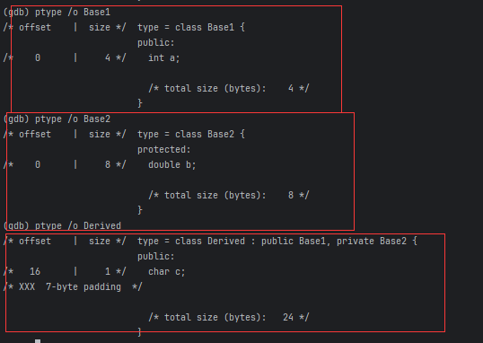

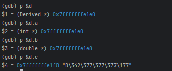


> <span style="color:red">参考上图变量内存地址，派生类内存布局类似这样：

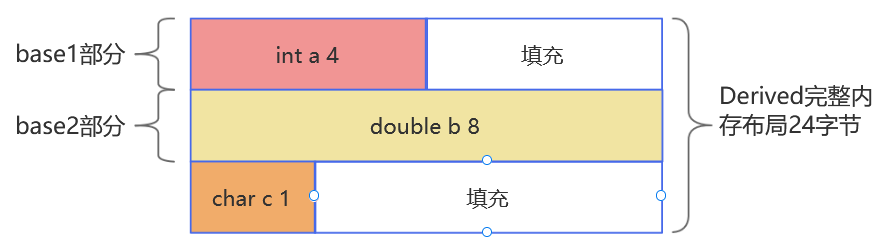

> <span style="color:red">重要结论

1. 继承顺序决定基类布局
先继承的基类子对象位于低地址区，与访问控制（public/private）无关

2. 内存对齐优先于空间节省
编译器会插入填充字节保证成员对齐，即使这意味着空间浪费

3. 派生类成员最后布局
派生类自身成员始终位于所有基类子对象之后


---

# 七、传统单继承包含虚函数的对象内存布局

## 代码样例：

```cpp
#include <iostream>

class Base {
public:
  int a;
  double b;

  virtual void printInfo() {
    std::cout << "Base: a = " << a << ", b = " << b << std::endl;
  }

  virtual void printB() {
    std::cout << "Base in B" << std::endl;
  }

  void setB(double value) {
    b = value; // 直接访问成员变量b
  }
};

class Derived : public Base {
public:
  int c;

  void printInfo() override {
    std::cout << "Derived: a = " << a << ", b = " << b << ", c = " << c << std::endl;
  }

  void setC(int value) {
    c = value; // 直接访问成员变量c
  }
};

int main() {
  Derived derivedObj;
  derivedObj.a = 10;
  derivedObj.setB(3.14);
  derivedObj.c = 1;
  derivedObj.setC(2);

  Base* ptr = &derivedObj; // 基类指针指向派生类对象
  ptr->printInfo(); // 多态调用
  ptr->printB(); // 调用

  Base  BaseObj;
  BaseObj.a = 10;
  BaseObj.setB(3.14);

  Base* anotherPtr = &BaseObj;
  anotherPtr->printInfo();
  anotherPtr->printB();
  return 0;
}
```

## 内存布局：

> <span style="color:red">gdb 调试看对象内存布局

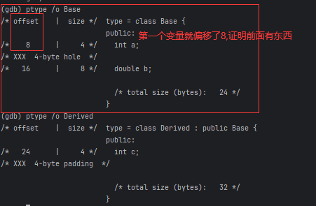

```c++
//查看类结构
(gdb) ptype /o Base
/* offset    |  size */  type = class Base {
                         public:
/*    8      |     4 */    int a;
/* XXX  4-byte hole  */
/*   16      |     8 */    double b;

                           /* total size (bytes):   24 */
                         }
(gdb) ptype /o Derived
/* offset    |  size */  type = class Derived : public Base {
                         public:
/*   24      |     4 */    int c;
/* XXX  4-byte padding  */

                           /* total size (bytes):   32 */
                         }
//打印类实例对象地址 
(gdb) p &b
$10 = (Base *) 0x7fffffffe1b0
(gdb) p &d
$11 = (Derived *) 0x7fffffffe1d0
(gdb) x /8xg 0x7fffffffe1b0
//查看虚表
(gdb) info vtbl b
vtable for 'Base' @ 0x555555557d40 (subobject @ 0x7fffffffe1b0):
[0]: 0x555555555378 <Base::printInfo()>
[1]: 0x5555555553ee <Base::printB()>
(gdb) info vtbl d
vtable for 'Derived' @ 0x555555557d20 (subobject @ 0x7fffffffe1d0):
[0]: 0x55555555544c <Derived::printInfo()>
[1]: 0x5555555553ee <Base::printB()>

#查看实例对象变量地址
(gdb) p b
$12 = {_vptr.Base = 0x555555557d40 <vtable for Base+16>, a = 10, 
  b = 3.1400000000000001}
(gdb) p d
$13 = {<Base> = {_vptr.Base = 0x555555557d20 <vtable for Derived+16>, 
    a = 10, b = 3.1400000000000001}, c = 2}
(gdb) p &b.a
$14 = (int *) 0x7fffffffe1b8
(gdb) p &b.b
$15 = (double *) 0x7fffffffe1c0
(gdb) p &d.a
$16 = (int *) 0x7fffffffe1d8
(gdb) p &d.b
$17 = (double *) 0x7fffffffe1e0
(gdb) p &d.c
$18 = (int *) 0x7fffffffe1e8

// 查看虚函数表附近的地址        
(gdb) x /14xg 0x555555557d10
0x555555557d10 <_ZTV7Derived>:  0x0000000000000000      0x0000555555557d50
0x555555557d20 <_ZTV7Derived+16>:       0x000055555555544c      0x00005555555553ee
0x555555557d30 <_ZTV4Base>:     0x0000000000000000      0x0000555555557d68
0x555555557d40 <_ZTV4Base+16>:  0x0000555555555378      0x00005555555553ee
0x555555557d50 <_ZTI7Derived>:  0x00007ffff7f9bc98      0x0000555555556048
0x555555557d60 <_ZTI7Derived+16>:       0x0000555555557d68      0x00007ffff7f9b008
0x555555557d70 <_ZTI4Base+8>:   0x0000555555556051      0x0000000000000001
//查看代码段地址
(gdb) info target
     0x0000555555555120 - 0x00005555555555c5 is .text
     0x0000555555557d10 - 0x0000555555557d78 is .data.rel.ro

```
> <span style="color:red">x /14xg 0x555555557d10 命令内容解析


**1. 符号含义解析**

- **`_ZTV7Derived`**：`Derived`类的虚函数表（vtable）
- **`_ZTV4Base`**：`Base`类的虚函数表
- **`_ZTI7Derived`**：`Derived`类的类型信息（RTTI，用于`typeid`）
- **`_ZTI4Base`**：`Base`类的类型信息

**2. 内存布局示意图**，参考上述gdb调试的输出
```
地址                 内容                    说明
0x555555557d10    | 0x00000000       | Derived虚表：偏移量
0x555555557d18    | 0x555555557d50   | → 指向_ZTI7Derived（Derived的RTTI）
0x555555557d20    | 0x55555555544c   | Derived::func()
0x555555557d28    | 0x5555555553ee   | Base::printB
--------------------------------------------------------------
0x555555557d30    | 0x00000000       | Base虚表：偏移量
0x555555557d38    | 0x555555557d68   | → 指向_ZTI4Base（Base的RTTI）
0x555555557d40    | 0x555555555378   | Base::func()
0x555555557d48    | 0x5555555553ee   | Base::printB
--------------------------------------------------------------
0x555555557d50    | 0x7ffff7f9bc98   | _ZTI7Derived的RTTI元数据
0x555555557d58    | 0x555555556048   | 类名字符串"7Derived"
0x555555557d60    | 0x555555557d68   | → 基类_ZTI4Base
0x555555557d68    | 0x7ffff7f9b008   | _ZTI4Base的RTTI元数据
0x555555557d70    | 0x555555556051   | 类名字符串"4Base"
```

> <span style="color:red">.data.rel.ro 段的作用,这里用来存储虚函数表，虚函数表存储指向虚函数的地址 函数定义在.text段

- 只读重定位数据段：该段用于存储需要重定位但运行期间只读的数据（Read-Only Relocation Data）。
- 动态链接场景：当程序编译为动态库（.so、.dll）或使用 -fPIC（位置无关代码）选项时，编译器会将虚表等需要地址重定位的数据放入 .data.rel.ro，而非普通的 .rodata。
- 安全性：该段在程序加载后会被标记为只读，防止运行时被意外修改。

> <span style="color:red">内存布局和虚函数表示意图：
> 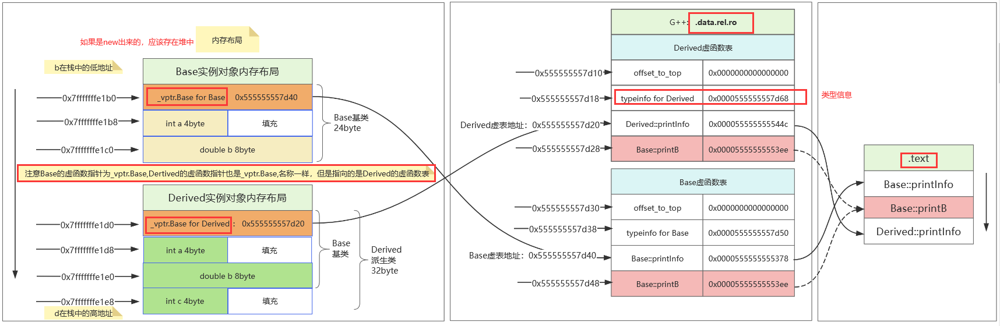

> <span style="color:red"> 注意：从下面的代码可以看出Derived对象的虚表指针的名称和Base虚表指针名称相同，但是指针的指向是说明虚表的关键信息，所以不能通过虚表指针，例如_vptr.Base名称来确定，需要看后面的vtable for Derived+16信息确定
```c
(gdb) p b
$12 = {_vptr.Base = 0x555555557d40 <vtable for Base+16>, a = 10, 
  b = 3.1400000000000001}
(gdb) p d
$13 = {<Base> = {_vptr.Base = 0x555555557d20 <vtable for Derived+16>, 
    a = 10, b = 3.1400000000000001}, c = 2}
#-----------------------------------------------------------------------
(gdb) info vtbl d
vtable for 'Derived' @ 0x555555557d20 (subobject @ 0x7fffffffe1d0):
[0]: 0x55555555544c <Derived::printInfo()>
[1]: 0x5555555553ee <Base::printB()>
```

---

# 八、传统多继承包含虚函数的对象内存布局

## 代码样例：

```cpp
#include <iostream>
using namespace std;

// 第一个基类
class Base1 {
public:
  int b1_int=1;
  double b1_double=1.1;
public:
  virtual void vir_display() const {
    cout << "Base1: var = " << b1_int << endl;
  }
  void base1_function() { b1_int = 0; }  // 普通函数
};

// 第二个基类
class Base2 {
public:
  int b2_int=2;
  double b2_double=2.2;
public:
  virtual void vir_display() const {
    cout << "Base2: var = " << b2_int << endl;
  }
  void base2_function() { b2_int *= 2; }  // 普通函数
};

// 派生类（多继承）
class Derived : public Base1, public Base2 {
public:
  int d_int=3;
  double d_double=3.3;
public:
  // 覆盖两个基类的虚函数
  void vir_display() const override {
    cout << "Derived: "
         << b1_int << ", "
         << b2_int << ", "
         << d_int << endl;
  }

  // 新增普通函数
  void d_function() {
    b1_int += 10;
    b2_int -= 5;
    d_int *= 2;
  }
};

int main() {
  // 创建各个类的实例
  Base1 b1;
  Base2 b2;
  Derived d;
  return 0;
}
```

## 内存布局：

> <span style="color:red">gdb 调试看对象内存布局

```c
(gdb) ptype /o b1
/* offset    |  size */  type = class Base1 {
                         public:
/*    8      |     4 */    int b1_int;
/* XXX  4-byte hole  */
/*   16      |     8 */    double b1_double;

                           /* total size (bytes):   24 */
                         }
(gdb) ptype /o b2
/* offset    |  size */  type = class Base2 {
                         public:
/*    8      |     4 */    int b2_int;
/* XXX  4-byte hole  */
/*   16      |     8 */    double b2_double;

                           /* total size (bytes):   24 */
                         }
(gdb) ptype /o d
/* offset    |  size */  type = class Derived : public Base1, public Base2 {
                         public:
/*   48      |     4 */    int d_int;
/* XXX  4-byte hole  */
/*   56      |     8 */    double d_double;

                           /* total size (bytes):   64 */
                         }


```
> <span style="color:red">栈中 类对象成员变量的地址

```c
(gdb) p &b1
$3 = (Base1 *) 0x7fffffffe170
(gdb) p &b1.b1_int
$4 = (int *) 0x7fffffffe178
(gdb) p &b1.b1_double
$5 = (double *) 0x7fffffffe180
#####################################
(gdb) p &b2
$15 = (Base2 *) 0x7fffffffe190
(gdb) p &b2.b2_int
$13 = (int *) 0x7fffffffe198
(gdb) p &b2.b2_double
$14 = (double *) 0x7fffffffe1a0
#####################################
(gdb) p &d
$6 = (Derived *) 0x7fffffffe1b0
(gdb) p &d.b1_int
$7 = (int *) 0x7fffffffe1b8
(gdb) p &d.b1_double
$8 = (double *) 0x7fffffffe1c0
(gdb) p &d.b2_int
$9 = (int *) 0x7fffffffe1d0
(gdb) p &d.b2_double
$10 = (double *) 0x7fffffffe1d8
(gdb) p &d.d_int
$11 = (int *) 0x7fffffffe1e0
(gdb) p &d.d_double
$12 = (double *) 0x7fffffffe1e8

        

(gdb) x /32xg 0x7fffffffe170
0x7fffffffe170: 0x0000555555557d10 vptr:Base1    0x0000555500000001 b1_int
0x7fffffffe180: 0x3ff199999999999a b1_double     0x0000000000000001

0x7fffffffe190: 0x0000555555557cf8 vptr:Base2    0x0000555500000002 b2_int
0x7fffffffe1a0: 0x400199999999999a b2_double     0x000000010000ffff// 未知数据（可能是其他变量）


0x7fffffffe1b0: 0x0000555555557cc8 vptr:Derived  0x0000555500000001 b1_int
0x7fffffffe1c0: 0x3ff199999999999a b1_double     0x0000555555557ce0 vptr:Base2
0x7fffffffe1d0: 0x00007fff00000002 b2_int        0x400199999999999a  b2_double
0x7fffffffe1e0: 0x0000000000000003 d_int         0x400a666666666666 d_double

(gdb) info target
  0x0000555555555140 - 0x0000555555555a85 is .text
  0x0000555555557cb8 - 0x0000555555557d70 is .data.rel.ro

```

> <span style="color:red">类对象虚函数表地址信息

```c
p d
$3 = {<Base1> = {_vptr.Base1 = 0x555555557cc8 <vtable for Derived+16>, b1_int = 1, 
    b1_double = 1.1000000000000001}, <Base2> = {
    _vptr.Base2 = 0x555555557ce0 <vtable for Derived+48>, b2_int = 2, 
    b2_double = 2.2000000000000002}, d_int = 3, d_double = 3.2999999999999998}

(gdb) info vtbl b1
vtable for 'Base1' @ 0x555555557d10 (subobject @ 0x7fffffffe170):
[0]: 0x55555555584c <Base1::vir_display() const>
(gdb) info vtbl b2
vtable for 'Base2' @ 0x555555557cf8 (subobject @ 0x7fffffffe190):
[0]: 0x5555555558b6 <Base2::vir_display() const>

(gdb) info vtbl d
vtable for 'Derived' @ 0x555555557cc8 (subobject @ 0x7fffffffe1b0):
[0]: 0x555555555926 <Derived::vir_display() const>

vtable for 'Base2' @ 0x555555557ce0 (subobject @ 0x7fffffffe1c8):
[0]: 0x5555555559bb <non-virtual thunk to Derived::vir_display() const>


```

可以看到b1,b2的结构比较简单，d的结构有两个虚函数指针，一个是vtable for 'Derived' @ 0x555555557cc8，一个是vtable for 'Base2' @ 0x555555557ce0

在C++多继承中，派生类对象会按继承顺序依次包含各基类的子对象。对于虚函数表的布局，每个含有虚函数的基类都会在子对象头部引入独立的虚表指针（vptr）。`Derived`对象`d`的内存布局如下：

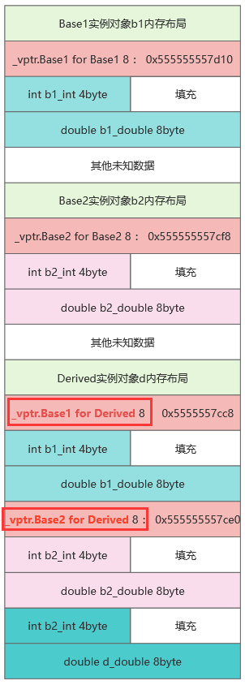


> <span style="color:red">从如下info vtbl d命令可以看到，表面上，Derived似乎只有Base2的虚表指针，没有Base1的，其实是Base1的虚函数表和Derived自己的虚函数表合并了，这是编译器优化的结果。

```c
(gdb) info vtbl d
vtable for 'Derived' @ 0x555555557cc8 (subobject @ 0x7fffffffe1b0):
[0]: 0x555555555926 <Derived::vir_display() const>

vtable for 'Base2' @ 0x555555557ce0 (subobject @ 0x7fffffffe1c8):
[0]: 0x5555555559bb <non-virtual thunk to Derived::vir_display() const>

```

**核心原因：多继承的虚表合并与 thunk 机制**   【thunk:θʌŋk读做：桑可】

在多继承中，**派生类会为每个含有虚函数的基类维护独立的虚表指针**。但当派生类**覆盖**基类虚函数时，编译器会进行优化：

1. **主基类（第一个基类）的虚表会被直接替换为派生类的虚表**
2. **次基类的虚表会通过 thunk 技术实现函数覆盖**


**为什么看不到 Base1 的原始虚表？**
1. **虚表合并优化**
    - 当 `Derived` 覆盖 `Base1::vir_display()` 时，编译器直接将 `Base1` 子对象的虚表指针替换为 `Derived` 的主虚表。
    - **主虚表 (0x555555557cc8)** 已经包含 `Derived::vir_display()`，因此无需保留 `Base1` 的原始虚表。

2. **函数调用透明性**
    - 通过 `Base1*` 调用 `vir_display()` 时，直接使用主虚表中的 `Derived` 函数，无需任何地址调整（`this` 指针已经是正确偏移）。


**为什么 Base2 的虚表指针依然存在？**

1. **多重继承的独立性**
    - `Base2` 子对象在内存中位于 `Base1` 子对象之后，其虚表指针需要独立维护。

2. **thunk 的必要性**
    - 当通过 `Base2*` 调用 `vir_display()` 时，`this` 指针指向的是 `Base2` 子对象的起始地址（`0x7fffffffe1c8`），而 `Derived::vir_display()` 需要 `this` 指向整个 `Derived` 对象的起始地址（`0x7fffffffe1b0`）。
    - **thunk 函数 (0x5555555559bb)** 的作用：
      ```asm
      ; 伪代码示意
      thunk_to_Derived_vir_display:
          sub  rdi, 0x18    ; 将this指针从Base2子对象回退24字节到Derived起始地址
          jmp  Derived::vir_display
      ```

---

**关键验证：偏移量计算**

```text
Base2子对象起始地址：0x7fffffffe1c8
Derived对象起始地址：0x7fffffffe1b0

偏移量 = 0x7fffffffe1c8 - 0x7fffffffe1b0 = 0x18（24字节）
```
这正是 thunk 中 `sub rdi, 0x18` 的来源，确保 `Derived::vir_display()` 能正确访问所有成员变量。


> <span style="color:red">虚函数表内容信息

```c
(gdb) set $addr = 0x555555557cb8
(gdb)  while $addr < 0x555555557cb8 + 32 * 8
 >x/1xg $addr
 >set $addr = $addr + 8
 >end
0x555555557cb8 <_ZTV7Derived>:  0x0000000000000000
0x555555557cc0 <_ZTV7Derived+8>:        0x0000555555557d18
0x555555557cc8 <_ZTV7Derived+16>:       0x0000555555555926
0x555555557cd0 <_ZTV7Derived+24>:       0xffffffffffffffe8
0x555555557cd8 <_ZTV7Derived+32>:       0x0000555555557d18
0x555555557ce0 <_ZTV7Derived+40>:       0x00005555555559bb

0x555555557ce8 <_ZTV5Base2>:    0x0000000000000000
0x555555557cf0 <_ZTV5Base2+8>:  0x0000555555557d50
0x555555557cf8 <_ZTV5Base2+16>: 0x00005555555558b6

0x555555557d00 <_ZTV5Base1>:    0x0000000000000000
0x555555557d08 <_ZTV5Base1+8>:  0x0000555555557d60
0x555555557d10 <_ZTV5Base1+16>: 0x000055555555584c
//类型信息
0x555555557d18 <_ZTI7Derived>:  0x00007ffff7f9bd58
0x555555557d20 <_ZTI7Derived+8>:        0x0000555555556228
0x555555557d28 <_ZTI7Derived+16>:       0x0000000200000000
0x555555557d30 <_ZTI7Derived+24>:       0x0000555555557d60
0x555555557d38 <_ZTI7Derived+32>:       0x0000000000000002
0x555555557d40 <_ZTI7Derived+40>:       0x0000555555557d50
0x555555557d48 <_ZTI7Derived+48>:       0x0000000000001802
0x555555557d50 <_ZTI5Base2>:    0x00007ffff7f9b008
0x555555557d58 <_ZTI5Base2+8>:  0x0000555555556231
0x555555557d60 <_ZTI5Base1>:    0x00007ffff7f9b008
0x555555557d68 <_ZTI5Base1+8>:  0x0000555555556238
```
> <span style="color:red">内存布局和虚函数表，示意图：

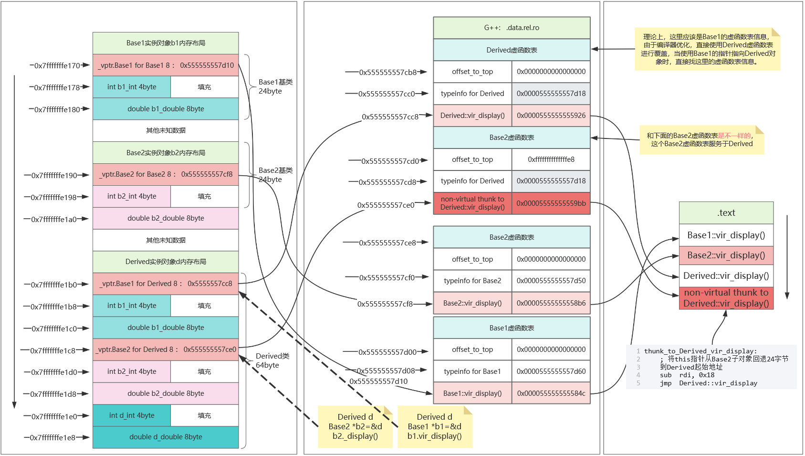

> <span style="color:red">额外的实验：前面的代码没有这种情况，子类直接继承基类的虚函数，基类添加这两个代码之后

```c
  virtual void vir_Base1() const {
    cout << "Base1: var = " << b1_int << endl;
  }
    virtual void vir_Base2() const {
    cout << "Base2: var = " << b2_int << endl;
  }
``` 

再查看虚表信息：

```c
(gdb) info vtbl b1
vtable for 'Base1' @ 0x555555557d08 (subobject @ 0x7fffffffe170):
[0]: 0x55555555584c <Base1::vir_display() const>
[1]: 0x55555555589c <Base1::vir_Base1() const>

(gdb) info vtbl b2
vtable for 'Base2' @ 0x555555557ce8 (subobject @ 0x7fffffffe190):
[0]: 0x555555555906 <Base2::vir_display() const>
[1]: 0x555555555956 <Base2::vir_Base2() const>


(gdb) info vtbl d
vtable for 'Derived' @ 0x555555557ca8 (subobject @ 0x7fffffffe1b0):
[0]: 0x5555555559c6 <Derived::vir_display() const>
[1]: 0x55555555589c <Base1::vir_Base1() const>

vtable for 'Base2' @ 0x555555557cc8 (subobject @ 0x7fffffffe1c8):
[0]: 0x555555555a5b <non-virtual thunk to Derived::vir_display() const>
[1]: 0x555555555956 <Base2::vir_Base2() const>

```

> <span style="color:red">可以发现Base1还是被Derived主虚表替换，Base2基于thunk机制，因此，不管是子类对象d还是指向d的父类指针调用vir_display(),都会指向子类实现的vir_display(),

---


# 九、传统**多级继承**包含虚函数的对象内存布局

> <span style="color:red">注意：多继承分为继承多个类A->B,A->C，以及多层继承：A->B->C

## 代码样例：

```cpp
#include <iostream>
using namespace std;

// 第一个基类
class Base1 {
public:
  int b1_int = 1;
  double b1_double = 1.1;
public:
  virtual void vir_display() const {
    cout << "Base1: var = " << b1_int << endl;
  }
  virtual void vir_Base1() const {
    cout << "Base1: vir_Base1()" << endl;
  }
  void base1_function() {
    b1_int = 0;
    cout << "Base1::base1_function() called" << endl;
  }
};

// 第一层派生类
class Derived1 : public Base1 {
public:
  int d1_int = 3;
  double d1_double = 3.3;
public:
  void vir_display() const override {
    cout << "Derived1: d1_int = " << d1_int << endl;
  }

  void d1_function() {
    cout << "Derived1::d1_function() called" << endl;
  }
};

// 第二层派生类
class Derived2 : public Derived1 {
public:
  int d2_int = 4;
  double d2_double = 4.4;
public:
  void vir_display() const override {
    cout << "Derived2: d2_int = " << d2_int << endl;
  }

  // 修正后的函数（操作 Base1 和 Derived1/Derived2 的成员）
  void d2_function() {
    cout << "Derived2::d2_function() called" << endl;
  }
};

int main() {
  // 实例化对象
  Base1 b1;
  Derived1 d1;
  Derived2 d2;

  // 多态性测试
  Base1* pb1 = &d1;
  Base1* pb2 = &d2;
  cout << "=== 多态调用 ===" << endl;
  pb1->vir_display();  // 应调用 Derived1 的版本
  pb2->vir_display();  // 应调用 Derived2 的版本

  // 成员函数测试
  cout << "\n=== 成员函数测试 ===" << endl;
  d2.base1_function();  // 调用 Base1 的函数
  d2.d1_function();     // 调用 Derived1 的函数
  d2.d2_function();     // 调用 Derived2 的函数
  cout << "修改后值: "
       << d2.b1_int << ", "
       << d2.d1_int << ", "
       << d2.d2_int << endl;

  // 内存布局分析
  cout << "\n=== 内存地址分析 ===" << endl;
  cout << "Base1 对象地址: " << &b1 << endl;
  cout << "  b1_int 地址: " << &b1.b1_int << " 值: " << b1.b1_int << endl;
  cout << "  b1_double 地址: " << &b1.b1_double << " 值: " << b1.b1_double << endl;

  cout << "\nDerived1 对象地址: " << &d1 << endl;
  cout << "  b1_int 地址: " << &d1.b1_int << " 值: " << d1.b1_int << endl;
  cout << "  d1_int 地址: " << &d1.d1_int << " 值: " << d1.d1_int << endl;

  cout << "\nDerived2 对象地址: " << &d2 << endl;
  cout << "  b1_int 地址: " << &d2.b1_int << " 值: " << d2.b1_int << endl;
  cout << "  d1_int 地址: " << &d2.d1_int << " 值: " << d2.d1_int << endl;
  cout << "  d2_int 地址: " << &d2.d2_int << " 值: " << d2.d2_int << endl;

  return 0;
}
```

## 内存布局：

> <span style="color:red">gdb调试：对象内存布局

```c
(gdb) ptype /o b1
/* offset    |  size */  type = class Base1 {
                         public:
/*    8      |     4 */    int b1_int;
/* XXX  4-byte hole  */
/*   16      |     8 */    double b1_double;

                           /* total size (bytes):   24 */
                         }
(gdb) ptype /o d1
/* offset    |  size */  type = class Derived1 : public Base1 {
                         public:
/*   24      |     4 */    int d1_int;
/* XXX  4-byte hole  */
/*   32      |     8 */    double d1_double;

                           /* total size (bytes):   40 */
                         }
(gdb) ptype /o d2
/* offset    |  size */  type = class Derived2 : public Derived1 {
                         public:
/*   40      |     4 */    int d2_int;
/* XXX  4-byte hole  */
/*   48      |     8 */    double d2_double;

                           /* total size (bytes):   56 */
                         }

 (gdb) p b1
$1 = {_vptr.Base1 = 0x555555557d20 <vtable for Base1+16>, b1_int = 1, 
  b1_double = 1.1000000000000001}
(gdb) p d1
$2 = {<Base1> = {_vptr.Base1 = 0x555555557d00 <vtable for Derived1+16>, b1_int = 1, 
    b1_double = 1.1000000000000001}, d1_int = 3, d1_double = 3.2999999999999998}
(gdb) p d2
$3 = {<Derived1> = {<Base1> = {_vptr.Base1 = 0x555555557ce0 <vtable for Derived2+16>, 
      b1_int = 1, b1_double = 1.1000000000000001}, d1_int = 3, 
    d1_double = 3.2999999999999998}, d2_int = 4, d2_double = 4.4000000000000004}
                        
```


> <span style="color:red">虚函数表信息

```c
(gdb) info vtbl b1
vtable for 'Base1' @ 0x555555557d20 (subobject @ 0x7fffffffe170):
[0]: 0x55555555580a <Base1::vir_display() const>
[1]: 0x55555555585a <Base1::vir_Base1() const>
(gdb) info vtbl d1
vtable for 'Derived1' @ 0x555555557d00 (subobject @ 0x7fffffffe190):
[0]: 0x5555555558dc <Derived1::vir_display() const>
[1]: 0x55555555585a <Base1::vir_Base1() const>
(gdb) info vtbl d2
vtable for 'Derived2' @ 0x555555557ce0 (subobject @ 0x7fffffffe1c0):
[0]: 0x555555555968 <Derived2::vir_display() const>
[1]: 0x55555555585a <Base1::vir_Base1() const>

//查看虚函数表
(gdb) set $addr = 0x555555557cd0
(gdb) while $addr < 0x555555557cd0 + 21*8
 >x/1xg $addr
 >set $addr = $addr + 8
 >end
0x555555557cd0 <_ZTV8Derived2>: 0x0000000000000000
0x555555557cd8 <_ZTV8Derived2+8>:       0x0000555555557d30
0x555555557ce0 <_ZTV8Derived2+16>:      0x0000555555555968
0x555555557ce8 <_ZTV8Derived2+24>:      0x000055555555585a
0x555555557cf0 <_ZTV8Derived1>: 0x0000000000000000
0x555555557cf8 <_ZTV8Derived1+8>:       0x0000555555557d48
0x555555557d00 <_ZTV8Derived1+16>:      0x00005555555558dc
0x555555557d08 <_ZTV8Derived1+24>:      0x000055555555585a
0x555555557d10 <_ZTV5Base1>:    0x0000000000000000
0x555555557d18 <_ZTV5Base1+8>:  0x0000555555557d60
0x555555557d20 <_ZTV5Base1+16>: 0x000055555555580a
0x555555557d28 <_ZTV5Base1+24>: 0x000055555555585a
0x555555557d30 <_ZTI8Derived2>: 0x00007ffff7f9bc98
0x555555557d38 <_ZTI8Derived2+8>:       0x00005555555561d0
0x555555557d40 <_ZTI8Derived2+16>:      0x0000555555557d48
0x555555557d48 <_ZTI8Derived1>: 0x00007ffff7f9bc98
0x555555557d50 <_ZTI8Derived1+8>:       0x00005555555561e0
0x555555557d58 <_ZTI8Derived1+16>:      0x0000555555557d60
0x555555557d60 <_ZTI5Base1>:    0x00007ffff7f9b008
0x555555557d68 <_ZTI5Base1+8>:  0x00005555555561ea


```

> <span style="color:red">内存布局和虚函数表 示意图：

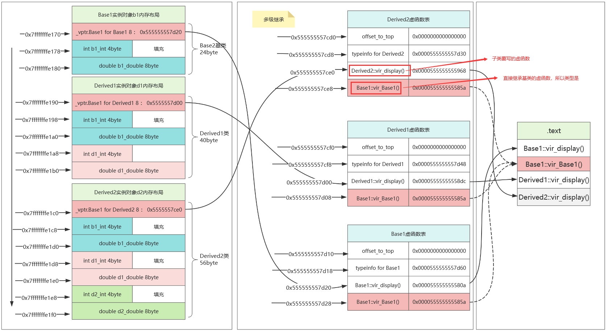

> <span style="color:red">下面代码中，红色框中的信息，观察到，派生类的虚函数表指针的名称还是沿用的基类的名称，但是虚函数表的地址是不同的。

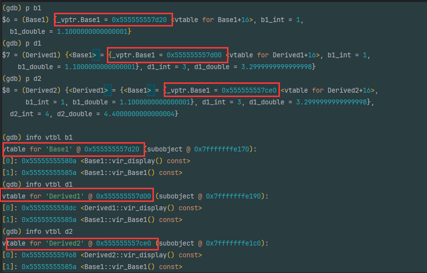


---

# 十、传统多继承包含纯虚函数对象内存布局

> 包含纯虚函数，并且多级继承

## 代码样例：

```cpp
#include <iostream>

// 第一个基类（包含纯虚函数）
class Base1 {
public:
  int b1_int = 1;
  double b1_double = 1.1;
public:
  virtual void b1_pure_virtual() = 0;
  virtual void b1_virtual_func() { 
    std::cout << "Base1::b1_virtual_func()\n";  // 修正输出
  }
  void b1_normal_func() {
    std::cout << "Base1::b1_normal_func()\n";   // 修正输出
  }
};

// 第二个基类（包含纯虚函数）
class Base2 {
public:
  int b2_int = 2;
  double b2_double = 2.2;
public:
  virtual void b2_pure_virtual() = 0;
  virtual void b2_virtual_func() {
    std::cout << "Base2::b2_virtual_func()\n";  // 修正输出
  }
  void b2_normal_func() {
    std::cout << "Base2::b2_normal_func()\n";   // 修正输出
  }
};

// 派生类（多继承）
class Derived1 : public Base1, public Base2 {
public:
  int d1_int = 1;
  double d1_double = 1.1;
public:
  void b1_pure_virtual() override {
    std::cout << "Derived1::b1_pure_virtual()\n";  // 修正输出
  }
  void b2_pure_virtual() override {
    std::cout << "Derived1::b2_pure_virtual()\n";  // 修正输出
  }
  void b1_virtual_func() override {
    std::cout << "Derived1::b1_virtual_func()\n";  // 修正输出
  }
  void d1_normal_func() {
    std::cout << "Derived1::d1_normal_func()\n";   // 修正输出
  }
};

// 派生类（多继承）
class Derived2 : public Derived1 {
public:
  int d2_int = 2;
  double d2_double = 2.2;
public:
  void b1_pure_virtual() override {
    std::cout << "Derived2::b1_pure_virtual()\n";  // 修正输出
  }
  void b2_pure_virtual() override {
    std::cout << "Derived2::b2_pure_virtual()\n";  // 修正输出
  }
  void b2_virtual_func() override {
    std::cout << "Derived2::b2_virtual_func()\n";  // 修正输出
  }
  void d2_normal_func() {
    std::cout << "Derived2::d2_normal_func()\n";   // 修正输出
  }
};

int main() {
  // 测试 Derived1 对象
  std::cout << "===== Testing Derived1 =====" << std::endl;
  Derived1 d1;

  // 调用所有可用函数
  std::cout << "\n[Member Functions]" << std::endl;
  d1.b1_pure_virtual();        // Derived1::b1_pure_virtual()
  d1.b2_pure_virtual();        // Derived1::b2_pure_virtual()
  d1.b1_virtual_func();        // Derived1::b1_virtual_func()
  d1.b2_virtual_func();        // Base2::b2_virtual_func()
  d1.b1_normal_func();         // Base1::b1_normal_func()
  d1.b2_normal_func();         // Base2::b2_normal_func()
  d1.d1_normal_func();         // Derived1::d1_normal_func()

  // 测试 Derived2 对象
  std::cout << "\n\n===== Testing Derived2 =====" << std::endl;
  Derived2 d2;

  // 调用所有可用函数
  std::cout << "\n[Member Functions]" << std::endl;
  d2.b1_pure_virtual();        // Derived2::b1_pure_virtual()
  d2.b2_pure_virtual();        // Derived2::b2_pure_virtual()
  d2.b1_virtual_func();        // Derived1::b1_virtual_func()
  d2.b2_virtual_func();        // Derived2::b2_virtual_func()
  d2.b1_normal_func();         // Base1::b1_normal_func()
  d2.b2_normal_func();         // Base2::b2_normal_func()
  d2.d1_normal_func();         // Derived1::d1_normal_func()
  d2.d2_normal_func();         // Derived2::d2_normal_func()

  return 0;
}
```

## 内存布局：

> 关系类图：主要看源代码理解

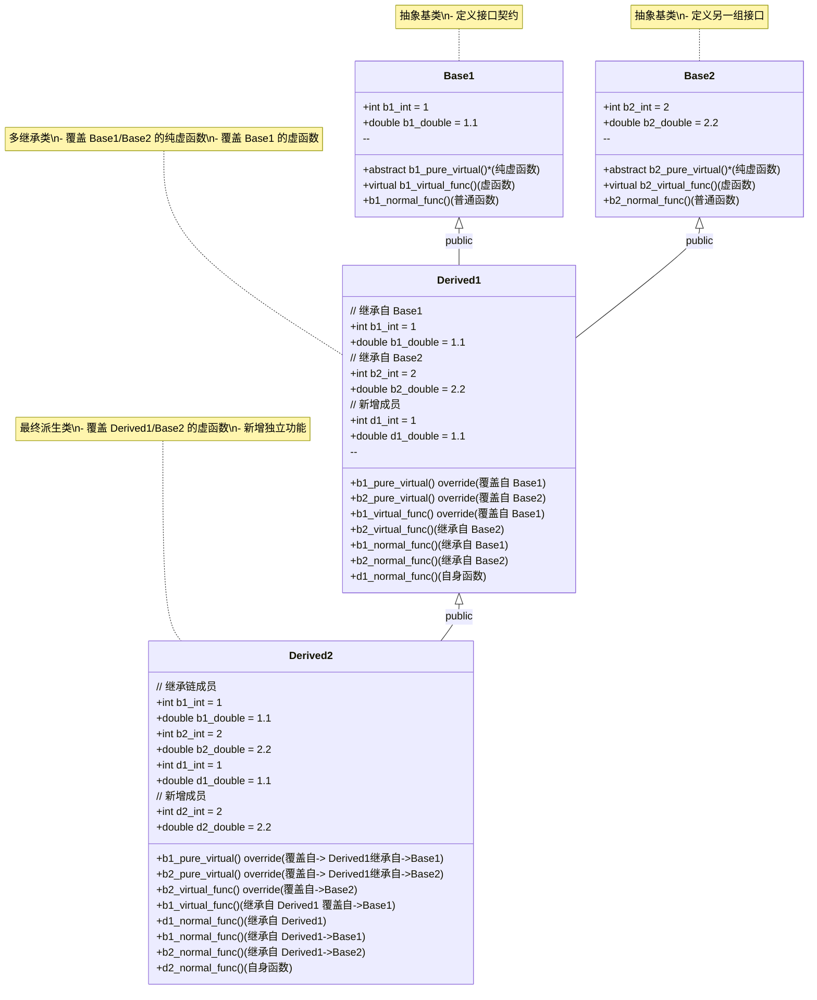

> gdb 查看内存布局

```c
(gdb) p d1
$3 = {
        <Base1> = {_vptr.Base1 = 0x555555557ce0 <vtable for Derived1+16>, b1_int = 1,b1_double = 1.1000000000000001}, 
        <Base2> = {_vptr.Base2 = 0x555555557d08 <vtable for Derived1+56>,b2_int = 2, b2_double = 2.2000000000000002}, 
        d1_int = 1, d1_double = 1.1000000000000001
     }
    
(gdb) p d2
$4 = {
        <Derived1> ={
                <Base1> = {_vptr.Base1 = 0x555555557c90 <vtable for Derived2+16>, b1_int = 1,b1_double = 1.1000000000000001}, 
                <Base2> = {_vptr.Base2 = 0x555555557cc0 <vtable for Derived2+64>,b2_int = 2, b2_double = 2.2000000000000002}, 
                d1_int = 1, d1_double = 1.1000000000000001
              }, 
        d2_int = 2, d2_double = 2.2000000000000002}
        
        
        
(gdb) ptype /o Base1
/* offset    |  size */  type = class Base1 {
                         public:
/*    8      |     4 */    int b1_int;
/* XXX  4-byte hole  */
/*   16      |     8 */    double b1_double;

                           /* total size (bytes):   24 */
                         }
(gdb) ptype /o Base2
/* offset    |  size */  type = class Base2 {
                         public:
/*    8      |     4 */    int b2_int;
/* XXX  4-byte hole  */
/*   16      |     8 */    double b2_double;

                           /* total size (bytes):   24 */
                         }
(gdb) ptype /o d1
/* offset    |  size */  type = class Derived1 : public Base1, public Base2 {
                         public:
/*   48      |     4 */    int d1_int;
/* XXX  4-byte hole  */
/*   56      |     8 */    double d1_double;

                           /* total size (bytes):   64 */
                         }
(gdb) ptype /o d2
/* offset    |  size */  type = class Derived2 : public Derived1 {
                         public:
/*   64      |     4 */    int d2_int;
/* XXX  4-byte hole  */
/*   72      |     8 */    double d2_double;

                           /* total size (bytes):   80 */
                         }

```

> 查看d1,d2对象的内存信息

d1内存信息
```c

(gdb) p &d1
$10 = (Derived1 *) 0x7fffffffe160
(gdb) p &d1.b1_int
$11 = (int *) 0x7fffffffe168
(gdb) p &d1.b1_double
$12 = (double *) 0x7fffffffe170
(gdb) p &d1.b2_int
$13 = (int *) 0x7fffffffe180
(gdb) p &d1.b2_double
$14 = (double *) 0x7fffffffe188
(gdb) p &d1.d1_int
$15 = (int *) 0x7fffffffe190
(gdb) p &d1.d1_double
$16 = (double *) 0x7fffffffe198
        
(gdb) p &d2
$17 = (Derived2 *) 0x7fffffffe1a0
(gdb) p &d2.b1_int
$18 = (int *) 0x7fffffffe1a8
(gdb) p &d2.b1_double
$19 = (double *) 0x7fffffffe1b0
(gdb) p &d2.b2_int
$20 = (int *) 0x7fffffffe1c0
(gdb) p &d2.b2_double
$21 = (double *) 0x7fffffffe1c8
(gdb) p &d2.d1_int
$22 = (int *) 0x7fffffffe1d0
(gdb) p &d2.d1_double
$23 = (double *) 0x7fffffffe1d8
(gdb) p &d2.d2_int
$24 = (int *) 0x7fffffffe1e0
(gdb) p &d2.d2_double
$25 = (double *) 0x7fffffffe1e8

        
        
(gdb) set &a = 0x7fffffffe160
Left operand of assignment is not an lvalue.
(gdb) set $a = 0x7fffffffe160
(gdb) while $a < 0x7fffffffe160 + 18*8
 >x/1xg $a
 >set $a = $a +8
 >end
0x7fffffffe160: 0x0000555555557ce0 vptr:derived1
0x7fffffffe168: 0x00007fff00000001 base1数据
0x7fffffffe170: 0x3ff199999999999a
0x7fffffffe178: 0x0000555555557d08 vptr:Base2
0x7fffffffe180: 0x00007fff00000002 base2数据
0x7fffffffe188: 0x400199999999999a 
0x7fffffffe190: 0x00007fff00000001 derived1自己数据
0x7fffffffe198: 0x3ff199999999999a


d2的内存信息
0x7fffffffe1a0: 0x0000555555557c90 vptr:derived2
0x7fffffffe1a8: 0x0000000100000001 base1数据
0x7fffffffe1b0: 0x3ff199999999999a
0x7fffffffe1b8: 0x0000555555557cc0 vptr:Base2
0x7fffffffe1c0: 0x0000000000000002 base2数据
0x7fffffffe1c8: 0x400199999999999a
0x7fffffffe1d0: 0x00007fff00000001 derived1数据
0x7fffffffe1d8: 0x3ff199999999999a
0x7fffffffe1e0: 0x0000000000000002 derived2自己数据
0x7fffffffe1e8: 0x400199999999999a

```

> d1 

```c
(gdb) info vtbl (Base1*)&d1
vtable for 'Base1' @ 0x555555557ce0 (subobject @ 0x7fffffffe160):
[0]: 0x555555555514 <Derived1::b1_pure_virtual()>
[1]: 0x55555555556a <Derived1::b1_virtual_func()>
#######################################################
(gdb) info vtbl (Base2*)&d1
vtable for 'Base2' @ 0x555555557d08 (subobject @ 0x7fffffffe178):
[0]: 0x555555555560 <non-virtual thunk to Derived1::b2_pure_virtual()>
[1]: 0x5555555554c8 <Base2::b2_virtual_func()>

#######################################################
(gdb) info vtbl d1
vtable for 'Derived1' @ 0x555555557ce0 (subobject @ 0x7fffffffe160):
[0]: 0x555555555514 <Derived1::b1_pure_virtual()>
[1]: 0x55555555556a <Derived1::b1_virtual_func()>
[2]: 0x55555555553a <Derived1::b2_pure_virtual()>

vtable for 'Base2' @ 0x555555557d08 (subobject @ 0x7fffffffe178):
[0]: 0x555555555560 <non-virtual thunk to Derived1::b2_pure_virtual()>
[1]: 0x5555555554c8 <Base2::b2_virtual_func()>
```

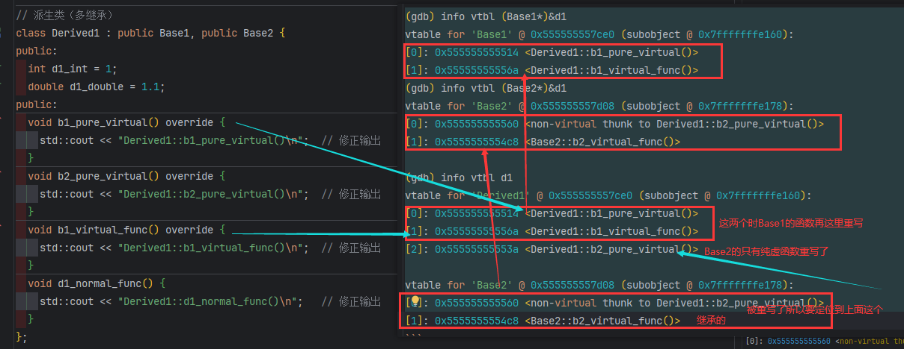

> 如图分析：
> <span style="color:red">对于derived1，继承了Base1和Base2，虚函数表有两个:

- 一个是`vtable for 'Derived1' @ 0x555555557ce0`，由于编译器优化，Base1虚表直接被Derived1虚表覆盖整合，查看上面的命令info vtbl (Base1*)&d1，查看到Base1的虚表就两个信息，这里Derived1有三个虚函数信息，前两个表示:Derived1覆写继承自Base1的两个虚函数，第三个Derived1::b2_pure_virtual()是覆写继承自Base2的虚函数

    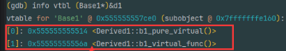

- 另一个是`vtable for 'Base2' @ 0x555555557d08`,Base2的虚表，他属于Derived1,两个信息，第一个是b2_pure_virtual(),如果没有被Derived1覆写，这里的类型肯定是Base2::b2_pure_virtual()，由于覆写，覆写之后的地址信息在第一个虚函数表`vtable for 'Derived1' @ 0x555555557ce0`里面存着，根据thunk机制可以找到。第二个是Base2::b2_virtual_func()，这个虚函数是直接继承的。因此类型是Base2,而不是Derived1

> d2 的虚函数信息

```c
(gdb) info vtbl (Base1*)&d2
vtable for 'Base1' @ 0x555555557c90 (subobject @ 0x7fffffffe1a0):
[0]: 0x5555555555b6 <Derived2::b1_pure_virtual()>
[1]: 0x55555555556a <Derived1::b1_virtual_func()>
(gdb) info vtbl (Base2*)&d2
vtable for 'Base2' @ 0x555555557cc0 (subobject @ 0x7fffffffe1b8):
[0]: 0x555555555602 <non-virtual thunk to Derived2::b2_pure_virtual()>
[1]: 0x555555555632 <non-virtual thunk to Derived2::b2_virtual_func()>
#######################################################
(gdb) info vtbl (Derived1*)&d2
vtable for 'Derived1' @ 0x555555557c90 (subobject @ 0x7fffffffe1a0):
[0]: 0x5555555555b6 <Derived2::b1_pure_virtual()>
[1]: 0x55555555556a <Derived1::b1_virtual_func()>
[2]: 0x5555555555dc <Derived2::b2_pure_virtual()>

vtable for 'Base2' @ 0x555555557cc0 (subobject @ 0x7fffffffe1b8):
[0]: 0x555555555602 <non-virtual thunk to Derived2::b2_pure_virtual()>
[1]: 0x555555555632 <non-virtual thunk to Derived2::b2_virtual_func()>
#######################################################
(gdb) info vtbl d2
vtable for 'Derived2' @ 0x555555557c90 (subobject @ 0x7fffffffe1a0):
[0]: 0x5555555555b6 <Derived2::b1_pure_virtual()>
[1]: 0x55555555556a <Derived1::b1_virtual_func()>
[2]: 0x5555555555dc <Derived2::b2_pure_virtual()>
[3]: 0x55555555560c <Derived2::b2_virtual_func()>

vtable for 'Base2' @ 0x555555557cc0 (subobject @ 0x7fffffffe1b8):
[0]: 0x555555555602 <non-virtual thunk to Derived2::b2_pure_virtual()>
[1]: 0x555555555632 <non-virtual thunk to Derived2::b2_virtual_func()>


```
> 如图分析：

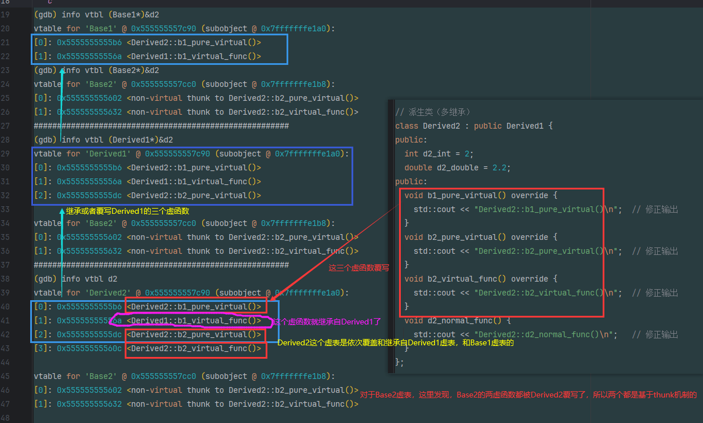

>  <span style="color:red">总的来说，Derived2的虚函数表有两个，第一个是Derived2覆写了Derived1，Derived1覆写和继承了Base1，第二个是Base2虚表


> d1和d2的虚函数表信息：
```c
(gdb) set $a = 0x555555557c80
(gdb) while $a < 0x555555557c80 + 36*8
 >x/1xg $a
 >set $a = $a +8
 >end
 #虚函数表
0x555555557c80 <_ZTV8Derived2>: 0x0000000000000000
0x555555557c88 <_ZTV8Derived2+8>:       0x0000555555557d18
0x555555557c90 <_ZTV8Derived2+16>:      0x00005555555555b6
0x555555557c98 <_ZTV8Derived2+24>:      0x000055555555556a
0x555555557ca0 <_ZTV8Derived2+32>:      0x00005555555555dc
0x555555557ca8 <_ZTV8Derived2+40>:      0x000055555555560c
0x555555557cb0 <_ZTV8Derived2+48>:      0xffffffffffffffe8
0x555555557cb8 <_ZTV8Derived2+56>:      0x0000555555557d18
0x555555557cc0 <_ZTV8Derived2+64>:      0x0000555555555602
0x555555557cc8 <_ZTV8Derived2+72>:      0x0000555555555632

0x555555557cd0 <_ZTV8Derived1>: 0x0000000000000000
0x555555557cd8 <_ZTV8Derived1+8>:       0x0000555555557d30
0x555555557ce0 <_ZTV8Derived1+16>:      0x0000555555555514
0x555555557ce8 <_ZTV8Derived1+24>:      0x000055555555556a
0x555555557cf0 <_ZTV8Derived1+32>:      0x000055555555553a
0x555555557cf8 <_ZTV8Derived1+40>:      0xffffffffffffffe8
0x555555557d00 <_ZTV8Derived1+48>:      0x0000555555557d30
0x555555557d08 <_ZTV8Derived1+56>:      0x0000555555555560
0x555555557d10 <_ZTV8Derived1+64>:      0x00005555555554c8
# 类型信息表
0x555555557d18 <_ZTI8Derived2>: 0x00007ffff7f9bc98
0x555555557d20 <_ZTI8Derived2+8>:       0x00005555555561a0
0x555555557d28 <_ZTI8Derived2+16>:      0x0000555555557d30
0x555555557d30 <_ZTI8Derived1>: 0x00007ffff7f9bd58
0x555555557d38 <_ZTI8Derived1+8>:       0x00005555555561b0
0x555555557d40 <_ZTI8Derived1+16>:      0x0000000200000000
0x555555557d48 <_ZTI8Derived1+24>:      0x0000555555557d78
0x555555557d50 <_ZTI8Derived1+32>:      0x0000000000000002
0x555555557d58 <_ZTI8Derived1+40>:      0x0000555555557d68
0x555555557d60 <_ZTI8Derived1+48>:      0x0000000000001802
0x555555557d68 <_ZTI5Base2>:    0x00007ffff7f9b008
0x555555557d70 <_ZTI5Base2+8>:  0x00005555555561ba
0x555555557d78 <_ZTI5Base1>:    0x00007ffff7f9b008
0x555555557d80 <_ZTI5Base1+8>:  0x00005555555561c1

```

>  <span style="color:red">内存布局和虚函数表示意图，注意Base1和Base2属于抽象类，没有实例对象，这里不在给出地址信息，图中的布局和虚函数表都是按照上述gdb调试信息给出的，text段是按照地址从低到高排布的。

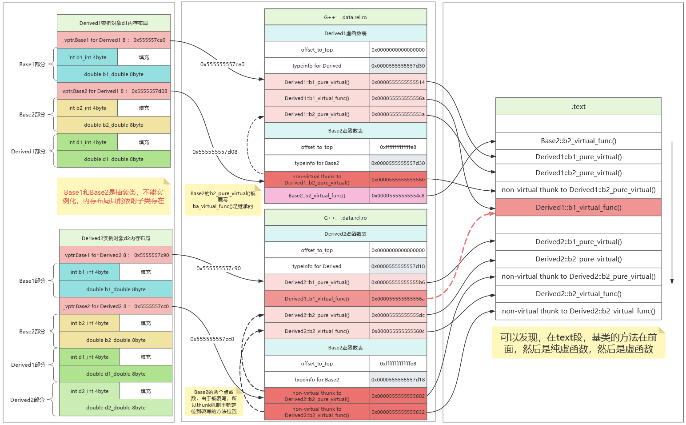

---

# 十一、传统多继承包含纯虚函数**接口对象**内存布局

## 代码样例：

```cpp
#include <iostream>
using namespace std;

class Interface1 {
public:
  virtual void int_method1() = 0;
  virtual void int_method2() = 0;
};

class Interface2 {
public:
  virtual void int_method1() = 0;
  virtual void int_method2() = 0;
};
class Interface3 {
public:
  virtual void int_method1() = 0;
  virtual void int_method2() = 0;
};

class Concrete : public Interface1, public Interface2, public Interface3 {
public:
  void int_method1() override { cout << "Implemented method1" << endl; }
  void int_method2() override { cout << "Implemented method2" << endl; }
};

int main() {
  Concrete c;
  c.int_method1();                  // 输出: Implemented method1
  c.int_method2();                  // 输出: Implemented method2
  return 0;
}
```

## 内存布局：


> gdb调试，查看内存布局

```c
(gdb) ptype /o Interface1
/* offset    |  size */  type = class Interface1 {

                           /* total size (bytes):    8 */
                         }
(gdb) ptype /o Interface3
/* offset    |  size */  type = class Interface3 {

                           /* total size (bytes):    8 */
                         }
(gdb) ptype /o Concrete
/* offset    |  size */  type = class Concrete : public Interface1, public Interface2
        , public Interface3 {

                           /* total size (bytes):   24 */
                         }
(gdb) p c
$1 = {<Interface1> = {
    _vptr.Interface1 = 0x555555557cc0 <vtable for Concrete+16>}, 
      <Interface2> = {
    _vptr.Interface2 = 0x555555557ce0 <vtable for Concrete+48>}, 
    <Interface3> = {
    _vptr.Interface3 = 0x555555557d00 <vtable for Concrete+80>}, <No data fields>}

(gdb) info vtbl c
vtable for 'Concrete' @ 0x555555557cc0 (subobject @ 0x7fffffffe1e0):
[0]: 0x55555555529e <Concrete::int_method1()>
[1]: 0x5555555552ee <Concrete::int_method2()>

vtable for 'Interface2' @ 0x555555557ce0 (subobject @ 0x7fffffffe1e8):
[0]: 0x5555555552e3 <non-virtual thunk to Concrete::int_method1()>
[1]: 0x555555555333 <non-virtual thunk to Concrete::int_method2()>

vtable for 'Interface3' @ 0x555555557d00 (subobject @ 0x7fffffffe1f0):
[0]: 0x5555555552d9 <non-virtual thunk to Concrete::int_method1()>
[1]: 0x555555555329 <non-virtual thunk to Concrete::int_method2()>


(gdb) x /32xg 0x555555557cb0
0x555555557cb0 <_ZTV8Concrete>: 0x0000000000000000      0x0000555555557d10
0x555555557cc0 <_ZTV8Concrete+16>:      0x000055555555529e      0x00005555555552ee
0x555555557cd0 <_ZTV8Concrete+32>:      0xfffffffffffffff8      0x0000555555557d10
0x555555557ce0 <_ZTV8Concrete+48>:      0x00005555555552e3      0x0000555555555333
0x555555557cf0 <_ZTV8Concrete+64>:      0xfffffffffffffff0      0x0000555555557d10
0x555555557d00 <_ZTV8Concrete+80>:      0x00005555555552d9      0x0000555555555329

0x555555557d10 <_ZTI8Concrete>: 0x00007ffff7f9bd58      0x0000555555556030
0x555555557d20 <_ZTI8Concrete+16>:      0x0000000300000000      0x0000555555557d78
0x555555557d30 <_ZTI8Concrete+32>:      0x0000000000000002      0x0000555555557d68
0x555555557d40 <_ZTI8Concrete+48>:      0x0000000000000802      0x0000555555557d58
0x555555557d50 <_ZTI8Concrete+64>:      0x0000000000001002      0x00007ffff7f9b008
0x555555557d60 <_ZTI10Interface3+8>:    0x0000555555556040      0x00007ffff7f9b008
0x555555557d70 <_ZTI10Interface2+8>:    0x0000555555556050      0x00007ffff7f9b008
0x555555557d80 <_ZTI10Interface1+8>:    0x0000555555556060      0x0000000000000001

```


> 内存布局和虚函数表信息


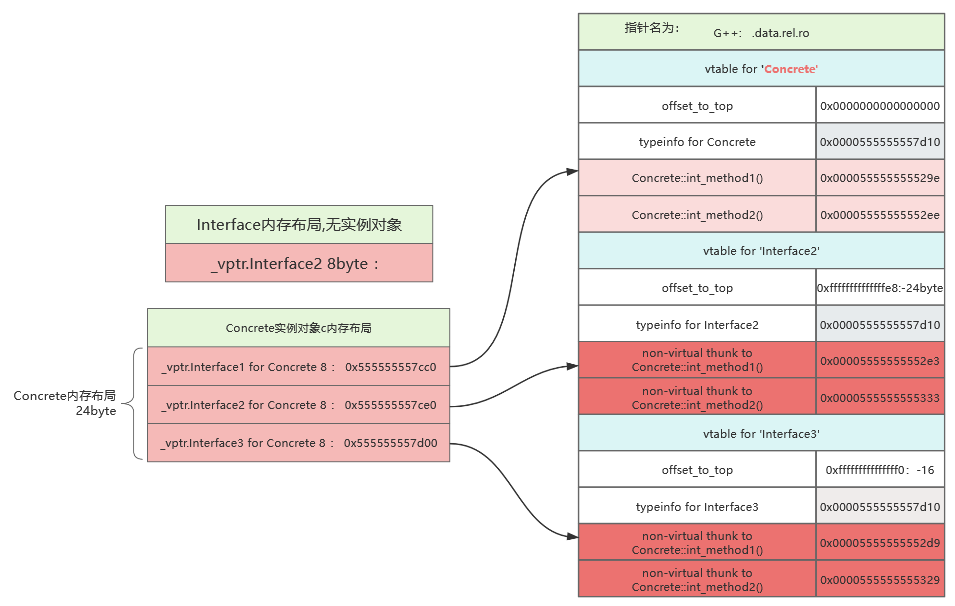


---


# 十二、虚拟多继承(菱形继承)对象内存布局

## 代码样例：

```cpp
#include <iostream>

class Base {
public:
  int base_int = 0;
  double base_double = 0.3;
  virtual void base_virtual_func() {
    std::cout << "Base::base_virtual_func()\n";
  }
  void base_normal_func(){
    std::cout << "Base::base_normal_func()\n";
  }
};

class Base1 : virtual public Base {
public:
  int b1_int = 1;
  double b1_double = 1.1;
  void base_virtual_func() override {
    std::cout << "Base1::base_virtual_func()\n";
  }
  virtual void b1_virtual_func() {
    std::cout << "Base1::b1_virtual_func()\n";
  }
  void b1_normal_func() {
    std::cout << "Base1::b1_normal_func()\n";
  }
};

class Base2 : virtual public Base {
public:
  int b2_int = 2;
  double b2_double = 2.2;
  void base_virtual_func() override {
    std::cout << "Base2::base_virtual_func()\n";
  }
  virtual void b2_virtual_func() {
    std::cout << "Base2::b2_virtual_func()\n";
  }
  void b2_normal_func() {
    std::cout << "Base2::b2_normal_func()\n";
  }
};

class Derived : public Base1, public Base2 {  // 移除冗余的 virtual
public:
  int d1_int = 3;
  double d1_double = 3.1;
  void base_virtual_func() override {
    std::cout << "Derived::base_virtual_func()\n";
  }
  void b1_virtual_func() override {
    std::cout << "Derived::b1_virtual_func()\n";
  }
  void b2_virtual_func() override {  // 修正输出文本
    std::cout << "Derived::b2_virtual_func()\n";
  }
  void d1_normal_func() {
    std::cout << "Derived::d1_normal_func()\n";
  }
};

int main() {
  // 实例化所有类的对象
  std::cout << "===== Instantiate All Classes =====" << std::endl;
  Base base;
  Base1 base1;
  Base2 base2;
  Derived derived;

  // 测试基础调用
  std::cout << "\n===== Direct Call Test =====" << std::endl;
  base.base_virtual_func();   // Base::base_virtual_func()
  base1.base_virtual_func();  // Base1::base_virtual_func()
  base2.base_virtual_func();  // Base2::base_virtual_func()
  derived.base_virtual_func(); // derived::base_virtual_func()

  // 多态调用测试
  std::cout << "\n===== Polymorphic Call Test =====" << std::endl;
  Base* pBase = &derived;
  Base1* pBase1 = &derived;
  Base2* pBase2 = &derived;

  pBase->base_virtual_func();   // derived::base_virtual_func()
  pBase1->base_virtual_func();   // derived::base_virtual_func()
  pBase2->base_virtual_func();   // derived::base_virtual_func()

  // 强制调用指定基类版本
  std::cout << "\n===== Explicit Scope Call =====" << std::endl;
  derived.Base::base_virtual_func();    // Base::base_virtual_func()
  derived.Base1::base_virtual_func();   // Base1::base_virtual_func()
  derived.Base2::base_virtual_func();   // Base2::base_virtual_func()

  // 验证其他成员函数
  std::cout << "\n===== Other Function Test =====" << std::endl;
  derived.b1_virtual_func();    // derived::b1_virtual_func()
  derived.b2_virtual_func();    // derived::b2_virtual_func()
  derived.b1_normal_func();     // Base1::b1_normal_func()
  derived.b2_normal_func();     // Base2::b2_normal_func()
  derived.d1_normal_func();     // derived::d1_normal_func()

  return 0;
}
```

## 内存布局：

> gdb调试，内存布局
```c
(gdb) ptype /o Base
/* offset    |  size */  type = class Base {
                         public:
/*    8      |     4 */    int base_int;
/* XXX  4-byte hole  */
/*   16      |     8 */    double base_double;

                           /* total size (bytes):   24 */
                         }
(gdb) ptype /o Base1
/* offset    |  size */  type = class Base1 : public virtual Base {
                         public:
/*    8      |     4 */    int b1_int;
/* XXX  4-byte hole  */
/*   16      |     8 */    double b1_double;
/* XXX 24-byte padding  */

                           /* total size (bytes):   48 */
                         }
(gdb) ptype /o Base2
/* offset    |  size */  type = class Base2 : public virtual Base {
                         public:
/*    8      |     4 */    int b2_int;
/* XXX  4-byte hole  */
/*   16      |     8 */    double b2_double;
/* XXX 24-byte padding  */

                           /* total size (bytes):   48 */
                         }
                         
                         
(gdb) ptype /o Derived
/* offset    |  size */  type = class Derived : public Base1
        , public Base2 {
                         public:
/*   48      |     4 */    int d1_int;
/* XXX  4-byte hole  */
/*   56      |     8 */    double d1_double;
/* XXX 24-byte padding  */

                           /* total size (bytes):   88 */210*
                         }

(gdb) p base
$17 = {_vptr.Base = 0x555555557ce8 <vtable for Base+16>, base_int = 0, base_double = 0.29999999999999999}

(gdb) p base1
$18 = {<Base> = {_vptr.Base = 0x555555557cc0 <vtable for Base1+64>, base_int = 0, base_double = 0.29999999999999999}, 
  _vptr.Base1 = 0x555555557c98 <vtable for Base1+24>, b1_int = 1, b1_double = 1.1000000000000001}
  
  
(gdb) p base2
$19 = {<Base> = {_vptr.Base = 0x555555557c68 <vtable for Base2+64>, base_int = 0, base_double = 0.29999999999999999}, 
  _vptr.Base2 = 0x555555557c40 <vtable for Base2+24>, b2_int = 2, b2_double = 2.2000000000000002}
  
  
(gdb) p derived
$20 = {<Base1> = {
                    <Base>    = {_vptr.Base = 0x555555557b58 <vtable for Derived+112>, base_int = 0, base_double = 0.29999999999999999}, 
                    _vptr.Base1 = 0x555555557b00 <vtable for Derived+24>, b1_int = 1, b1_double = 1.1000000000000001
                 },
       <Base2> = {_vptr.Base2 = 0x555555557b30 <vtable for Derived+72>, b2_int = 2, b2_double = 2.2000000000000002}, 
       d1_int = 3, d1_double = 3.1000000000000001
}

```

> 对象虚函数表信息

```c

(gdb) info vtbl base
vtable for 'Base' @ 0x555555557ce8 (subobject @ 0x7fffffffe120):
[0]: 0x55555555549c <Base::base_virtual_func()>
#############################################################
(gdb) info vtbl base1
vtable for 'Base1' @ 0x555555557c98 (subobject @ 0x7fffffffe140):
[0]: 0x5555555554c2 <Base1::base_virtual_func()>
[1]: 0x5555555554f6 <Base1::b1_virtual_func()>

vtable for 'Base' @ 0x555555557cc0 (subobject @ 0x7fffffffe158):
[0]: 0x5555555554e8 <virtual thunk to Base1::base_virtual_func()>
#############################################################
(gdb) info vtbl base2
vtable for 'Base2' @ 0x555555557c40 (subobject @ 0x7fffffffe170):
[0]: 0x555555555542 <Base2::base_virtual_func()>
[1]: 0x555555555576 <Base2::b2_virtual_func()>

vtable for 'Base' @ 0x555555557c68 (subobject @ 0x7fffffffe188):
[0]: 0x555555555568 <virtual thunk to Base2::base_virtual_func()>
#############################################################
(gdb) info vtbl derived
vtable for 'Derived' @ 0x555555557b00 (subobject @ 0x7fffffffe1a0):
[0]: 0x5555555555c2 <Derived::base_virtual_func()>
[1]: 0x555555555600 <Derived::b1_virtual_func()>
[2]: 0x555555555626 <Derived::b2_virtual_func()>

vtable for 'Base2' @ 0x555555557b30 (subobject @ 0x7fffffffe1b8):
[0]: 0x5555555555f5 <non-virtual thunk to Derived::base_virtual_func()>
[1]: 0x55555555564c <non-virtual thunk to Derived::b2_virtual_func()>

vtable for 'Base' @ 0x555555557b58 (subobject @ 0x7fffffffe1e0):
[0]: 0x5555555555e8 <virtual thunk to Derived::base_virtual_func()>

```

> 栈中,几个类实例化对象内存信息
```c
$4 = (Base *) 0x7fffffffe120
(gdb) set $a = 0x7fffffffe120
(gdb) while $a < 0x7fffffffe120 + 30*8
 >x/1xg $a
 >set $a = $a + 8
 >end
#base对象内存信息
0x7fffffffe120: 0x0000555555557ce8 vtable for 'Base' @ 0x555555557ce8  _vptr.Base = 0x555555557ce8 <vtable for Base+16>
0x7fffffffe128: 0x00007fff00000000 Base::base_int
0x7fffffffe130: 0x3fd3333333333333 Base::base_double


#base1对象内存信息
0x7fffffffe140: 0x0000555555557c98 vtable for 'Base1' @ 0x555555557c98
0x7fffffffe148: 0x00007fff00000001 Base1::b1_int
0x7fffffffe150: 0x3ff199999999999a Base1::b1_double

0x7fffffffe158: 0x0000555555557cc0 vtable for 'Base' @ 0x555555557cc0
0x7fffffffe160: 0x00007fff00000000 base::base_int
0x7fffffffe168: 0x3fd3333333333333 base::base_double

#base2
0x7fffffffe170: 0x0000555555557c40 vtable for 'Base2' @ 0x555555557c40
0x7fffffffe178: 0x0000555500000002 base2::b2_int
0x7fffffffe180: 0x400199999999999a base2::b2_double

0x7fffffffe188: 0x0000555555557c68 vtable for 'Base' @ 0x555555557c68
0x7fffffffe190: 0x00007fff00000000 base::base_int
0x7fffffffe198: 0x3fd3333333333333 base::base_double

#derived
0x7fffffffe1a0: 0x0000555555557b00 指向的虚函数表名为：vtable for 'Derived' @ 0x555555557b00  指针名为： _vptr.Base1 = 0x555555557b00 <vtable for Derived+24>
0x7fffffffe1a8: 0x0000000100000001 Base1::b1_int
0x7fffffffe1b0: 0x3ff199999999999a Base1::b1_double

0x7fffffffe1b8: 0x0000555555557b30 vtable for 'Base2' @ 0x555555557b30  指针名为： _vptr.Base2 = 0x555555557b30 <vtable for Derived+72>
0x7fffffffe1c0: 0x0000000000000002 Base2::b2_int
0x7fffffffe1c8: 0x400199999999999a Base2::b2_double

0x7fffffffe1d0: 0x00007fff00000003 Derived::d1_int
0x7fffffffe1d8: 0x4008cccccccccccd Derived::d1_double

0x7fffffffe1e0: 0x0000555555557b58 vtable for 'Base' @ 0x555555557b58 指针名为： _vptr.Base = 0x555555557b58 <vtable for Derived+112>
0x7fffffffe1e8: 0x0000555500000000 base::base_int
0x7fffffffe1f0: 0x3fd3333333333333 base::base_double

```

> 代码段，虚函数表附近信息
> 
```c
(gdb) set $a = 0x555555557af0
(gdb) while $a < 0x555555557af0 + 86 * 8
 >x/1xg $a
 >set $a = $a +8
 >end
Derived虚表
0x555555557af0 <_ZTV7Derived+8>:        0x0000000000000000
0x555555557af8 <_ZTV7Derived+16>:       0x0000555555557cf0
0x555555557b00 <_ZTV7Derived+24>:       0x00005555555555c2
0x555555557b08 <_ZTV7Derived+32>:       0x0000555555555600
0x555555557b10 <_ZTV7Derived+40>:       0x0000555555555626

0x555555557b18 <_ZTV7Derived+48>:       0x0000000000000028
0x555555557b20 <_ZTV7Derived+56>:       0xffffffffffffffe8
0x555555557b28 <_ZTV7Derived+64>:       0x0000555555557cf0
0x555555557b30 <_ZTV7Derived+72>:       0x00005555555555f5
0x555555557b38 <_ZTV7Derived+80>:       0x000055555555564c

0x555555557b40 <_ZTV7Derived+88>:       0xffffffffffffffc0
0x555555557b48 <_ZTV7Derived+96>:       0xffffffffffffffc0
0x555555557b50 <_ZTV7Derived+104>:      0x0000555555557cf0
0x555555557b58 <_ZTV7Derived+112>:      0x00005555555555e8
---------------------------------------------------------
ZTT 前缀（虚表表，Virtual Table Table）作用：在对象构造/析构过程中，动态切换虚表（如基类和派生类的虚表不同阶段）。
0x555555557b60 <_ZTT7Derived>:  0x0000555555557b00
0x555555557b68 <_ZTT7Derived+8>:        0x0000555555557bb0
0x555555557b70 <_ZTT7Derived+16>:       0x0000555555557bd8
0x555555557b78 <_ZTT7Derived+24>:       0x0000555555557bf8
0x555555557b80 <_ZTT7Derived+32>:       0x0000555555557c20
0x555555557b88 <_ZTT7Derived+40>:       0x0000555555557b58
0x555555557b90 <_ZTT7Derived+48>:       0x0000555555557b30
-----------------------------------------------------------
_ZTC 前缀（构造虚表，Construction VTable）作用：用于初始化继承链中不同基类的虚表。
0x555555557b98 <_ZTC7Derived0_5Base1>:  0x0000000000000040
0x555555557ba0 <_ZTC7Derived0_5Base1+8>:        0x0000000000000000
0x555555557ba8 <_ZTC7Derived0_5Base1+16>:       0x0000555555557d50
0x555555557bb0 <_ZTC7Derived0_5Base1+24>:       0x00005555555554c2
0x555555557bb8 <_ZTC7Derived0_5Base1+32>:       0x00005555555554f6
0x555555557bc0 <_ZTC7Derived0_5Base1+40>:       0xffffffffffffffc0
0x555555557bc8 <_ZTC7Derived0_5Base1+48>:       0xffffffffffffffc0
0x555555557bd0 <_ZTC7Derived0_5Base1+56>:       0x0000555555557d50
0x555555557bd8 <_ZTC7Derived0_5Base1+64>:       0x00005555555554e8
0x555555557be0 <_ZTC7Derived24_5Base2>: 0x0000000000000028
0x555555557be8 <_ZTC7Derived24_5Base2+8>:       0x0000000000000000
0x555555557bf0 <_ZTC7Derived24_5Base2+16>:      0x0000555555557d28
0x555555557bf8 <_ZTC7Derived24_5Base2+24>:      0x0000555555555542
0x555555557c00 <_ZTC7Derived24_5Base2+32>:      0x0000555555555576
0x555555557c08 <_ZTC7Derived24_5Base2+40>:      0xffffffffffffffd8
0x555555557c10 <_ZTC7Derived24_5Base2+48>:      0xffffffffffffffd8
0x555555557c18 <_ZTC7Derived24_5Base2+56>:      0x0000555555557d28
0x555555557c20 <_ZTC7Derived24_5Base2+64>:      0x0000555555555568
--------------------------------------------------
Base2虚表
0x555555557c28 <_ZTV5Base2>:    0x0000000000000018
0x555555557c30 <_ZTV5Base2+8>:  0x0000000000000000
0x555555557c38 <_ZTV5Base2+16>: 0x0000555555557d28
0x555555557c40 <_ZTV5Base2+24>: 0x0000555555555542
0x555555557c48 <_ZTV5Base2+32>: 0x0000555555555576
0x555555557c50 <_ZTV5Base2+40>: 0xffffffffffffffe8
0x555555557c58 <_ZTV5Base2+48>: 0xffffffffffffffe8
0x555555557c60 <_ZTV5Base2+56>: 0x0000555555557d28
0x555555557c68 <_ZTV5Base2+64>: 0x0000555555555568
ZTT 前缀（虚表表，Virtual Table Table）作用：在对象构造/析构过程中，动态切换虚表（如基类和派生类的虚表不同阶段）。
0x555555557c70 <_ZTT5Base2>:    0x0000555555557c40
0x555555557c78 <_ZTT5Base2+8>:  0x0000555555557c68
-------------------------------------------------
Base1虚表
0x555555557c80 <_ZTV5Base1>:    0x0000000000000018
0x555555557c88 <_ZTV5Base1+8>:  0x0000000000000000
0x555555557c90 <_ZTV5Base1+16>: 0x0000555555557d50
0x555555557c98 <_ZTV5Base1+24>: 0x00005555555554c2
0x555555557ca0 <_ZTV5Base1+32>: 0x00005555555554f6
0x555555557ca8 <_ZTV5Base1+40>: 0xffffffffffffffe8
0x555555557cb0 <_ZTV5Base1+48>: 0xffffffffffffffe8
0x555555557cb8 <_ZTV5Base1+56>: 0x0000555555557d50
0x555555557cc0 <_ZTV5Base1+64>: 0x00005555555554e8
ZTT 前缀（虚表表，Virtual Table Table）作用：在对象构造/析构过程中，动态切换虚表（如基类和派生类的虚表不同阶段）。
0x555555557cc8 <_ZTT5Base1>:    0x0000555555557c98
0x555555557cd0 <_ZTT5Base1+8>:  0x0000555555557cc0
--------------------------------------------------
Base虚表
0x555555557cd8 <_ZTV4Base>:     0x0000000000000000
0x555555557ce0 <_ZTV4Base+8>:   0x0000555555557d78
0x555555557ce8 <_ZTV4Base+16>:  0x000055555555549c
--------------------------------------------------
类型信息
0x555555557cf0 <_ZTI7Derived>:  0x00007ffff7f9bd58
0x555555557cf8 <_ZTI7Derived+8>:        0x0000555555556218
0x555555557d00 <_ZTI7Derived+16>:       0x0000000200000002
0x555555557d08 <_ZTI7Derived+24>:       0x0000555555557d50
0x555555557d10 <_ZTI7Derived+32>:       0x0000000000000002
0x555555557d18 <_ZTI7Derived+40>:       0x0000555555557d28
0x555555557d20 <_ZTI7Derived+48>:       0x0000000000001802
0x555555557d28 <_ZTI5Base2>:    0x00007ffff7f9bd58
0x555555557d30 <_ZTI5Base2+8>:  0x0000555555556221
0x555555557d38 <_ZTI5Base2+16>: 0x0000000100000000
0x555555557d40 <_ZTI5Base2+24>: 0x0000555555557d78
0x555555557d48 <_ZTI5Base2+32>: 0xffffffffffffe803
0x555555557d50 <_ZTI5Base1>:    0x00007ffff7f9bd58
0x555555557d58 <_ZTI5Base1+8>:  0x0000555555556228
0x555555557d60 <_ZTI5Base1+16>: 0x0000000100000000
0x555555557d68 <_ZTI5Base1+24>: 0x0000555555557d78
0x555555557d70 <_ZTI5Base1+32>: 0xffffffffffffe803
0x555555557d78 <_ZTI4Base>:     0x00007ffff7f9b008
0x555555557d80 <_ZTI4Base+8>:   0x000055555555622f

```


> <span style="color:red"> 虚函数表附近地址解析 (0x555555557af0 ~ 0x555555557d80)

 **Derived 虚表信息** (`0x555555557af0` 附近)
```plaintext
0x555555557b00 <_ZTV7Derived+24>: 0x5555555555c2 (Derived::base_virtual_func)
0x555555557b08 <_ZTV7Derived+32>: 0x555555555600 (Derived::b1_virtual_func)
0x555555557b10 <_ZTV7Derived+40>: 0x555555555626 (Derived::b2_virtual_func)
0x555555557b30 <_ZTV7Derived+72>: 0x5555555555f5 (non-virtual thunk to Derived::base_virtual_func)
0x555555557b58 <_ZTV7Derived+112>:0x5555555555e8 (virtual thunk to Derived::base_virtual_func)
```
- **`_ZTV7Derived+24`**：Derived 的主虚表，包含其覆盖的虚函数地址：
- `base_virtual_func()`：直接指向 `Derived::base_virtual_func`。
- `b1_virtual_func()`：指向 `Derived::b1_virtual_func`。
- `b2_virtual_func()`：指向 `Derived::b2_virtual_func`。
- **`_ZTV7Derived+72`**：Base2 子对象的虚表，包含 `non-virtual thunk`：
- `non-virtual thunk`：用于在调用 `base_virtual_func()` 时调整 `this` 指针（从 Base2 子对象到 Derived 对象）。
- **`_ZTV7Derived+112`**：虚基类 Base 的虚表，包含 `virtual thunk`：
- `virtual thunk`：用于在虚继承中调整 `this` 指针（从 Base 子对象到 Derived 对象）。

---

 **Base2 虚表信息** (`0x555555557c28` 附近)
```plaintext
0x555555557c40 <_ZTV5Base2+24>: 0x555555555542 (Base2::base_virtual_func)
0x555555557c48 <_ZTV5Base2+32>: 0x555555555576 (Base2::b2_virtual_func)
0x555555557c68 <_ZTV5Base2+64>: 0x555555555568 (virtual thunk to Base2::base_virtual_func)
```
- **`_ZTV5Base2+24`**：Base2 的主虚表，包含其虚函数：
- `base_virtual_func()`：直接指向 `Base2::base_virtual_func`。
- `b2_virtual_func()`：指向 `Base2::b2_virtual_func`。
- **`_ZTV5Base2+64`**：虚基类 Base 的虚表，包含 `virtual thunk`：
- `virtual thunk`：调整 `this` 指针（从 Base 子对象到 Base2 对象）。

---

**Base1 虚表信息** (`0x555555557c80` 附近)
```plaintext
0x555555557c98 <_ZTV5Base1+24>: 0x5555555554c2 (Base1::base_virtual_func)
0x555555557ca0 <_ZTV5Base1+32>: 0x5555555554f6 (Base1::b1_virtual_func)
0x555555557cc0 <_ZTV5Base1+64>: 0x5555555554e8 (virtual thunk to Base1::base_virtual_func)
```
- **`_ZTV5Base1+24`**：Base1 的主虚表，包含其虚函数：
- `base_virtual_func()`：直接指向 `Base1::base_virtual_func`。
- `b1_virtual_func()`：指向 `Base1::b1_virtual_func`。
- **`_ZTV5Base1+64`**：虚基类 Base 的虚表，包含 `virtual thunk`：
- `virtual thunk`：调整 `this` 指针（从 Base 子对象到 Base1 对象）。

---

> <span style="color:red"> ZTT、ZTC、ZTI、ZTV 的含义与作用

**ZTV（Virtual Table）**
- **定义**：虚函数表，存储类的虚函数地址、`RTTI` 指针、虚基类偏移量等信息。
- **作用**：
- 多态调用时通过虚表找到实际函数地址。
- 在代码中，`_ZTV7Derived` 表示 `Derived` 的虚表。
- **示例**：
  ```plaintext
  _ZTV7Derived+24: 0x5555555555c2 (Derived::base_virtual_func)
  ```

**ZTT（Virtual Table Table）**
- **定义**：虚表表，管理对象构造/析构过程中需要切换的多个虚表。
- **作用**：
- 在构造 `Derived` 对象时，先调用基类构造函数，此时虚表会指向基类的虚表（如 `Base1`），构造完成后切换到 `Derived` 的虚表。
- `_ZTT7Derived` 存储了 `Derived` 的构造虚表列表。
- **示例**：
  ```plaintext
  _ZTT7Derived: 0x555555557b00 (Derived 主虚表) → 0x555555557bb0 (Base1 构造虚表) → 0x555555557bf8 (Base2 构造虚表)
  ```

**ZTC（Construction Virtual Table）**
- **定义**：构造虚表，用于基类构造阶段的虚表。
- **作用**：
- 在构造 `Derived` 的 `Base1` 子对象时，使用 `_ZTC7Derived0_5Base1` 的虚表。
- 构造完成后恢复为 `Derived` 的虚表。
- **示例**：
  ```plaintext
  _ZTC7Derived0_5Base1+24: 0x5555555554c2 (Base1::base_virtual_func)
  ```

**ZTI（Type Information）**
- **定义**：类型信息，用于 RTTI（Run-Time Type Information）。
- **作用**：
- `typeid` 和 `dynamic_cast` 依赖此信息。
- `_ZTI7Derived` 是 `Derived` 的类型信息。
- **示例**：
  ```plaintext
  _ZTI7Derived: 0x00007ffff7f9bd58 (RTTI 类型信息指针)
  ```

---

> <span style="color:red"> Base1 的特定地址解析

**1. `0x555555557c80 <_ZTV5Base1>: 0x0000000000000018`**
- **含义**：虚表到顶层对象（Base1）的偏移量。
- **作用**：
- 在多继承中，通过 `this` 指针调整访问基类成员。
- `0x18` 表示从虚表起始地址到 `Base1` 对象起始地址的偏移量（24 字节）。

**2. `0x555555557ca8 <_ZTV5Base1+40>: 0xffffffffffffffe8`**
- **含义**：虚基类偏移量（Virtual Base Offset）。
- **作用**：
- 虚继承中，通过此偏移量找到虚基类 `Base` 的位置。
- `0xffffffffffffffe8` 是补码表示，实际值为 `-24`，表示从 `Base1` 子对象到 `Base` 的偏移量。

**3. `0x555555557cb0 <_ZTV5Base1+48>: 0xffffffffffffffe8`**
- **含义**：重复的虚基类偏移量。
- **作用**：
- 某些编译器会冗余存储偏移量以优化访问速度。
- 与 `0x555555557ca8` 相同，均为 `-24`。


> <span style="color:red"> 内存布局和寻函数表 示意图：

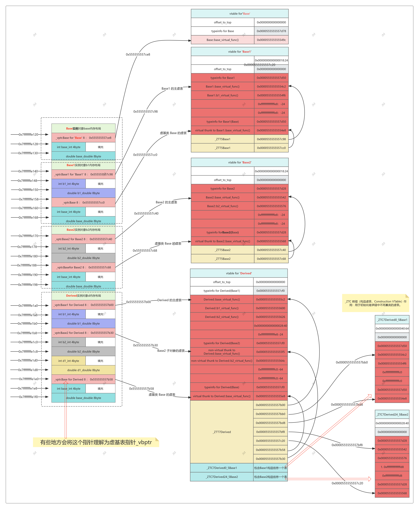

# 十三、类实例对象如果在堆上

## 代码样例：****

```cpp
#include <iostream>

// 第一个基类（包含纯虚函数）
class Base1 {
public:
  int b1_int = 1;
  double b1_double = 1.1;
public:
  virtual void b1_pure_virtual() = 0;
  virtual void b1_virtual_func() { 
    std::cout << "Base1::b1_virtual_func()\n";
  }
  void b1_normal_func() {
    std::cout << "Base1::b1_normal_func()\n";
  }
};

// 第二个基类（包含纯虚函数）
class Base2 {
public:
  int b2_int = 2;
  double b2_double = 2.2;
public:
  virtual void b2_pure_virtual() = 0;
  virtual void b2_virtual_func() {
    std::cout << "Base2::b2_virtual_func()\n";
  }
  void b2_normal_func() {
    std::cout << "Base2::b2_normal_func()\n";
  }
};

// 派生类（多继承）
class Derived1 : public Base1, public Base2 {
public:
  int d1_int = 1;
  double d1_double = 1.1;
public:
  void b1_pure_virtual() override {
    std::cout << "Derived1::b1_pure_virtual()\n";
  }
  void b2_pure_virtual() override {
    std::cout << "Derived1::b2_pure_virtual()\n";
  }
  void b1_virtual_func() override {
    std::cout << "Derived1::b1_virtual_func()\n";
  }
  void d1_normal_func() {
    std::cout << "Derived1::d1_normal_func()\n";
  }
};

// 派生类（多继承）
class Derived2 : public Derived1 {
public:
  int d2_int = 2;
  double d2_double = 2.2;
public:
  void b1_pure_virtual() override {
    std::cout << "Derived2::b1_pure_virtual()\n";
  }
  void b2_pure_virtual() override {
    std::cout << "Derived2::b2_pure_virtual()\n";
  }
  void b2_virtual_func() override {
    std::cout << "Derived2::b2_virtual_func()\n";
  }
  void d2_normal_func() {
    std::cout << "Derived2::d2_normal_func()\n";
  }
};

int main() {
  // ========== 关键修改点 ==========
  // 使用 new 在堆上分配对象
  Derived1* d1 = new Derived1();
  Derived2* d2 = new Derived2();

  // 测试 Derived1 对象
  std::cout << "===== Testing Derived1 =====" << std::endl;
  std::cout << "\n[Member Functions]" << std::endl;
  d1->b1_pure_virtual();        // Derived1::b1_pure_virtual()
  d1->b2_pure_virtual();        // Derived1::b2_pure_virtual()
  d1->b1_virtual_func();        // Derived1::b1_virtual_func()
  d1->b2_virtual_func();        // Base2::b2_virtual_func()
  d1->b1_normal_func();         // Base1::b1_normal_func()
  d1->b2_normal_func();         // Base2::b2_normal_func()
  d1->d1_normal_func();         // Derived1::d1_normal_func()

  // 测试 Derived2 对象
  std::cout << "\n\n===== Testing Derived2 =====" << std::endl;
  std::cout << "\n[Member Functions]" << std::endl;
  d2->b1_pure_virtual();        // Derived2::b1_pure_virtual()
  d2->b2_pure_virtual();        // Derived2::b2_pure_virtual()
  d2->b1_virtual_func();        // Derived1::b1_virtual_func()
  d2->b2_virtual_func();        // Derived2::b2_virtual_func()
  d2->b1_normal_func();         // Base1::b1_normal_func()
  d2->b2_normal_func();         // Base2::b2_normal_func()
  d2->d1_normal_func();         // Derived1::d1_normal_func()
  d2->d2_normal_func();         // Derived2::d2_normal_func()

  // ========== 释放堆内存 ==========
  delete d1;
  delete d2;

  return 0;
}
```

## 内存布局

> gdb查看内存布局

```c
(gdb) p d1
$1 = (Derived1 *) 0x55555556aeb0
(gdb) p d2
$2 = (Derived2 *) 0x55555556af00
(gdb) p &d1
$3 = (Derived1 **) 0x7fffffffe1e0
(gdb) p &d2
$4 = (Derived2 **) 0x7fffffffe1e8
############################################################
(gdb) ptype /o d1
type = class Derived1 : public Base1, public Base2 {
                         public:
/*   48      |     4 */    int d1_int;
/* XXX  4-byte hole  */
/*   56      |     8 */    double d1_double;

                           /* total size (bytes):   64 */
                         } *
(gdb) ptype /o d2
type = class Derived2 : public Derived1 {
                         public:
/*   64      |     4 */    int d2_int;
/* XXX  4-byte hole  */
/*   72      |     8 */    double d2_double;

                           /* total size (bytes):   80 */
                         } *
############################################################
(gdb) ptype *d1
type = class Derived1 : public Base1, public Base2 {
  public:
    int d1_int;
    double d1_double;

    virtual void b1_pure_virtual(void);
    virtual void b2_pure_virtual(void);
    virtual void b1_virtual_func(void);
    void d1_normal_func(void);
}
(gdb) ptype *d2
type = class Derived2 : public Derived1 {
  public:
    int d2_int;
    double d2_double;

    virtual void b1_pure_virtual(void);
    virtual void b2_pure_virtual(void);
    virtual void b2_virtual_func(void);
    void d2_normal_func(void);
}
############################################################
(gdb) p *d1
$5 = {<Base1> = {_vptr.Base1 = 0x555555557c98 <vtable for Derived1+16>, b1_int = 1, 
    b1_double = 1.1000000000000001}, <Base2> = {
    _vptr.Base2 = 0x555555557cc0 <vtable for Derived1+56>, b2_int = 2, 
    b2_double = 2.2000000000000002}, d1_int = 1, d1_double = 1.1000000000000001}
(gdb) p *d2
$6 = {<Derived1> = {<Base1> = {
      _vptr.Base1 = 0x555555557c48 <vtable for Derived2+16>, b1_int = 1, 
      b1_double = 1.1000000000000001}, <Base2> = {
      _vptr.Base2 = 0x555555557c78 <vtable for Derived2+64>, b2_int = 2, 
      b2_double = 2.2000000000000002}, d1_int = 1, d1_double = 1.1000000000000001}, 
  d2_int = 2, d2_double = 2.2000000000000002}
############################################################
  (gdb) info vtbl d1
vtable for 'Derived1' @ 0x555555557c98 (subobject @ 0x55555556aeb0):
[0]: 0x55555555559e <Derived1::b1_pure_virtual()>
[1]: 0x5555555555f4 <Derived1::b1_virtual_func()>
[2]: 0x5555555555c4 <Derived1::b2_pure_virtual()>

vtable for 'Base2' @ 0x555555557cc0 (subobject @ 0x55555556aec8):
[0]: 0x5555555555ea <non-virtual thunk to Derived1::b2_pure_virtual()>
[1]: 0x555555555552 <Base2::b2_virtual_func()>
(gdb) info vtbl d2
vtable for 'Derived2' @ 0x555555557c48 (subobject @ 0x55555556af00):
[0]: 0x555555555640 <Derived2::b1_pure_virtual()>
[1]: 0x5555555555f4 <Derived1::b1_virtual_func()>
[2]: 0x555555555666 <Derived2::b2_pure_virtual()>
[3]: 0x555555555696 <Derived2::b2_virtual_func()>

vtable for 'Base2' @ 0x555555557c78 (subobject @ 0x55555556af18):
[0]: 0x55555555568c <non-virtual thunk to Derived2::b2_pure_virtual()>
[1]: 0x5555555556bc <non-virtual thunk to Derived2::b2_virtual_func()>

```
> 查看堆空间地址

```c
(gdb) info proc
process 222413
cmdline = '/home/skg/workspace/jm_other/cplus/code13'
cwd = '/home/skg/workspace/jm_other/cplus'
exe = '/home/skg/workspace/jm_other/cplus/code13'
(gdb) shell cat /proc/222413/maps
555555554000-555555555000 r--p 00000000 08:05 3411996                    /home/skg/workspace/jm_other/cplus/code13
555555559000-55555557a000 rw-p 00000000 00:00 0                          [heap]
7ffff7a68000-7ffff7a6c000 rw-p 00000000 00:00 0 
7ffff7a6c000-7ffff7a6f000 r--p 00000000 08:05 2623982                    /usr/lib/x86_64-linux-gnu/libgcc_s.so.1
7ffff7fc9000-7ffff7fcd000 r--p 00000000 00:00 0                          [vvar]
7ffff7fcd000-7ffff7fcf000 r-xp 00000000 00:00 0                          [vdso]

7ffffffde000-7ffffffff000 rw-p 00000000 00:00 0                          [stack]
ffffffffff600000-ffffffffff601000 --xp 00000000 00:00 0                  [vsyscall]

info target
        0x0000555555555100 - 0x0000555555555895 is .text
        0x0000555555555898 - 0x00005555555558a5 is .fini
        0x0000555555556000 - 0x00005555555561e0 is .rodata
                          ...
        0x00005555555562d0 - 0x0000555555556658 is .eh_frame
        0x0000555555557c20 - 0x0000555555557c30 is .init_array
        0x0000555555557c30 - 0x0000555555557c38 is .fini_array
        0x0000555555557c38 - 0x0000555555557d80 is .data.rel.ro
        0x0000555555557d80 - 0x0000555555557f80 is .dynamic
        0x0000555555557f80 - 0x0000555555558000 is .got
        0x0000555555558000 - 0x0000555555558010 is .data
        0x0000555555558040 - 0x0000555555558158 is .bss                        【最高地址是  558158】
                          ...
        0x00007ffff7fcf2a8 - 0x00007ffff7fcf2c8 is .note.gnu.property in /lib64/ld-linux-x86-64.so.2
        0x00007ffff7fcf2c8 - 0x00007ffff7fcf2ec is .note.gnu.build-id in /lib64/ld-linux-x86-64.so.2

(gdb) p d1
$1 = (Derived1 *) 0x55555556aeb0 在堆中
(gdb) p d2
$2 = (Derived2 *) 0x55555556af00
(gdb) p &d1
$3 = (Derived1 **) 0x7fffffffe1e0 在栈中
(gdb) p &d2
$4 = (Derived2 **) 0x7fffffffe1e8
```
exit
> 观察上述调试代码，可以看到d1对象在堆中，指向的d1的指针在栈中，

| 地址高低 | 堆地址空间  | 栈地址空间  | d1,d2指针地址           | d1,d2对象地址           | 数据段地址  | 备注               |
|------|--------|--------|---------------------|---------------------|--------|------------------|
| 低地址  |        |        |                     |                     | 556000 | 数据段地址起始地址        |
|      |        |        |                     |                     | ...    |                  |
|      |        |        |                     |                     | 558158 | 数据段地址终止地址        |
|      | 559000 |        |                     |                     |        | 堆地址起始地址          |
|      | ...    |        |                     | d1:56ae60,d2:56af00 |        | 对象存放地址           |
|      | 57a000 |        |                     |                     |        | 堆地址终止地址          |
|      |        | fde000 |                     |                     |        | 栈地址起始地址          |
|      |        | ...    | d1:ffe1e0,d2:ffe1e8 |                     |        | 对象指针存放地址，指向堆对象地址 |
| 高地址  |        | fff000 |                     |                     |        | 栈地址起始地址          |

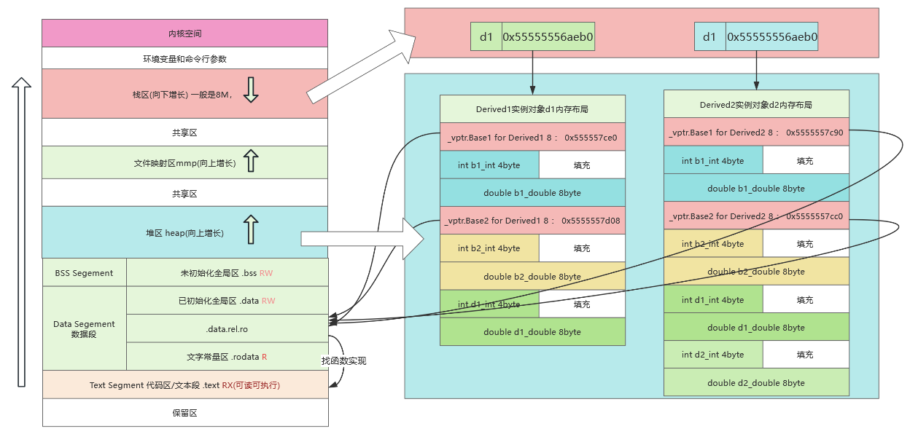


# 十四，lambda对象内存模型

## 代码示例
```cpp
#include <iostream>
#include <string>
#include <vector>

struct ComplexData {
  int id;
  std::string tag;
  std::vector<float> values;
};

int main() {
  int counter = 100;
  double factor = 3.14;
  ComplexData data{42, "lambda", {1.1, 2.2}};
  std::string& ref_str = data.tag;

  // 三层嵌套的复杂lambda
  auto outer_lambda = [=, &ref_str, data](const std::string& param) mutable {
    auto middle_lambda = [&counter, factor, this_data = data]() {
      auto inner_lambda = [this_data, &factor]() {
        std::cout << this_data.id << factor << std::endl;
        return this_data.values.size();
      };
      return inner_lambda;
    };

    data.id += ::atoi(param.c_str());
    ref_str += "_modified";
    return middle_lambda;
  };

  auto result = outer_lambda("5");  // 在此设置断点
  std::cout << "Result: " << result()() << std::endl;
  return 0;
}
```

## 内存模型

> gdb调试信息

```c

(gdb) ptype /o inner_lambda
/* offset    |  size */  type = struct <lambda(const string&)>::<lambda()>::<lambda()> {
/*    0      |    64 */    const struct ComplexData {
/*    0      |     4 */        int id;
/* XXX  4-byte hole  */
/*    8      |    32 */        std::string tag;
/*   40      |    24 */        std::vector<float> values;

                               /* total size (bytes):   64 */
                           } __this_data;
/*   64      |     8 */    const double &__factor;

                           /* total size (bytes):   72 */
                         }
(gdb) ptype /o middle_lambda
/* offset    |  size */  type = struct <lambda(const string&)>::<lambda()> {
/*    0      |     8 */    int &__counter;
/*    8      |     8 */    double __factor;
/*   16      |    64 */    struct ComplexData {
/*   16      |     4 */        int id;
/* XXX  4-byte hole  */
/*   24      |    32 */        std::string tag;
/*   56      |    24 */        std::vector<float> values;

                               /* total size (bytes):   64 */
                           } __this_data;

                           /* total size (bytes):   80 */
                         }
(gdb) ptype /o outer_lambda
/* offset    |  size */  type = struct <lambda(const string&)> {
/*    0      |     8 */    std::string &__ref_str;
/*    8      |    64 */    struct ComplexData {
/*    8      |     4 */        int id;
/* XXX  4-byte hole  */
/*   16      |    32 */        std::string tag;
/*   48      |    24 */        std::vector<float> values;

                               /* total size (bytes):   64 */
                           } __data;
/*   72      |     4 */    int __counter;
/* XXX  4-byte hole  */
/*   80      |     8 */    double __factor;

                           /* total size (bytes):   88 */
                         }

(gdb) ptype  inner_lambda
type = struct <lambda(const string&)>::<lambda()>::<lambda()> {
    const ComplexData __this_data;
    const double &__factor;
}
(gdb) ptype middle_lambda
type = struct <lambda(const string&)>::<lambda()> {
    int &__counter;
    double __factor;
    ComplexData __this_data;
}
(gdb) ptype outer_lambda
type = struct <lambda(const string&)> {
    std::string &__ref_str;
    ComplexData __data;
    int __counter;
    double __factor;
}

```

> **Lambda内存布局规则与特点**
> 
> **1. 闭包类型生成规则**
- 每个Lambda表达式会生成唯一的匿名类（闭包类型）,这里是结构体
- 捕获的变量按`捕获模式`成为类的成员变量
- 成员变量按`捕获顺序`排列（编译器可能优化顺序）

> **2. 内存布局特点**

| 捕获方式       | 内存存储形式                   | 生命周期依赖        |
|----------------|-------------------------------|-------------------|
| `[=]` 值捕获   | 成员变量存储值的副本           | 独立于原变量       |
| `[&]` 引用捕获 | 成员变量存储指针/引用          | 依赖原变量生命周期 |
| 显式捕获       | 按指定方式存储（如`this_data`）| 与捕获方式一致     |

#### **3. 嵌套Lambda结构**
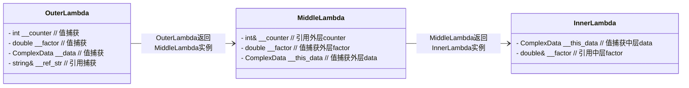


