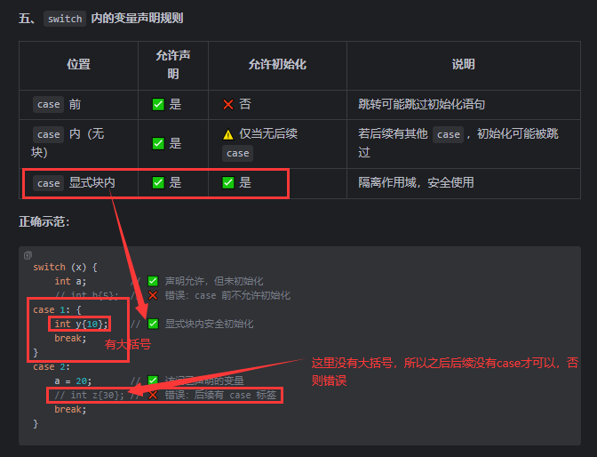
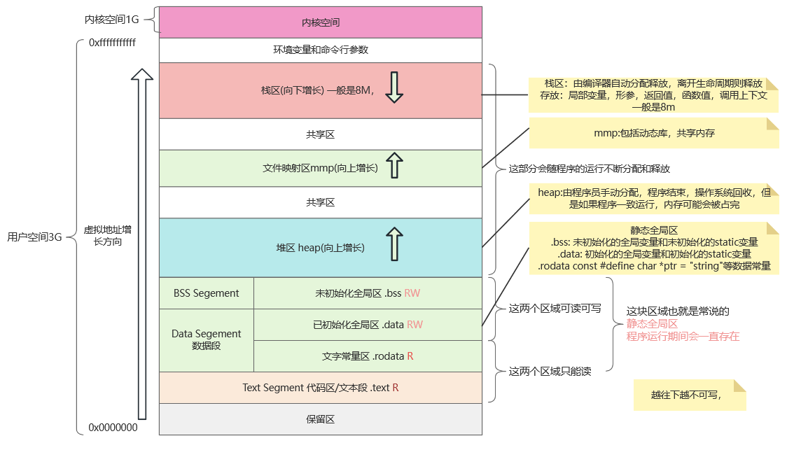
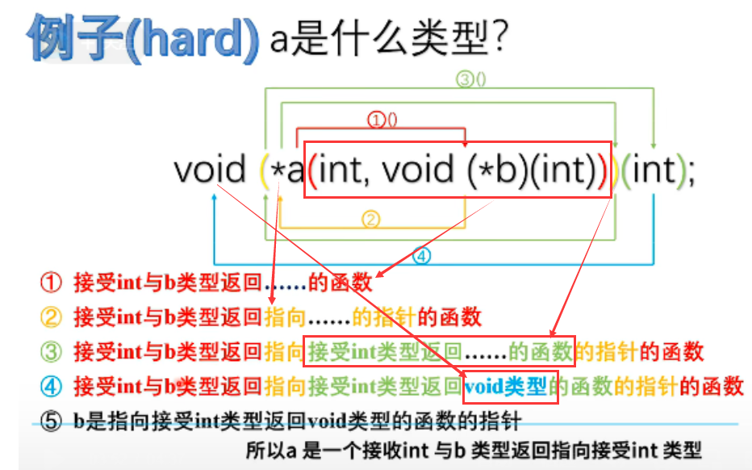

# 基础知识,零散知识收集，多个知识点结合理解

> 需要特别明确了解的知识点：
> 包含的知识点比较零碎

### 1.多种初始化方法：

1. **默认初始化**：未提供初始值。
2. **拷贝初始化**：使用等号进行初始化。
3. **直接初始化**：使用括号进行初始化。
4. **列表初始化（C++11起）**：使用花括号进行初始化。

### 2.命名规则

### 3.字面值

### 4.前向声明和单定义规则

### 5.命名空间：

    * [命名冲突和名称空间简介](###命名冲突和名称空间简介)
      * [命名冲突](###命名冲突)
      * [名称空间](###名称空间)
      * [全局命名空间](###全局命名空间)
      * [标准命名空间 `std`](###标准命名空间-std)

避免使用 using指令 例如 `using namespace std`
尽量使用 std::的方式

### 6.预处理

- **预处理**：编译前的步骤，对源代码进行文本替换等操作。
- **翻译单元**：经过预处理后的源文件内容（包括通过`#include`插入的内容），是编译器的基本编译单位。
- **格式**：以`#`开头，以换行符结束，不使用分号。
- **宏定义 (`#define`)**：
    - **对象样式的宏**：用于简单的文本替换。
    - **函数样式的宏**：模拟函数调用，但无类型检查和参数安全。
- **条件编译**：基于是否定义了某些宏来选择性地编译代码段。常用指令包括`#ifdef`, `#ifndef`, `#endif`等。
- **`#if 0`...`#endif`**：用于注释掉大块代码，方便临时排除部分代码不参与编译。

### 7.头文件

- <>和""引入头文件的区别
- 标准库iostream和iostream.h是两个库
- 头文件保护和#pragma once 避免头文件被多次包含
- 前向声明和头文件引入结合使用提高编译效率

### 8.C++不支持函数中嵌套函数

### 9.Switch Fallthrough机制与作用域

C++17之后，通过 [[fallthrough]] 属性标记有意穿透的代码，消除编译器警告
switch 整体视为一个作用域，case 标签不会创建隐式代码块，所有 case 内的变量共享同一作用域。



### 10. 迭代器

|      | 详情                                                             |
|------|----------------------------------------------------------------|
| 优点   | 提供统一遍历接口，隐藏容器内部实现，支持多种容器类型                                     |
| 缺点   | 需注意迭代器失效问题，某些操作（如指针算术）会使代码难理解                                  |
| 最佳实践 | 优先使用基于范围的 `for` 循环，避免遍历时修改容器，使用标准库迭代器接口（如 `begin()` 和 `end()`） |

```c++
    std::vector v{ 0, 1, 2, 3 };
    for (auto num : v)
    {
        if (num % 2 == 0)
            v.push_back(num + 1); // 修改容器，导致迭代器失效
    }
```

| 特性      | 指针作为迭代器      | 标准库迭代器  | 基于范围的 for 循环               |
|---------|--------------|---------|----------------------------|
| 适用容器    | 连续存储的容器（如数组） | 所有标准库容器 | 支持 `begin()` 和 `end()` 的容器 |
| 语法复杂度   | 较高           | 中等      | 低                          |
| 迭代器失效风险 | 高            | 中等      | 中等                         |
| 代码可读性   | 低            | 高       | 高                          |

### 11.内存管理



### 12. void指针

### 总结

| 方面   | 详情                                                                                                      |
|------|---------------------------------------------------------------------------------------------------------|
| 定义   | `void` 指针是一种特殊指针类型，也称为泛型指针，可指向任何数据类型的对象，用于在不知具体类型时进行数据传递或存储                                             |
| 声明   | `void* ptr{};` 可声明一个 `void` 指针                                                                          |
| 赋值   | 能指向任何类型的对象，如 `int`、`float`、自定义结构体等                                                                      |
| 使用   | - 不能直接解引用，直接解引用会导致编译错误<br>- 需先将其转换为具体指针类型才能解引用，如 `int* intPtr{static_cast<int*>(voidPtr)};`             |
| 实际示例 | 通过函数结合枚举类型，根据传入的类型信息将 `void` 指针转换为具体类型指针，从而处理不同类型的数据                                                    |
| 注意事项 | - 可设置为 `nullptr`<br>- `delete` 操作会导致未定义行为，应先转换回原类型<br>- 不能进行指针运算，因其不包含大小信息<br>- 不存在 `void` 引用，引用必须有明确类型 |
| 结论   | `void` 指针虽灵活，但缺乏类型安全，易导致错误。现代 C++ 有更安全的替代方案（如函数重载和模板），使用时应谨慎，无更好方案时才考虑使用                                | 

### 13.函数指针（声明的理解）

| 类别                 | 详情                                                                      | 示例                                                                                                                                                                                       |
|--------------------|-------------------------------------------------------------------------|------------------------------------------------------------------------------------------------------------------------------------------------------------------------------------------|
| 定义                 | 指向函数的指针，可动态调用函数或作为参数传递给其他函数                                             | - 基本语法：`int (*fcnPtr)();`<br>- 常量函数指针：`int (*const fcnPtr)();`                                                                                                                           |
| 解析复杂声明             | 使用“螺旋法则”，从标识符开始，先右后左递归解析                                                | <br/>以 `a` 声明为例，最终理解为 `a` 是一个函数，接收 `int` 类型和指向接收 `int` 类型、返回 `void` 类型的函数指针，返回指向接收 `int` 类型、返回 `void` 类型的函数指针的函数                                                |
| 赋值与初始化             | - 可赋值指向不同函数<br>- `&` 可省略，会隐式转换<br>- 可初始化为 `nullptr`                     | - `int (*fcnPtr)() = &foo; fcnPtr = &goo;`<br>- `int (*fcnPtr5)() = foo;`<br>- `int (*fcnPtr)() = nullptr;`                                                                              |
| 调用函数               | - 显式解引用：`(*fcnPtr)(5)`<br>- 隐式解引用：`fcnPtr(5)`<br>- 安全调用：检查是否为 `nullptr` | - `int (*fcnPtr)(int) = &foo; (*fcnPtr)(5);`<br>- `int (*fcnPtr)(int) = &foo; fcnPtr(5);`<br>- `if (fcnPtr) fcnPtr(5);`                                                                  |
| 默认参数               | 通过函数指针调用函数不会应用默认参数                                                      | `using fnptr = void(*)(int); fnptr pi = print; pi(1);`                                                                                                                                   |
| 函数作为参数             | 常用于将函数作为参数传递给其他函数，如排序算法中的回调函数                                           | `void selectionSort(int* array, int size, bool (*comparisonFcn)(int, int));`<br>`bool ascending(int x, int y); bool descending(int x, int y);`<br>`selectionSort(array, 9, descending);` |
| 使用 `std::function` | 提供更简洁和类型安全的方式处理函数指针                                                     | `std::function<int()> fcnPtr{ &foo }; fcnPtr = &goo; std::cout << fcnPtr() << '\n';`                                                                                                     |
| 类型推导与 `auto`       | 使用 `auto` 简化函数指针声明                                                      | `auto fcnPtr{ &foo };`                                                                                                                                                                   |
| 结论                 | 函数指针在动态调用或传递函数时有用，但语法复杂，使用 `std::function` 和类型别名可提高代码可读性和安全性            | -                                                                                                                                                                                        |

### 14.命令行参数

| 类别            | 详情                                                                                      |
|---------------|-----------------------------------------------------------------------------------------|
| 为什么需要命令行参数    | 允许用户在启动程序时传递输入，适用于自动化任务、批量文件处理或服务器环境运行程序                                                |
| 示例：需要用户输入的程序  | 生成图像缩略图程序，运行时等待用户输入文件名，不适合批量处理或自动化                                                      |
| 使用命令行参数       | - **传递参数**：在命令行中参数跟随程序名，多个参数用空格分隔<br>- **从IDE传递参数**：如在Visual Studio中通过项目属性设置            |
| `main()`函数的变体 | `int main(int argc, char* argv[])`，`argc`表示参数数量（至少为1），`argv`是指针数组，每个元素指向一个C风格字符串（即每个参数） |
| 示例程序：打印命令行参数  | 编写程序打印`argc`和`argv`内容，`argv[0]`是程序本身路径和名称                                               |
| 处理数值参数        | 命令行参数是字符串，需转换为数字，转换失败时可设默认值                                                             |
| 操作系统的预处理      | - **引号处理**：引号内内容作为单一参数<br>- **转义字符**：用反斜杠包含引号                                           |
| 结论            | 命令行参数提供灵活输入方式，可提高程序自动化和批处理能力，设计程序时要验证参数有效性                                              | 

### 15.省略号 ...

| 类别          | 详情                                                                                                                                                                    |
|-------------|-----------------------------------------------------------------------------------------------------------------------------------------------------------------------|
| 省略号与可变参数的定义 | 省略号允许函数接受不定数量参数，函数基本形式为 `返回类型 函数名(正常参数列表, ...)`，必须至少有一个非省略号参数，省略号必须是参数列表最后一个参数                                                                                        |
| 使用省略号的示例    | 计算整数平均值的函数 `findAverage`，通过 `va_list`、`va_start`、`va_arg` 和 `va_end` 来访问和处理可变参数                                                                                       |
| 访问省略号参数     | - 使用 `va_list` 类型变量存储参数列表<br>- `va_start(list, count)` 初始化 `va_list`，`count` 为已知参数数量<br>- `va_arg(list, int)` 获取下一个参数，第二个参数指定获取参数的类型<br>- `va_end(list)` 清理 `va_list` |
| 省略号的危险性     | - **缺乏类型检查**：编译器不检查省略号参数类型，可能传递错误类型数据，导致结果异常<br>- **不知道参数数量**：需要额外机制确定参数数量，如传递长度参数（依赖准确传递数量）、使用哨兵值（需注意特殊值选择）、使用解码字符串（描述参数类型和数量）                                       |
| 安全使用省略号的建议  | - **尽量避免使用**：优先用传递动态数组、C++17 折叠表达式和可变参数模板等替代方案<br>- **确保参数类型一致**：若必须使用，保证所有省略号参数类型相同<br>- **使用计数参数或解码字符串**：比哨兵值更安全，能强制用户正确提供参数信息                                      |
| 高级选项        | C++11 可变参数模板提供更类型安全的可变参数处理方式，C++17 折叠表达式进一步简化其使用                                                                                                                      |
| 总结          | 省略号提供灵活性，但存在复杂性和安全隐患，现代 C++ 应优先选择更安全的替代方案                                                                                                                             | 

### 16.lambda

#### 1. 基础概念

| **特性**     | **描述**                                        |
|------------|-----------------------------------------------|
| **定义**     | 匿名函数，允许在代码中内联定义，避免全局污染，提升可读性。                 |
| **基本结构**   | `[捕获列表](参数列表) -> 返回类型 { 函数体 }`                |
| **返回类型推导** | 可省略,会自动推导为`auto`，由编译器根据`return`推导；若推导冲突需显式声明。 |
| **类型特性**   | 每个Lambda有唯一类型；无法显式声明类型。                       |

#### 2. 捕获机制

| **捕获方式**   | **语法/行为**                       | **注意事项**                     |
|------------|---------------------------------|------------------------------|
| **按值捕获**   | `[var]` 创建变量副本                  | 默认const，需`mutable`关键字才能修改副本。 |
| **按引用捕获**  | `[&var]` 引用外部变量                 | 需确保变量生命周期覆盖Lambda使用期。        |
| **默认捕获**   | `[=]`（按值）或 `[&]`（按引用）捕获所有可见变量   | 易导致意外捕获，建议显式指定变量。            |
| **混合捕获**   | `[var, &ref]` 组合使用              | 可同时捕获多个变量。                   |
| **捕获时初始化** | `[var=expr]` 在捕获列表中定义新变量（C++14） | 支持表达式初始化。                    |

#### 3. Lambda存储与传递

| **方式**              | **语法示例**                                   | **限制**                |
|---------------------|--------------------------------------------|-----------------------|
| **函数指针**            | `void (*fp)(int) = [](int){};`             | 仅限无捕获的Lambda。         |
| **`std::function`** | `std::function<void(int)> fn = [](int){};` | 可处理有捕获的Lambda，但有性能开销。 |
| **模板参数**            | `template<typename T> void foo(T&& fn)`    | 高效，泛用性强。              |
| **C++20 `auto`参数**  | `void foo(auto&& fn)`                      | 简化模板语法。               |

#### 4. 高级特性

| **特性**                 | **描述**                  | **示例**                                                 |
|------------------------|-------------------------|--------------------------------------------------------|
| **泛型Lambda**           | 参数使用`auto`（C++14起）      | `[](const auto& a, const auto& b) { return a < b; }`   |
| **`constexpr` Lambda** | 可在编译期求值（C++17起）         | `constexpr auto square = [](int x) { return x * x; };` |
| **静态变量**               | 泛型Lambda中，不同实例拥有独立静态变量。 | `auto print = [](auto v) { static int cnt; ... };`     |

#### 5. 注意事项与最佳实践

| **问题/建议**      | **说明**                                                                                                        |
|----------------|---------------------------------------------------------------------------------------------------------------|
| **悬空引用**       | 避免捕获局部变量的引用（如返回Lambda时捕获局部变量）。                                                                                |
| **可变Lambda副本** | 使用 `mutable` 关键字可以使捕获的变量在 lambda 内可修改。<br/>复制可变Lambda会生成独立副本，导致状态不一致。 <br/>`auto shoot = [ammo]() mutable {}` |
| **性能优化**       | 优先使用`auto`或模板存储Lambda，避免`std::function`的开销。                                                                   |
| **代码可读性**      | 复杂逻辑建议使用命名函数，简单逻辑使用Lambda。                                                                                    |

#### 6. 标准库结合示例

| **场景**             | **代码示例**                                                                  |
|--------------------|---------------------------------------------------------------------------|
| **`std::find_if`** | `std::find_if(arr.begin(), arr.end(), [](auto s) { return s.find(x); });` |
| **`std::sort`**    | `std::sort(arr.begin(), arr.end(), std::greater{});`                      |

### 17.C++ 构造函数详解：默认、拷贝、赋值、移动

| **构造函数/运算符** | **关键特性**      | **性能**    | **适用场景**    |
|--------------|---------------|-----------|-------------|
| **默认构造函数**   | 无参或默认参数初始化    | 低开销       | 创建未初始化的对象   |
| **拷贝构造函数**   | 深拷贝资源，复制所有数据  | 高开销（深拷贝）  | 对象初始化或按值传递  |
| **拷贝赋值运算符**  | 释放旧资源后深拷贝新数据  | 高开销（深拷贝）  | 对象赋值操作      |
| **移动构造函数**   | 转移资源所有权，原对象置空 | 低开销（指针操作） | 临时对象或显式移动语义 |
| **移动赋值运算符**  | 释放当前资源后接管新资源  | 低开销（指针操作） | 高效赋值临时对象    |

1. **Rule of Five**：若定义了拷贝构造函数、拷贝赋值运算符、移动构造函数、移动赋值运算符或析构函数中的任意一个，应同时定义其他四个。
2. **优先使用 `= default`**：对不需要特殊处理的构造函数/运算符，使用 `= default` 让编译器生成。
3. **移动操作标记 `noexcept`**：确保容器（如 `std::vector`）能高效使用移动语义。
4. **避免返回局部对象的引用**：返回值优化（RVO）通常比移动更高效。