# 目录

<!-- TOC -->
* [目录](#目录)
* [0. 几个问题](#0-几个问题)
* [1. 什么是浮点数](#1-什么是浮点数)
* [2. 浮点数的形式](#2-浮点数的形式)
* [3. 浮点数的数学形式](#3-浮点数的数学形式)
* [4. 小数的二进制和十进制转换](#4-小数的二进制和十进制转换)
    * [1. 二进制小数转十进制小数](#1-二进制小数转十进制小数)
        * [示例](#示例)
    * [2. 十进制小数转二进制小数](#2-十进制小数转二进制小数)
        * [示例](#示例-1)
    * [3. 十进制整数转二进制整数](#3-十进制整数转二进制整数)
        * [示例](#示例-2)
* [5. 经典问题：0.1 + 0.2 = 0.30000000000000004](#5-经典问题01--02--030000000000000004)
    * [1. 浮点数在计算机中的表示](#1-浮点数在计算机中的表示)
    * [示例：0.1 和 0.2 的二进制表示](#示例01-和-02-的二进制表示)
* [6. 浮点数的 IEEE754 表示](#6-浮点数的-ieee754-表示)
    * [IEEE 754 浮点数的存储方式](#ieee-754-浮点数的存储方式)
    * [1. 浮点数的构成](#1-浮点数的构成)
    * [2. 尾数部分的存储](#2-尾数部分的存储)
        * [规范化浮点数（Normal Number）](#规范化浮点数normal-number)
    * [3. 指数部分的存储](#3-指数部分的存储)
        * [有偏指数（Biased Exponent）](#有偏指数biased-exponent)
            * [示例](#示例-3)
    * [4. 浮点数的精度](#4-浮点数的精度)
    * [5. 示例：十进制数 0.15625 的存储](#5-示例十进制数-015625-的存储)
        * [1. 符号位（Sign）](#1-符号位sign)
        * [2. 尾数部分（Mantissa/Significand）](#2-尾数部分mantissasignificand)
            * [（1）将十进制数转换为二进制](#1将十进制数转换为二进制)
            * [（2）规范化尾数](#2规范化尾数)
            * [（3）存储尾数部分](#3存储尾数部分)
        * [3. 指数部分（Exponent）](#3-指数部分exponent)
            * [（1）计算实际指数](#1计算实际指数)
            * [（2）计算有偏指数（Biased Exponent）](#2计算有偏指数biased-exponent)
            * [（3）将有偏指数转换为二进制](#3将有偏指数转换为二进制)
        * [4. 最终的内存表示](#4-最终的内存表示)
        * [5. 总结](#5-总结)
    * [6. 示例： 十进制2.75的存储](#6-示例-十进制275的存储)
        * [1. 将十进制数转换为二进制](#1-将十进制数转换为二进制)
            * [（1）整数部分](#1整数部分)
            * [（2）小数部分](#2小数部分)
            * [（3）合并整数和小数部分](#3合并整数和小数部分)
        * [2. 规范化二进制数](#2-规范化二进制数)
        * [3. 计算有偏指数（Biased Exponent）](#3-计算有偏指数biased-exponent)
        * [4. 尾数部分](#4-尾数部分)
        * [5. 符号位](#5-符号位)
        * [6. 完整的二进制表示](#6-完整的二进制表示)
* [7. 程序确认下IEEE754的如上规定](#7-程序确认下ieee754的如上规定)
* [8. 再看 0.1+0.2 = 0.30000000000000004](#8-再看-0102--030000000000000004)
    * [无法精确表示的十进制小数](#无法精确表示的十进制小数)
    * [可以精确表示的十进制小数](#可以精确表示的十进制小数)
    * [二进制数的离散性](#二进制数的离散性)
    * [0.1 的单精度浮点数表示](#01-的单精度浮点数表示)
        * [1. **0.1 的二进制表示**](#1-01-的二进制表示)
        * [2. **IEEE 754 单精度浮点数表示**](#2-ieee-754-单精度浮点数表示)
            * [（1）符号位](#1符号位)
            * [（2）指数位](#2指数位)
            * [（3）尾数位](#3尾数位)
        * [3. **完整的单精度浮点数表示**](#3-完整的单精度浮点数表示)
        * [4. **0.1二进制转换为十进制**](#4-01二进制转换为十进制)
        * [5. **总结**](#5-总结-1)
* [9. 特殊值](#9-特殊值)
    * [1. **无穷大（Infinity）**](#1-无穷大infinity)
        * [表示方式](#表示方式)
        * [示例](#示例-4)
        * [特点](#特点)
    * [2. **NaN（非数，Not a Number）**](#2-nan非数not-a-number)
        * [表示方式](#表示方式-1)
        * [示例](#示例-5)
        * [特点](#特点-1)
* [10. 非规范化数（Denormal Number）](#10-非规范化数denormal-number)
    * [1. **零值（Zero）**](#1-零值zero)
        * [表示方式](#表示方式-2)
        * [示例](#示例-6)
        * [特点](#特点-2)
    * [2. 非规范化数](#2-非规范化数)
        * [1. **非规范化数的定义**](#1-非规范化数的定义)
        * [2. **非规范化数的表示**](#2-非规范化数的表示)
            * [（1）单精度浮点数（32 位）](#1单精度浮点数32-位)
            * [（2）双精度浮点数（64 位）](#2双精度浮点数64-位)
        * [3. **非规范化数的计算**](#3-非规范化数的计算)
            * [（1）指数部分](#1指数部分)
            * [（2）尾数部分](#2尾数部分)
            * [（3）值的计算](#3值的计算)
        * [4. **非规范化数的示例**](#4-非规范化数的示例)
            * [示例 1：单精度浮点数](#示例-1单精度浮点数)
            * [示例 2：双精度浮点数](#示例-2双精度浮点数)
        * [5. **非规范化数的作用**](#5-非规范化数的作用)
            * [（1）填补零和最小规范化数之间的空白](#1填补零和最小规范化数之间的空白)
            * [（2）避免突然下溢到零](#2避免突然下溢到零)
        * [6. **非规范化数的性能问题**](#6-非规范化数的性能问题)
* [11. 各种临界值的计算，二进制，十进制表示](#11-各种临界值的计算二进制十进制表示)
    * [单精度各种临界值示例：](#单精度各种临界值示例)
        * [1. 公式组成解释](#1-公式组成解释)
        * [2. 公式中尾数计算解释](#2-公式中尾数计算解释)
            * [1. **二进制尾数的十进制值**](#1-二进制尾数的十进制值)
            * [2. **公式推导**](#2-公式推导)
            * [3. **总结**](#3-总结)
        * [3. 形象表示为：](#3-形象表示为)
    * [双精度浮点数示例](#双精度浮点数示例)
        * [1. 公式组成解释](#1-公式组成解释-1)
        * [2. 形象表示为：](#2-形象表示为)
* [12. 规格化到非规范化数据是如何平滑过度的？](#12-规格化到非规范化数据是如何平滑过度的)
    * [1. **规范化数和非规范化数的定义**](#1-规范化数和非规范化数的定义)
    * [2. **平滑过渡的原理**](#2-平滑过渡的原理)
    * [3. **具体示例（单精度浮点数）**](#3-具体示例单精度浮点数)
    * [4. **双精度浮点数的平滑过渡**](#4-双精度浮点数的平滑过渡)
<!-- TOC -->


# 0. 几个问题

开始之前请思考如下问题：

1. 二进制 0.1，用十进制表示的话是多少？十进制的 0.1，用二进制表示又是多少？
2. 为什么 0.1 + 0.2 = 0.30000000000000004？
3. 单精度和双精度浮点数的有效小数位分别是多少？
   单精度浮点数能表示的范围是什么？
4. 浮点数为什么会存在 -0？infinity 和 NaN 又是怎么表示的？


# 1. 什么是浮点数

我们知道，数学中并没有浮点数的概念，虽然小数看起来像浮点数，但从不这么叫。那为什么计算机中不叫小数而叫浮点数呢？

因为资源的限制，数学中的小数无法直接在计算机中准确表示。为了更好地表示它，计算机科学家们发明了浮点数，这是对小数的近似表示。

也就是说浮点数是相对于定点数而言的，表示小数点位置是浮动的。比如 7.5 × 10、0.75 × 10² 等表示法，值一样，但小数点位置不一样。

具体来说，浮点数是指用符号、尾数、基数和指数这四部分来表示的小数。

> 浮点数是一种用于表示实数的计算机数据类型。它可以表示非常大或非常小的数，同时支持小数部分。浮点数的核心思想是通过科学计数法来表示数值，即用一个尾数（Mantissa）和一个指数（Exponent）来表示。

# 2. 浮点数的形式
浮点数的形式可以通过数学公式表示，并且其编码规则遵循 IEEE 754 标准。以下是详细说明：

---

# 3. 浮点数的数学形式
浮点数的数学形式可以表示为：

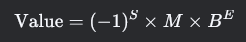

其中：
- \( S \)：符号位（Sign），决定数的正负。
    - \( S = 0 \) 表示正数。
    - \( S = 1 \) 表示负数。
- \( M \)：尾数（Mantissa），也称为有效数字（Significand），是一个小数。
- \( B \)：基数（Base），通常为 2（二进制）。
- \( E \)：指数（Exponent），表示基数的幂。

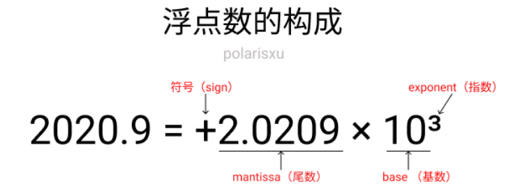

---

# 4. 小数的二进制和十进制转换

### 1. 二进制小数转十进制小数

二进制小数的每一位都有对应的位权，从小数点后第一位开始，位权依次为 \\(2^{-1}, 2^{-2}, 2^{-3}, \\ldots\\)。转换方法是将每一位的值与其位权相乘，然后相加。

##### 示例
将二进制小数 (0.101)₂ 转换为十进制小数：

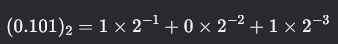

计算：

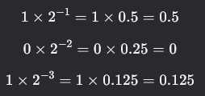

相加：

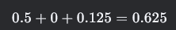

所以：

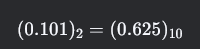


---

### 2. 十进制小数转二进制小数
十进制小数转二进制小数采用“乘 2 取整，顺序排列”法。具体步骤如下：
1. 将十进制小数乘以 2。
2. 记录结果的整数部分（0 或 1）。
3. 用结果的小数部分继续乘以 2，重复上述步骤，直到小数部分为 0 或达到所需精度。

##### 示例
将十进制小数 (0.625)₁₀ 转换为二进制小数：
1. \( 0.625 * 2 = 1.25 \) → 整数部分为 `1`，小数部分为 `0.25`。
2. \( 0.25 * 2 = 0.5 \) → 整数部分为 `0`，小数部分为 `0.5`。
3. \( 0.5 * 2 = 1.0 \) → 整数部分为 `1`，小数部分为 `0`。

将整数部分按顺序排列：

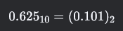

---

### 3. 十进制整数转二进制整数
十进制整数转二进制整数采用“除 2 取余，逆序排列”法。具体步骤如下：
1. 将十进制整数除以 2，记录余数（0 或 1）。
2. 用商继续除以 2，重复上述步骤，直到商为 0。
3. 将余数按逆序排列，得到二进制数。

##### 示例
将十进制整数 (11)₁₀转换为二进制整数：

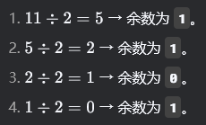


将余数按逆序排列：

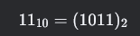

---


通过以上方法，可以实现二进制和十进制之间的相互转换。

# 5. 经典问题：0.1 + 0.2 = 0.30000000000000004

这个问题网上相关的讨论很多，甚至有专门的一个网站：https://0.30000000000000004.com/ 这个网站上有各门语言的 0.1 + 0.2 的结果。比如 C 语言：

```c
#include <stdio.h>

int main(int argc, char** argv) {
  printf("%.17f\n", .1 + .2);
  return 0;
}
```


结果都是 0.30000000000000004。

`0.1 + 0.2 = 0.30000000000000004` 是计算机中浮点数运算的一个经典问题，其根本原因是 **浮点数在计算机中的表示和运算存在精度限制**。以下是详细解释：

---

### 1. 浮点数在计算机中的表示
计算机使用二进制表示浮点数，而 IEEE 754 标准定义了浮点数的存储格式。对于十进制小数，很多数无法用有限的二进制小数精确表示，因此会产生精度误差。

### 示例：0.1 和 0.2 的二进制表示
- **0.1 的二进制表示**：
    - 十进制 \(0.1\) 转换为二进制是一个无限循环小数：

```c
    0.1 = 0.000 1100 1100 1100 1100 1100 1100 1100 1100 1100 1100 1100 11 ...
```
- 由于计算机存储位数有限（单精度 23 位尾数，双精度 52 位尾数），二进制表示会被截断，导致精度损失。

- **0.2 的二进制表示**：
    - 十进制 \(0.2\) 转换为二进制也是一个无限循环小数：
```c
    0.2 = 0.0011 0011 0011 0011 0011 0011 0011 0011 0011 0011 0011 0011 ...
```
- 同样，由于存储位数有限，二进制表示会被截断，导致精度损失。

---


# 6. 浮点数的 IEEE754 表示

### IEEE 754 浮点数的存储方式

IEEE 754 标准规定了浮点数的存储方式，主要包括符号位、指数部分和尾数部分。浮点数通常分为两种类型：**单精度浮点数（float）**和**双精度浮点数（double）**。

---

### 1. 浮点数的构成
浮点数由以下三部分构成：
1. **符号位（Sign）**：
- 1 位，表示数的正负。
- `0` 表示正数，`1` 表示负数。

2. **指数部分（Exponent）**：
- 单精度浮点数：8 位。
- 双精度浮点数：11 位。
- 采用**有偏指数（Biased Exponent）**表示法，避免使用符号位。

3. **尾数部分（Mantissa/Significand）**：
- 单精度浮点数：23 位。
- 双精度浮点数：52 位。
- 采用**规范化形式**存储，隐含前导 `1`。

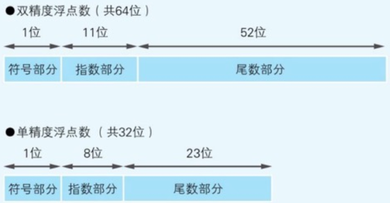

---

### 2. 尾数部分的存储


#### 规范化浮点数（Normal Number）
IEEE 754 规定，浮点数的尾数部分需要规范化，即将二进制数的小数点前固定为 `1`。例如：
- 十进制数 `0.15625` 的二进制表示为 `0.00101`。
- 通过右移 3 位，尾数部分变为 `1.01`，指数部分为 `-3`。

由于规范化后小数点前的 `1` 是固定的，因此可以省略不存储。实际存储的是小数点后的部分：
- 尾数部分存储为 `0100`（实际值为 `0.01`，十进制为 `0.25`）。
- 单精度浮点数的尾数部分实际为 24 位（隐含 `1` + 23 位存储）。
- 双精度浮点数的尾数部分实际为 53 位（隐含 `1` + 52 位存储）。


---

### 3. 指数部分的存储
#### 有偏指数（Biased Exponent）
为了避免使用符号位，IEEE 754 采用有偏指数表示法：

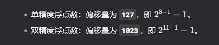

有偏指数 = 实际指数（阶码） + 偏移量。

实际指数（阶码） = 有偏指数 - 偏移量。

计算机二进制存储的时候主要用的有偏指数来代替实际指数，注意这两个公式的使用场景，如果你已经知道有偏指数的二进制表示，那么减去偏移量，就能知道实际指数，相反如果不知道二进制表示，那么就用计算得到的实际指数+偏移量

实际指数（阶码）是有正负的，因此单精度，8位的范围在[-126,127],偏移量为127 ，所以有偏指数的范围就在[1,254],计算机二进制存储就不用考虑正负号了

##### 示例
- 对于十进制数 `0.15625`，二进制表示为 `0.00101`，规范化后实际指数（阶码）为 `-3`。
- 单精度浮点数中，有偏指数为： -3 + 127 = 124
- 十进制的 `124` 转换为二进制为 `01111100`。

---

### 4. 浮点数的精度
尾数部分决定了浮点数的精度：
- **单精度浮点数**：
    - 尾数部分为 23 位，实际精度为 24 位。
    - 有效小数位约为 7 位十进制数。
- **双精度浮点数**：
    - 尾数部分为 52 位，实际精度为 53 位。
    - 有效小数位约为 15 位十进制数。

---

### 5. 示例：十进制数 0.15625 的存储


以下是 **十进制数 `0.15625` 的存储过程** 的详细步骤分解：

---

#### 1. 符号位（Sign）
- **规则**：
    - `0` 表示正数。
    - `1` 表示负数。
- **过程**：
    - 十进制数 `0.15625` 是正数。
    - 符号位为 `0`。

---

#### 2. 尾数部分（Mantissa/Significand）
##### （1）将十进制数转换为二进制
- 十进制数 `0.15625` 转换为二进制：
  0.15625 = 0.00101

    - 转换方法：乘 2 取整法。
        - \(0.15625 * 2 = 0.3125\) → 整数部分为 `0`。
        - \(0.3125 * 2 = 0.625\) → 整数部分为 `0`。
        - \(0.625 * 2 = 1.25\) → 整数部分为 `1`。
        - \(0.25 * 2 = 0.5\) → 整数部分为 `0`。
        - \(0.5 * 2 = 1.0\) → 整数部分为 `1`。
    - 结果为：`0.00101`。

##### （2）规范化尾数
- IEEE 754 规定，尾数部分需要规范化，即将小数点前的值固定为 `1`。
- 对于二进制数 `0.00101`，通过右移 3 位，使其变为 `1.01`：

- 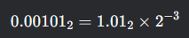

    - 规范化后的尾数为 `1.01`。
    - 实际指数为 `-3`。

##### （3）存储尾数部分
- 规范化后的尾数为 `1.01`，其中前导 `1` 是隐含的，不需要存储。
- 实际存储的是小数点后的部分：`01`。
- 单精度浮点数的尾数部分为 23 位，因此需要在 `01` 后面补零：
  `
  01000000000000000000000
  `

---

#### 3. 指数部分（Exponent）
##### （1）计算实际指数
- 规范化过程中，尾数右移了 3 位，因此实际指数为 `-3`。

##### （2）计算有偏指数（Biased Exponent）
- 单精度浮点数的偏移量为 `127`。
- 有偏指数 = 实际指数 + 偏移量：
  \[
  -3 + 127 = 124
  \]

##### （3）将有偏指数转换为二进制
- 十进制数 `124` 转换为二进制：
  \[
  124 = 01111100
  \]
    - 转换方法：除 2 取余法。
        - \(124 / 2 = 62\) → 余数为 `0`。
        - \(62 / 2 = 31\) → 余数为 `0`。
        - \(31 / 2 = 15\) → 余数为 `1`。
        - \(15 / 2 = 7\) → 余数为 `1`。
        - \(7 / 2 = 3\) → 余数为 `1`。
        - \(3 / 2 = 1\) → 余数为 `1`。
        - \(1 / 2 = 0\) → 余数为 `1`。
    - 结果为：`01111100`。最左边补了一个0

---

#### 4. 最终的内存表示
将符号位、指数部分和尾数部分组合起来，得到单精度浮点数的二进制表示：
- 符号位：`0`。
- 指数部分：`01111100`。
- 尾数部分：`01000000000000000000000`。

最终的内存表示为：

```c
0 01111100 01000000000000000000000
```

---

#### 5. 总结
- **符号位**：`0`（正数）。
- **指数部分**：
    - 实际指数为 `-3`。
    - 有偏指数为 `124`，二进制为 `01111100`。
- **尾数部分**：
    - 规范化后的尾数为 `1.01`。
    - 存储为 `01 000000000000000000000`。

通过以上步骤，十进制数 `0.15625` 被转换为 IEEE 754 单精度浮点数的二进制表示：
```c
0 01111100 01000000000000000000000
```

---

### 6. 示例： 十进制2.75的存储
#### 1. 将十进制数转换为二进制
##### （1）整数部分
- 十进制数 `2` 转换为二进制：
  2 => 10


##### （2）小数部分
- 十进制数 `0.75` 转换为二进制：

  0.75 => 0.11

    - 转换方法：乘 2 取整法。
        - \(0.75 * 2 = 1.5\) → 整数部分为 `1`。
        - \(0.5 * 2 = 1.0\) → 整数部分为 `1`。

##### （3）合并整数和小数部分
- 合并后：
  2.75 => 10.11


---

#### 2. 规范化二进制数
IEEE 754 规定，浮点数的尾数部分需要规范化，即将小数点前的值固定为 `1`。

- 将二进制数 `10.11` 规范化：

  \\( 10.11 = 1.011 * 2^1 \\)

    - 规范化后的尾数为 `1.011`。
    - 实际指数为 `1`。

---

#### 3. 计算有偏指数（Biased Exponent）
- 单精度浮点数的偏移量为 `127`。
- 实际指数为 `1`，因此有偏指数为：
  1 + 127 = 128

- 将 `128` 转换为二进制：
  128 => 10000000


---

#### 4. 尾数部分
- 规范化后的尾数为 `1.011`，其中前导 `1` 是隐含的，不需要存储。
- 实际存储的是小数点后的部分：`011`。
- 单精度浮点数的尾数部分为 23 位，因此需要在 `011` 后面补零：
  01100000000000000000000


---

#### 5. 符号位
- 十进制数 `2.75` 是正数，因此符号位为 `0`。

---

#### 6. 完整的二进制表示
将符号位、指数部分和尾数部分组合起来：
- 符号位：`0`。
- 指数部分：`10000000`。
- 尾数部分：`01100000000000000000000`。

完整的二进制表示为：
```c
0 10000000 01100000000000000000000

```

---


# 7. 程序确认下IEEE754的如上规定

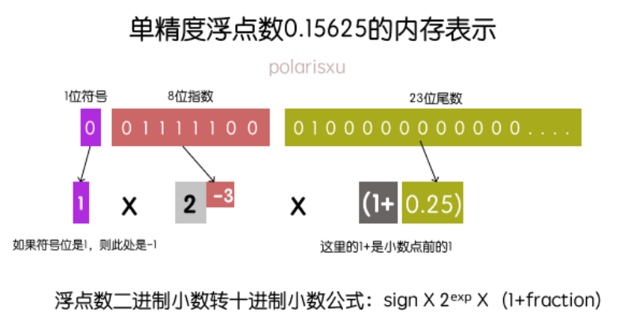

```C++
#include <iostream>
#include <bitset>
#include <cstring>

// 打印浮点数的二进制表示
void printFloatBinary(float f) {
  // 将浮点数的内存表示转换为无符号整数
  unsigned int binaryRepresentation;
  std::memcpy(&binaryRepresentation, &f, sizeof(f));

  // 打印二进制表示
  std::cout << "Binary:  " << std::bitset<32>(binaryRepresentation) << std::endl;
}

// 打印浮点数的十六进制表示
void printFloatHex(float f) {
  // 将浮点数的内存表示转换为无符号整数
  unsigned int hexRepresentation;
  std::memcpy(&hexRepresentation, &f, sizeof(f));

  // 打印十六进制表示
  std::cout << "Hex:     0x" << std::hex << hexRepresentation << std::endl;
}

int main() {
  float inputFloat;

  // 输入浮点数
  std::cout << "Enter a float number: ";
  std::cin >> inputFloat;

  // 打印二进制和十六进制表示
  printFloatBinary(inputFloat);
  printFloatHex(inputFloat);

  return 0;
}
```

# 8. 再看 0.1+0.2 = 0.30000000000000004

有了上面的知识，我们回过头看看这个经典的问题。（讨论单精度的情况，因此实际是 0.1+0.2 = 0.300000004）

在计算机中，许多十进制小数无法用有限的二进制小数精确表示，因为它们的二进制表示是无限循环的。以下是一些常见的十进制小数及其二进制表示形式（无法精确表示的部分用省略号代替）：

---

### 无法精确表示的十进制小数

| 十进制小数 | 二进制表示（无限循环）                        | 说明                                                                 |
|------------|------------------------------------|----------------------------------------------------------------------|
| 0.1        | 0.000 1100 1100 1100 1100 1100 ... | 二进制表示无限循环，无法精确表示。                                   |
| 0.2        | 0.0011 0011 0011 0011 0011 001...  | 二进制表示无限循环，无法精确表示。                                   |
| 0.3        | 0.0 1001 1001 1001 1001 1001 10... | 二进制表示无限循环，无法精确表示。                                   |
| 0.4        | 0.0 1100 1100 1100 1100 1100 11... | 二进制表示无限循环，无法精确表示。                                   |
| 0.6        | 0.1001 1001 1001 1001 1001 100...  | 二进制表示无限循环，无法精确表示。                                   |
| 0.7        | 0.10 1100 1100 1100 1100 1100 1... | 二进制表示无限循环，无法精确表示。                                   |
| 0.8        | 0.1100 1100 1100 1100 1100 110...  | 二进制表示无限循环，无法精确表示。                                   |
| 0.9        | 0.1 1100 1100 1100 1100 1100 11... | 二进制表示无限循环，无法精确表示。                                   |

---

### 可以精确表示的十进制小数

| 十进制小数 | 二进制表示（有限）           | 说明                                                                 |
|------------|------------------------------|----------------------------------------------------------------------|
| 0.5        | 0.1                          | 二进制表示有限，可以精确表示。                                       |
| 0.25       | 0.01                         | 二进制表示有限，可以精确表示。                                       |
| 0.125      | 0.001                        | 二进制表示有限，可以精确表示。                                       |
| 0.0625     | 0.0001                       | 二进制表示有限，可以精确表示。                                       |
| 0.75       | 0.11                         | 二进制表示有限，可以精确表示。                                       |
| 0.375      | 0.011                        | 二进制表示有限，可以精确表示。                                       |
| 0.875      | 0.111                        | 二进制表示有限，可以精确表示。                                       |

---


这段内容解释了为什么某些十进制小数无法在计算机中精确表示为二进制数，以及这种不精确性如何导致浮点数运算中的误差。以下是详细解释：

---


### 二进制数的离散性
- **问题**：
    - 二进制小数是离散的，而十进制小数是连续的。
    - 例如，在表格中，`0.0001`（二进制）对应 `0.0625`（十进制），而 `0.0010`（二进制）对应 `0.125`（十进制）。
    - 在这两个值之间，存在许多十进制小数（如 `0.1`、`0.2` 等），但它们无法用有限的二进制小数精确表示。

- **解决方法**：
    - 增加二进制小数的位数，以尽可能接近这些无法精确表示的十进制小数。
    - 例如，单精度浮点数使用 23 位尾数，双精度浮点数使用 52 位尾数。

---
### 0.1 的单精度浮点数表示

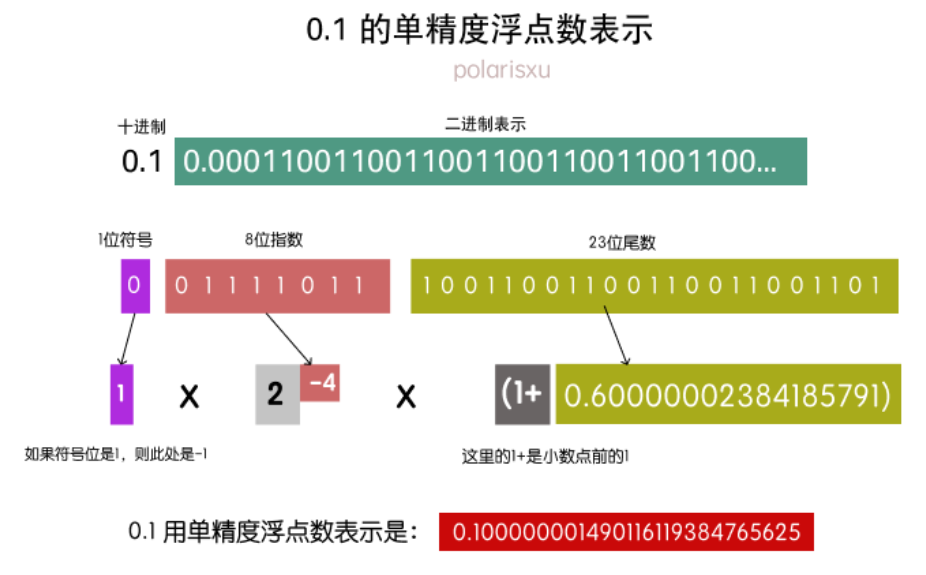

以下是对 **0.1 的单精度浮点数表示** 的详细解释：

---

#### 1. **0.1 的二进制表示**
- 十进制数 `0.1` 转换为二进制是一个无限循环小数：
```c
  0.1 = 0.00011001100110011001100110011001100110011001100110011001...
```
- 二进制表示中，`1100` 是循环节。

---

#### 2. **IEEE 754 单精度浮点数表示**
IEEE 754 单精度浮点数使用 32 位表示，分为以下三部分：
1. **符号位（Sign）**：1 位。
2. **指数位（Exponent）**：8 位。
3. **尾数位（Mantissa）**：23 位。

##### （1）符号位
- `0.1` 是正数，因此符号位为 `0`。

##### （2）指数位
- 将二进制数 `0.00011001100110011001100110011001100110011001100110011001...`
  规范化：

```c
  0.0001100110011001100... = 1.1001100110011001100... * 2^{-4}
```
- 规范化后的尾数为 `1.1001100110011001100110011001100110011001100110011001...`。
- 实际指数为 `-4`。

- 单精度浮点数的指数偏移量为 `127`，因此有偏指数为：

  -4 + 127 = 123

- 将 `123` 转换为二进制：

  123 = 01111011


##### （3）尾数位
- 规范化后的尾数为 `1.1001100110011001100110011001100110011001100110011001...`。
- 尾数部分存储的是小数点后的部分，即 `1001100110011001100110011001100110011001100110011001...`。
- 由于尾数部分只有 23 位，因此需要截断：
  `10011001100110011001100`


---

#### 3. **完整的单精度浮点数表示**
将符号位、指数位和尾数位组合起来：
- 符号位：`0`。
- 指数位：`01111011`。
- 尾数位：`10011001100110011001100`。

完整的二进制表示为：
```c
0 01111011 10011001100110011001100
```

---

#### 4. **0.1二进制转换为十进制**
- 符号位：`0`（正数）。
- 指数部分：`01111011`（二进制） = `123`（十进制）。
    - 实际指数 = `123 - 127 = -4`。  使用实际指数计算公式 ： 实际指数=有偏指数-偏移量
- 尾数部分：`10011001100110011001100`。
    - 实际尾数 = `1.10011001100110011001100`（二进制） ≈ `1.60000002384185791`（十进制）。
    - 这里有个隐含的1也要拼接进来

- 最终值：
```c
  Value = (-1)^0 * 1.60000002384185791 * 2^{-4}  ≈  0.10000000149011612
```

---

#### 5. **总结**
- **0.1 的单精度浮点数表示**：
    - 二进制：`0 01111011 10011001100110011001100`。
    - 十进制：`0.10000000149011612`。

- **误差来源**：
    - 由于 `0.1` 的二进制表示是无限循环的，计算机只能存储一个近似值。
    - 这种近似值在运算中会导致误差累积，例如 `0.1 + 0.2` 的结果不是 `0.3`，而是 `0.300000004470348358154296875`。

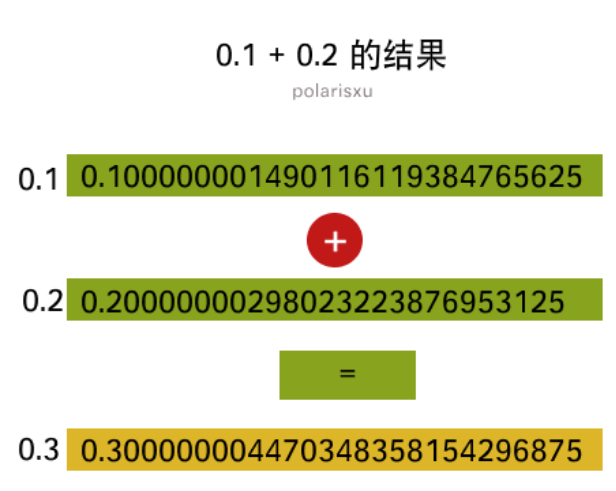

通过理解这些内容，可以更好地处理计算机中的浮点数精度问题。

# 9. 特殊值

在 IEEE 754 浮点数标准中，除了正常的浮点数表示外，还定义了一些 **特殊值**，用于表示特定的情况或异常。这些特殊值包括 **零值**、**无穷大** 和 **NaN（非数）**。以下是详细介绍：

---


### 1. **无穷大（Infinity）**
无穷大用于表示超出浮点数表示范围的数值，分为 **正无穷大（+∞）** 和 **负无穷大（-∞）**。

#### 表示方式
- **符号位**：
    - 正无穷大：`0`。
    - 负无穷大：`1`。
- **指数部分**：全 `1`。
- **尾数部分**：全 `0`。

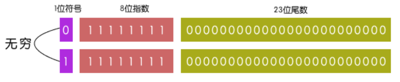

#### 示例
- 单精度浮点数：
    - 正无穷大：`0 11111111 00000000000000000000000`。
    - 负无穷大：`1 11111111 00000000000000000000000`。

#### 特点

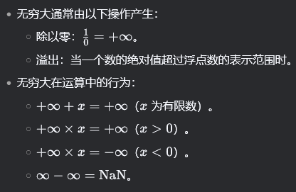

---

### 2. **NaN（非数，Not a Number）**
NaN 用于表示无效的浮点数运算结果，例如：

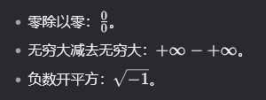

#### 表示方式
- **符号位**：可以是 `0` 或 `1`（不影响 NaN 的值）。
- **指数部分**：全 `1`。
- **尾数部分**：非全 `0`（至少有一位为 `1`）。

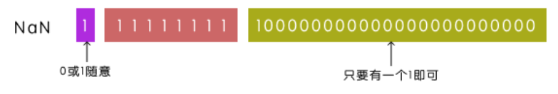

#### 示例
- 单精度浮点数：
    - 一个常见的 NaN 表示：`0 11111111 10000000000000000000000`。

#### 特点

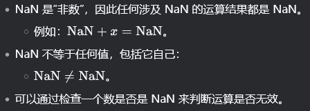

---

# 10. 非规范化数（Denormal Number）

**非规范化数（Denormal Number 或 Subnormal Number）** 是 IEEE 754 浮点数标准中的一种特殊值，用于表示非常接近零的数。它们填补了 **零值** 和 **最小规范化数** 之间的空白，使得浮点数能够更平滑地过渡到零，避免突然下溢（Underflow）到零。

---

### 1. **零值（Zero）**
零值用于表示数值零。由于浮点数的符号位可以表示正负，因此零值分为 **正零（+0）** 和 **负零（-0）**。

#### 表示方式
- **符号位**：
    - 正零：`0`。
    - 负零：`1`。
- **指数部分**：全 `0`。
- **尾数部分**：全 `0`。

#### 示例
- 单精度浮点数：
    - 正零：`0 00000000 00000000000000000000000`。
    - 负零：`1 00000000 00000000000000000000000`。

#### 特点
- 正零和负零在大多数情况下是等价的，但在某些特殊情况下（如除以零）会表现出不同的行为。
- 例如：

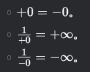

---

### 2. 非规范化数

#### 1. **非规范化数的定义**
非规范化数是指：
- **指数部分** 为全 `0`。
- **尾数部分** 不为全 `0`。

在 IEEE 754 标准中，规范化数的指数部分有一个隐含的前导 `1`，而非规范化数的指数部分没有隐含的前导 `1`，因此它们的表示方式与规范化数不同。

---

#### 2. **非规范化数的表示**
##### （1）单精度浮点数（32 位）
- **符号位**：1 位。
- **指数部分**：8 位，全 `0`。
- **尾数部分**：23 位，非全 `0`。

##### （2）双精度浮点数（64 位）
- **符号位**：1 位。
- **指数部分**：11 位，全 `0`。
- **尾数部分**：52 位，非全 `0`。

---

#### 3. **非规范化数的计算**
##### （1）指数部分
- 对于非规范化数，指数部分规定为：
    - 单精度浮点数：\( -126 \)
    - 双精度浮点数：\( -1022 \)
    - 注意，指数部分的二进制全是0，而且这里没有有偏指数和偏移量这一说了，之所以这么规定，是因为正好能和规范化数在非常非常非常非常小的误差内平滑过度。

##### （2）尾数部分
- 非规范化数的尾数部分没有隐含的前导 `1`，因此实际尾数为：
  \[
  M = 0.{尾数部分}
  \]

##### （3）值的计算
非规范化数的值计算公式为：

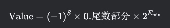

其中：
- \( S \) 是符号位。
- \( E \) 是非规范化数的指数（单精度为 \( -126 \)，双精度为 \( -1022 \)）。

---

#### 4. **非规范化数的示例**
##### 示例 1：单精度浮点数
假设一个单精度浮点数的二进制表示为：
0 00000000 00000000000000000000001

- **符号位**：`0`（正数）。
- **指数部分**：全 `0`，表示非规范化数。
- **尾数部分**：`00000000000000000000001`。

计算其值：
- 指数：\( -126 \)。
- 实际尾数：

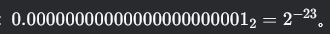

- 值：(计算值时，乘2^-126是固定不变的)


##### 示例 2：双精度浮点数
假设一个双精度浮点数的二进制表示为：
`
0 00000000000 0000000000000000000000000000000000000000000000000001
`


- **符号位**：`0`（正数）。
- **指数部分**：全 `0`，表示非规范化数。
- **尾数部分**：`0000000000000000000000000000000000000000000000000001`。

计算其值：
- 指数：\( -1022 \)。
- 实际尾数：

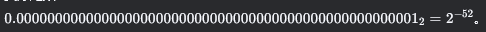

- 值：

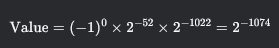

---


#### 5. **非规范化数的作用**

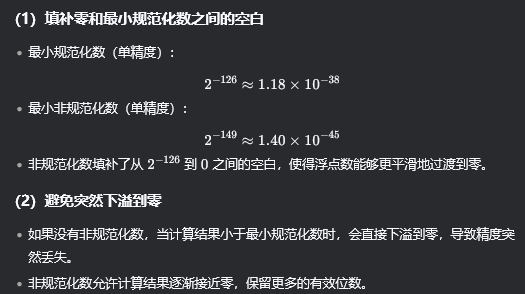


---

#### 6. **非规范化数的性能问题**
- **计算速度较慢**：
    - 非规范化数的处理通常比规范化数慢，因为硬件需要额外的逻辑来处理这些特殊情况。
- **性能优化**：
    - 一些处理器提供了“非规范化数刷新为零”（Flush-to-Zero）模式，将非规范化数直接视为零，以提高性能。

---

# 11. 各种临界值的计算，二进制，十进制表示


### 单精度各种临界值示例：


| **类型**                  | **符号** | **指数**      | **尾数**               | **二进制表示**                               | **十进制值**                        | **二进制值计算**                                        | **公式组成**                                                               |
|---------------------------|----------|-------------|------------------------|-----------------------------------------|---------------------------------|---------------------------------------------------|------------------------------------------------------------------------|
| **-Infinity**             | 1        | 全1 (255)    | 全0                    | `1 11111111 00000000000000000000000`    | \\(-\\infty\\)                  |                                                   |                                                                        |
| **最大负规范化数**        | 1        | 254 (偏移后127) | 全1                    | `1 11111110 11111111111111111111111`    | \\(-3.4028235 \\times 10^{38}\\)   | \\((-1)^1 \times (2 - 2^{-23}) \times 2^{127}\\)  | \\((-1)^{\text{符号}} \times (1.\text{尾数}) \times 2^{\text{有偏指数}-127}\\) |
| **最小负规范化数**        | 1        | 1 (偏移后-126) | 全0                    | `1 00000001 00000000000000000000000`    | \\(-1.17549435 \\times 10^{-38}\\) | \\((-1)^1 \times 1.0 \times 2^{-126}\\)           | \\((-1)^{\text{符号}} \times (1.\text{尾数}) \times 2^{\text{有偏指数}-127}\\)   |
| **最大负非规范化数**      | 1        | 全0          | 全1                    | `1 00000000 11111111111111111111111`    | \\(-1.17549421 \\times 10^{-38}\\) | \\((-1)^1 \times (1 - 2^{-23}) \times 2^{-126}\\) | \\((-1)^{\text{符号}} \times (0.\text{尾数}) \times 2^{-126}\\)            |
| **最小负非规范化数**      | 1        | 全0          | 1 (最低位为1)          | `1 00000000 00000000000000000000001`    | \\(-1.40129846 \\times 10^{-45}\\) | \\((-1)^1 \times 2^{-23} \times 2^{-126}\\)       | \\((-1)^{\text{符号}} \times (0.\text{尾数}) \times 2^{-126}\\)            |
| **-0**                    | 1        | 全0 | 全0                    | `1 00000000 00000000000000000000000`    | \\(-0.0\\)                        |                                                   |                                                                        |
| **+0**                    | 0        | 全0 | 全0                    | `0 00000000 00000000000000000000000`    | \\(+0.0\\)                        |                                                   |                                                                        |
| **最小正非规范化数**      | 0        | 全0 | 1 (最低位为1)          | `0 00000000 00000000000000000000001`    | \\(+1.40129846 \\times 10^{-45}\\) | \\((-1)^0 \times 2^{-23} \times 2^{-126}\\)       | \\((-1)^{\text{符号}} \times (0.\text{尾数}) \times 2^{-126}\\)            |
| **最大正非规范化数**      | 0        | 全0 | 全1                    | `0 00000000 11111111111111111111111`    | \\(+1.17549421 \\times 10^{-38}\\) | \\((-1)^0 \times (1 - 2^{-23}) \times 2^{-126}\\) | \\((-1)^{\text{符号}} \times (0.\text{尾数}) \times 2^{-126}\\)            |
| **最小正规范化数**        | 0        | 1 (偏移后-126) | 全0                    | `0 00000001 00000000000000000000000`    | \\(+1.17549435 \\times 10^{-38}\\) | \\((-1)^0 \times 1.0 \times 2^{-126}\\)           | \\((-1)^{\text{符号}} \times (1.\text{尾数}) \times 2^{\text{有偏指数}-127}\\)   |
| **最大正规范化数**        | 0        | 254 (偏移后127) | 全1                    | `0 11111110 11111111111111111111111`    | \\(+3.4028235 \\times 10^{38}\\)   | \\((-1)^0 \times (2 - 2^{-23}) \times 2^{127}\\)  | \\((-1)^{\text{符号}} \times (1.\text{尾数}) \times 2^{\text{有偏指数}-127}\\)   |
| **+Infinity**             | 0        | 全1 (255)    | 全0                    | `0 11111111 00000000000000000000000`    | \\(+\\infty\\)                     |                                                   |                                                                        |
| **NaN**                   | 0 或 1   | 全1 (255)    | 不全为0                | `0 11111111 00000000000000000000100`    | not a number                      |                                                   |                                                                        |


---

#### 1. 公式组成解释
1. **符号部分**：
    - 由符号位决定，公式为 \\((-1)^{\text{符号}}\\)。
    - 符号位为 `0` 表示正数，符号位为 `1` 表示负数。

2. **尾数部分**：
    - 对于 **规范化数**，尾数部分隐含前导1，公式为 \\(1.\text{尾数}\\)。
    - 对于 **非规范化数**，尾数部分没有隐含前导1，公式为 \\(0.\text{尾数}\\)。

3. **指数部分**：
    - 对于 **规范化数**，实际指数为 \\(\text{有偏指数} - 127\\)。
    - 对于 **非规范化数**，指数固定为 \\(-126\\)。

4. **最终公式**：
    - 规范化数：\\((-1)^{\text{符号}} \times (1.\text{尾数}) \times 2^{\text{有偏指数}-127}\\)。
    - 非规范化数：\\((-1)^{\text{符号}} \times (0.\text{尾数}) \times 2^{-126}\\)。

5. 规范化数的**实际指数**的范围：
    - 有偏指数的取值是从[0000 0001,1111 1110] 也就是1~254 所以实际指数值在[1-127, 254-127]=[-126,127]之间
    - 有偏指数不能取`0000 0000`，不然他就是非规范化数了，也不能取`1111 1111`，不然就是infinity \\(\\infty\\)
---

#### 2. 公式中尾数计算解释

在 IEEE 754 浮点数标准中，**规范化数** 的尾数部分隐含前导1，因此尾数的实际值为 (1.{尾数})。对于 **最大负规范化数**，尾数部分为全1，因此尾数的实际值为：

\\[
1.11111111111111111111111 \\quad (\\text{二进制})
\\]

这个二进制数的十进制值可以通过以下步骤计算：


##### 1. **二进制尾数的十进制值**
- 尾数部分有 23 位，每一位的权重为 \\(2^{-k}\\)，其中 \\(k\\) 是位的位置（从1开始）。
- 尾数的十进制值为：
  \\[
  1 + \\sum_{k=1}^{23} 2^{-k}
  \\]
- 这是一个等比数列，其和为：
  \\[
  \\sum_{k=1}^{n} 2^{-k} = 1 - 2^{-n}
  \\]
  其中 \\(n = 23\\)，因此：
  \\[
  \\sum_{k=1}^{23} 2^{-k} = 1 - 2^{-23}
  \\]
- 因此，尾数的十进制值为：
  \\[
  1 + (1 - 2^{-23}) = 2 - 2^{-23}
  \\]


##### 2. **公式推导**
- 规范化数的值计算公式为：
  \\[
  \\text{值} = (-1)^{\\text{符号}} \\times (1.\\text{尾数}) \\times 2^{\\text{实际指数}}
  \\]
- 对于 **最大负规范化数**：
    - 符号位为 1（负数）。
    - 尾数部分为全1，因此 \\(1.\\text{尾数} = 2 - 2^{-23}\\)。
    - 实际指数为 127（单精度）或 1023（双精度）。

- 因此，单精度浮点数的最大负规范化数的值为：
  \\[
  \\text{值} = (-1)^1 \\times (2 - 2^{-23}) \\times 2^{127} \\approx -3.4028235 \\times 10^{38}
  \\]


##### 3. **总结**

- 对于单精度浮点数：
  \\[
  1.11111111111111111111111 \\quad (\\text{二进制}) = 2 - 2^{-23} \\quad (\\text{十进制})
  \\]
- 对于双精度浮点数：
  \\[
  1.1111111111111111111111111111111111111111111111111111 \\quad (\\text{二进制}) = 2 - 2^{-52} \\quad (\\text{十进制})
  \\]


---


#### 3. 形象表示为：


---

### 双精度浮点数示例


| **类型**                  | **符号** | **指数**         | **尾数**               | **二进制表示**                                                                             | **十进制值**                                    | **二进制值计算**                                        | **公式组成**                                                                 |
|---------------------------|----------|------------------|------------------------|---------------------------------------------------------------------------------------|---------------------------------------------|---------------------------------------------------|-----------------------------------------------------------------------------|
| **-Infinity**             | 1        | 全1 (2047)       | 全0                    | `1 11111111111`<br>`00000000000000000000`<br>`00000000000000000000`<br>`000000000000` | \\(-\\infty\\)                              |                                                   |                                                                             |
| **最大负规范化数**        | 1        | 2046 (偏移后1023)| 全1                    | `1 11111111110`<br>`11111111111111111111`<br>`11111111111111111111`<br>`111111111111` | \\(-1.7976931348623157 \\times 10^{308}\\)  | \\((-1)^1 \times (2 - 2^{-52}) \times 2^{1023}\\) | \\((-1)^{\text{符号}} \times (1.\text{尾数}) \times 2^{\text{有偏指数}-1023}\\) |
| **最小负规范化数**        | 1        | 1 (偏移后-1022)  | 全0                    | `1 00000000001`<br>`00000000000000000000`<br>`00000000000000000000`<br>`000000000000` | \\(-2.2250738585072014 \\times 10^{-308}\\) | \\((-1)^1 \times 1.0 \times 2^{-1022}\\)          | \\((-1)^{\text{符号}} \times (1.\text{尾数}) \times 2^{\text{有偏指数}-1023}\\)   |
| **最大负非规范化数**      | 1        | 全0  | 全1                    | `1 00000000000`<br>`11111111111111111111`<br>`11111111111111111111`<br>`111111111111` | \\(-2.225073858507201 \\times 10^{-308}\\)  | \\((-1)^1 \times (1 - 2^{-52}) \times 2^{-1022}\\) | \\((-1)^{\text{符号}} \times (0.\text{尾数}) \times 2^{-1022}\\)            |
| **最小负非规范化数**      | 1        | 全0   | 1 (最低位为1)          | `1 00000000000`<br>`00000000000000000000`<br>`00000000000000000000`<br>`000000000001` | \\(-4.9406564584124654 \\times 10^{-324}\\) | \\((-1)^1 \times 2^{-52} \times 2^{-1022}\\)      | \\((-1)^{\text{符号}} \times (0.\text{尾数}) \times 2^{-1022}\\)            |
| **-0**                    | 1        |全0   | 全0                    | `1 00000000000`<br>`00000000000000000000`<br>`00000000000000000000`<br>`000000000000` | \\(-0.0\\)                                  |                                                   |                                                                             |
| **+0**                    | 0        |全0  | 全0                    | `0 00000000000`<br>`00000000000000000000`<br>`00000000000000000000`<br>`000000000000` | \\(+0.0\\)                                  |                                                   |                                                                             |
| **最小正非规范化数**      | 0        | 全0  | 1 (最低位为1)          | `0 00000000000`<br>`00000000000000000000`<br>`00000000000000000000`<br>`000000000001` | \\(+4.9406564584124654 \\times 10^{-324}\\) | \\((-1)^0 \times 2^{-52} \times 2^{-1022}\\)      | \\((-1)^{\text{符号}} \times (0.\text{尾数}) \times 2^{-1022}\\)            |
| **最大正非规范化数**      | 0        | 全0  | 全1                    | `0 00000000000`<br>`11111111111111111111`<br>`11111111111111111111`<br>`111111111111` | \\(+2.225073858507201 \\times 10^{-308}\\)  | \\((-1)^0 \times (1 - 2^{-52}) \times 2^{-1022}\\) | \\((-1)^{\text{符号}} \times (0.\text{尾数}) \times 2^{-1022}\\)            |
| **最小正规范化数**        | 0        | 1 (偏移后-1022)  | 全0                    | `0 00000000001`<br>`00000000000000000000`<br>`00000000000000000000`<br>`000000000000` | \\(+2.2250738585072014 \\times 10^{-308}\\) | \\((-1)^0 \times 1.0 \times 2^{-1022}\\)          | \\((-1)^{\text{符号}} \times (1.\text{尾数}) \times 2^{\text{有偏指数}-1023}\\)   |
| **最大正规范化数**        | 0        | 2046 (偏移后1023)| 全1                    | `0 11111111110`<br>`11111111111111111111`<br>`11111111111111111111`<br>`111111111111` | \\(+1.7976931348623157 \\times 10^{308}\\)  | \\((-1)^0 \times (2 - 2^{-52}) \times 2^{1023}\\) | \\((-1)^{\text{符号}} \times (1.\text{尾数}) \times 2^{\text{有偏指数}-1023}\\)   |
| **+Infinity**             | 0        | 全1 (2047)       | 全0                    | `0 11111111111`<br>`00000000000000000000`<br>`00000000000000000000`<br>`000000000000` | \\(+\\infty\\)                              |                                                   |                                                                             |
| **NaN**                   | 0 或 1   | 全1 (2047)       | 不全为0                | `0 11111111111`<br>`00000000000000000000`<br>`00000000000000000000`<br>`000000100000` | not a number                                |                                                   |                                                                             |


---

#### 1. 公式组成解释
1. **符号部分**：
    - 由符号位决定，公式为 \\((-1)^{\text{符号}}\\)。
    - 符号位为 `0` 表示正数，符号位为 `1` 表示负数。

2. **尾数部分**：
    - 对于 **规范化数**，尾数部分隐含前导1，公式为 \\(1.\text{尾数}\\)。
    - 对于 **非规范化数**，尾数部分没有隐含前导1，公式为 \\(0.\text{尾数}\\)。

3. **指数部分**：
    - 对于 **规范化数**，实际指数为 \\(\text{有偏指数} - 1023\\)。
    - 对于 **非规范化数**，实际指数固定为 \\(-1022\\)。

4. **最终公式**：
    - 规范化数：\\((-1)^{\text{符号}} \times (1.\text{尾数}) \times 2^{\text{指数}-1023}\\)。
    - 非规范化数：\\((-1)^{\text{符号}} \times (0.\text{尾数}) \times 2^{-1022}\\)。

5. 规范化数的**实际指数**的范围：
    - 有偏指数的取值是从[0000 0000 001,1111 1111 110] 也就是1~2046 所以实际指数值在[1-1023, 2046-1023]=[-1022,1023]之间
    - 有偏指数不能取`0000 0000 000`，不然他就是非规范化数了，也不能取`1111 1111 111`，不然就是infinity \\(\\infty\\)
---


#### 2. 形象表示为：


---


# 12. 规格化到非规范化数据是如何平滑过度的？

在 **IEEE 754 浮点数标准** 中，**规范化数（Normalized Numbers）** 和 **非规范化数（Denormalized Numbers，也称为 Subnormal Numbers）** 之间的平滑过渡是通过 **指数和尾数的特殊处理** 实现的。以下是详细的解释：

---

### 1. **规范化数和非规范化数的定义**
- **规范化数**：
    - 指数部分的取值范围为 **1 到 254**（单精度）或 **1 到 2046**（双精度）。
    - 尾数部分隐含前导1。
    - 实际指数的计算公式为：
      \\[
      \\text{实际指数} = \\text{指数值} - \\text{偏移量}
      \\]
      对于单精度浮点数，偏移量为 **127**；对于双精度浮点数，偏移量为 **1023**。

- **非规范化数**：
    - 指数部分的值为 **0**。
    - 尾数部分没有隐含的前导1。
    - 实际指数固定为 **-126**（单精度）或 **-1022**（双精度）。

---

### 2. **平滑过渡的原理**
- **规范化数的最小值**：
    - 对于单精度浮点数，规范化数的最小值是：
      \\[
      2^{-126}
      \\]
    - 对于双精度浮点数，规范化数的最小值是：
      \\[
      2^{-1022}
      \\]

- **非规范化数的最大值**：
    - 对于单精度浮点数，非规范化数的最大值是：
      \\[
      (1 - 2^{-23}) \\times 2^{-126}
      \\]
    - 对于双精度浮点数，非规范化数的最大值是：
      \\[
      (1 - 2^{-52}) \\times 2^{-1022}
      \\]

- **平滑过渡**：
    - 规范化数的最小值和非规范化数的最大值非常接近，确保了数值的连续性。如图所示：

  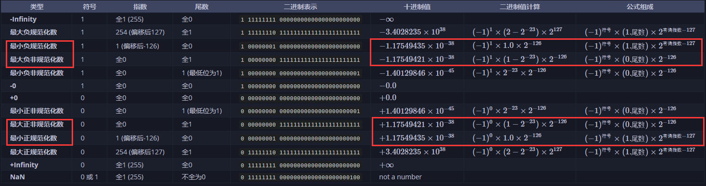

    - 当数值从规范化数过渡到非规范化数时，指数部分从 **1** 变为 **0**，尾数部分从隐含前导1变为没有隐含前导1。


---

### 3. **具体示例（单精度浮点数）**
- **规范化数的最小值**：
  \\[
  2^{-126} \\approx 1.17549435 \\times 10^{-38}
  \\]
  二进制表示为：
  \\[
  0\\ 00000001\\ 00000000000000000000000
  \\]

- **非规范化数的最大值**：
  \\[
  (1 - 2^{-23}) \\times 2^{-126} \\approx 1.17549421 \\times 10^{-38}
  \\]
  二进制表示为：
  \\[
  0\\ 00000000\\ 11111111111111111111111
  \\]

- **平滑过渡**：
    - 当数值从规范化数的最小值过渡到非规范化数的最大值时，指数部分从 **1** 变为 **0**，尾数部分从 **00000000000000000000000** 变为 **11111111111111111111111**。
    - 这种设计确保了数值的连续性，没有间隙。

---

### 4. **双精度浮点数的平滑过渡**
- **规范化数的最小值**：
  \\[
  2^{-1022} \\approx 2.2250738585072014 \\times 10^{-308}
  \\]
  二进制表示为：
  \\[
  0\\ 00000000001\\ 0000000000000000000000000000000000000000000000000000
  \\]

- **非规范化数的最大值**：
  \\[
  (1 - 2^{-52}) \\times 2^{-1022} \\approx 2.225073858507201 \\times 10^{-308}
  \\]
  二进制表示为：
  \\[
  0\\ 00000000000\\ 1111111111111111111111111111111111111111111111111111
  \\]

- **平滑过渡**：
    - 当数值从规范化数的最小值过渡到非规范化数的最大值时，指数部分从 **1** 变为 **0**，尾数部分从 **0000000000000000000000000000000000000000000000000000** 变为 **1111111111111111111111111111111111111111111111111111**。
    - 这种设计确保了数值的连续性，没有间隙。

---

# 参考文章：

https://www.cnblogs.com/hzy1987/p/18021627


