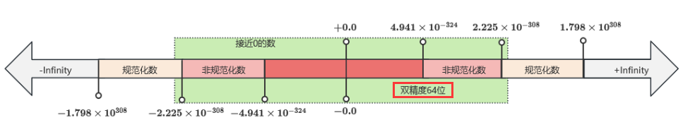

# 要点总结

### 1.基本类型

在64位系统上，C++的基本数据类型及其所占字节数可能会有所不同，具体取决于编译器和操作系统。下面是一个典型的64位系统下的基本数据类型表，包括每种类型的案例以及它们通常占用的字节数。

| 数据类型        | 所占字节（典型64位系统） | 示例                       | 说明                                                                 |
|-----------------|--------------------------|----------------------------|----------------------------------------------------------------------|
| `char`          | 1                        | `char letter = 'A';`       | 字符型，用于存储单个字符。                                           |
| `unsigned char` | 1                        | `unsigned char num = 255;` | 无符号字符型，范围0到255。                                           |
| `short`         | 2                        | `short s = -32768;`        | 短整型，有符号，范围通常是-32768到32767。                            |
| `unsigned short`| 2                        | `unsigned short us = 65535;`| 无符号短整型，范围0到65535。                                         |
| `int`           | 4                        | `int i = 100;`             | 整型，有符号，范围通常是-2^31到2^31-1。                              |
| `unsigned int`  | 4                        | `unsigned int ui = 4294967295;`| 无符号整型，范围0到2^32-1。                                       |
| `long`          | 8 (在64位系统上)         | `long l = 9223372036854775807L;`| 长整型，在64位系统上通常为8字节。                                |
| `unsigned long` | 8 (在64位系统上)         | `unsigned long ul = 18446744073709551615UL;`| 无符号长整型，在64位系统上通常为8字节。                         |
| `long long`     | 8                        | `long long ll = 9223372036854775807LL;`| 更长的整型，总是8字节。                                          |
| `unsigned long long` | 8            | `unsigned long long ull = 18446744073709551615ULL;`| 无符号更长整型，总是8字节。                                    |
| `float`         | 4                        | `float f = 3.14f;`         | 单精度浮点数，通常占用32位。                                          |
| `double`        | 8                        | `double d = 3.141592653589793;`| 双精度浮点数，通常占用64位。                                      |
| `long double`   | 16 或 12 (依赖于实现)    | `long double ld = 3.14159265358979323846L;`| 扩展精度浮点数，大小可能为12或16字节，具体取决于平台和编译器。|
| `bool`          | 1                        | `bool b = true;`           | 布尔类型，表示逻辑值`true`或`false`。                               |
| `wchar_t`       | 4 (在Windows上) / 2 (在Linux上)| `wchar_t wc = L'中';` | 宽字符类型，用于支持多字节字符集如Unicode。                           |

- **`long` 和 `unsigned long`**：在不同的平台上，`long` 的大小可能不同。例如，在64位Windows系统上，`long` 是4字节；而在大多数Unix/Linux系统上，`long` 是8字节。
- **`long double`**：其大小可以是12字节或16字节，具体取决于编译器和硬件平台。
- **`wchar_t`**：在Windows平台上，`wchar_t` 通常是4字节，用于UTF-16编码；而在Linux等系统上，它通常是2字节，用于UCS-2编码。

### 2.void类型 void*类型

### 3.基本类型内存大小和sizeof运算符

为了测验：这里给出了实验代码：[data_type.cpp](../../../code/02_data_type/01_base_data_type/data_type.cpp)

### 4.无符号整数（尽量避免使用）

特殊情况下：
- 在进行位操作或需要利用环绕行为的算法（如加密）时，无符号整数可能是更好的选择。
- 在嵌入式系统开发中，出于性能考虑，也可能需要使用无符号整数。

### 5.固定宽度整数和size_t类型

1. **优先选择固定宽度整数**：当需要特定范围的整数值时，使用固定宽度整数类型（如`std::int32_t`）。
2. **避免8位固定宽度整数**：由于可能被视为字符类型，推荐使用16位类型（如`std::int16_t`）。
3. **谨慎使用快速/至小类型**：它们的实际大小可能会导致不可预测的行为，尤其是在不同的架构上。
4. **使用`std::size_t`处理大小相关的问题**：例如数组索引、内存分配等场景。

### 6. 浮点数在计算机中的存储，【重点】

1. 知道浮点数的存储方式
2. 浮点数的特殊值NAN,infinity,非规格化数,0值
3. 规范化数到非规范化数是如何平滑过度的？
4. 掌握**浮点数的修约方法**

### 7. 布尔值转换

- 使用列表初始化不能直接将整数转换为布尔值。
- 在其他上下文中，整数`0`转换为`false`，任何非零整数转换为`true`。

### 8. 字符

1. char的数据类型是整型，char变量被解释位ASCII字符 1个字节
2. ASCII字符表 0-31为不可打印字符，32-127为可打印字符
3. char初始化，''和整数两种方式
4. 常见的转义字符，例如 \t 水平制表符 tab
5. 将独立字符放在单引号中（例如，’t’或’\n’，而不是"t"或"\n"）。这有助于编译器更有效地优化。
6. 避免多字符文本（例如'56’）。

