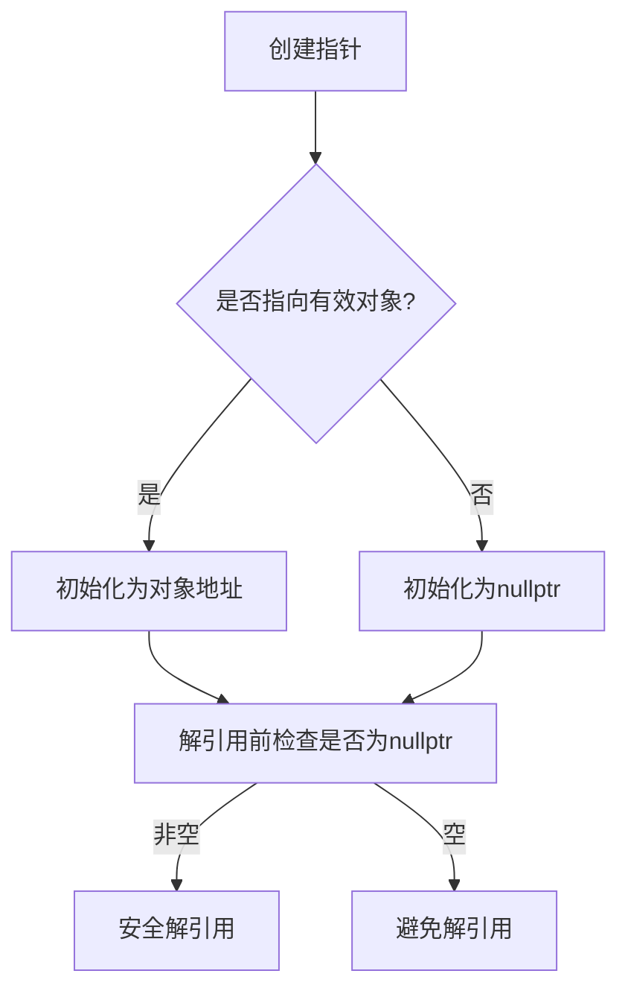

### 空指针知识点详解

#### 1. 空指针的定义与创建
空指针（Null Pointer）是指不指向任何有效对象或函数的指针。在C++中，空指针的创建方法主要有以下两种：
- **值初始化**：使用空初始化器 `{}` 或 `nullptr` 关键字显式初始化。
- **赋值操作**：将指针赋值为 `nullptr`。

```cpp
int* ptr1 {};        // 空指针（推荐写法）
int* ptr2 {nullptr}; // 显式使用nullptr
int* ptr3 = nullptr; // 赋值初始化
```

#### 2. `nullptr` 关键字
`nullptr` 是C++11引入的空指针字面量，用于明确表示空指针。与旧式的 `0` 和 `NULL` 不同，`nullptr` 具有类型安全特性。

```cpp
void func(int* ptr) {}

int main() {
    func(nullptr);  // 合法：传递空指针
    func(0);        // 可能产生歧义（旧式写法，不推荐）
    return 0;
}
```

#### 3. 解引用空指针的风险
解引用空指针会导致 **未定义行为**（Undefined Behavior, UB），通常引发程序崩溃或不可预测的结果。

```cpp
int* ptr {nullptr};
std::cout << *ptr;  // 危险！解引用空指针，导致UB
```

#### 4. 检查空指针的方法
- **显式检查**：直接与 `nullptr` 比较。
- **隐式检查**：利用指针到布尔值的隐式转换（非空指针为 `true`，空指针为 `false`）。

```cpp
int* ptr {nullptr};

// 显式检查
if (ptr == nullptr) {
    std::cout << "Pointer is null";
}

// 隐式检查
if (ptr) {  // 等价于 if (ptr != nullptr)
    std::cout << "Pointer is non-null";
}
```

#### 5. 悬空指针（Dangling Pointers）与空指针的区别
| **特征**         | **空指针**                  | **悬空指针**                  |
|-------------------|-----------------------------|-------------------------------|
| 定义              | 显式设置为 `nullptr`         | 指向已释放的内存               |
| 解引用行为        | 未定义行为（通常崩溃）       | 未定义行为（可能崩溃或数据损坏）|
| 检测方式          | 可通过条件语句检测           | 无法直接检测                   |

#### 6. 避免悬空指针的最佳实践
- **初始化时置空**：未指向有效对象时，指针应初始化为 `nullptr`。
- **对象销毁后置空**：当对象被销毁时，手动将相关指针置空。

```cpp
int main() {
    int* ptr {new int{10}}; // 动态分配内存
    delete ptr;             // 释放内存
    ptr = nullptr;          // 显式置空，避免悬空
    return 0;
}
```

#### 7. 旧式空指针的替代方案
在旧代码中可能使用 `0` 或 `NULL`，但它们存在类型安全问题：
- **`0`**：可能被误认为是整数。
- **`NULL`**：本质是宏定义，通常为 `0`。

```cpp
int* ptr1 = 0;    // 旧式写法（不推荐）
int* ptr2 = NULL; // 旧式宏定义（不推荐）
```

#### 8. 优先使用引用代替指针
引用（Reference）更安全，因为：
- 必须绑定到有效对象（无空引用）。
- 不可重新绑定（避免悬空风险）。

```cpp
int x = 5;
int& ref = x; // 引用必须初始化
// int& invalidRef; // 错误：引用必须绑定到对象
```

##### 指针与引用的对比
| **特性**          | **指针**                | **引用**                |
|-------------------|-------------------------|-------------------------|
| 可空性            | 可以指向 `nullptr`      | 必须绑定到对象          |
| 重新绑定          | 可以修改指向的对象      | 初始化后不可更改        |
| 内存管理          | 需要手动管理            | 自动绑定到已有对象      |
| 语法              | 使用 `*` 和 `->`        | 直接使用变量名          |

#### 9. 代码示例：安全使用指针
```cpp
#include <iostream>

void printValue(int* ptr) {
    if (ptr) { // 检查指针是否为空
        std::cout << "Value: " << *ptr << '\n';
    } else {
        std::cout << "Pointer is null\n";
    }
}

int main() {
    int* ptr1 {new int{20}};
    printValue(ptr1);  // 输出：Value: 20

    delete ptr1;
    ptr1 = nullptr;    // 显式置空
    printValue(ptr1);  // 输出：Pointer is null

    return 0;
}
```

#### 10. 总结
- **空指针**：使用 `nullptr` 初始化，解引用前必须检查。
- **悬空指针**：通过及时置空和合理内存管理避免。
- **引用优先**：在不需要指针特性的场景下，优先使用引用。

