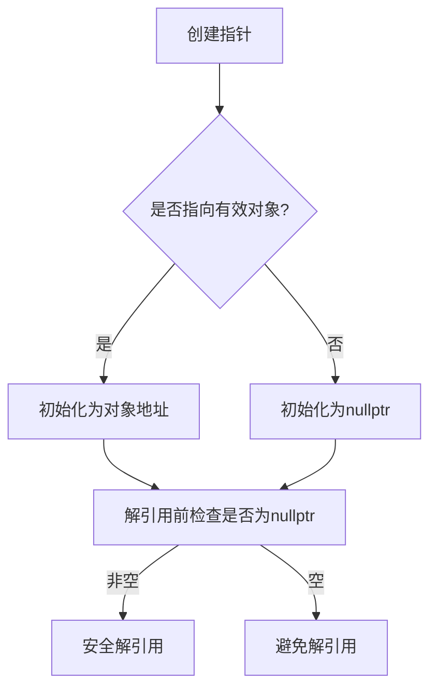
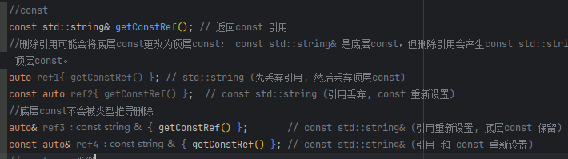
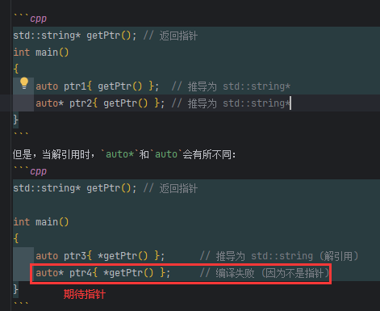
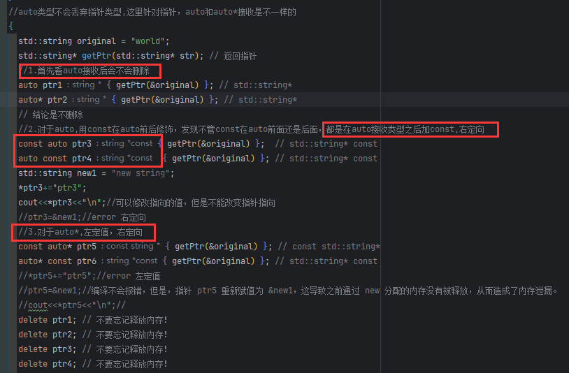
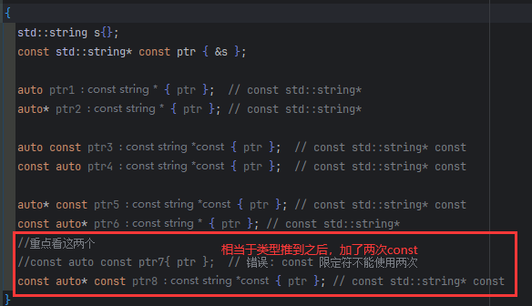

# 要点总结


### 1. 复合数据类型简介

1. **函数**  
   函数本身就是一种复合类型。函数类型由返回类型和参数类型组成，参数类型可以是基本类型，也可以是复合类型。

2. **数组 (Arrays)**  
   数组是由相同类型的元素构成的集合。可以通过下标访问数组中的元素。

3. **指针类型 (Pointers)**  
   指针类型是存储内存地址的类型。指针可以指向基本类型、数组、函数，甚至是类成员。

    - **对象指针**：指向对象的指针。
    - **函数指针**：指向函数的指针。
    - **指向成员类型的指针**：指向类的成员函数或成员数据的指针。

4. **引用类型 (References)**  
   引用是对变量的别名，分为左值引用和右值引用。

    - **左值引用 (Lvalue Reference)**：引用一个可修改的对象。
    - **右值引用 (Rvalue Reference)**：引用一个临时对象（右值）。

5. **枚举类型 (Enumerations)**  
   枚举类型允许为一组常量定义一个名字，分为强作用域枚举和弱作用域枚举。

6. **类类型 (Class Types)**
    - **结构体 (struct)**：类类型的一种特殊形式。
    - **类 (class)**：更复杂的数据类型，包含数据成员和成员函数。
    - **联合体 (union)**：多个数据成员共用同一块内存。
7. **模板类型** 
   - 类模板和函数模板实例化后的类型

| 类型           | 描述                         | 示例                                   |
|----------------|------------------------------|--------------------------------------|
| **函数类型**    | 由返回类型和参数类型组成       | `void doSomething(int, double)`      |
| **数组类型**    | 同一类型元素的集合             | `int arr[10];`                       |
| **指针类型**    | 存储对象的内存地址             | `int* ptr;`                          |
| **引用类型**    | 对变量的别名                   | `int& ref = x;`                      |
| **枚举类型**    | 为常量定义名字                 | `enum Day {Sun, Mon};`               |
| **类类型**      | 更复杂的数据类型，包含成员数据 | `class Person { int age; };`         |
|**模板类型**|类模板和函数模板实例化后的类型| 实例化后：`void doSomething(int, double)` |

### 2. 左值，右值

- 表达式的值类型：int,double这种
- 表达式的值类别：左值，右值
- 左值（lvalue):具有持久性的**对象**或**函数的表达式**，分为可修改的左值，不可修改的左值
- 右值（rvalue）:指计算为一个值的表达式，通常不具有持久性,右值不指向一个明确的对象，它们在表达式结束时会被丢弃。
- 左值到右值的转换
- 常见右值表达式：
  - **字面值**：如整数、浮点数、字符串字面值（`"abc"` 也是左值，但 C 样式字符串字面值是右值）。
  - **临时变量**：例如，`x + 1`，这会产生一个临时的右值。
  - **函数返回值**：如 `return 5` 的返回值。


### 3. 左值引用

- 引用：现有对象的别名，在C++中，引用是高效传递数据的关键方式。
- 左值引用（`lvalue reference`）指向一个**左值**，即一个有持久性并且可以被修改的对象。左值引用通过 `&` 来表示
- 左值引用必须在声明时进行初始化。不能先声明后赋值。
- 左值引用不能绑定到右值或常量左值
- 引用不能重置
- 引用遵循与普通变量相同的作用域规则
- 引用和它所绑定的对象具有独立的生命周期，
- 悬空引用


### 4.常量引用

- **常量左值引用**允许引用常量左值，左值不能修改，并能绑定到右值。
- **常量左值引用**允许引用可修改的左值，但是不能通过引用修改左值，可以通过左值本身修改左值
- **常量引用的生命周期扩展**：当绑定到右值时，临时对象的生命周期会被延长至引用的生命周期结束。
- **最佳实践**：尽量使用常量引用，除非明确需要修改对象。
- **`constexpr` 引用**用于绑定编译时常量，具有严格的限制，要求绑定的对象必须是静态存储期的。


### 5. 左值引用传递参数

- 非常量引用：只能绑定到可修改的左值，不能绑定常量或右值。 T& y
- 按引用传递参数：避免了高成本的对象复制，并允许直接修改传入的对象
- 常量引用：可以绑定到“右值，可修改的左值，不可修改的左值”， const T& y
- 常量左值引用的一个显著优势是它能够绑定到右值。没有这个功能，我们就无法通过引用传递字面值（或其他右值）给函数。
- 对于具有较高复制成本的类类型，通常通过常量引用传递更为高效。
- 对于基本类型，复制成本很低，通常选择按值传递。
- 在处理字符串时，`std::string_view` 通常是一个更高效的选择，比 `const std::string&` 更灵活且开销更小。


### 6.指针简介

- 指针：T*
- 取地址符：&
- 解引用符：* 用来访问指针指向的内存地址中的值
- 指针在声明时必须进行初始化，否则它将成为“野指针”
- 空指针是指不指向任何有效的内存地址。C++ 中使用 `nullptr` 来表示空指针
- 指针可以用来做两件事：
  1. **改变指针所指向的地址：** 指针可以改变它所指向的对象。
  2. **改变指针指向对象的值：** 通过解引用指针，我们可以直接修改指向的对象的值。
- 指针比引用更灵活，因为指针可以指向不同的对象，
- 引用必须在初始化时绑定到一个对象，且绑定后不能再更改
- 指针的大小是固定的，通常为 4 字节（32 位系统）或 8 字节（64 位系统）
- 悬空指针：是指指向已销毁对象的指针，为了避免悬空指针，建议在指针不再需要时将其设置为 `nullptr`。
- 野指针：未初始化的指针被称为野指针


| 特性                | 指针                          | 引用                        |
|---------------------|-------------------------------|-----------------------------|
| 初始化             | 可以为 null 或未初始化         | 必须初始化                  |
| 可更改性            | 可以改变指向的对象（指向不同地址）| 不可改变引用对象            |
| 是否指向 null      | 可以指向 null                  | 不可以（始终绑定到一个对象）|
| 是否独立对象       | 是（指针本身也是一个变量）      | 不是（引用是另一个对象的别名）|


### 7.空指针
- 空指针的定义和创建：
  - **值初始化**：使用空初始化器 `{}` 或 `nullptr` 关键字显式初始化。
  - **赋值操作**：将指针赋值为 `nullptr`。
- nullptr： C++11引入的空指针字面量，与旧式的 `0` 和 `NULL` 不同，`nullptr` 具有类型安全特性
- 解引用空指针会导致 **未定义行为**
- 检查空指针的方法：
  - **显式检查**：if (ptr == nullptr)
  - **隐式检查**：if (ptr)
- **`0`**：可能被误认为是整数
- **`NULL`**：本质是宏定义，通常为 `0`
- 优先使用引用代替指针


| **特征**         | **空指针**                  | **悬空指针**           |
|-------------------|-----------------------------|--------------------|
| 定义              | 显式设置为 `nullptr`         | 指向已释放的内存           |
| 解引用行为        | 未定义行为（通常崩溃）       | 未定义行为（可能崩溃或数据损坏）   |
| 检测方式          | 可通过条件语句检测           | 无法直接检测 （可能是一个非法地址） |




### 8.指针常量和常量指针（左定值，右定向）

| 指针类型               | 是否可以更改指向的值 | 是否可以更改指针本身的地址 |
|------------------------|---------------------|---------------------------|
| **普通指针**            | 可以更改             | 可以更改                   |
| **常量指针（`const` 指针）** | 不能更改             | 可以更改                   |
| **指针常量**            | 可以更改             | 不能更改                   |
| **常量指针常量（`const` 指针常量）** | 不能更改             | 不能更改                   |


```cpp
int main() {
    int v{ 5 };
    int* ptr0 { &v };             // 普通指针：指向 "int"
    const int* ptr1 { &v };       // 常量指针：指向 "const int"，指针本身不是const
    int* const ptr2 { &v };       // 指针常量：指向 "int"，指针本身是const
    const int* const ptr3 { &v }; // 指向 "const int"，指针本身是const
}
```


### 9.通过指针传递函数参数

- 指针传递参数可以提高程序性能，避免不必要的数据拷贝，同时也能让函数修改传入的对象
- 指针传递会带来一些风险，如空指针解引用和指针的复杂性，因此在可能的情况下，优先选择引用传递
- 传递地址的“可选”参数
- 通过指针传递修改指针参数：void nullify([[maybe_unused]] int* ptr2)  // ptr2 是指针的副本
- 通过引用传递指针，而不是通过值传递指针，void nullify(int*& refptr)  // refptr 是指向指针的引用
- 尽量使用 `nullptr` 替代 `0` 或 `NULL` 作为空指针：这两个会被当作整型，出现不可预料的错误
- `std::nullptr_t` 是一个类型，它表示空指针的值 `nullptr`


### 10.引用或指针作为函数返回值

- 引用作为返回值
- 悬空引用
- 生命周期延长不能跨函数边界工作：
```c++
 // 案例 1: 直接绑定
    const int& ref1 { 5 }; // 可以延长临时对象的生命周期
    std::cout << ref1 << '\n'; // okay

    // 案例 2: 间接绑定
    const int& ref2 { returnByConstReference(5) }; // ref2会绑定到悬空引用，临时对象5的生命周期不能延长
    std::cout << ref2 << '\n'; // 未定义的行为
```
- 避免返回非常量静态局部变量的引用
- 通过引用返回函数的引用参数
- 通过函数返回的引用修改对应的对象
```c++
int& max(int& x, int& y) {
    return (x > y) ? x : y;
}
int main() {
    int a{ 5 };
    int b{ 6 };
    max(a, b) = 7;//b=7，b修改为7
    std::cout << a << b << '\n';//57
    return 0;
}
```

- 按地址返回与按引用返回工作原理类似，只是返回的是对象的指针


### 11.输入和输出参数

- **输入参数**：通常使用值或常量引用传递。
- **输出参数**：通常使用非常量引用或指针传递，允许函数修改参数值。
- **输入/输出参数**：在某些特殊情况下使用，允许函数修改并返回输入的参数。
- 使用输出参数时要注意语义清晰，可以通过传递指针或引用来避免不必要的副本。


### 12.指针、引用和常量的类型自动推导


- **常量限定符丢弃**：`auto`推导的类型不会保留`const`，即使原始值是`const`或`constexpr`。
- 可以通过显式指定`const`或`constexpr`，重新应用限定符
```c++
    constexpr double cd{ 7.8 };
    auto y{ cd };// 推导为  double
    constexpr auto y{ cd }; // 推导为 constexpr double
```
- **引用属性丢弃**`auto`推导也会**丢弃引用属性**，即使初始化的值是一个引用
```c++
    std::string& getRef(); // 返回引用
    auto ref { getRef() };  // 推导为 std::string (引用被丢弃)
    auto& ref2 { getRef() }; // 推导为 std::string& (引用重新加上)
```
- 对于顶层const和底层const: auto推导会**丢弃顶层const**，但**保留底层const**。
- **顶层const**：应用于对象本身，如`const int x` 或 `int* const ptr`。
- **底层const**：应用于引用或指向的对象，如`const int& ref` 或 `const int* ptr`。
```cpp
const int x = 5;  // 顶层const
const int* ptr = &x;  // 底层const

auto var1 = x;  // 推导为 int，顶层const被丢弃
auto* var2 = ptr; // 推导为 const int*，底层const被保留
```
- 常量引用的类型推导
```cpp
const std::string& getConstRef(); // 返回 const 引用

int main()
{
    auto ref1{ getConstRef() };        // 推导为 std::string (引用 和 顶层 const 丢弃)
    const auto ref2{ getConstRef() };  // 推导为 const std::string (const 重新设置)

    auto& ref3{ getConstRef() };       // 推导为 const std::string& (引用重新设置, 底层const 保留)
    const auto& ref4{ getConstRef() }; // 推导为 const std::string& (引用 和 const 重新设置)
}
```



- `constexpr`引用类似

```cpp
constexpr std::string_view hello { "Hello" };

constexpr const std::string_view& getConstRef() {
    return hello;
}

int main()
{
    auto ref1{ getConstRef() };            // 推导为 std::string_view (引用 和 顶层 const 丢弃)
    constexpr auto ref2{ getConstRef() };  // 推导为 constexpr std::string_view (const 重新设置)

    auto& ref3{ getConstRef() };           // 推导为 const std::string_view& (引用重新设置, 底层const 保留)
    constexpr auto& ref4{ getConstRef() }; // 推导为 constexpr const std::string_view& (引用 和 const 重新设置)
}
```
- 指针的类型推导不会丢弃指针类型:`auto`会保留指针类型，但如果使用`auto*`，推导会首先推导出值类型，然后重新加上指针。
- **`auto`和`auto*`的区别**:
  - `auto*`会期待指针类型，而`auto`会推导值类型。




- `auto`和`const`与指针类型结合时，类型推导的顺序很重要





> #### auto，auto&和auto* 在类型推导的规律
> 1. 当被推导类型为引用类型：
>    1. auto推导会丢弃引用和顶层const
>    2. auto& 推导会重新设置&,保留底层const
>    3. constexper类似
> 2. 当被推导类型为指针类型:
>    1. auto推导不会丢弃指针类型，推导为指针
>    2. `auto*`会期待指针类型,
>    3. 对于auto,用const在auto前后修饰，发现不管const在auto前面还是后面，都是在auto接收类型之后加const
>    4. 对于auto*,因为是期待，如果期待的是指针，那么const在auto*前，最终const就在指针前面修饰，在auto*后面，最终const就在指针后面修饰
> 3. const std::string& const ptr { s };  //这种写法是错的，引用不是对象，所以没有第二个const，只有const std::string& ptr，这种形式的写法


| 被推导类型 | 推导方式 | 推导规则 | 示例 | 推导结果 |
| --- | --- | --- | --- | --- |
| **引用类型** | `auto` | 丢弃引用和顶层 `const`，保留底层 `const` | `const T&` <br> `const T*` | `T` <br> `const T*` |
|  | `auto&` | 重新绑定引用，保留底层 `const` | `const T&` <br> `const T*` | `const T&` <br> `const T*&` |
|  | `constexpr` | 类似 `const`，需显式声明 | `constexpr T&` <br> `constexpr auto` <br> `constexpr auto&` | `T` <br> `constexpr T` <br> `constexpr T&` |
| **指针类型** | `auto` | 保留指针类型，丢弃指针本身的顶层 `const` | `T* const` <br> `const T*` | `T*` <br> `const T*` |
|  | `auto*` | 显式声明指针类型，需确保初始化式是指针 | `const T*` | `const T*` |
|  | `const auto` 和 `auto const` | 为推导出的类型添加顶层 `const` | `auto const ptr = ...` <br> `const auto ptr = ...` | `T* const` <br> `T* const` |
|  | `const auto*` | 为指向的对象添加底层 `const` | `const auto* ptr = ...` | `const T*` |
|  | `auto* const` | 为指针本身添加顶层 `const` | `auto* const ptr = ...` | `T* const` |
|  | `const auto* const` | 同时为指向的对象和指针本身添加 `const` | `const auto* const ptr = ...` | `const T* const` |


