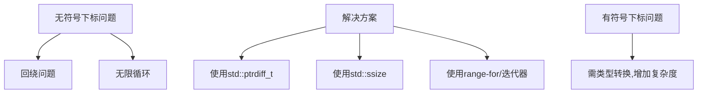

### 数组、循环和有符号下标

在C++中，使用数组时通常需要一个索引来访问元素。C++标准库的容器类（如 `std::vector`）默认使用无符号整数类型 `std::size_t` 作为数组的索引类型。虽然使用无符号整数类型在许多情况下是合理的，但它也可能引发一些令人意想不到的问题，特别是当你使用有符号类型时。

### 问题：无符号下标引发的未定义行为

```cpp
#include <iostream>
#include <vector>

template <typename T>
void printReverse(const std::vector<T>& arr)
{
    for (std::size_t index{ arr.size() - 1 }; index >= 0; --index)  // index 是无符号整数
    {
        std::cout << arr[index] << ' ';
    }
    std::cout << '\n';
}

int main()
{
    std::vector arr{ 4, 6, 7, 3, 8, 2, 1, 9 };
    printReverse(arr);
    return 0;
}
```

该代码意图反向打印数组内容，但会导致未定义行为，表现为可能输出垃圾值或导致程序崩溃。原因如下：

1. **无符号循环变量的问题**：`std::size_t` 是无符号类型，当 `index` 为 0 时，`index--` 会回绕为一个非常大的正数。这导致数组访问越界，发生未定义行为。
2. **循环永不终止**：由于 `std::size_t` 是无符号类型，`index >= 0` 总是成立，因此循环不会停止。

#### 解决方法

一种解决方法是将循环索引从无符号类型改为有符号类型 `int`，但这引入了额外的类型转换，降低了代码的可读性：

```cpp
#include <iostream>
#include <vector>

template <typename T>
void printReverse(const std::vector<T>& arr)
{
    for (int index{ static_cast<int>(arr.size()) - 1}; index >= 0; --index) // index 是有符号整数
    {
        std::cout << arr[static_cast<std::size_t>(index)] << ' ';
    }
    std::cout << '\n';
}

int main()
{
    std::vector arr{ 4, 6, 7, 3, 8, 2, 1, 9 };
    printReverse(arr);
    return 0;
}
```

虽然这种方式能正常工作，但由于强制转换（`static_cast`）的存在，代码可读性较差，而且不直观。

### 使用 `std::ptrdiff_t` 或 `std::ssize()` 处理有符号下标

对于大型数组，`std::ptrdiff_t` 作为有符号类型，通常是 `std::size_t` 的有符号版本。可以将索引定义为 `std::ptrdiff_t`，避免出现溢出和回绕问题：

```cpp
using Index = std::ptrdiff_t;

for (Index index{ static_cast<Index>(arr.size()) - 1 }; index >= 0; --index)
{
    std::cout << arr[static_cast<std::size_t>(index)] << ' ';
}
```

C++20 引入了 `std::ssize()`，它返回容器的大小作为有符号类型，非常方便：

```cpp
#include <iostream>
#include <vector>

int main()
{
    std::vector arr{ 9, 7, 5, 3, 1 };

    for (auto index{ std::ssize(arr) - 1 }; index >= 0; --index)
        std::cout << arr[static_cast<std::size_t>(index)] << ' ';

    return 0;
}
```

`std::ssize()` 提供了一个优雅且清晰的方式来获取容器的有符号索引。

### 使用 `std::size_t` 或 `std::vector<T>::size_type` 的优缺点

#### 使用 `std::size_t` 或 `std::vector<T>::size_type`（无符号类型）

这是最常见的做法，因为 `std::size_t` 具有良好的跨平台兼容性，适用于所有容器类：

```cpp
#include <iostream>
#include <vector>

int main()
{
    std::vector arr { 1, 2, 3, 4, 5 };

    for (std::vector<int>::size_type index { 0 }; index < arr.size(); ++index)
        std::cout << arr[index] << ' ';

    return 0;
}
```

优点：
- 简洁明了，符合 C++ 标准库容器的设计。

缺点：
- 需要使用冗长的类型名（如 `std::vector<int>::size_type`）进行类型声明，尤其在函数模板中使用时。

#### 使用 `std::ptrdiff_t` 或 `Index`（有符号类型）

对于大型数组，使用 `std::ptrdiff_t` 作为循环索引更加适合，避免了无符号类型的回绕问题：

```cpp
using Index = std::ptrdiff_t;

for (Index index{ static_cast<Index>(arr.size()) - 1 }; index >= 0; --index)
{
    std::cout << arr[static_cast<std::size_t>(index)] << ' ';
}
```

优点：
- 解决了无符号类型引发的回绕问题。
- 更加符合最佳实践，减少潜在的错误。

缺点：
- 需要将无符号类型转换为有符号类型，增加了复杂度和代码冗余。

### 使用 `decltype` 和 `typename` 动态推导类型

通过 `decltype` 和 `typename` 可以简化容器索引的类型声明。例如，使用 `decltype` 推导类型，而不需要显式指定 `std::size_t` 或 `std::vector<T>::size_type`：

```cpp
template <typename T>
void printArray(const std::vector<T>& arr)
{
    for (decltype(arr)::size_type index { 0 }; index < arr.size(); ++index)
        std::cout << arr[index] << ' ';
}
```

这使得代码更加简洁易懂。

### 避免显式使用索引

尽量避免直接使用索引来遍历容器。C++ 提供了其他更优雅的遍历方式，例如 `range-for` 和迭代器：

```cpp
for (const auto& item : arr)
{
    std::cout << item << ' ';
}
```

这种方式不仅简洁而且避免了索引相关的问题。

### 总结

- **无符号下标问题**：`std::size_t` 作为无符号类型可能导致回绕或无限循环，特别是在递减索引时。
- **有符号下标的优缺点**：使用 `std::ptrdiff_t` 或 `std::ssize()` 能够更好地处理边界条件，但可能会增加代码复杂度。
- **最佳实践**：尽可能避免直接使用整数值作为数组索引，使用 `range-for` 或迭代器等更高层的抽象来遍历数组。

### 参考图（Mermaid）



这样，通过图示可以看到问题与解决方案的关系。

### 最佳实践

- 尽可能避免显式使用索引，尤其是与无符号和有符号类型相关的索引问题。