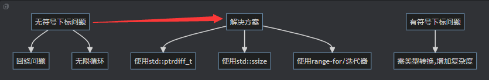

# 要点总结

### 01. 容器和数组简介

| 要点      | 详情                                                                                                                                                   |
|---------|------------------------------------------------------------------------------------------------------------------------------------------------------|
| 变量管理问题  | 用多个单独变量存储大量同类型数据会导致命名冲突、效率低下；结构体虽改进组织，但无法解决核心问题                                                                                                      |
| 容器      | 存储不命名元素集合的数据结构，能自动处理元素数量变化。核心概念包括元素未命名、有长度概念及多种操作。标准库提供多种类型，通常是同质的                                                                                   |
| 容器类型    | - `std::vector`：常用动态数组，支持随机访问和动态调整大小 - `std::array`：固定大小数组，类型安全，接口便捷 - `std::list`：双向链表，适合频繁插入和删除 - `std::map`、`std::set`：关联容器，用于存储键值对或唯一元素 |
| 数组      | 存储相同类型数据的容器，有C样式数组（固定大小，基本类型）、`std::array`（C++11固定大小，类型安全）、`std::vector`（动态数组，支持自动扩展）三种类型                                                            |
| 容器与数组比较 | **大小**：数组固定，容器可动态调整；**内存分配**：数组静态不自动扩展，容器动态自动扩展；**访问性能**：两者均为O(1)；**插入/删除操作**：数组不支持动态操作，容器支持；**类型安全**：C样式数组无类型检查，容器提供类型检查和模板参数                       |
| C++容器类  | 满足不同编程需求，如`std::vector`适合频繁操作元素，`std::map`适合存键值对，`std::list`适合频繁插入删除                                                                                 |
| 总结      | 容器和数组使数据管理更高效，标准库提供多种类型，应按需选择以提高代码可维护性和性能                                                                                                            | 

| 特性          | 数组（C样式、std::array） | 容器（std::vector 等） |
|-------------|--------------------|-------------------|
| **大小**      | 固定大小               | 可动态调整大小           |
| **内存分配**    | 静态分配，内存不自动扩展       | 动态分配，内存自动扩展       |
| **访问性能**    | 快速，常量时间复杂度 O(1)    | 快速，常量时间复杂度 O(1)   |
| **插入/删除操作** | 不支持动态插入或删除         | 支持动态插入和删除操作       |
| **类型安全**    | 无类型检查（C样式数组）       | 提供类型检查，支持模板类型参数   |

- 容器通常是同质的
-

### 02. std::vector和列表构造函数简介

| 要点                  | 详情                                                                                                       |
|---------------------|----------------------------------------------------------------------------------------------------------|
| `std::vector`简介     | 动态数组容器，定义于`<vector>`头文件，是类模板，用模板类型参数指定元素类型，如`std::vector<int>`                                           |
| 列表初始化               | 用`{}`语法简化初始化，如`std::vector<int> primes{2, 3, 5, 7}`；列表构造函数确保空间、设置长度、顺序赋值                                 |
| 下标运算符访问             | 支持`[]`访问元素，下标从0开始；但`operator[]`不做越界检查，越界会导致未定义行为                                                         |
| 内存连续性               | 元素在内存中连续分配，利于随机访问，元素内存地址相邻                                                                               |
| 构造特定长度              | 用单个整数参数构造，如`std::vector<int> data(10)`创建含10个默认值为0元素的容器                                                   |
| 初始化优先级              | 列表初始化优先匹配列表构造函数，如`std::vector<int> v{ 10 }`含一个值为10的元素；直接初始化调用单参数构造函数，如`std::vector<int> v(10)`含10个值为0的元素 |
| `const`和`constexpr` | 对象可声明为`const`使其不可修改，但本身不能是`constexpr`，编译时常量数组可用`std::array`                                              |
| 名称由来                | C++中实际是动态数组，名称源于早期编程语言命名习惯                                                                               |
| 总结与最佳实践             | 用列表构造函数初始化；支持随机访问；推荐列表初始化，避免不明确构造函数匹配；使用时注意下标越界问题                                                        | 

### 03. vector与无符号长度和下标问题

| 要点               | 详情                                                                                                                                 |
|------------------|------------------------------------------------------------------------------------------------------------------------------------|
| 容器长度设计选择         | C++标准库中多数容器用无符号整数（如`std::size_t`）表示长度和下标，初衷是避免负值、支持更大数组，但易因隐式类型转换引发错误                                                              |
| 符号转换影响           | - **窄化与宽化转换**：有符号转无符号可能有风险，`constexpr`上下文符号转换较安全 - **示例**：`int`转`std::size_t`会有隐式转换问题                                           |
| `size_type`与长度获取 | - **`size_type`**：容器类定义的嵌套类型，通常是`std::size_t`别名，可表示长度或下标 - **`std::size_t`**：标准无符号整数类型，用于表示容器大小                                 |
| 访问容器元素           | - **`[]`**：按下标访问元素，不进行边界检查，越界导致未定义行为 - **`at()`**：提供边界检查，越界抛`std::out_of_range`异常，性能稍差                                          |
| 获取容器长度           | - **`size()`**：成员函数，返回`size_type`类型的元素数量 - **`std::size()`（C++17）**：调用`size()`，语法更简洁 - **`std::ssize()`（C++20）**：返回有符号整数表示长度 |
| 索引类型注意事项         | - `std::vector`索引应为`std::size_t`，用有符号`int`可能有隐式转换警告 - 最佳实践是用`std::size_t`作数组下标，避免符号转换问题                                         |
| 总结               | 使用无符号类型表示容器长度和下标有潜在隐式转换问题；处理符号转换要小心；`[]`和`at()`访问元素各有特点；获取长度有多种函数可选，按需使用可编写更健壮安全的程序                                                | 

### 04. 传递std::vector

| 要点                      | 详情                                                                                       |
|-------------------------|------------------------------------------------------------------------------------------|
| 传值 vs 按引用传递             | - **按值传递**：复制整个 `std::vector` 对象，对大型向量开销大 - **按引用传递**：避免复制，推荐使用，若不修改传入向量，用 `const` 引用 |
| 传递不同元素类型的 `std::vector` | 函数参数类型须与传入的 `std::vector` 元素类型兼容，不兼容会导致编译错误                                              |
| 使用 `CTAD`               | C++17 引入，可在变量定义时推导 `std::vector` 元素类型，但不适用于函数参数                                          |
| 使用函数模板传递 `std::vector`  | 函数模板可处理不同类型的 `std::vector`，编译器会根据传入向量类型实例化不同函数版本                                         |
| 使用通用模板或缩写模板             | C++20 允许用 `auto` 关键字简化模板声明，可编写处理不同类型容器的通用函数模板                                            |
| 断言数组长度                  | 使用 `std::vector` 的 `size()` 函数检查数组大小，避免越界访问                                              |
| 总结                      | 按引用传递 `std::vector` 避免复制；用模板函数处理不同类型向量；CTAD 在函数参数中无法自动推导；处理向量时确保索引合法                     | 

### 05. 返回std::vector，移动语义简介

| 要点                 | 详情                                                                               |
|--------------------|----------------------------------------------------------------------------------|
| 复制语义               | 通过拷贝构造函数和拷贝赋值运算符实现对象复制，复制后对象相互独立，改变一个不影响另一个                                      |
| 按值返回 `std::vector` | 理论上返回 `std::vector` 会创建副本，通过复制语义实现，但复制涉及昂贵的内存分配和数据拷贝操作                           |
| 移动语义               | 将数据所有权从一个对象转移到另一个对象，避免昂贵的副本创建，本质是数据所有权转移而非复制                                     |
| 触发移动语义条件           | - 对象类型支持移动语义，如 `std::vector`、`std::string` - 被赋值或初始化对象是右值（临时对象） - 移动语义未被忽略 |
| 按值返回高效原因           | 支持移动语义的类型（如 `std::vector`）返回时通过移动而非复制数据，减少内存复制开销                                 |
| 按值返回性能优化           | 编译器对支持移动的类型按值返回时，通常自动使用移动语义避免创建不必要的副本                                            |

### 06. 数组和循环

| 要点                   | 详情                                           |
|----------------------|----------------------------------------------|
| 可变与可扩展性挑战            | 传统方法用多个独立变量存储数据，学生数量变化时需手动更新代码，易引入错误         |
| 使用数组简化问题             | 使用 `std::vector` 存储数据，减少变量数量，但计算时仍需手动列出元素    |
| 使用循环简化访问             | 用 `for` 循环自动访问数组元素，计算平均值，可扩展性好，增减数据只需修改数组初始值 |
| 模板、数组和循环协同作用         | 使用函数模板将平均值计算提取成通用函数，可处理不同类型的 `std::vector`   |
| 数组和循环常见操作            | 可用于查询元素、操作元素、重新排序等，基本思路是循环遍历数组元素并操作          |
| 避免 Off - by - One 错误 | 编写循环时，循环条件应使用 `<` 而非 `<=`，防止数组下标越界           |

### 07. 数组、循环和有符号下标

| 要点               | 详情                                                                                                                                     |
|------------------|----------------------------------------------------------------------------------------------------------------------------------------|
| 问题：无符号下标引发的未定义行为 | 用无符号 `std::size_t` 作循环变量反向打印数组时，`index--` 会回绕，且 `index >= 0` 恒成立，导致数组越界和循环不终止                                                          |
| 解决方法             | - 改为有符号 `int` 类型，但需强制类型转换，降低代码可读性 - 使用 有符号类型`std::ptrdiff_t` 或 `std::ssize()`，避免溢出和回绕问题                                             |
| 使用不同类型的优缺点       | - **`std::size_t` 或 `std::vector<T>::size_type`**：跨平台兼容，符合标准库设计，但类型声明冗长 - **`std::ptrdiff_t` 或 `Index`**：解决回绕问题，符合最佳实践，但需类型转换，增加复杂度 |
| 简化类型声明           | 用 `decltype` 和 `typename` 动态推导类型，使代码更简洁易懂                                                                                              |
| 避免显式使用索引         | 使用 `range-for` 和迭代器遍历容器，简洁且避免索引相关问题                                                                                                    |
| 总结               | 无符号下标可能导致回绕和无限循环；有符号下标可处理边界条件但增加复杂度；最佳实践是避免直接用整数值作索引，用高层抽象遍历数组                                                                         |
| 最佳实践             | 尽量避免显式使用索引，规避无符号和有符号类型相关的索引问题                                                                                                          | 

### 08. 基于范围的for循环（rangefor/for each）

| 要点                 | 详情                                                               |
|--------------------|------------------------------------------------------------------|
| 语法                 | `for (元素声明 : 数组对象) { 语句; }`，元素声明是容器元素类型声明，数组对象是被遍历的容器            |
| 使用 `auto` 关键字      | 让编译器自动推导元素类型，避免手动声明，对复杂容器类型更方便                                   |
| 避免不必要的拷贝           | 容器元素类型复杂时，用引用（`&`）直接访问元素，避免创建副本，如 `const auto&`                  |
| `const auto&` 最佳实践 | `auto` 适用于值类型元素；`const auto&` 用于复杂或重的类型，提升代码可维护性和性能              |
| 迭代其他容器类型           | 适用于 `std::array`、`std::list`、`std::map` 等标准容器，灵活通用               |
| 获取当前元素的索引          | 基于范围的 `for` 循环本身不提供直接方式，可手动声明计数器或用传统 `for` 循环                    |
| 基于范围的反向循环（C++20）   | 与 `std::views::reverse` 配合，支持反向迭代容器                              |
| 小结                 | 提供简洁安全的容器遍历方式，避免传统 `for` 循环索引越界问题；结合 `auto` 和引用优化代码；C++20 支持反向循环 |

| 类型                    | 使用场景                  | 示例代码                                                  |
|-----------------------|-----------------------|-------------------------------------------------------|
| `auto`                | 适用于值类型的简单容器元素         | `for (auto num : fibonacci)`                          |
| `const auto&`         | 适用于复杂类型的容器元素，避免不必要的拷贝 | `for (const auto& word : words)`                      |
| `auto&`               | 适用于需要修改容器元素的情况        | `for (auto& num : fibonacci)`                         |
| `std::views::reverse` | C++20后，反向遍历容器         | `for (const auto& word : std::views::reverse(words))` | 

### 09. 使用枚举值来作为数组索引

| 要点                    | 详情                                                      |
|-----------------------|---------------------------------------------------------|
| 问题背景                  | 直接用整数作数组索引，索引含义不明确，降低代码可读性和可维护性                         |
| 使用非限定作用域枚举进行索引        | 用非限定作用域枚举作为数组索引，通过枚举类型名称代表元素，使索引含义更明确                   |
| 非constexpr非限定作用域枚举的挑战 | 非`constexpr`枚举变量作索引可能有符号转换警告，可将枚举基础类型显式指定为无符号整数类型避免     |
| 使用计数枚举元素              | 在枚举定义末尾添加`max_students`元素表示枚举总数，可用于动态数组大小分配，新增元素时其值自动更新 |
| 使用枚举类与数组              | 枚举类类型安全，但无隐式转换为整数类型，作数组索引需显式转换；可重载一元运算符`+`将枚举类转换为底层类型   |

| 枚举类型     | 示例                                    | 描述                             |
|----------|---------------------------------------|--------------------------------|
| 非限定作用域枚举 | `enum { kenny, kyle, stan };`         | 枚举值隐式转换为`std::size_t`，适合用作数组索引 |
| 枚举类      | `enum class StudentNames { kenny };`  | 类型安全，无法隐式转换为整数                 |
| 计数枚举器    | `enum { kenny, kyle, max_students };` | 用于自动管理数组大小                     |

### 10. std::vector大小调整和容量

| 要点                   | 详情                                                                                                                                 |
|----------------------|------------------------------------------------------------------------------------------------------------------------------------|
| 固定大小数组与动态大小数组        | - **固定大小数组**：长度在创建时确定，编译时确定大小，运行时无法修改，如`int arr[5]` - **动态大小数组（`std::vector`）**：大小可在运行时改变，能根据需求添加或删除元素，如`std::vector<int> vec`  |
| 调整 `std::vector` 的大小 | - **`resize()` 函数**：改变 `std::vector` 的长度，增加大小时保留现有元素，新增元素初始化为默认值；减小大小时丢弃多余元素                                                       |
| 长度与容量的区别             | - **容量**：为存储元素分配的内存空间，可大于或等于长度，避免频繁内存重新分配 - **长度**：当前 `std::vector` 中实际使用的元素数量 - **查看方式**：通过 `capacity()` 查看容量，`size()` 查看长度 |
| 内存重新分配与性能            | - **重新分配过程**：分配新内存、复制或移动元素、释放旧内存、更新容量和长度，开销大 - **避免方法**：使用 `reserve()` 提前分配内存，避免频繁重新分配                                          |
| `std::vector` 的索引    | 基于长度，索引范围在 `0` 到 `size() - 1` 之间访问元素才合法，使用 `at()` 可避免越界访问                                                                          |
| 收缩 `std::vector` 的容量 | 使用 `shrink_to_fit()` 请求收缩容量，使其匹配当前长度，但这只是建议，编译器可选择是否实施                                                                             |
| 总结                   | - `resize()` 调整大小 - 区分长度和容量概念 - 用 `reserve()` 避免频繁重新分配 - 索引基于长度 - 用 `shrink_to_fit()` 回收内存，可高效使用 `std::vector` 提高性能    | 

### 11. std::vector和栈行为

| 要点                               | 详情                                                                                                                                    |
|----------------------------------|---------------------------------------------------------------------------------------------------------------------------------------|
| 栈的定义                             | 具有后进先出（LIFO）性质的容器，操作在栈顶进行，如自助餐厅的盘子堆                                                                                                   |
| 编程中的栈                            | 常见操作有 `push`（添加元素到栈顶）、`pop`（从栈顶移除元素），还有 `top`（查看栈顶元素）、`empty`（检查栈是否为空）、`size`（获取元素数量），用于函数调用管理等                                       |
| 栈在C++中的实现                        | C++无专门栈容器类型，可用 `std::vector`、`std::deque` 和 `std::list` 模拟，`std::vector` 最常见                                                          |
| 使用 `std::vector` 模拟栈行为           | 通过 `push_back()`、`pop_back()`、`back()`、`size()`、`empty()`、`capacity()` 实现栈操作                                                          |
| `push_back` 与 `emplace_back` 的区别 | - `push_back()`：先创建对象，再拷贝或移动到 `std::vector` - `emplace_back()`：直接在 `std::vector` 内部构造对象，更高效，在处理需要大量临时对象的情况下，`emplace_back()`提供了性能上的优势。                                       |
| 容量管理与避免多次重新分配                    | - `reserve()`：预先分配足够内存，不改变长度 - `resize()`：改变长度并填充新元素                                                                               |
| 动态输入与栈操作                         | 用 `push_back()` 不断添加元素，直到用户输入终止信号，可处理不确定数量的数据输入                                                                                       |

### 12. std::vector\<bool\>

> `std::vector<bool>`是`std::vector`的一个特化版本，其设计目的是优化布尔类型的存储。通常，`std::vector`会按元素类型的大小分配内存，但`std::vector<bool>`为了节省空间，采取了一种不同的实现方式：每个布尔值只占用一个比特，而不是一个字节。这使得它在存储大量布尔值时，比普通的`std::vector<bool>`要更高效地利用内存。然而，这种实现方式也带来了性能上的一些折衷，且与标准库其他容器的兼容性存在问题。

| 要点                       |详情|
|--------------------------| ---- |
| 基本行为                     |与普通 `std::vector` 类似，可通过下标访问、修改元素，支持 `push_back`、`pop_back` 等常见操作|
| 性能与内存开销                  | - **内存开销**：存储少量布尔值时，可能比普通存储方式消耗更多内存 - **性能差异**：性能受编译器实现影响，优化差时性能下降 - **内存布局问题**：内存布局不保证连续，不符合标准库容器定义，与其他容器兼容有问题|
| 不兼容性示例                   |使用引用获取元素时，`std::vector<bool>` 返回代理对象而非 `bool` 引用，导致编译错误|
| 避免使用 `std::vector<bool>` | - **`std::bitset`**：编译时已知布尔值数量且相对较小（少于64K）时适用 - **`std::vector<char>`**：需动态大小且不关心节省内存时使用 - **`boost::dynamic_bitset`**：需动态大小且支持位操作时使用|
| 最佳实践                     | - 编译时已知布尔值数量且不超一定数量，优先用 `std::bitset` - 需动态大小布尔值容器且不关心节省内存，用 `std::vector<char>` - 需执行位操作且容器动态变化，用 `boost::dynamic_bitset`|
| 关键点总结                    | - **特性/优点**：空间优化，接口与普通 `std::vector` 相似，适合编译时已知且数量少的布尔值情况 - **缺点/限制**：少量布尔值时内存开销大，性能不稳定，不符合标准容器，可能与其他容器不兼容|
| 替代方案                     | - `std::bitset`：编译时已知且较小数量布尔值 - `std::vector<char>`：动态大小且不关心节省内存 - `boost::dynamic_bitset`：动态大小且支持位操作| 
