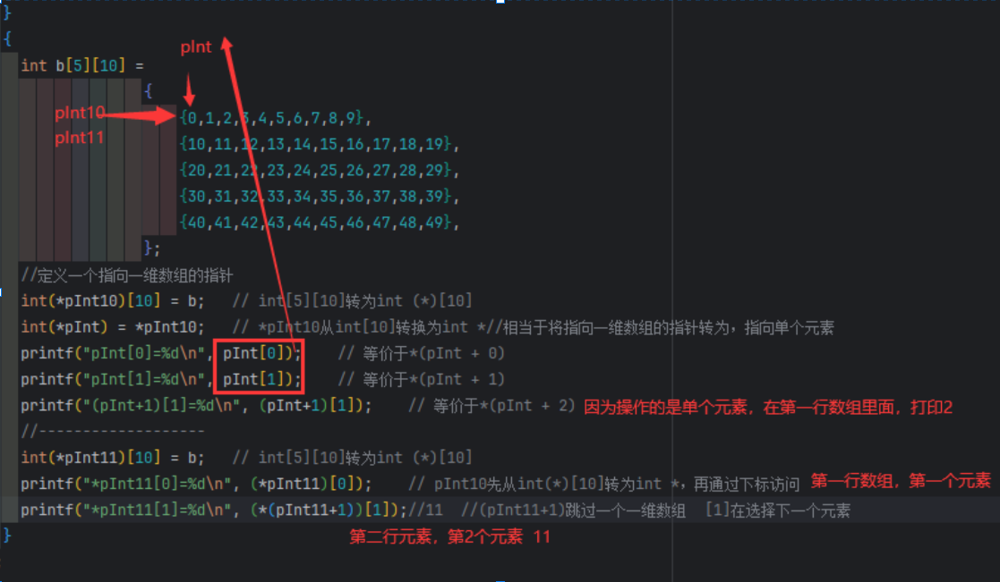

# 要点总结


### 01. std::array简介

| 要点         |详情|
|------------| ---- |
| 数组简介       | - **C 样式数组**：固定大小，直接定义元素数量<br>- **std::array**：C++11 引入，固定大小，类型安全，接口便捷<br>- **std::vector**：动态数组，支持自动扩展|
| 容器与数组的比较   | - **大小**：数组固定，容器可动态调整<br>- **内存分配**：数组静态，容器动态<br>- **访问性能**：两者均为 O(1)<br>- **插入/删除操作**：数组不支持动态操作，容器支持<br>- **类型安全**：C 样式数组无类型检查，容器提供类型检查|
| C++ 容器类    |不同容器类满足不同编程需求，如 `std::vector` 用于频繁插入、删除和访问元素；`std::map` 用于存储键值对；`std::list` 用于频繁插入和删除操作|

> 容器与数组的比较

| 特性                  | 数组（C样式、std::array）   | 容器（std::vector 等）     |
|---------------------|--------------------------|---------------------------|
| **大小**               | 固定大小                   | 可动态调整大小               |
| **内存分配**             | 静态分配，内存不自动扩展       | 动态分配，内存自动扩展           |
| **访问性能**            | 快速，常量时间复杂度 O(1)      | 快速，常量时间复杂度 O(1)      |
| **插入/删除操作**         | 不支持动态插入或删除           | 支持动态插入和删除操作           |
| **类型安全**            | 无类型检查（C样式数组）         | 提供类型检查，支持模板类型参数   |


### 02. std::array长度和索引


| 要点                                  | 详情                                                                                                                                                                                      |
|-------------------------------------|-----------------------------------------------------------------------------------------------------------------------------------------------------------------------------------------|
| `std::array` 长度类型                   | `std::array` 是模板结构，长度由非类型模板参数定义，类型为 `std::size_t`，大小在编译时确定，不会遇到有符号到无符号的转换问题                                                                                                                             |
| `std::array` 的长度类型和索引类型             | 定义了 `size_type` 类型别名，用于容器长度和索引类型，始终为 `std::size_t`，便于统一处理数组大小和索引                                                                                                                        |
| 获取 `std::array` 的长度                 | - **`size()` 成员函数**：返回数组长度，类型为 `size_type`<br>- **`std::size()`（C++17 引入）**：非成员函数，接受容器参数并返回大小，实际调用 `size()` 成员函数<br>- **`std::ssize()`（C++20 引入）**：返回有符号整数类型，适用于有符号类型需求                 |
| 使用 `std::array` 的长度作为 `constexpr` 值 | `std::array` 长度是常量表达式，可作为 `constexpr` 使用，安全转换为 `int` 类型                                                                                                                                 |
| 访问 `std::array` 元素                  | - **下标操作符 `[]`**：不进行边界检查，传入无效索引导致未定义行为<br>- **`at()` 成员函数**：执行运行时边界检查，访问无效索引抛出 `std::out_of_range` 异常，性能稍低                                                                              |
| 编译时边界检查：`std::get()`                | 模板函数，将索引作为非类型模板参数，执行编译时边界检查，索引必须是 `constexpr`，内部有 `static_assert` 验证索引范围                                                                                                                |
| 符号转换问题                              | `std::array` 长度是 `std::size_t`（无符号类型），使用带符号类型索引或长度可能有符号转换问题，建议用 `size_type` 作索引类型并确保非负                                                                                                  |


### 03. std::array作为函数参数或返回值


|要点|详情|
| ---- | ---- |
|通过引用传递 `std::array`| - **按值与按引用传递**：按值传递 `std::array` 会创建副本，有性能问题，通常用引用传递<br>- **类型和长度作为函数模板参数**：可同时参数化 `std::array` 的元素类型和数组长度，编写通用函数模板|
|模板化的 `std::array` 函数| - **使用模板接受任何类型和大小的 `std::array`**：创建模板函数，用 `std::size_t` 表示数组长度作为非类型模板参数<br>- **只模板化数组的长度**：将元素类型设为固定类型，只模板化数组长度 `N`|
|C++20 `auto` 非类型模板参数|引入 `auto` 非类型模板参数，可在模板中推导非类型模板参数，无需显式指定 `N` 的类型|
|数组越界和静态断言| - **使用 `std::get()` 进行边界检查**：访问数组元素时进行编译时边界检查<br>- **使用 `static_assert` 进行静态检查**：确保数组长度足够大，避免越界访问|
|返回 `std::array`| - **按值返回 `std::array`**：会生成副本，效率低，尤其元素复杂时<br>- **使用输出参数（避免返回副本）**：通过输出参数修改传入的数组，避免复制|
|结论| - 按引用传递 `std::array` 性能好<br>- 模板化函数可接受任何 `std::array` 类型和大小<br>- 返回 `std::array` 尽量用输出参数，必须返回时按值返回要考虑性能影响| 


### 04. std::array与类类型元素

>通常情况下，我们会遇到单大括号和双大括号的使用。为了避免潜在的错误，可以始终使用双大括号进行初始化。

- **单大括号：** 如果不涉及嵌套初始化，使用单大括号即可。

```cpp
constexpr std::array<int, 5> arr { 1, 2, 3, 4, 5 };
```

- **双大括号：** 当嵌套结构体初始化时，必须使用双大括号。

```cpp
constexpr std::array<House, 3> houses {{ 
    {13, 1, 7}, 
    {14, 2, 5}, 
    {15, 2, 4} 
}};
```
>大括号省略的规则

- **单个值初始化：** `std::array` 可以用单大括号初始化。
- **类类型元素初始化：** 在初始化 `std::array` 中的类类型元素时，如果没有显式提供类型信息，必须使用双大括号。

### 05. 通过std::reference_wrapper创建引用的数组


|要点|详情|
| ---- | ---- |
|背景：不能创建引用数组|C++ 不允许直接创建引用类型的数组，因为引用不是对象，数组要求元素为对象且不能重新绑定|
|解决方案：使用 `std::reference_wrapper`|`std::reference_wrapper` 是模板类，可包装任何类型的引用，使引用可存于标准容器如 `std::array` 中|
|使用 `std::reference_wrapper` 创建引用数组|创建 `std::array` 包含 `std::reference_wrapper<int>` 类型元素，引用原始变量，通过 `get()` 方法修改原始变量值|
|`std::reference_wrapper` 的使用细节| - **`get()` 方法**：提供对原始对象的引用，可修改其值<br>- **隐式转换**：会隐式转换为其所包装的引用类型，便于直接使用|
|简化引用包装：`std::ref` 和 `std::cref`| - **`std::ref`**：创建包装普通引用的 `std::reference_wrapper`，自动推导模板类型<br>- **`std::cref`**：创建包装常量引用的 `std::reference_wrapper`，自动推导模板类型|
|`std::ref` 和 `std::cref` 的优势| - **简洁性**：避免显式指定模板参数，使引用包装更简洁<br>- **与 `auto` 一起使用**：可与 `auto` 关键字结合，自动推导类型，减少冗长代码|


| 函数名称         | 功能                          | 用法示例                          | 说明                        |
|----------------|-----------------------------|---------------------------------|---------------------------|
| `std::reference_wrapper` | 创建引用包装器                  | `std::reference_wrapper<int> ref{ x };`  | 显式指定模板参数，创建引用包装器。 |
| `std::ref`      | 创建普通引用的包装器           | `auto ref = std::ref(x);`       | 自动推导模板类型，包装普通引用。    |
| `std::cref`     | 创建常量引用的包装器           | `auto cref = std::cref(x);`     | 自动推导模板类型，包装常量引用。    |


### 06. std::array和枚举


|要点|详情|
| ---- | ---- |
|使用静态断言确保数组初始值的正确性|使用 `static_assert` 确保 `std::array` 的元素数量与枚举数量相符，避免因不匹配引发未定义行为，在编译时捕获错误|
|更好的枚举输入和输出|通过 `std::array` 存储枚举值的字符串映射，避免手动编写 `switch` 语句，在 `operator<<` 和 `operator>>` 中方便地进行枚举值与字符串的转换，提高代码可维护性|
|使用范围循环迭代枚举|范围循环不能直接用于枚举类型，创建包含所有枚举值的 `std::array`，在数组上使用范围循环，可轻松遍历枚举值，无需手动管理索引或强制转换|
|编译时验证：确保所有枚举都有对应的字符串|使用 `static_assert` 确保 `std::array` 的大小与枚举类型的数量一致，避免遗漏枚举值的转换，在添加新枚举元素时保持代码一致性|
|总结| - **静态断言**：保证数组和枚举数量匹配，防止运行时错误<br>- **枚举与字符串映射**：用 `std::array` 简化转换，避免 `switch` 语句<br>- **范围循环**：借助 `std::array` 实现枚举值范围循环，无需手动索引管理，提升代码清晰度、可读性和可维护性| 


### 07. C样式数组简介


| 要点                              | 详情                                                                                  |
|---------------------------------|-------------------------------------------------------------------------------------|
| 声明C样式数组                         | - 使用方括号 `[]` 声明，方括号内指定数组长度（`std::size_t` 类型整数），长度须为常量表达式<br>- 不指定长度时，编译器根据初始化列表推导   |
| std::array和vector底层             | std::array和vector底层是c样式数组                                                           |
| c样式数组长度                         | c样式数组长度至少为1，如果是在堆上动态分配可以为0                                                          |
| 索引                              | 索引可以是任何类型的整数（有符号int，无符号unsigned int）                                                |
| 访问C样式数组                         | 通过下标访问元素，无边界检查，越界访问导致未定义行为                                                          |
| 初始化                             | 初始化可以：默认初始化，值初始化，列表初始化，拷贝初始化。                                                       |
| 聚合初始化                           | 支持通过初始化列表直接设置数组值，初始化列表元素少于数组大小时，剩余元素值初始化                                            |
|元素类型| C样式数组必须显示指定元素类型，CTAD不能工作，因为他不是类模板                                                   |
| 使用 `constexpr` 和 `const` 定义常量数组 | 可用 `constexpr` 或 `const` 定义常量数组，`const` 数组元素不可修改                                    |
| 数组的大小                           | 使用 `sizeof` 操作符获取整个数组大小（以字节为单位），但要注意数组退化问题                                          |
| 获取数组长度                          | - C++17 引入 `std::size` 获取数组长度（元素数量）<br>- C++17 之前可自定义模板函数计算数组长度                     |
| C样式数组的赋值                        | 不支持直接赋值操作，可逐个元素赋值或使用 `std::copy` 复制数组内容                                             |


### 08. C样式数组退化

- C样式数组退化
```c++
    int arr[5]{ 9, 7, 5, 3, 1 }; // 定义一个包含5个整数的数组
    auto ptr = arr; // 数组退化为指针
    
    const int arr[] {9, 7, 5, 3, 1};
    const int* ptr = arr;  // 显式使用指针,arr数组退化为指针
```


| **主题**                | **描述**                                                                                                                                                                                                 | **注意事项/细节**                                                                                                                       |
|-----------------------|---------------------------------------------------------------------------------------------------------------------------------------------------------------------------------------------------------|---------------------------------------------------------------------------------------------------------------------------------------|
| **C数组退化**             | C数组在传递时会隐式转换为指向首元素的指针，导致长度信息丢失。                                                                                                                                    | - 数组名退化为指针后，无法获取原数组长度信息。                                                                                        |
| **1. C数组不支持引用**       | C语言中数组不能直接作为引用传递。                                                                                                                                                                    | - 传递大数组时复制成本高，需通过指针传递。                                                                                            |
| **2. C数组的挑战**         | - **a.** 大数组复制成本高。<br>- **b.** 需编写能接收不同长度数组的函数。                                                                                                                                 | - 数组作为参数传递时退化为指针，长度信息丢失。                                                                                        |
| **3. 解决方案**           | 数组退化：传递数组地址（隐式转换为指针）。                                                                                                                                                          | - 指针指向数组首元素，但丢失长度信息。                                                                                                |
| **4. C数组不退化的场景**      | - **a.** 作为`sizeof`或`typeid`的参数。<br>- **b.** 使用`&`取地址。<br>- **c.** 作为类的成员传递时。                                                                                                  | - 这些场景下数组保留完整类型信息。                                                                                                    |
| **5. 访问数组本质**         | 访问C数组时，`[]`运算符作用于退化的指针。                                                                                                                                                            | - `arr[i]`等价于`*(arr + i)`。                                                                                                       |
| **6. 函数参数语法建议**       | 函数参数应使用数组语法（如`int arr[]`），而非指针语法（`int* arr`）。                                                                                                                                | - 语法上更明确参数应为数组，但实际仍退化为指针。                                                                                      |
| **7. 长度丢失导致的问题**      | - **a.** `sizeof`对原数组和退化指针返回不同值。<br>- **b.** 重构代码时可能引发错误（退化与非退化数组不兼容）。<br>- **c.** 易出现越界访问（无法验证传入数组长度）。                                   | - 运行时错误难以追踪，可能导致未定义行为。                                                                                            |
| **8. 长度丢失导致的问题的解决方法** | **方法一：传递数组和长度参数**<br>- 需手动确保长度匹配。<br>- 可能引入符号转换问题（如`std::size_t`）。<br>- 无法在编译时验证长度（函数参数非`constexpr`）。<br>**方法二：使用终止标记（如`-1`）**<br>- 需存在无效值作为终止标记。<br>- 遍历逻辑复杂，可能误处理标记。 | - **缺点**：<br>  - 方法一依赖调用者正确性。<br>  - 方法二需特定语义条件且易出错。                                                   |
| **9. 总结**             | 两种方法均存在缺陷，应尽量避免使用C样式数组。                                                                                                                                                        | - 现代C++推荐使用更安全的容器替代。                                                                                                   |
| **10. 最佳实践**          | - **a.** 只读字符串：`std::string_view`。<br>- **b.** 可修改字符串：`std::string`。<br>- **c.** 非全局`constexpr`数组：`std::array`。<br>- **d.** 非`constexpr`数组：`std::vector`。                    | - 优先使用标准库容器以自动管理内存和长度。                                                                                            |
| **11. 适用场景**          | C数组仅建议用于：<br>- **a.** 全局`constexpr`/静态数据（无需传递，避免退化）。<br>- **b.** 处理非`constexpr` C字符串（避免`std::string_view`转换开销或需兼容旧接口）。                                 | - 例：性能敏感场景直接操作C字符串，或需调用底层C库函数时。                                                                            |

---


### 09. 指针运算和下标


|要点|详情|
| ---- | ---- |
|什么是指针运算|对指针变量执行加法、减法等整数算术操作，基于指针所指向的类型大小进行偏移，如 `int` 指针 `ptr + 1` 增加 `sizeof(int)` 字节|
|指针运算中的减法|指针执行 `ptr - 1` 操作，返回指向前一个对象的地址，偏移量为 `sizeof(指针指向类型)` 字节|
|自增与自减操作符的作用|自增（`++`）与自减（`--`）操作符可用于指针，使指针偏移到下一个或前一个对象的位置|
|指针运算与数组访问|C++ 中数组退化为指向首元素的指针，数组下标访问 `arr[n]` 等价于 `*(arr + n)`，可通过指针运算访问数组元素|
|指针与下标是相对地址|指针和数组下标代表相对于数组首地址的偏移量，指针可重新指向数组不同位置，体现其相对性|
|负指针|在 C++ 中可通过负下标访问数组前一个元素，`ptr[-1]` 等同于 `*(ptr - 1)`|
|使用指针算法遍历数组|可通过指针算法遍历数组，定义起始指针和结束指针，通过指针自增遍历数组元素|
|基于范围的 for 循环与指针运算|基于范围的 `for` 循环背后使用指针运算，编译器将其转换为类似于指针算法的实现|
|总结|指针运算和下标基于内存相对地址操作，指针运算可高效遍历数组，数组下标是指针运算的封装，理解两者关系有助于掌握内存管理和数据访问效率| 

>口诀：
>指针加减改对象
> 

### 10. C样式字符串

- 定义：
```cpp
char str1[8] = {};        // 8个char元素数组，包含一个空终止符
const char str2[] = "string";   // 包含7个char数组和一个空终止符
constexpr char str3[] = "hello"; // 6个const char元素
```
- 退化：
```cpp
const char *str = "hello"; // 字符串字面量退化为 const char* 类型
```


|要点|详情|
| ---- | ---- |
|定义C样式字符串|由字符组成的数组，字符串字面值隐式以空字符（`'\0'`）作为终止符，建议用 `const char[]` 或 `constexpr char[]` 定义，让编译器自动推断数组长度|
|C样式字符串的退化|C样式字符串会退化为指针，函数传参时传递指向数组首元素的指针，不包含长度信息，用空字符标记结束|
|输出C样式字符串|`std::cout` 会一直打印字符直到遇到空字符终止符，若字符串无空字符终止，打印可能出现未定义行为|
|输入C样式字符串|C++20 之前，`std::cin >>` 处理输入可能导致缓冲区溢出，可用 `std::cin.getline()` 安全读取指定数量字符|
|修改C样式字符串|不能直接用赋值运算符修改字符串内容，但可修改数组中的单个字符|
|获取C样式字符串的长度|使用 `std::strlen()` 函数（来自 `<cstring>` 头文件）计算长度，它是 O(n) 操作，遍历数组直到遇到空终止符|
|其他C样式字符串操作函数|`<cstring>` 头文件继承了一些C语言常用的C样式字符串操作函数，如 `strcpy()`、`strncpy()`、`strcat()` 等|
|避免非常量的C样式字符串对象|非常量C样式字符串易出错，特别是缓冲区溢出问题，现代C++推荐使用 `std::string` 代替|
|总结| - C样式字符串是以空字符终止的字符数组<br>- 退化为指向字符的指针<br>- 无法自动管理内存，易引发溢出和未定义行为<br>- 现代C++推荐使用 `std::string` 或 `std::string_view`| 


### 11. 常量C样式字符串


|要点|详情|
| ---- | ---- |
|创建常量C样式字符串的方式| - **使用C样式字符串字面值初始化字符数组**：编译器为数组分配足够空间（含空终止符），将字符串存入数组，字符串字面值在只读内存，数组包含副本<br>- **使用常量指针指向C样式字符串字面值**：字符串字面值在只读内存区域，指针指向该位置，无数组副本|
|类型推导与C样式字符串常量| - `auto s1{ "Alex" }` 推导为 `const char*`<br>- `auto* s2{ "Alex" }` 推导为 `const char*`<br>- `auto& s3{ "Alex" }` 推导为 char `const(&)[5]`（C样式字符串字面值的引用）|
|输出C样式字符串|`std::cout` 对指向字符的指针（`char*` 或 `const char*`）会打印字符串，对非字符数组会打印指针地址|
|C样式字符串与内存分配优化|编译器可优化相同字符串字面值的内存使用，使其共享同一内存位置|
|打印字符的地址|`std::cout` 输出 `char*` 类型指针时会尝试打印字符串，需显式转换为 `const void*` 来打印指针地址|
|优先使用 `std::string_view` 而非C样式字符串常量|`std::string_view` 更安全、一致，可与字符串字面值配合使用，性能与C样式字符串相当，有更好的类型安全性和更少的内存管理风险|
|总结| - 常量C样式字符串可通过字符数组或常量指针定义<br>- C++ 自动推导合适类型<br>- `std::cout` 对字符指针打印字符串<br>- 编译器可能优化相同字面值内存存储<br>- 显式转换为 `const void*` 打印指针地址<br>- 推荐使用 `std::string_view` 代替C样式字符串常量| 


### 12. 多维C样式数组


```c++
  { //1.使用第一个元素获取数组首地址
    //表达式 p + 1 必须先被括号包裹，再使用取值运算符*。
    //这是因为取值运算符*的优先级高于算术运算符。
    //我们需要先让首地址移动，再进行取值操作。
    //若不使用括号，*p会先被取值，之后值再被加1。
    int arr[5] = {111, 222, 333, 444, 555};
    int *p = &arr[0];
    printf("%d\n", *p);       // 第1个元素
    printf("%d\n", *(p + 1)); // 第2个元素
    printf("%d\n", *(p + 2)); // 第3个元素
  };
  {
    //2.使用数组名获取数组首地址
    int arr[5] = { 111, 222, 333, 444, 555 };
    //+ 1 运算就将arr退化为指针了
    printf("sizeof arr + 1 = %d\n", sizeof(arr + 1)); //8
    int* p = arr;
    printf("sizeof arr = %d\n", sizeof(arr)); // 20 ,没有退化
    printf("sizeof p = %d\n", sizeof(p));  //8
    printf("sizeof arr + 1 = %d\n", sizeof(arr + 1));//8
  };
  {
    //3.使用指针访问数组等价于下标访问
    int arr[5] = { 111, 222, 333, 444, 555 };
    printf("arr[2] = %d\n", arr[2]);//arr[2] 展开为 *(arr + 2) 。  打印：333
    printf("2[arr] = %d\n", 2[arr]);//2[arr] 展开为 *(2 + arr) 。  打印：333
    printf("*(arr + 2) = %d\n", *(arr + 2)); //打印：333
  };
   //4.多级指针
    //int **p; // 正确
    //int**p; // 正确
    //int* *p; // 正确
    //int * *p; // 正确
    //int * * p; // 正确
    {
      int n = 123;
      int* pn = &n;//取一次地址
      int** pnn = &pn;//再取一次地址
      printf("**pnn = %d\n", **pnn);//解两次引用
    };
    {
      int arr[5] = { 111, 222, 333, 444, 555 };
      int* pToarr = arr;
      int** p = &pToarr;
      // p ，指向 pToArr 的第一个元素，类型为 int ** 。
      //*p ，指向 arr1 的第一个元素，类型为 int * 。
      //*p + j ，指向 arr1 中的第j个元素，类型为 int * 。
      //*(*p + j) ，为 arr1 中的第j个元素。
      printf("*p = %d\n", *(*p+2));
    } 
```

- 定义指向一维数组的指针和指向单个元素的指针

```c++
{
      int b[5][10] =
                    {
                        {0,1,2,3,4,5,6,7,8,9},
                        {10,11,12,13,14,15,16,17,18,19},
                        {20,21,22,23,24,25,26,27,28,29},
                        {30,31,32,33,34,35,36,37,38,39},
                        {40,41,42,43,44,45,46,47,48,49},
                    };
      //定义一个指向一维数组的指针
      int(*pInt10)[10] = b;   // int[5][10]转为int (*)[10]
      int(*pInt) = *pInt10;   // *pInt10从int[10]转换为int *//相当于将指向一维数组的指针转为，指向单个元素
      printf("pInt[0]=%d\n", pInt[0]);    // 等价于*(pInt + 0)
      printf("pInt[1]=%d\n", pInt[1]);    // 等价于*(pInt + 1)
      printf("(pInt+1)[1]=%d\n", (pInt+1)[1]);    // 等价于*(pInt + 2)
      //-------------------
      int(*pInt11)[10] = b;   // int[5][10]转为int (*)[10]
      printf("*pInt11[0]=%d\n", (*pInt11)[0]);    // pInt10先从int(*)[10]转为int *，再通过下标访问
      printf("(*(pInt11+1))[1]=%d\n", (*(pInt11+1))[1]);//11  //(pInt11+1)跳过一个一维数组  [1]在选择下一个元素
      // 结果
      // pInt[0]=0
      // pInt[1]=1
      //(pInt+1)[1]=2
      //*pInt11[0]=0
      //(*(pInt11+1))[1]=11
    }
``` 

- 理解：



如果不使用[]访问：

```c++
{//不使用[]访问的方式
      int b[5][10] = {
          {0, 1, 2, 3, 4, 5, 6, 7, 8, 9},
          {10, 11, 12, 13, 14, 15, 16, 17, 18, 19},
          {20, 21, 22, 23, 24, 25, 26, 27, 28, 29},
          {30, 31, 32, 33, 34, 35, 36, 37, 38, 39},
          {40, 41, 42, 43, 44, 45, 46, 47, 48, 49}
      };

      // 定义一个指向一维数组的指针
      int (*pInt10)[10] = b;
      // 将指向一维数组的指针转为指向单个元素的指针
      int *pInt = *pInt10;

      // 不使用 [] 操作符访问元素
      printf("pInt[0]=%d\n", *(pInt));
      printf("pInt[1]=%d\n", *(pInt + 1));
      printf("(pInt+1)[1]=%d\n", *(pInt + 2));

      // 再次定义一个指向一维数组的指针
      int (*pInt11)[10] = b;

      // 不使用 [] 操作符访问元素
      printf("*pInt11[0]=%d\n", *(*pInt11));
      printf("(*(pInt11+1))[1]=%d\n", *(*(pInt11 + 1) + 1));
    }
```


|要点|详情|
| ---- | ---- |
|基本概念：多维数组| - **一维数组**：最基本数组形式，元素按顺序存储，如用长度为9的一维数组存储3×3棋盘元素<br>- **二维数组**：数组的数组，由多行多列元素组成，用两个下标访问元素，内存按行主序列存储<br>- **多维数组**：扩展二维数组概念，C++支持最多4维数组，通常不超过3维|
|二维数组在内存中的布局|内存是一维的，多维数组按顺序列表存储。C++ 中二维数组采用行主序列，即按行依次存储元素|
|二维数组的初始化|通常用嵌套大括号逐行赋值，可省略部分元素，未指定元素默认初始化为 0|
|多维数组的循环遍历| - 一维数组用单个循环遍历<br>- 二维数组用两个循环，外层循环遍历行，内层循环遍历列，行选择通常为外层循环|
|笛卡尔坐标与数组索引|笛卡尔坐标中 x 对应数组列索引，y 对应数组行索引，数组元素通过 `[y][x]` 访问|
|二维数组应用示例：乘法表|用二维数组计算并打印 1 - 9 的乘法表，展示二维数组管理表格数据的能力|
|总结| - 多维数组适用于存储多维度数据，用于棋盘、表格等场景<br>- 理解多维数组内存布局和遍历方式很重要|
|表格概述| - 一维数组：单一维度，按顺序存储元素，访问方法 `arr[index]`<br>- 二维数组：二维表格结构，有行和列，访问方法 `arr[row][col]`<br>- 多维数组：支持更多维度的复杂数据结构，访问方法 `arr[dim1][dim2][dim3]...`|


### 13. 多维std::array

创建一个 3 行 4 列的二维数组，标准的写法如下：

```cpp
std::array<std::array<int, 4>, 3> arr {{
    { 1, 2, 3, 4 },
    { 5, 6, 7, 8 },
    { 9, 10, 11, 12 }
}};
```

|要点|详情|
| ---- | ---- |
|C风格的多维数组|示例为 3x4 的二维数组 `int arr[3][4]`，使用简单但存在大小无法运行时修改、无边界检查等问题|
|`std::array` 和多维数组| - **创建二维 `std::array`**：通过嵌套 `std::array` 实现，如 `std::array<std::array<int, 4>, 3>`，用双大括号初始化，通过 `arr[row][col]` 访问元素<br>- **通过函数传递二维 `std::array`**：可将二维 `std::array` 作为参数传递给函数，使用模板函数处理<br>- **使用别名模板简化代码**：使用类型别名模板，如 `using Array2d = std::array<std::array<T, Col>, Row>`，简化二维数组定义<br>- **高维数组的别名模板**：可扩展到更高维度，如三维数组的别名模板 `using Array3d = std::array<std::array<std::array<T, Depth>, Col>, Row>`|
|获取多维数组的维度长度|使用模板函数获取二维数组每个维度的长度，避免 `arr[0].size()` 的潜在问题|
|展平二维数组|将多维数组展平为一维数组，通过自定义类 `ArrayView2d` 提供接口模拟多维数组访问，通过计算元素在一维数组中的位置实现|
|`std::mdspan`（C++23）|C++23 引入 `std::mdspan`，提供多维数组视图，可高效处理多维数组数据，使用 `mdspan` 可方便获取维度信息和访问元素|
|总结| - **多维 `std::array`**：嵌套实现多维数组，高维度时代码冗长<br>- **类型别名模板**：简化多维数组定义和操作<br>- **展平数组**：展平为一维数组并模拟多维访问<br>- **C++23 `std::mdspan`**：提供简洁高效的多维数组视图处理方式，避免传统 C 风格数组局限性| 

