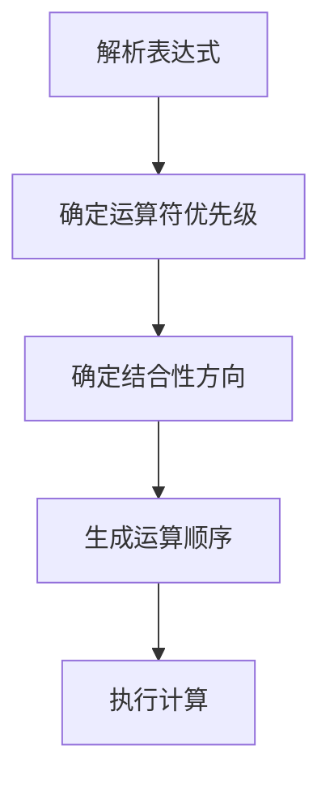
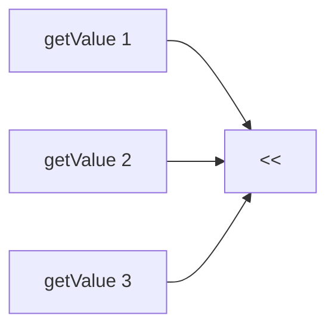

# 深入理解 C++ 运算符：优先级、结合性与求值顺序

## 一、运算符基础概念

### 1.1 核心术语解析
```cpp
int result = 5 + 3 * 2; // * 优先级高于 +
```
- **操作数**：表达式中的运算对象（如5, 3, 2）
- **运算符**：表示操作的符号（如+, *）
- **优先级**：决定运算执行顺序的等级
- **结合性**：相同优先级运算符的执行方向

### 1.2 表达式求值流程


## 二、运算符优先级与结合性详解

| 优先级/结合性 | 运算符                            | 描述 | 模式                                                               |
|---------|--------------------------------| --- |------------------------------------------------------------------|
| 1 L->R  | `::`                           | 全局命名空间（一元） | `::name`                                                         |
|         | `::`                           | 命名空间（二元） | `class_name::member_name`                                        |
| 2 L->R  | `()`                           | 括号 | `(expression)`                                                   |
|         | `()`                           | 函数调用 | `function_name(parameters)`                                      |
|         | `()`                           | 初始化 | `type name(expression)`                                          |
|         | `{}`                           | 列表初始化 | `type name{expression}`                                          |
|         | `type()`                       | 类型转换 | `new_type(expression)`                                           |
|         | `type{}`                       | 类型转换 | `new_type{expression}`                                           |
|         | `[]`                           | 数组下标取值 | `pointer[expression]`                                            |
|         | `.`                            | 取对象成员 | `object.member_name`                                             |
|         | `->`                           | 取对象指针的成员 | `object_pointer->member_name`                                    |
|         | `++`                           | 后自增 | `lvalue++`                                                       |
|         | `--`                           | 后自减 | `lvalue--`                                                       |
|         | `typeid`                       | 运行时类型信息 | `typeid(type)` 或 `typeid(expression)`                            |
|         | `const_cast`                   | 去掉类型的 `const` 限定 | `const_cast(expression)`                                         |
|         | `dynamic_cast`                 | 运行时类型转换 | `dynamic_cast(expression)`                                       |
|         | `reinterpret_cast`             | 强制类型转换 | `reinterpret_cast(expression)`                                   |
|         | `static_cast`                  | 编译时类型转换 | `static_cast(expression)`                                        |
|         | `sizeof...`                    | 获取模板打包的参数个数 | `sizeof...(expression)`                                          |
|         | `noexcept`                     | 编译时异常检查 | `noexcept(expression)`                                           |
|         | `alignof`                      | 获取类型对齐方式 | `alignof(type)`                                                  |
| 3 R->L  | `+`                            | 一元加 | `+expression`                                                    |
|         | `-`                            | 一元减 | `-expression`                                                    |
|         | `++`                           | 前自增 | `++lvalue`                                                       |
|         | `--`                           | 前自减 | `--lvalue`                                                       |
|         | `!`                            | 逻辑非 | `!expression`                                                    |
|         | `not`                          | 逻辑非 | `not expression`                                                 |
|         | `~`                            | 按位取反 | `~expression`                                                    |
|         | `(type)`                       | C 样式类型转换 | `(new_type)expression`                                           |
|         | `sizeof`                       | 求字节大小 | `sizeof(type)` 或 `sizeof(expression)`                            |
|         | `co_await`                     | 异步 Await 调用（C++20） | `co_await expression`                                            |
|         | `&`                            | 取对象地址 | `&lvalue`                                                        |
|         | `*`                            | 解引用 | `*expression`                                                    |
|         | `new`                          | 动态内存分配 | `new type`                                                       |
|         | `new[]`                        | 动态数组内存分配 | `new type[expression]`                                           |
|         | `delete`                       | 动态内存回收 | `delete pointer`                                                 |
|         | `delete[]`                     | 动态数组内存回收 | `delete[] pointer`                                               |
| 4 L->R  | `->*`                          | 成员指针访问 | `object_pointer->*pointer_to_member`                             |
|         | `.*`                           | 成员对象访问 | `object.*pointer_to_member`                                      |
| 5 L->R  | `*`                            | 乘 | `expression * expression`                                        |
|         | `/`                            | 除 | `expression / expression`                                        |
|         | `%`                            | 余数 | `expression % expression`                                        |
| 6 L->R  | `+`                            | 加 | `expression + expression`                                        |
|         | `-`                            | 减 | `expression - expression`                                        |
| 7 L->R  | `<<`                           | 按位左移/插入 | `expression << expression`                                       |
|         | `>>`                           | 按位右移/提取 | `expression >> expression`                                       |
| 8 L->R  | `<=>`                          | 三向比较 | `expression <=> expression`                                      |
| 9 L->R  | `<`                            | 小于比较 | `expression < expression`                                        |
|         | `<=`                           | 小于等于比较 | `expression <= expression`                                       |
|         | `>`                            | 大于比较 | `expression > expression`                                        |
|         | `>=`                           | 大于等于比较 | `expression >= expression`                                       |
| 10 L->R | `==`                           | 相等比较 | `expression == expression`                                       |
|         | `!=`                           | 不相等比较 | `expression != expression`                                       |
| 11 L->R | `&`                            | 按位 And | `expression & expression`                                        |
| 12 L->R | `^`                            | 按位 XOR | `expression ^ expression`                                        |
| 13 L->R | `                      \|`     | 按位 OR | `expression \| expression`                                       |
| 14 L->R | `&&`                           | 逻辑 AND | `expression && expression`                                       |
|         | `and`                          | 逻辑 AND | `expression and expression`                                      |
| 15 L->R | `\|\|`                         | 逻辑 OR | `expression                            \|\| expression`          |
|         | `or`                           | 逻辑 OR | `expression or expression`                                       |
| 16 R->L | `throw`                        | 抛出异常 | `throw expression`                                               |
|         | `co_yield`                     | Yield 表达式（C++20） | `co_yield expression`                                            |
|         | `?:`                           | 条件表达式 | `expression ? expression : expression`                           |
|         | `=`                            | 赋值 | `lvalue = expression`                                            |
|         | `*=`                           | 乘赋值 | `lvalue *= expression`                                           |
|         | `/=`                           | 除赋值 | `lvalue /= expression`                                           |
|         | `%=`                           | 余数赋值 | `lvalue %= expression`                                           |
|         | `+=`                           | 加赋值 | `lvalue += expression`                                           |
|         | `-=`                           | 减赋值 | `lvalue -= expression`                                           |
|         | `<<=`                          | 按位左移赋值 | `lvalue <<= expression`                                          |
|         | `>>=`                          | 按位右移赋值 | `lvalue >>= expression`                                          |
|         | `&=`                           | 按位 And 赋值 | `lvalue &= expression`                                           |
|         | `                         \|=` | 按位 Or 赋值                               | `lvalue \|= expression` |
|         | `^=`                           | 按位 Xor 赋值 | `lvalue ^= expression`                                           |
| 17 L->R | `,`                            | 逗号运算符 | `expression, expression`                                         |

>备注
>- 优先级 1 是最高的优先级，级别 17 是最低的优先级。具有更高优先级的运算符首先对其操作数进行分组。
>- `L->R` 表示从左到右的结合性。
>- `R->L` 表示从右到左的结合性。


### 2.1 优先级层级表（节选关键运算符）

| 优先级 | 结合性   | 运算符               | 示例          | 说明                     |
|--------|----------|----------------------|---------------|--------------------------|
| 1      | L→R      | `::`                 | `std::cout`   | 作用域解析               |
| 2      | L→R      | `()` `[]` `.` `->`   | `arr[5]`      | 函数调用/成员访问         |
| 3      | R→L      | `++` `--` `!` `~`    | `!flag`       | 一元运算符               |
| 5      | L→R      | `*` `/` `%`          | `a % b`       | 算术运算                 |
| 6      | L→R      | `+` `-`              | `x + y`       | 加减运算                 |
| 14     | L→R      | `&&`                 | `a && b`      | 逻辑与                   |
| 16     | R→L      | `=` `+=` `*=`        | `x *= 2`      | 赋值运算符               |

### 2.2 结合性示意图
```cpp
int a = 8 / 4 / 2; // 等价于 (8 / 4) / 2 = 1
int b = x = y = 5; // 等价于 x = (y = 5)
```

| 结合性类型 | 运算符示例        | 运算顺序         |
|------------|-------------------|------------------|
| 左→右      | `a + b + c`       | `(a + b) + c`   |
| 右→左      | `a = b = c`       | `a = (b = c)`   |

## 三、括号的妙用与最佳实践
### 3.1 优先级覆盖规则
```cpp
// 不加括号
int result1 = 5 + 3 * 2;   // 11

// 显式括号
int result2 = (5 + 3) * 2; // 16
```

### 3.2 推荐使用场景
```cpp
// 复杂逻辑表达式
if ((x > 0) && (y < 10) || (z != 5))  // 易混淆
if (((x > 0) && (y < 10)) || (z != 5)) // 明确

// 位运算组合
int flags = (READ | WRITE) & ~EXEC;  // 明确优先级
```

## 四、求值顺序陷阱与解决方案
### 4.1 未指定求值顺序示例
```cpp
#include <iostream>

int getValue() {
    static int count = 0;
    return ++count;
}

int main() {
    std::cout << getValue() << getValue() << getValue(); // 输出可能是123/321等
}
```

### 4.2 求值顺序可视化



### 4.3 安全写法实践
```cpp
// 不安全写法
int x = f() + g() * h();

// 安全写法
int a = f();
int b = g();
int c = h();
int x = a + b * c;
```

## 五、常见错误案例分析
### 5.1 自增运算符陷阱
```cpp
int i = 0;
int j = ++i + i++; // 未定义行为
```

### 5.2 短路求值特性
```cpp
bool result = (ptr != nullptr) && (ptr->value > 5); // 安全访问
```

## 六、特殊运算符解析
### 6.1 C++20 三向比较符
```cpp
auto cmp = (a <=> b);
if (cmp < 0)  // a < b
else if (cmp > 0) // a > b
else         // a == b
```

### 6.2 位运算符优先级表
| 运算符  | 优先级 | 示例             |
|------|--------|----------------|
| `<<` | 7      | `a << 1`       |
| `>>` | 7      | `b >> 2`       |
| `&`  | 11     | `mask & 0xFF`  |
| `^`  | 12     | `flags ^ 0x0F` |
| `\|` | 13     | `options \| 1` |

## 七、最佳实践指南
### 7.1 优先级处理原则
1. **四则运算**：保持自然数学顺序
2. **位运算**：始终使用括号
3. **混合运算**：显式声明优先级

### 7.2 代码可读性建议
```cpp
// 不易读
int x=y*3+4<<2;

// 推荐写法
int x = (y * 3 + 4) << 2;
```

## 八、综合应用测试
### 8.1 复杂表达式解析练习
```cpp
int a = 5, b = 3, c = 2;
int result = ++a * b-- + c << 2 / (a > b ? 1 : 2);

// 分步解析：
// 1. ++a → a=6
// 2. b-- → 使用3后b=2
// 3. 6 * 3 = 18
// 4. a > b → 6>2 → true
// 5. 2 / 1 = 2
// 6. 18 + 2 = 20
// 7. 20 << 2 = 80
```

### 8.2 运算符优先级速查表
```cpp
// 常用运算符优先级速记口诀：
// 括号成员第一       []() . ->
// 单目运算第二       ! ~ ++ -- 
// 乘除取余第三       * / %
// 加减移位第四       + - << >>
// 比较运算符第五     < <= > >=
// 相等判断第六       == !=
// 位与异或或第七     & ^ |
// 逻辑与或第八       && ||
// 条件赋值第九       ?: = 
```

通过系统理解运算符的优先级和结合性规则，结合明确的代码书写规范，可以有效避免表达式求值错误，提升代码质量和可维护性。在复杂场景中，**显式优于隐式**的原则应始终贯彻于编码实践中。