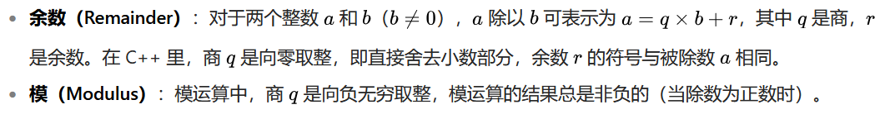

# 深入理解 C++ 中的余数和指数运算

## 一、余数运算符（operator%）

### 1.1 基本概念与用法
余数运算符（`%`）用于计算两个整数相除后的余数。其语法形式为：
```cpp
int result = a % b;  // 计算 a 除以 b 的余数
```

#### 示例代码
```cpp
#include <iostream>

int main() {
    int x = 7, y = 4;
    std::cout << "7 % 4 = " << x % y << '\n';  // 输出 3
    return 0;
}
```

#### 关键特性
- **适用类型**：仅适用于整数类型（`int`、`long` 等）。
- **结果符号**：结果的符号与被除数（第一个操作数）相同。
- **整除判断**：如果 `x % y == 0`，则 `x` 能被 `y` 整除。

### 1.2 负数余数的处理
余数运算符的结果符号与被除数一致：
```cpp
std::cout << "-6 % 4 = " << -6 % 4 << '\n';  // 输出 -2
std::cout << "6 % -4 = " << 6 % -4 << '\n';  // 输出 2
```

#### 注意事项
- **负数余数**：当被除数为负数时，余数也为负数。
- **整除判断优化**：判断奇偶性时，应使用 `x % 2 != 0` 而非 `x % 2 == 1`，以避免负数问题。

#### 示例：判断奇偶性
```cpp
bool isOdd(int x) {
    return x % 2 != 0;  // 正确处理负数
}
```

### 1.3 术语澄清
在C++里，`%` 运算符执行的是余数运算，而模运算在C++中没有直接对应的运算符，但可以通过特定公式实现。下面详细阐述它们的区别并给出示例。

### 定义区别



### 代码示例

```cpp
#include <iostream>
#include <cmath>

// 自定义模运算函数
int mod(int a, int b) {
    return a - b * std::floor(static_cast<double>(a) / b);
}

int main() {
    // 示例 1：正数除以正数
    int a1 = 13;
    int b1 = 5;
    std::cout << "正数除以正数：" << std::endl;
    std::cout << "余数（a1 % b1）: " << a1 % b1 << std::endl; 
    // 计算过程：13 = 2 * 5 + 3，商 2 是向零取整，余数 3 为最终结果
    std::cout << "模（mod(a1, b1)）: " << mod(a1, b1) << std::endl; 
    // 计算过程：13 = 2 * 5 + 3，商 2 是向负无穷取整，模 3 为最终结果

    // 示例 2：负数除以正数
    int a2 = -13;
    int b2 = 5;
    std::cout << "\n负数除以正数：" << std::endl;
    std::cout << "余数（a2 % b2）: " << a2 % b2 << std::endl; 
    // 计算过程：-13 = -2 * 5 - 3，商 -2 是向零取整，余数 -3 为最终结果
    std::cout << "模（mod(a2, b2)）: " << mod(a2, b2) << std::endl; 
    // 计算过程：-13 = -3 * 5 + 2，商 -3 是向负无穷取整，模 2 为最终结果

    // 示例 3：正数除以负数
    int a3 = 13;
    int b3 = -5;
    std::cout << "\n正数除以负数：" << std::endl;
    std::cout << "余数（a3 % b3）: " << a3 % b3 << std::endl; 
    // 计算过程：13 = -2 * (-5) + 3，商 -2 是向零取整，余数 3 为最终结果
    std::cout << "模（mod(a3, b3)）: " << mod(a3, b3) << std::endl; 
    // 计算过程：13 = -3 * (-5) - 2，商 -3 是向负无穷取整，模 -2 为最终结果

    // 示例 4：负数除以负数
    int a4 = -13;
    int b4 = -5;
    std::cout << "\n负数除以负数：" << std::endl;
    std::cout << "余数（a4 % b4）: " << a4 % b4 << std::endl; 
    // 计算过程：-13 = 2 * (-5) - 3，商 2 是向零取整，余数 -3 为最终结果
    std::cout << "模（mod(a4, b4)）: " << mod(a4, b4) << std::endl; 
    // 计算过程：-13 = 3 * (-5) + 2，商 3 是向负无穷取整，模 2 为最终结果

    return 0;
}
```

### 代码解释
1. **余数运算**：使用 `%` 运算符进行计算，其结果的符号与被除数相同，因为商是向零取整。
2. **模运算**：通过自定义函数 `mod` 实现，函数内部使用 `std::floor` 函数将商向负无穷取整，然后根据公式 r = a - b * q 计算模。

### 总结


| 运算类型 | 数学定义          | C++ 实现          |
|----------|-------------------|-------------------|
| 余数     | 符号与被除数一致  | `x % y`           |
| 模       | 结果始终为非负数  | 需额外处理        |

在C++中，`%` 运算符实现的余数运算和自定义的模运算的主要区别在于商的取整规则不同。余数运算的商向零取整，而模运算的商向负无穷取整，这导致它们在处理负数时结果可能不同。

---

## 二、指数运算

### 2.1 C++ 中的指数运算
C++ 没有内置的指数运算符，但可以通过 `<cmath>` 库中的 `pow()` 函数实现：
```cpp
#include <cmath>
double result = std::pow(3.0, 4.0);  // 计算 3 的 4 次方
```

#### 注意事项
- **浮点数精度**：`pow()` 的参数和返回值均为 `double` 类型，可能存在精度问题。
- **整数求幂**：需要自定义函数以避免浮点数精度问题。

### 2.2 自定义整数求幂函数
以下是一个高效的整数求幂函数实现：

#### 示例代码
```cpp
#include <cassert>
#include <cstdint>
#include <iostream>

constexpr std::int64_t powint(std::int64_t base, int exp) {
    assert(exp >= 0 && "powint: exp parameter has negative value");

    std::int64_t result = 1;
    while (exp > 0) {
        if (exp & 1)  // 如果 exp 为奇数
            result *= base;
        exp /= 2;
        base *= base;
    }
    return result;
}

int main() {
    std::cout << "7^12 = " << powint(7, 12) << '\n';  // 输出 13841287201
    return 0;
}
```

#### 算法解析
- **平方求幂法**：通过不断平方和累乘减少计算次数。
- **时间复杂度**：O(log n)，效率较高。

### 2.3 安全版本的整数求幂函数
为防止溢出，可以添加边界检查：

#### 示例代码
```cpp
#include <cassert>
#include <cstdint>
#include <iostream>
#include <limits>

constexpr std::int64_t powint_safe(std::int64_t base, int exp) {
    assert(exp >= 0 && "powint_safe: exp parameter has negative value");

    std::int64_t result = 1;
    bool negativeResult = false;

    if (base < 0) {
        base = -base;
        negativeResult = (exp & 1);
    }

    while (exp > 0) {
        if (exp & 1) {
            if (result > std::numeric_limits<std::int64_t>::max() / base) {
                std::cerr << "Overflow detected!\n";
                return std::numeric_limits<std::int64_t>::max();
            }
            result *= base;
        }
        exp /= 2;
        if (exp <= 0) break;

        if (base > std::numeric_limits<std::int64_t>::max() / base) {
            std::cerr << "Overflow detected!\n";
            return std::numeric_limits<std::int64_t>::max();
        }
        base *= base;
    }

    return negativeResult ? -result : result;
}

int main() {
    std::cout << "7^12 = " << powint_safe(7, 12) << '\n';  // 输出 13841287201
    return 0;
}
```

#### 关键特性
- **溢出检查**：在每次乘法前检查是否会导致溢出。
- **负数处理**：支持负底数的指数运算。

---

## 三、综合应用与最佳实践

### 3.1 余数运算的应用场景
- **循环索引**：计算循环中的索引位置。
  ```cpp
  for (int i = 0; i < 100; ++i) {
      if (i % 10 == 0) std::cout << '\n';  // 每 10 个元素换行
      std::cout << i << ' ';
  }
  ```
- **哈希函数**：用于哈希表的索引计算。

### 3.2 指数运算的应用场景
- **加密算法**：如 RSA 算法中的大数幂运算。
- **科学计算**：如计算物理公式中的幂次项。

### 3.3 最佳实践总结
| 场景                | 推荐方法                     | 理由                             |
|---------------------|------------------------------|----------------------------------|
| 整数求余            | 使用 `%` 运算符              | 简单高效                         |
| 判断整除            | `x % y == 0`                 | 避免负数问题                     |
| 浮点数指数运算      | 使用 `std::pow()`            | 标准库支持                       |
| 整数指数运算        | 自定义 `powint()` 函数       | 避免浮点数精度问题               |
| 防止溢出            | 使用 `powint_safe()` 函数    | 安全处理大数运算                 |

---

## 四、总结与扩展

### 4.1 核心知识点回顾
- **余数运算符**：用于整数除法后的余数计算，结果符号与被除数一致。
- **指数运算**：C++ 中需使用 `std::pow()` 或自定义函数实现。
- **安全编程**：处理负数余数和整数溢出问题。

### 4.2 扩展学习
- **模运算**：了解数学中的模运算与 C++ 余数运算的区别。
- **大数运算**：学习如何处理超出标准数据类型范围的运算。
- **算法优化**：深入研究平方求幂法等高效算法。

通过掌握余数和指数运算的核心知识点，您可以在实际编程中更高效地处理数学计算问题，并避免常见的错误和陷阱。