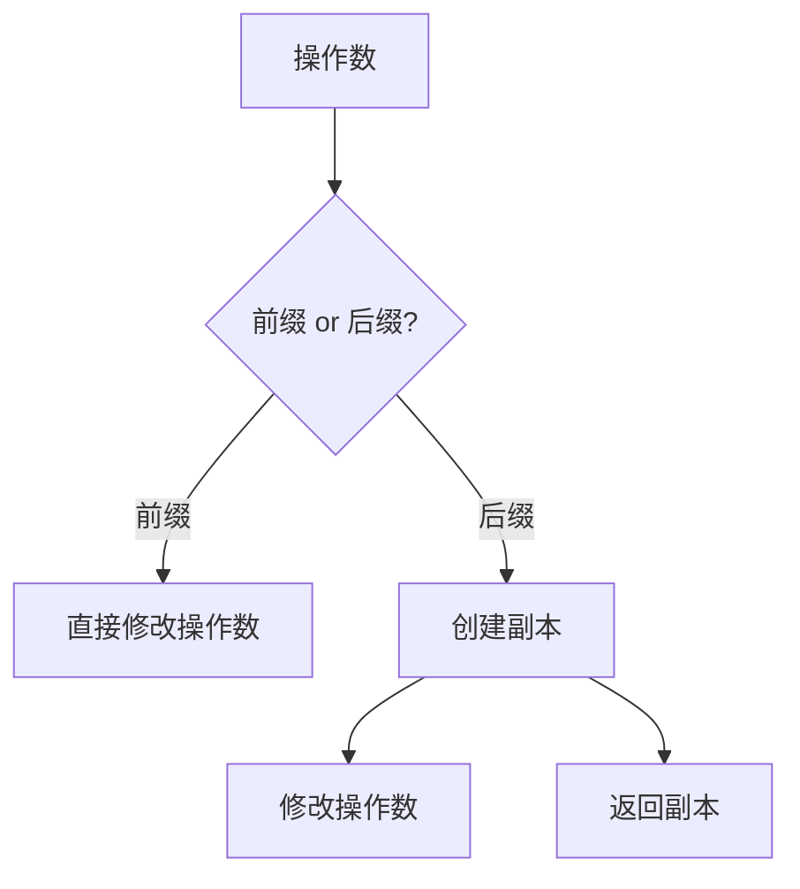

# C++ 自增/自减运算符与副作用


## 一、自增/自减运算符概述
### 1.1 运算符分类与行为
| 运算符类型   | 符号 | 使用形式 | 行为描述                                                                 |
|--------------|------|----------|--------------------------------------------------------------------------|
| 前缀自增     | `++` | `++x`    | 先对 `x` 加 1，然后返回 `x` 的值                                         |
| 前缀自减     | `--` | `--x`    | 先对 `x` 减 1，然后返回 `x` 的值                                         |
| 后缀自增     | `++` | `x++`    | 先创建 `x` 的副本，然后对 `x` 加 1，最后返回副本的值                     |
| 后缀自减     | `--` | `x--`    | 先创建 `x` 的副本，然后对 `x` 减 1，最后返回副本的值                     |

### 1.2 代码示例
```cpp
#include <iostream>

int main() {
    int x = 5;
    int y = ++x; // x 增加到 6，y 被赋值为 6
    std::cout << "Prefix: x = " << x << ", y = " << y << '\n';

    x = 5;
    y = x++; // y 被赋值为 5，x 增加到 6
    std::cout << "Postfix: x = " << x << ", y = " << y << '\n';

    return 0;
}
```
**输出**：
```
Prefix: x = 6, y = 6
Postfix: x = 6, y = 5
```

---

## 二、前缀与后缀运算符的详细对比
### 2.1 前缀运算符
- **行为**：先修改操作数，再返回修改后的值。
- **性能**：通常更高效，因为不需要创建临时副本。
- **适用场景**：当不需要原始值时优先使用。

### 2.2 后缀运算符
- **行为**：先创建操作数的副本，再修改操作数，最后返回副本的值。
- **性能**：由于需要创建临时副本，性能略低。
- **适用场景**：需要原始值的情况下使用。

### 2.3 性能对比


---

## 三、副作用与求值顺序
### 3.1 副作用定义
- **副作用**：表达式或函数除了返回值外，还有一些可观察的效果
- **常见副作用**：
    - 修改变量的值（如 `x++`）
    - 输入/输出操作（如 `std::cout << x`）
    - 更新 GUI 状态
  
这些副作用是有用的，副作用可以理解为额外的行为
  
### 3.2 副作用示例
```cpp
int x = 5;
int y = x++; // 副作用：x 的值从 5 变为 6
std::cout << y; // 副作用：输出 y 的值
```

### 3.3 求值顺序问题
- **未定义行为**：C++ 标准未规定函数参数或操作数的求值顺序。
- **示例**：
```cpp
int x = 5;
int value = add(x, ++x); // 未定义行为：可能是 add(5, 6) 或 add(6, 6)
```

**警告**：
- 不要在同一个语句中多次使用具有副作用的变量。
- 避免依赖未定义的求值顺序。

---

## 四、综合应用与最佳实践
### 4.1 前缀与后缀的选择
- **优先使用前缀**：性能更高，行为更直观。
- **后缀使用场景**：需要原始值的情况下。

### 4.2 副作用管理
- **避免未定义行为**：
    - 不要在同一个语句中多次使用具有副作用的变量。
    - 避免依赖未定义的求值顺序。

### 4.3 代码示例
```cpp
#include <iostream>

int main() {
    int x = 5, y = 5;
    std::cout << "Initial: x = " << x << ", y = " << y << '\n';

    // 前缀操作
    std::cout << "Prefix: " << ++x << ' ' << --y << '\n'; // x=6, y=4
    std::cout << "After Prefix: x = " << x << ", y = " << y << '\n';

    // 后缀操作
    std::cout << "Postfix: " << x++ << ' ' << y-- << '\n'; // 输出 x=6, y=4
    std::cout << "After Postfix: x = " << x << ", y = " << y << '\n'; // x=7, y=3

    return 0;
}
```
**输出**：
```
Initial: x = 5, y = 5
Prefix: 6 4
After Prefix: x = 6, y = 4
Postfix: 6 4
After Postfix: x = 7, y = 3
```

---

## 五、总结与关键点
### 5.1 关键知识点
| 主题               | 关键点                                                                 |
|--------------------|------------------------------------------------------------------------|
| 前缀运算符         | 先修改操作数，再返回值；性能高，优先使用                               |
| 后缀运算符         | 先创建副本，再修改操作数，返回副本；性能略低，需原始值时使用           |
| 副作用             | 表达式或函数对程序状态的影响；常见于变量修改、I/O 操作等               |
| 求值顺序           | C++ 未定义函数参数或操作数的求值顺序；避免依赖未定义行为               |
| 最佳实践           | 优先使用前缀运算符；避免在同一个语句中多次使用具有副作用的变量         |

### 5.2 注意事项
- **性能**：前缀运算符通常比后缀运算符更高效。
- **可读性**：明确使用前缀或后缀，避免混淆。
- **安全性**：避免未定义行为，确保代码的可移植性和稳定性。

通过深入理解自增/自减运算符的行为和副作用，开发者可以编写出更高效、更安全的 C++ 代码。