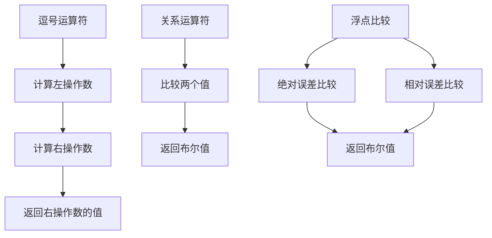

### 关系运算符与浮点比较

#### 关系运算符
关系运算符用于比较两个值，返回布尔值 `true` 或 `false`。

| 运算符 | 符号 | 使用形式 | 结果 |
|--------|------|----------|------|
| 大于   | `>`  | `x > y`  | `x` 大于 `y` 返回 `true`，否则 `false` |
| 小于   | `<`  | `x < y`  | `x` 小于 `y` 返回 `true`，否则 `false` |
| 大于等于 | `>=` | `x >= y` | `x` 大于等于 `y` 返回 `true`，否则 `false` |
| 小于等于 | `<=` | `x <= y` | `x` 小于等于 `y` 返回 `true`，否则 `false` |
| 等于   | `==` | `x == y` | `x` 等于 `y` 返回 `true`，否则 `false` |
| 不等于 | `!=` | `x != y` | `x` 不等于 `y` 返回 `true`，否则 `false` |

#### 示例代码
```cpp
#include <iostream>

int main() {
    int x, y;
    std::cout << "Enter two integers: ";
    std::cin >> x >> y;

    if (x == y) std::cout << x << " equals " << y << '\n';
    if (x != y) std::cout << x << " does not equal " << y << '\n';
    if (x > y)  std::cout << x << " is greater than " << y << '\n';
    if (x < y)  std::cout << x << " is less than " << y << '\n';
    if (x >= y) std::cout << x << " is greater than or equal to " << y << '\n';
    if (x <= y) std::cout << x << " is less than or equal to " << y << '\n';

    return 0;
}
```

#### 布尔条件值
- 避免在条件语句中使用冗余的 `== true` 或 `== false`。
- 例如：
  ```cpp
  if (b1) ... // 推荐
  if (b1 == true) ... // 不推荐
  ```

#### 浮点比较问题
浮点数在计算机中存储不精确，导致比较时可能出现意外结果。

##### 示例代码
```cpp
#include <iostream>

int main() {
    double d1{100.0 - 99.99}; // 应为 0.01
    double d2{10.0 - 9.99};   // 应为 0.01

    if (d1 == d2) std::cout << "d1 == d2\n";
    else if (d1 > d2) std::cout << "d1 > d2\n";
    else if (d1 < d2) std::cout << "d1 < d2\n";

    return 0;
}
```
- **输出**: `d1 > d2`

#### 浮点比较解决方案
##### 绝对误差比较
```cpp
bool approximatelyEqualAbs(double a, double b, double absEpsilon) {
    return std::abs(a - b) <= absEpsilon;
}
```

##### 相对误差比较（Knuth方法）
```cpp
bool approximatelyEqualRel(double a, double b, double relEpsilon) {
    return std::abs(a - b) <= (std::max(std::abs(a), std::abs(b)) * relEpsilon;
}
```

##### 结合绝对与相对误差
```cpp
bool approximatelyEqualAbsRel(double a, double b, double absEpsilon, double relEpsilon) {
    if (std::abs(a - b) <= absEpsilon) return true;
    return approximatelyEqualRel(a, b, relEpsilon);
}
```

#### 示例代码
```cpp
#include <iostream>
#include <cmath>
#include <algorithm>

bool approximatelyEqualRel(double a, double b, double relEpsilon) {
    return (std::abs(a - b) <= (std::max(std::abs(a), std::abs(b)) * relEpsilon));
}

bool approximatelyEqualAbsRel(double a, double b, double absEpsilon, double relEpsilon) {
    if (std::abs(a - b) <= absEpsilon) return true;
    return approximatelyEqualRel(a, b, relEpsilon);
}

int main() {
    constexpr double a{0.1 + 0.1 + 0.1 + 0.1 + 0.1 + 0.1 + 0.1 + 0.1 + 0.1 + 0.1};
    constexpr double relEps{1e-8};
    constexpr double absEps{1e-12};

    std::cout << approximatelyEqualRel(a, 1.0, relEps) << '\n';
    std::cout << approximatelyEqualRel(a - 1.0, 0.0, relEps) << '\n';

    std::cout << approximatelyEqualAbsRel(a, 1.0, absEps, relEps) << '\n';
    std::cout << approximatelyEqualAbsRel(a - 1.0, 0.0, absEps, relEps) << '\n';

    return 0;
}
```
- **输出**: `1 0 1 1`

#### 高级：`constexpr` 函数
在C++23中，可以将浮点比较函数设为 `constexpr`：
```cpp
constexpr bool approximatelyEqualRel(double a, double b, double relEpsilon) {
    return (std::abs(a - b) <= (std::max(std::abs(a), std::abs(b)) * relEpsilon);
}
```

#### 总结
- **关系运算符** 用于比较两个值，返回布尔结果。
- **浮点比较** 由于精度问题，需使用误差范围进行比较。
- **最佳实践**：避免直接使用 `==` 和 `!=` 比较浮点数，使用误差范围函数进行比较。

---

### 总结表格

| 运算符类型 | 符号 | 使用形式 | 结果 | 注意事项 |
|------------|------|----------|------|----------|
| 逗号运算符 | `,`  | `x, y`   | 返回 `y` 的值 | 优先级最低，避免使用 |
| 关系运算符 | `>`, `<`, `>=`, `<=`, `==`, `!=` | `x > y` 等 | 返回布尔值 | 浮点数比较需谨慎 |
| 浮点比较   | 自定义函数 | `approximatelyEqualAbsRel(a, b, absEps, relEps)` | 返回布尔值 | 使用绝对和相对误差 |

---

### Mermaid 图表示



---

### 代码案例总结

- **逗号运算符**：用于在单个表达式位置编写多个表达式，返回右操作数的值。
- **关系运算符**：用于比较两个值，返回布尔结果。
- **浮点比较**：由于浮点数精度问题，需使用误差范围函数进行比较。

通过以上内容，您可以更清晰地理解逗号运算符、关系运算符以及浮点比较的相关知识点。


---

