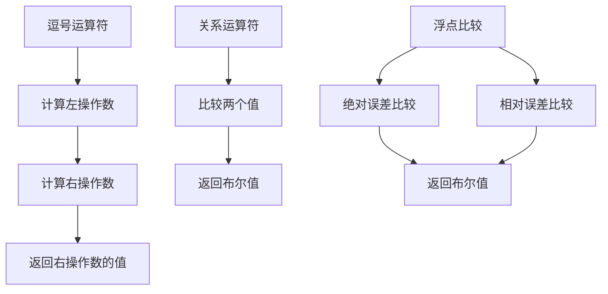

# 要点总结

### 1. 运算符优先级和结合性

> - 常用运算符优先级速记口诀：
> - 括号成员第一        . ->
> - 单目运算第二       ! ~ ++ -- 
> - 乘除取余第三       * / %
> - 加减移位第四       + - << >>
> - 比较运算符第五     < <= > >=
> - 相等判断第六       == !=
> - 位与异或或第七     & ^ |
> - 或第八       && ||
> - 条件赋值第九       ?: = 

### 2.算数运算符

1. **避免除零**：始终检查除数是否为零
2. **类型转换**：使用 `static_cast` 进行显式类型转换
3. **赋值运算符**：优先使用复合赋值运算符以提高代码效率
4. **浮点精度**：注意浮点数运算的精度问题

### 3.余数和指数

余数和模的区别：

| 运算类型 | 数学定义          | C++ 实现          |
|----------|-------------------|-------------------|
| 余数     | 符号与被除数一致  | `x % y`           |
| 模       | 结果始终为非负数  | 需额外处理        |

| 场景                | 推荐方法                     | 理由                             |
|---------------------|------------------------------|----------------------------------|
| 整数求余            | 使用 `%` 运算符              | 简单高效                         |
| 判断整除            | `x % y == 0`                 | 避免负数问题                     |
| 浮点数指数运算      | 使用 `std::pow()`            | 标准库支持                       |
| 整数指数运算        | 自定义 `powint()` 函数       | 避免浮点数精度问题               |
| 防止溢出            | 使用 `powint_safe()` 函数    | 安全处理大数运算                 |

### 4.自增自减运算符

优先使用前缀运算符，更高效，没有副本，

### 5.逗号运算符，关系运算符，逻辑运算符

- **避免使用逗号运算符**，除非在 `for` 循环中。

#### 短路求值：
逻辑与和逻辑或运算符支持短路求值：
- 对于 `&&`，如果左操作数为 false，则不会计算右操作数。
- 对于 `||`，如果左操作数为 true，则不会计算右操作数。

#### 德摩根定律：
德摩根定律描述了逻辑非与逻辑与、逻辑或之间的关系：
- `!(x && y)` 等价于 `!x || !y`
- `!(x || y)` 等价于 `!x && !y`

| 运算符类型 | 符号 | 使用形式 | 结果 | 注意事项 |
|------------|------|----------|------|----------|
| 逗号运算符 | `,`  | `x, y`   | 返回 `y` 的值 | 优先级最低，避免使用 |
| 关系运算符 | `>`, `<`, `>=`, `<=`, `==`, `!=` | `x > y` 等 | 返回布尔值 | 浮点数比较需谨慎 |
| 浮点比较   | 自定义函数 | `approximatelyEqualAbsRel(a, b, absEps, relEps)` | 返回布尔值 | 使用绝对和相对误差 |

