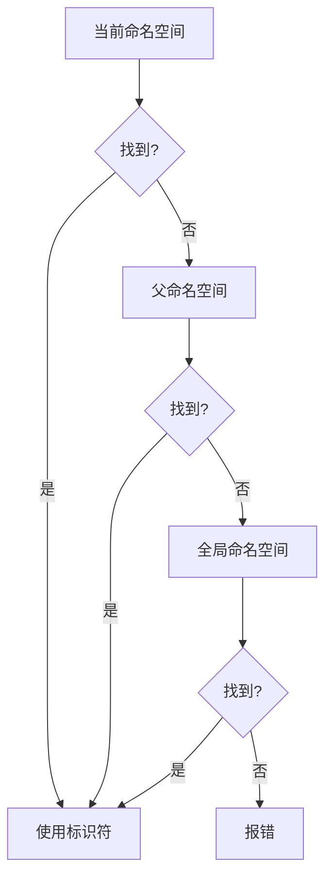

# 命名空间与作用域解析运算符详解

---

## **1. 命名冲突与命名空间的必要性**
**命名冲突**：当同一作用域中出现相同名称的标识符时，编译器无法区分，导致错误。  
**原因**：随着程序规模扩大，标识符数量增加，潜在冲突呈指数级增长。  
**解决方案**：使用**命名空间**隔离标识符的作用域。

### 示例：命名冲突案例
```cpp
// foo.cpp
int doSomething(int x, int y) { return x + y; }

// goo.cpp
int doSomething(int x, int y) { return x - y; }

// main.cpp
int main() {
    doSomething(4, 3); // 错误：多个定义
}
```
**错误**：链接器报告 `multiple definition of 'doSomething'`。

---

## **2. 定义自定义命名空间**
通过 `namespace` 关键字创建命名空间，隔离标识符的作用域。

### 语法
```cpp
namespace NamespaceName {
    // 变量、函数、类等
}
```

### 示例：解决冲突
```cpp
// foo.cpp
namespace Foo {
    int doSomething(int x, int y) { return x + y; }
}

// goo.cpp
namespace Goo {
    int doSomething(int x, int y) { return x - y; }
}

// main.cpp
int main() {
    Foo::doSomething(4, 3); // 正确：明确调用命名空间内的函数
    Goo::doSomething(4, 3);
}
```

---

## **3. 作用域解析运算符 `::`**
用于显式指定标识符所属的命名空间或类。

### 使用场景
| 场景                | 语法             | 说明                       |
|---------------------|------------------|----------------------------|
| 访问命名空间成员    | `Namespace::id`  | 指定命名空间中的标识符      |
| 访问全局命名空间    | `::id`           | 显式访问全局作用域中的标识符|

### 示例
```cpp
#include <iostream>

namespace Foo {
    void print() { std::cout << "Foo\n"; }
}

void print() { std::cout << "Global\n"; }

int main() {
    Foo::print(); // 输出 "Foo"
    ::print();    // 输出 "Global"
}
```

---

## **4. 命名空间的特性**

### **4.1 前向声明与头文件**
命名空间内的函数需在相同命名空间中声明和定义。

```cpp
// add.h
namespace BasicMath {
    int add(int x, int y); // 前向声明
}

// add.cpp
namespace BasicMath {
    int add(int x, int y) { return x + y; } // 定义
}

// main.cpp
#include "add.h"
int main() {
    std::cout << BasicMath::add(4, 3); // 正确
}
```

### **4.2 跨文件的命名空间**
同一命名空间可分散在多个文件中，编译器自动合并。

```cpp
// circle.h
namespace BasicMath { constexpr double pi = 3.14; }

// growth.h
namespace BasicMath { constexpr double e = 2.7; }

// main.cpp
#include "circle.h"
#include "growth.h"
int main() {
    std::cout << BasicMath::pi << ", " << BasicMath::e; // 输出 3.14, 2.7
}
```

### **4.3 嵌套命名空间**
命名空间可以嵌套，C++17支持简化语法。

```cpp
// 传统方式
namespace Foo {
    namespace Goo { 
        int add(int x, int y) { return x + y; }
    }
}

// C++17简化
namespace Foo::Goo {
    int add(int x, int y) { return x + y; }
}

// 调用
int main() {
    std::cout << Foo::Goo::add(1, 2); // 输出 3
}
```

### **4.4 命名空间别名**
简化长命名空间的访问。

```cpp
namespace VeryLongNamespaceName {
    void func() {}
}

int main() {
    namespace Short = VeryLongNamespaceName;
    Short::func(); // 等价于 VeryLongNamespaceName::func
}
```

---

## **5. 命名空间的最佳实践**
1. **避免命名冲突**：库代码必须置于自定义命名空间中。
2. **避免扩展 `std`**：向 `std` 添加内容会导致未定义行为。
3. **合理使用嵌套**：避免过度嵌套，保持结构清晰。
4. **优先使用作用域解析**：减少全局作用域的污染。

### 警告示例
```cpp
namespace std {
    void customFunc() {} // 错误！禁止扩展 std 命名空间
}
```

---

## **6. 命名空间的名称解析规则**
编译器按以下顺序查找标识符：
1. 当前命名空间 → 父命名空间 → 全局命名空间。
2. 若未找到，报错。

### 流程图（Mermaid）


---

## **7. 何时使用命名空间**
1. **代码模块化**：将相关功能分组（如 `Math::`、`Physics::`）。
2. **库开发**：防止与用户代码冲突。
3. **多团队协作**：隔离不同团队的代码。

### 示例：模块化设计
```cpp
namespace Graphics {
    void render() { /* ... */ }
}

namespace Network {
    void sendData() { /* ... */ }
}
```

---

### 总结
- **命名空间**是解决命名冲突的核心工具。
- **作用域解析运算符 `::`** 用于明确标识符的归属。
- 合理使用**嵌套命名空间**和**别名**提升代码可读性。
- 遵循最佳实践，避免污染全局作用域。