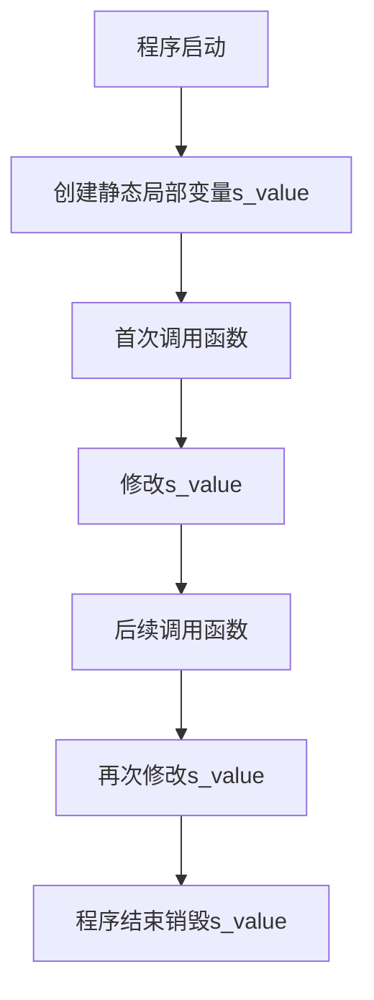

### C++ 静态局部变量详解

---

#### **1. 静态局部变量 vs 自动局部变量**
**核心区别**：静态局部变量具有**静态存储期**，在程序启动时创建，程序结束时销毁；自动局部变量具有**自动存储期**，在定义时创建，离开作用域时销毁。

| 特性               | 静态局部变量 (`static`)          | 自动局部变量 (默认)            |
|--------------------|--------------------------------|-------------------------------|
| 存储期             | 程序启动时创建，程序结束时销毁    | 进入作用域时创建，离开时销毁    |
| 初始化             | 仅初始化一次                    | 每次进入作用域时重新初始化      |
| 作用域             | 块作用域                       | 块作用域                      |
| 内存位置           | 全局数据区                     | 栈区                          |
| 默认初始化         | 零初始化（若未显式初始化）      | 未初始化时为随机值             |

---

#### **2. 静态局部变量的初始化规则**
- **显式初始化**：若使用 `constexpr` 或常量初始化，仅在程序启动时初始化一次。
- **隐式初始化**：未显式初始化的静态局部变量默认初始化为 `0`。
- **初始化时机**：首次执行到定义时初始化，后续调用跳过初始化。

##### 示例：静态局部变量的初始化
```cpp
#include <iostream>

void example() {
    static int s_value = 5;   // 程序启动时初始化
    static int s_uninit;      // 默认初始化为0
    std::cout << s_value++ << ", " << s_uninit++ << '\n';
}

int main() {
    example(); // 输出: 5, 0
    example(); // 输出: 6, 1
    example(); // 输出: 7, 2
}
```

---

#### **3. 应用场景**
##### **3.1 唯一ID生成器**
静态局部变量适合生成唯一序列号，每次调用保留上一次的值。

```cpp
int generateID() {
    static int s_id{0}; 
    return s_id++; // 返回当前值后自增
}

int main() {
    std::cout << generateID() << '\n'; // 0
    std::cout << generateID() << '\n'; // 1
    std::cout << generateID() << '\n'; // 2
}
```

##### **3.2 高成本初始化的常量**
若初始化成本高（如读取文件、数据库），使用 `const` 静态局部变量避免重复初始化。

```cpp
const std::string& getConfig() {
    static const std::string s_config = loadConfigFromFile(); // 仅初始化一次
    return s_config;
}
```

---

#### **4. 注意事项与陷阱**
##### **4.1 不要用静态局部变量控制程序流程**
静态局部变量的状态在多次调用间保留，可能导致不可预期的行为。

###### 反例：不可重用的函数
```cpp
#include <iostream>

int getInteger() {
    static bool s_isFirstCall{true};
    if (s_isFirstCall) {
        std::cout << "Enter an integer: ";
        s_isFirstCall = false;
    } else {
        std::cout << "Enter another integer: ";
    }
    int i;
    std::cin >> i;
    return i;
}

int main() {
    int a = getInteger(); // 提示 "Enter an integer: "
    int b = getInteger(); // 提示 "Enter another integer: "
    // 后续无法重置状态，导致其他模块调用时提示错误
}
```

###### 改进：通过参数传递状态
```cpp
int getInteger(bool isFirst) {
    if (isFirst) 
        std::cout << "Enter an integer: ";
    else 
        std::cout << "Enter another integer: ";
    int i;
    std::cin >> i;
    return i;
}
```

##### **4.2 多线程安全问题**
静态局部变量的初始化在多线程环境中可能引发竞态条件（需额外同步机制）。

---

#### **5. 最佳实践**
1. **明确初始化**：始终显式初始化静态局部变量。
2. **避免控制流程**：不要依赖静态局部变量管理函数状态。
3. **命名约定**：使用 `s_` 前缀标识静态局部变量（如 `s_counter`）。
4. **优先局部常量**：若需只读数据，使用 `const` 或 `constexpr`。

| 情景                 | 推荐做法                                     |
|----------------------|--------------------------------------------|
| 需要持久状态         | 使用静态局部变量                           |
| 高成本初始化         | 使用 `const` 静态局部变量                  |
| 需跨调用保持唯一性   | 静态局部变量生成ID或计数器                 |
| 需重置状态           | 使用参数传递状态，而非静态变量             |

---

#### **6. 生命周期图示（Mermaid）**


---

### 总结
- **静态局部变量**通过 `static` 关键字声明，生命周期与程序一致，适合需要跨调用保持状态的场景。
- **谨慎使用**：避免滥用导致代码难以理解和维护，尤其在多线程环境中。
- **替代方案**：优先考虑参数传递或面向对象设计管理状态。