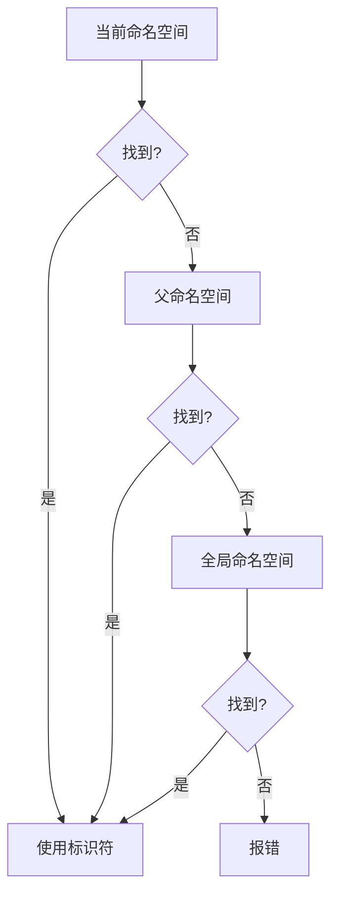

# 要点总结

### 1.自定义命名空间，作用域限定符

命名空间解决命名冲突问题，可以嵌套，使用::访问，别名可以简化长命名空间的访问

| 场景                | 语法             | 说明                       |
|---------------------|------------------|----------------------------|
| 访问命名空间成员    | `Namespace::id`  | 指定命名空间中的标识符      |
| 访问全局命名空间    | `::id`           | 显式访问全局作用域中的标识符|

使用推荐：
1. **代码模块化**：将相关功能分组（如 `Math::`、`Physics::`）。
2. **库开发**：防止与用户代码冲突。
3. **多团队协作**：隔离不同团队的代码。

编译器按以下顺序查找标识符：
1. 当前命名空间 → 父命名空间 → 全局命名空间。
2. 若未找到，报错。

### 流程图（Mermaid）



### 2.局部变量

局部变量没有链接属性，局部变量具有自动存储期

### 3.全局变量
- 在全局命名空间中声明的标识符具有全局命名空间作用域，这表明这些标识符从声明点开始，一直到声明它们的文件末尾都是可见的。
- 在命名空间内声明的变量同样是全局变量
- 全局变量具有静态存储期，这意味着它们在程序启动时就会被创建，直到程序结束才会被销毁
- 全局变量标识符前面加上“g”或者“g_”来命名
- 具有静态存储期的全局变量默认会被零初始化
    int g_x;       // 未显式初始化 (默认被初始化为 0)
    int g_y {};    // 值初始化 (被初始化为 0)
    int g_z { 1 }; // 使用特定的值，进行列表初始化

| 全局变量的主要问题 | 解决方案                     |
|-----------|------------------------------|
| 不可预测的程序状态 | 使用局部变量                 |
| 调试困难      | 封装全局变量                 |
| 降低模块化     | 使用函数参数传递数据         |
| 初始化顺序问题   | 避免动态初始化               |

尽管非常量全局变量通常不推荐使用，但在某些情况下，它们可能是合理的：

- **日志系统**：全局日志对象可以在程序的任何地方使用。
- **配置参数**：全局配置参数可以在程序启动时初始化，并在整个程序中使用。

**最佳实践**：
- 尽量避免使用非常量全局变量。
- 使用局部变量、命名空间和封装技术来替代全局变量。
- 如果必须使用全局变量，确保其使用范围最小化，并通过函数访问。

### 4.变量遮蔽

尽量避免变量遮蔽，因为在使用或修改变量时，容易误操作被遮挡的变量，从而导致意外错误。

### 5.内部链接性

- 具有内部链接的标识符，只能在单个翻译单元内被看到和使用，不会向链接器公开，也就意味着无法从其他翻译单元访问。
- static int g_x{}; // 非常量的全局变量默认是外部链接，通过 static 关键字使其成为内部链接 ，
- const int g_y{ 1 }; // const 全局变量默认是内部链接
- constexpr int g_z{ 2 }; // constexpr 全局变量默认是内部链接
- 函数设置为内部链接的方式：static， 匿名的命名空间（推荐）

### 6.外部链接性和前向声明

- 普通的全局变量和函数都被视为具有外部链接性，
- extern设置内部链接性的标识符改编为外部链接性，注意，一定是内部链接性的，
```C++
// 外部全局变量定义:
int g_x;                       // 定义未初始化的外部全局变量（默认初始化为 0）
extern const int g_x{ 1 };     // 定义初始化了的 const 外部全局变量 
extern constexpr int g_x{ 2 }; // 定义初始化了的 constexpr 外部全局变量

// 前向声明
extern int g_y;                // 前向声明非常量全局变量   ！！！！注意
extern const int g_y;          // 前向声明 const 全局变量
extern constexpr int g_y;      // 不被允许: constexpr 变量不能被前向声明
```
### 7.多个文件中共享**全局常量** 

- 在C++中，全局常量是程序中不会改变的值，例如数学常数（如π）或应用特定的系数（如重力系数）。
- C++17 之前，.h文件中声明，cpp文件中定义，一般定义在命名空间中，使用constexpr修饰
- C++17 及以后，.h文件中直接使用inline constexpr修饰，

#### **最佳实践**
1. **优先使用内联变量**：如果编译器支持C++17，优先使用 `inline constexpr` 定义全局常量。
2. **避免扩展 `std` 命名空间**：不要将自定义常量放入 `std` 命名空间。
3. **合理组织常量**：将相关常量分组到命名空间中，例如 `Math::`、`Physics::`。
4. **使用 `std::string_view` 定义字符串常量**：对于字符串常量，使用 `std::string_view` 代替 `const char*`。

##### **示例：使用 `std::string_view`**
```cpp
#include <string_view>

namespace constants {
    inline constexpr std::string_view appName{ "MyApp" };
    inline constexpr std::string_view version{ "1.0.0" };
}
```

| 方法                     | 适用场景                     | 优点                                   | 缺点                                   |
|--------------------------|------------------------------|----------------------------------------|----------------------------------------|
| `constexpr` + 头文件      | 小型项目，C++17 之前          | 简单易用，编译时常量                   | 重复定义，修改常量需重新编译所有文件   |
| 外部链接属性              | 大型项目，C++17 之前          | 避免重复定义，修改常量只需重新编译定义文件 | 运行时常量，编译器优化受限             |
| 内联变量（C++17 及以后）  | 所有项目，C++17 及以后        | 编译时常量，避免重复定义               | 修改常量需重新编译所有包含头文件的文件 |

### 7.静态局部变量

| 特性               | 静态局部变量 (`static`)          | 自动局部变量 (默认)            |
|--------------------|--------------------------------|-------------------------------|
| 存储期             | 程序启动时创建，程序结束时销毁    | 进入作用域时创建，离开时销毁    |
| 初始化             | 仅初始化一次                    | 每次进入作用域时重新初始化      |
| 作用域             | 块作用域                       | 块作用域                      |
| 内存位置           | 全局数据区                     | 栈区                          |
| 默认初始化         | 零初始化（若未显式初始化）      | 未初始化时为随机值             |

##### 最佳实践
1. **明确初始化**：始终显式初始化静态局部变量。
2. **避免控制流程**：不要依赖静态局部变量管理函数状态。，使用传参控制
3. **命名约定**：使用 `s_` 前缀标识静态局部变量（如 `s_counter`）。
4. **优先局部常量**：若需只读数据，使用 `const` 或 `constexpr`。
5. **多线程中不要使用**：静态局部变量的初始化在多线程环境中可能引发竞态条件（需额外同步机制）。

### 8. 作用域，存储期，链接

#### **1. 作用域（Scope）**
作用域决定了标识符在代码中的可见范围。

| 作用域类型       | 描述                                                                 | 示例                                                                 |
|------------------|----------------------------------------------------------------------|----------------------------------------------------------------------|
| **块作用域**     | 标识符从声明点开始，直到其所在块的末尾可见。                          | 局部变量、函数参数、代码块中的类型定义（如 `enum` 和 `class`）。     |
| **全局作用域**   | 标识符从声明点开始，直到文件末尾可见。                                | 全局变量、函数、命名空间中的类型定义（如 `enum` 和 `class`）。       |


#### **2. 存储期（Storage Duration）**
存储期决定了变量的创建和销毁时间。

| 存储期类型       | 描述                                                                 | 示例                                                                 |
|------------------|----------------------------------------------------------------------|----------------------------------------------------------------------|
| **自动存储期**   | 变量在定义时创建，在离开其作用域时销毁。                              | 局部变量、函数参数。                                                 |
| **静态存储期**   | 变量在程序开始时创建，在程序结束时销毁。                              | 全局变量、静态局部变量。                                             |
| **动态存储期**   | 变量由程序员显式创建和销毁（通过 `new` 和 `delete`）。                | 动态分配的变量（如 `int* ptr = new int;`）。                         |

#### **3. 链接（Linkage）**
链接属性决定了标识符在不同文件中的共享方式。

| 链接类型         | 描述                                                                 | 示例                                                                 |
|------------------|----------------------------------------------------------------------|----------------------------------------------------------------------|
| **无链接**       | 标识符仅在声明它的作用域内可见。                                      | 局部变量、代码块中的类型定义（如 `enum` 和 `class`）。               |
| **内部链接**     | 标识符在其声明的文件内可见。                                          | `static` 全局变量、`static` 函数、`const` 全局变量。                 |
| **外部链接**     | 标识符在其声明的文件及其他文件中可见（通过前向声明）。                | 函数、非常量全局变量、`extern const` 全局变量。                      |


#### **4. 变量作用域、存储期和链接的总结**
以下是变量作用域、存储期和链接的综合总结：

| 类别                     | 示例                          | 作用域     | 存储期     | 链接       | 备注                                                                 |
|--------------------------|-------------------------------|------------|------------|------------|----------------------------------------------------------------------|
| 局部变量                 | `int x;`                      | 块         | 自动       | 无         |                                                                      |
| 静态局部变量             | `static int s_x;`             | 块         | 静态       | 无         |                                                                      |
| 动态分配局部变量         | `int* x = new int{};`         | 块         | 动态       | 无         |                                                                      |
| 函数参数                 | `void foo(int x)`             | 块         | 自动       | 无         |                                                                      |
| 外部非常量全局变量       | `int g_x;`                    | 全局       | 静态       | 外部       | 可不初始化                                                           |
| 内部非常量全局变量       | `static int g_x;`             | 全局       | 静态       | 内部       | 可不初始化                                                           |
| 内部常量全局变量         | `constexpr int g_x = 1;`      | 全局       | 静态       | 内部       | 必须初始化                                                           |
| 外部常量全局变量         | `extern const int g_x = 1;`   | 全局       | 静态       | 外部       | 必须初始化                                                           |
| 内联常量全局变量 (C++17) | `inline constexpr int g_x = 1;` | 全局       | 静态       | 外部       | 必须初始化                                                           |

inline 两个作用 1.内联函数，2.inline 关键字定义的函数和变量可以在多个源文件中包含的头文件中定义，因为编译器会保证最终只有一个定义被使用。

#### **5. 前向声明汇总**
前向声明用于在文件中引用其他文件中定义的标识符。

| 类别                     | 示例                          | 备注                                                                 |
|--------------------------|-------------------------------|----------------------------------------------------------------------|
| 函数前向声明             | `void foo(int x);`            | 只有函数头，没有函数体。                                             |
| 非常量变量前向声明       | `extern int g_x;`             | 必须未初始化。                                                       |
| 常量变量前向声明         | `extern const int g_x;`       | 必须未初始化。                                                       |
| 常量表达式前向声明       | `extern constexpr int g_x;`   | 不允许。                                                             |


#### **6. 存储类说明符**
存储类说明符用于设置标识符的存储期和链接属性。

| 关键字          | 含义                                                                 | 备注                                                                 |
|-----------------|----------------------------------------------------------------------|----------------------------------------------------------------------|
| `extern`        | 静态存储期，外部链接。                                               | 用于声明外部变量或函数。                                             |
| `static`        | 静态存储期，内部链接。                                               | 用于限制变量或函数的作用域为当前文件。                               |
| `thread_local`  | 线程存储期。                                                         | 变量在每个线程中独立存在。                                           |
| `mutable`       | 即使对象是 `const`，标识的字段仍可修改。                             | 用于类的成员变量。                                                   |
| `auto`          | 自动存储期。                                                         | C++11 废弃。                                                         |
| `register`      | 自动存储期，并暗示编译器将变量保存在寄存器中。                       | C++17 废弃。                                                         |


### 9.using声明和using指令

using声明：

- 每个名称需单独声明（如 using std::cout; using std::cin;）。
- 作用域从声明点开始，至当前块结束。
- 安全建议：在函数或块内局部使用，避免全局作用域。

using指令： using namespace std;
- 命名冲突：易引发标识符重复。
- 第三方库风险：更新库可能引入冲突的新名称。

| **特征**        | `using` 声明                  | `using` 指令                  |
|------------------|------------------------------|------------------------------|
| **引入内容**     | 单个名称                     | 整个命名空间                 |
| **作用域**       | 声明点至块结束               | 声明点至文件或块结束         |
| **冲突风险**     | 低（精确控制）               | 高（可能引入多未知名称）     |
| **典型使用场景** | 函数内频繁使用某几个名称     | 旧代码迁移或极简局部作用域   |


### 10.匿名和内联命名空间

| 场景               | 匿名命名空间 | `static`关键字 |
|--------------------|--------------|----------------|
| **批量声明**       | ✅ 支持      | ❌ 需逐个标记  |
| **限制自定义类型** | ✅ 有效      | ❌ 无法实现    |

通过 `inline` 关键字将命名空间内容暴露给父命名空间，常用于**版本管理**。

| **特性**               | **匿名命名空间**        | **内联命名空间**       |
|------------------------|------------------------|------------------------|
| **语法**               | `namespace { ... }`    | `inline namespace ...` |
| **作用域归属**         | 父命名空间部分          | 父命名空间部分          |
| **链接属性**           | 内部链接                | 不影响链接              |
| **主要用途**           | 文件内封装              | 版本控制                |
| **显式访问支持**       | 不可（直接调用）        | 可（指定命名空间）      |


控制流简介
If语句与代码块
常见的if语句问题
Constexpr if语句
Switch语句基础
switch fallthrough机制与作用域
goto语句
循环和while语句简介
Do while语句
for语句
break与continue
提前退出程序 


