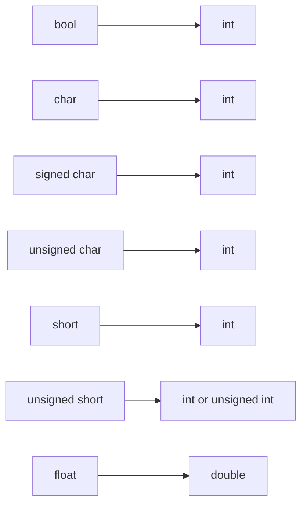

### C++ 隐式类型转换详解

---

#### 一、**类型转换的本质**
**定义**：
类型转换将某个数据类型的值转换为另一种类型的新值。新旧两个类型的二进制表示通常不同，编译器会生成与目标类型匹配的新值。
**关键点**：
- **转换不修改原值或原类型**，而是生成新类型的副本。
- **隐式转换由编译器自动完成**，满足类型兼容性时无需程序员干预。

**示例与验证**：
```cpp
float f = 3; // 隐式将int 3转换为float 3.0f
std::cout << typeid(f).name(); // 输出"float"，原int类型并未被修改
```

---

#### 二、**隐式类型转换的触发场景**
以下六种操作会触发隐式类型转换：

| **场景**               | **示例代码**                                 | **转换细节**                           |
|-------------------------|---------------------------------------------|----------------------------------------|
| 初始化或赋值            | `double d {3};` 或 `d = 6;`                 | `int` 转 `double`                      |
| 函数返回值类型不符      | `float func() { return 3.0; }`             | `double` 转 `float`                    |
| 二元操作符类型不同      | `double div = 4.0 / 3;`                    | `int 3` 转 `double`，再执行除法        |
| 非布尔值用于条件判断    | `if (5) { ... }`                           | `int 5` 转换为 `bool`（非零为`true`）  |
| 函数参数类型不匹配      | `void f(long l); f(3);`                    | `int 3` 转 `long`                      |
| 括号初始化（但有例外）  | `int x {3.5};` ❌编译错误                   | 大括号初始化禁止丢失精度的转换         |

**错误分析**：
`int x {3.5};` 使用括号初始化时不允许 **窄化转换**（即可能导致数据丢失的转换，如浮点转整数）。
但允许非窄化转换：`double d {5};` ✅，因为 `int` 转 `double` 无损。

---

#### 三、**标准转换的分类与规则**
C++将隐式转换分为四类标准转换：

| **类别**        | **作用**           | **示例**                          | **特点**                |
|------------------|------------------|-----------------------------------|-------------------------|
| 数值提升         | 小类型→大类型（无损）      | `int`→`long`                      | 不丢失精度或值范围      |
| 数值转换         | 某类型→某类型（可能截断或舍入） | `double`→`int`（截断小数部分）    | 可能损失精度或值        |
| 算术转换         | 统一二元运算符两边的类型     | `int + double`→`double + double` | 提升至“更宽”类型        |
| 其他转换         | 包括指针、引用等非算术类型转换  | `int*`→`void*`                    | 复杂规则（如指针安全转换） |

**数值提升方向（从低到高）**：

**数值提升规则**：若操作符两边的类型不同，提升至可涵盖两者范围的更宽类型。例如 `short + int` 被提升为 `int`。

---

#### 四、**类型转换的实际行为**
编译器按以下流程处理隐式转换：
1. 检查是否存在有效的标准转换路径。
2. 若存在，生成新类型的值；否则报错。

**零转换的情况**：
若两种类型的底层二进制表示相同（如某平台上 `int` 和 `long` 均为32位），则直接复制二进制数据（无实际转换操作）。
**示例**：
```cpp
long x = 10; // 假设int和long均为32位，直接拷贝二进制
```

---

#### 五、**隐式转换的陷阱**
1. **精度丢失**：大类型→小类型时可能截断数据。
   ```cpp
   int a = 3.9; // a = 3（直接截断小数部分）
   ```
2. **符号变化**：有符号与无符号类型的转换可能导致意外结果。
   ```cpp
   unsigned int u = -5; // 结果为4294967291（32位假设）
   ```
3. **隐式bool转换**：非零值转换为`true`，零值转`false`。
   ```cpp
   if (100) { /* 总是执行 */ }
   ```

---

#### 六、**最佳实践与编码习惯**
1. **优先使用括号初始化**：减少意外窄化转换。
   ```cpp
   int x {5};   // ✅
   int y {3.5}; // ❌ 编译错误，避免隐式截断
   ```
2. **显式标记转换**：必要时使用 `static_cast` 提高可读性。
   ```cpp
   double d = static_cast<double>(5) / 2; // 清晰表达意图
   ```
3. **警惕算术转换**：明确混合运算的类型提升规则。
   ```cpp
   char c = 'A';
   auto result = c + 1; // result类型为int，可能意外占用更大内存
   ```
4. **类型检查**：使用 `typeid` 或 `decltype` 调试变量类型。
   ```cpp
   std::cout << typeid(result).name(); // 打印实际类型名
   ```

---

### 总结
隐式类型转换简化了代码，但隐藏潜在风险。理解 **标准转换规则** 与 **编译器行为** 是写出健壮代码的关键。遵循最佳实践，合理使用显式转换，可以有效避免错误。