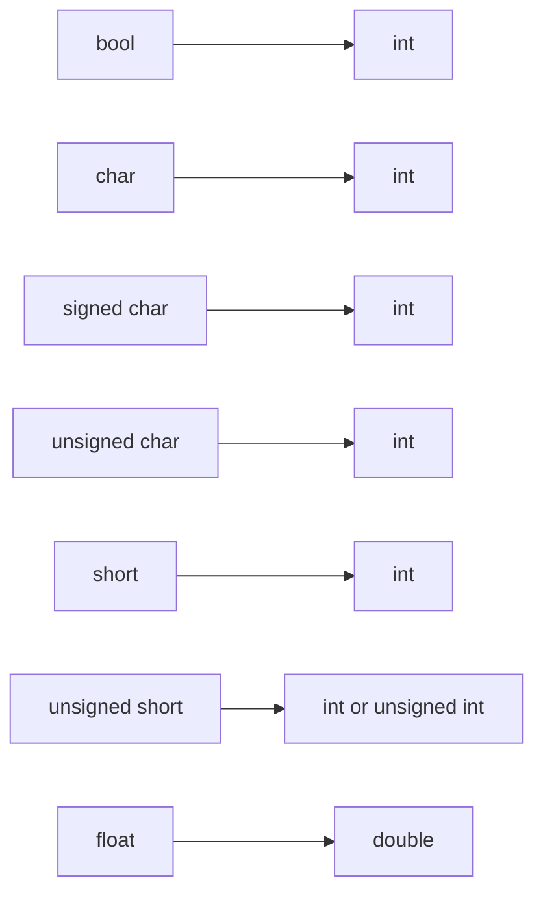

# 要点总结

### 1.隐式类型转换

以下六种操作会触发隐式类型转换：

| **场景**               | **示例代码**                                 | **转换细节**                           |
|-------------------------|---------------------------------------------|----------------------------------------|
| 初始化或赋值            | `double d {3};` 或 `d = 6;`                 | `int` 转 `double`                      |
| 函数返回值类型不符      | `float func() { return 3.0; }`             | `double` 转 `float`                    |
| 二元操作符类型不同      | `double div = 4.0 / 3;`                    | `int 3` 转 `double`，再执行除法        |
| 非布尔值用于条件判断    | `if (5) { ... }`                           | `int 5` 转换为 `bool`（非零为`true`）  |
| 函数参数类型不匹配      | `void f(long l); f(3);`                    | `int 3` 转 `long`                      |
| 括号初始化（但有例外）  | `int x {3.5};` ❌编译错误                   | 大括号初始化禁止丢失精度的转换         |

C++将隐式转换分为四类标准转换：


| **类别**        | **作用**           | **示例**                          | **特点**                |
|------------------|------------------|-----------------------------------|-------------------------|
| 数值提升         | 小类型→大类型（无损）      | `int`→`long`                      | 不丢失精度或值范围      |
| 数值转换         | 某类型→某类型（可能截断或舍入） | `double`→`int`（截断小数部分）    | 可能损失精度或值        |
| 算术转换         | 统一二元运算符两边的类型     | `int + double`→`double + double` | 提升至“更宽”类型        |
| 其他转换         | 包括指针、引用等非算术类型转换  | `int*`→`void*`                    | 复杂规则（如指针安全转换） |


### 2.数值提升

主要分为 **整形提升**和**浮点提升**

| 提升类型 | 源类型 | 目标类型 | 备注 |
| --- | --- | --- | --- |
| 整型提升 | signed char, short | int | 如果目标类型能容纳源类型的所有值 |
| 整型提升 | unsigned char, char8_t, unsigned short | int/unsigned int | 根据是否能完全包含源类型值决定 |
| 整型提升 | bool | int | false -> 0, true -> 1 |
| 浮点提升 | float | double | 提高精度 |

**数值提升方向（从低到高）**：

注意：这些是由C++标准规定的，除了C++规定的这些为数值提升，其余大多为数值转换

### 3.数值转换（数字转换）

- 安全转换：int->long,short->double(注意，这里的int->long,在数值提升里面就没有规定)
- 潜在不安全转换：有符号和无符号类型之间 int->unsigned int
- 有损转换:double->float


数值转换和数值提升的区别：

- 数值提升主要是由C++标准规定的，例如bool,char,short->int,或者float->double的转换。常用在表达式中
- 数值转换辐射范围广，例如 int -> long ,long->double,大类型到小类型，有符号到无符号等等。

### 4.窄化转换，列表初始化，constexpr初始化

窄化转换属于数值转换

// 编译失败：窄化转换

int i { 3.5 }; 列表初始化不允许窄化转换

| 转换类型 | 描述 | 示例 |
| --- | --- | --- |
| 浮点到整型 | 将浮点数转换为整数 | `int i = static_cast<int>(3.5);` |
| 浮点到较窄浮点类型 | 将较高精度浮点数转换为较低精度浮点数 | `float f = static_cast<float>(3.14159265358979323846);` |
| 整型到浮点类型 | 将整数转换为浮点数 | `float f = static_cast<float>(5);` |
| 整型到不同范围的整型 | 将一个整数转换为另一个范围不同的整数 | `unsigned int u = static_cast<unsigned int>(-5);` |

### 5.算数转换

发生在算术运算符的使用中，

### 6.显式类型转换和static_cast

- C样式的类型转换，可能不安全
- static_cast进行字符转换，可以处理窄化转换，这是安全的
- C++支持5种不同类型的强制转换:C样式转换、静态转换、常量转换、动态转换和重解释转换。后四种有时被称为命名转换。
- 避免常量转换和重解释转换，除非您有很好的理由使用它们。

### 7. 类型别名

合理利用 using 关键字来创建类型别名可以显著提高代码的可读性和维护性，同时避免了一些传统 typedef 的局限性。

### auto关键字进行类型推导

- **无法推导无初始值设定项的变量**：如果变量没有初始值，则编译器无法推导其类型。

- **删除 `const` 和 `constexpr` 限定符**：默认情况下，`auto` 会移除这些限定符。要保留它们，需显式声明：

  ```cpp
  const int x{5};
  auto y{x}; // y 的类型是 int
  constexpr auto z{x}; // z 的类型是 constexpr int
  ```

- **字符串字面值的特殊处理**：由于历史原因，字符串字面值的类型不同于 `std::string`，需要使用适当的后缀来获得期望的类型：

  ```cpp
  auto s1{"goo"s}; // s1 的类型是 std::string
  auto s2{"moo"sv}; // s2 的类型是 std::string_view
  ```
  
### 8. 函数的类型推导-auto


- 在C++14及之后的标准中，`auto`关键字被扩展用于函数返回类型的自动推导。
- 所有返回路径必须返回相同类型的值:if的多路返回
- 函数定义需在调用前完全定义
- 尾部返回类型语法，对于那些返回类型复杂的函数特别有用
- C++11之前，auto用来声明类型为自动存储期，
- C++11之后，可以用来类型推导，
- C++14之后，auto可以用在函数类型推导上。
- C++20之后，auto可以用在形参上，但期本质不是类型推导了，而是出发了函数模板生成

