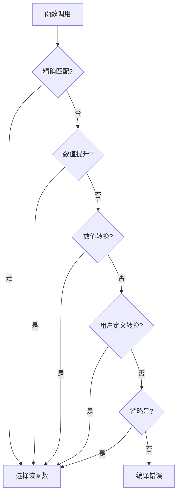

### 函数重载决议详解

#### 一、函数重载决议概述
当调用重载函数时，编译器需确定最匹配的函数版本。此过程称为**重载决议**，遵循严格的优先级顺序，依次尝试不同类型转换。若在某一阶段找到唯一匹配，则选中；若多个匹配则引发歧义错误。

---

#### 二、参数匹配步骤与优先级

##### 1. 精确匹配（Exact Match）
- **完全类型一致**：参数类型与函数声明完全一致。
- **Trivial转换**：允许不影响值的简单转换，包括：
    - 添加/移除 `const` 或 `volatile` 限定符。
    - 数组到指针、函数到函数指针的转换。
    - 顶层引用的添加或移除。

**示例**：
```cpp
void print(const int) {}
void print(double) {}

int main() {
    int x = 5;
    print(x); // x(int) 转换为 const int，精确匹配
}
```

##### 2. 数值提升（Numeric Promotion）
- 将窄类型提升为更宽类型，如：
    - `char`/`short` → `int`
    - `float` → `double`
- **提升优先级高于转换**。

**示例**：
```cpp
void print(int) {}
void print(double) {}

int main() {
    print('a'); // char → int（提升）
    print(4.5f); // float → double（提升）
}
```

##### 3. 数值转换（Numeric Conversion）
- 若提升不可行，尝试隐式转换，如：
    - `int` → `double`
    - `long` → `int` 或 `double`
    - 派生类指针 → 基类指针（继承场景）

**示例**：
```cpp
void print(double) {}
void print(std::string) {}

int main() {
    print(5L); // long → double（转换）
}
```

##### 4. 用户定义转换（User-Defined Conversion）
- 类可通过转换函数或构造函数定义隐式转换。
- 转换后可继续应用提升或数值转换。

**示例**：
```cpp
class X {
public:
    operator int() { return 0; } // 用户定义转换
};

void print(int) {}
void print(double) {}

int main() {
    X x;
    print(x); // X → int → 匹配 print(int)
}
```

##### 5. 省略号匹配（Ellipsis Match）
- 匹配省略号 `...`（C风格可变参数），但通常不推荐使用。

##### 6. 无匹配（No Match）
- 若所有步骤均无匹配，编译器报错。

---

#### 三、不明确匹配（Ambiguous Matches）
当同一阶段多个函数匹配时，引发歧义错误。

**示例1**：
```cpp
void print(int) {}
void print(double) {}

int main() {
    print(5L); // long → int 或 double？歧义！
}
```
**错误信息**：

```
error: call to 'print' is ambiguous
```

**示例2**：
```cpp
void print(unsigned int) {}
void print(float) {}

int main() {
    print(0);    // 0 → unsigned int 或 float？
    print(3.14); // double → unsigned int 或 float？
}
```

---

#### 四、解决歧义的方法
1. **添加精确匹配函数**：
   ```cpp
   void print(long) {} // 新增精确匹配
   ```

2. **显式类型转换**：
   ```cpp
   print(static_cast<unsigned int>(0));
   ```

3. **使用字面值后缀**：
   ```cpp
   print(0u);   // 匹配 unsigned int
   print(3.14f); // 匹配 float
   ```

---

#### 五、多参数匹配规则
编译器对每个参数独立应用匹配规则，最终函数需满足：
- 所有参数至少与其他候选函数匹配一样好。
- 至少一个参数匹配优于其他候选。

**示例**：
```cpp
void print(char, int) {}    // (1)
void print(char, double) {} // (2)
void print(char, float) {}  // (3)

int main() {
    print('x', 'a'); // 第二个参数 'a'（char）→ int（提升）优于 double/float（转换）
                     // 选择 (1)
}
```

---

#### 六、流程图与总结

##### 重载决议流程图


##### 转换优先级表格
| 优先级 | 转换类型          | 示例                     |
|--------|-------------------|--------------------------|
| 1      | 精确匹配          | `int` → `int`            |
| 2      | Trivial转换       | `int` → `const int`      |
| 3      | 数值提升          | `char` → `int`           |
| 4      | 数值转换          | `int` → `double`         |
| 5      | 用户定义转换      | `ClassX` → `int`         |
| 6      | 省略号匹配        | `...`                    |

---

#### 七、关键总结
- 编译器按优先级顺序逐步尝试匹配。
- 精确匹配 > 数值提升 > 数值转换 > 用户定义转换。
- 歧义产生于同一阶段的多个匹配。
- 多参数需每个参数至少不劣于其他候选，且至少一个更优。


> 以上是https://www.studycpp.cn/basic/chapter11/func-overload-resolution/ 所给的函数决议流程


---
---
---

其他参考文献：

https://zhuanlan.zhihu.com/p/561977606