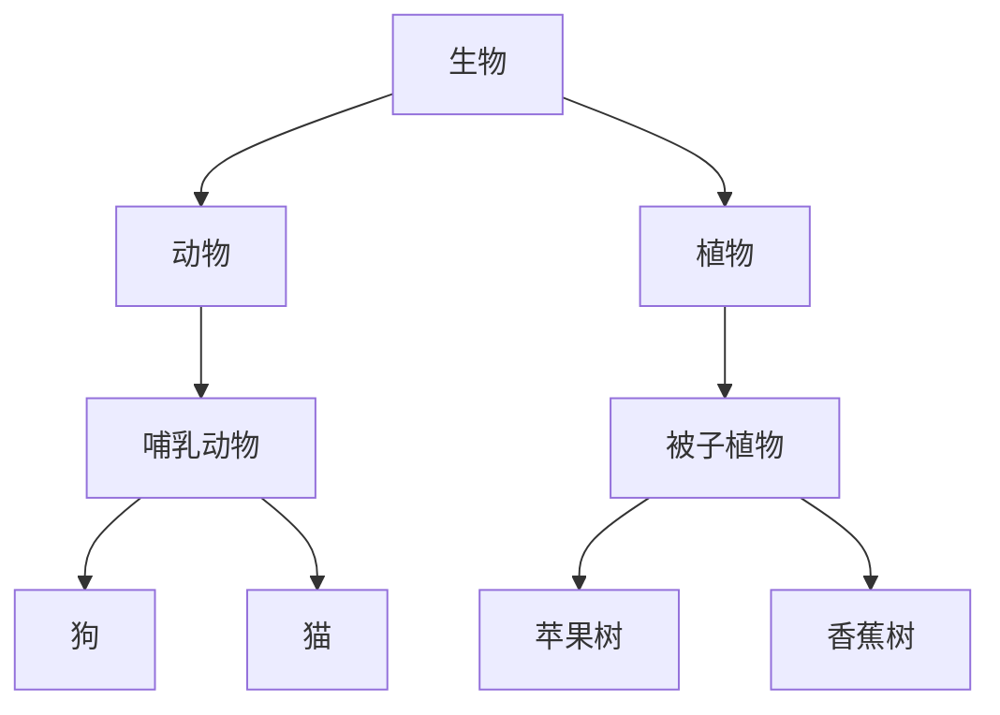
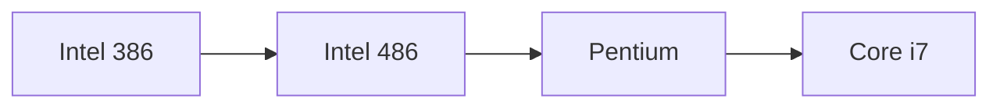
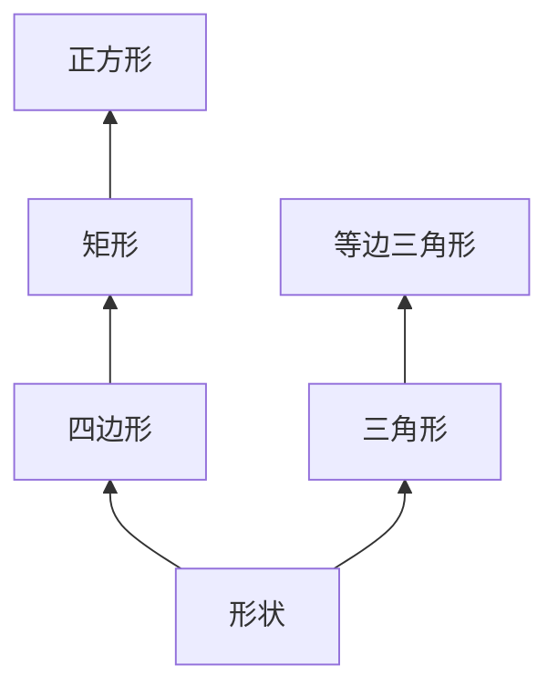

### C++ 继承详解：从概念到应用

---

#### 一、继承的核心概念
##### 1. 定义与目的
- **继承**：允许新类（派生类）基于现有类（基类）构建，继承其属性和行为，并扩展或特化功能。
- **核心关系**：描述 **"是一个（is-a）"** 关系（如：苹果是一种水果）。

##### 2. 与对象组合的对比
| 特性            | 继承（is-a）                     | 对象组合（has-a）               |
|-----------------|--------------------------------|--------------------------------|
| 关系类型         | 纵向扩展（从一般到具体）         | 横向组合（对象包含其他对象）     |
| 代码复用方式     | 直接复用基类逻辑                | 通过成员对象调用功能            |
| 典型场景        | 分类学结构、功能扩展            | 复杂对象由多个部件构成          |
| 耦合度          | 高（派生类依赖基类实现）         | 低（通过接口交互）              |

```cpp
// 继承示例：苹果是一种水果
class Apple : public Fruit { /*...*/ };

// 组合示例：汽车有发动机
class Car {
    Engine engine; // 对象组合
};
```

---

#### 二、继承的层次结构
##### 1. 生物学分类示例

- **特征继承**：狗继承哺乳动物的温血属性，苹果树继承被子植物的开花特性。

##### 2. 技术产品迭代示例

- **功能继承**：Pentium 继承 486 的指令集，并新增多媒体扩展指令。

##### 3. 形状分类示例

- **属性继承**：正方形继承矩形的四边直角特性，并添加边长相等约束。

---

#### 三、C++ 继承语法详解
##### 1. 基本语法与访问控制
```cpp
class Base {
public:
    int publicVar;
protected:
    int protectedVar;
private:
    int privateVar;
};

// 公有继承：基类public/protected成员在派生类中保持原有访问权限
class DerivedPublic : public Base {
    void accessDemo() {
        publicVar = 1;      // ✅ 允许访问
        protectedVar = 2;   // ✅ 允许访问
        // privateVar = 3;  // ❌ 不可访问
    }
};

// 保护继承：基类public/protected成员在派生类中变为protected
class DerivedProtected : protected Base { /*...*/ };

// 私有继承：基类public/protected成员在派生类中变为private
class DerivedPrivate : private Base { /*...*/ };
```

##### 2. 构造函数与析构函数
- **构造顺序**：基类 → 成员对象 → 派生类
- **析构顺序**：派生类 → 成员对象 → 基类
- **虚析构函数**：基类析构函数应声明为 `virtual`，确保正确释放资源。

```cpp
class Fruit {
public:
    std::string name;
    Fruit(const std::string& n) : name(n) {}
    virtual ~Fruit() = default; // 虚析构函数
};

class Apple : public Fruit {
public:
    Apple(const std::string& n) : Fruit(n) {} // 调用基类构造函数
    ~Apple() override { std::cout << name << " destroyed\n"; }
};
```

##### 3. 方法覆盖与扩展
```cpp
class Fruit {
public:
    virtual void ripen() { 
        std::cout << "Fruit is ripening.\n";
    }
};

class Banana : public Fruit {
public:
    void ripen() override { // 覆盖基类方法
        std::cout << "Banana turns yellow.\n";
    }
    void peel() { // 添加新方法
        std::cout << "Banana peeled.\n";
    }
};
```

---

#### 四、继承的典型应用场景
##### 1. 分类体系建模
- **示例**：GUI 控件层次（`Widget → Button → Checkbox`）
- **优势**：统一接口，简化事件处理逻辑。

##### 2. 功能渐进式增强
- **示例**：处理器指令集扩展（`386 → 486 → SSE指令`）
- **优势**：向后兼容，逐步添加新特性。

##### 3. 多态实现基础
- **关键机制**：虚函数（virtual functions）
- **示例**：动物发出不同叫声（`Animal → Dog::bark(), Cat::meow()`）

---

#### 五、潜在问题与最佳实践
##### 1. 常见陷阱
- **菱形继承**：多重继承导致同一基类多次被继承。
- **过度继承**：滥用继承导致层次结构复杂化。
- **脆弱基类**：基类修改影响所有派生类。

##### 2. 设计原则
- **Liskov 替换原则**：派生类应完全支持基类行为。
- **组合优先**：优先使用对象组合，除非明确需要“is-a”关系。
- **避免深继承**：建议继承层次不超过 3 层。

---

#### 六、进阶内容预告
##### 1. 多态与虚函数
- **动态绑定**：通过基类指针调用派生类方法。
- **纯虚函数**：定义接口规范（`virtual void func() = 0;`）。

##### 2. 抽象基类
- **接口定义**：仅包含纯虚函数，无具体实现。
- **示例**：`class Shape { virtual double area() = 0; };`

##### 3. 多重继承
- **语法**：`class Derived : public Base1, public Base2 { /*...*/ };`
- **挑战**：解决命名冲突和菱形继承问题。

---

#### 总结
继承是面向对象编程的核心机制，通过层次化建模和代码复用提升开发效率。正确使用时，它能优雅地表达分类关系和功能扩展；滥用时则会导致维护困难。理解其原理和适用场景，结合后续将学的多态与设计模式，将大幅提升代码设计能力。