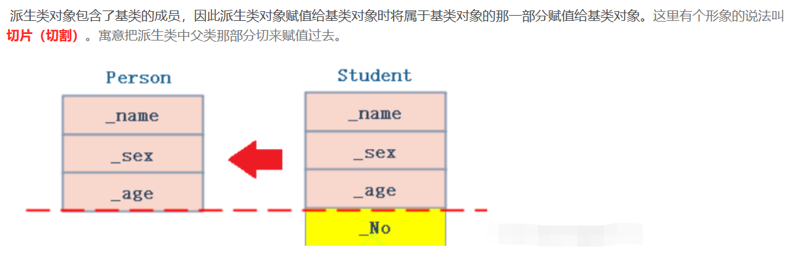
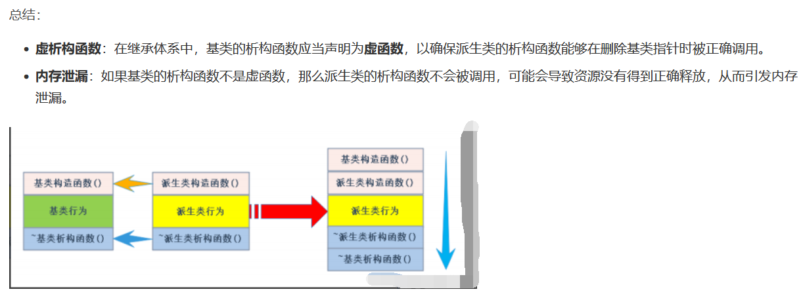
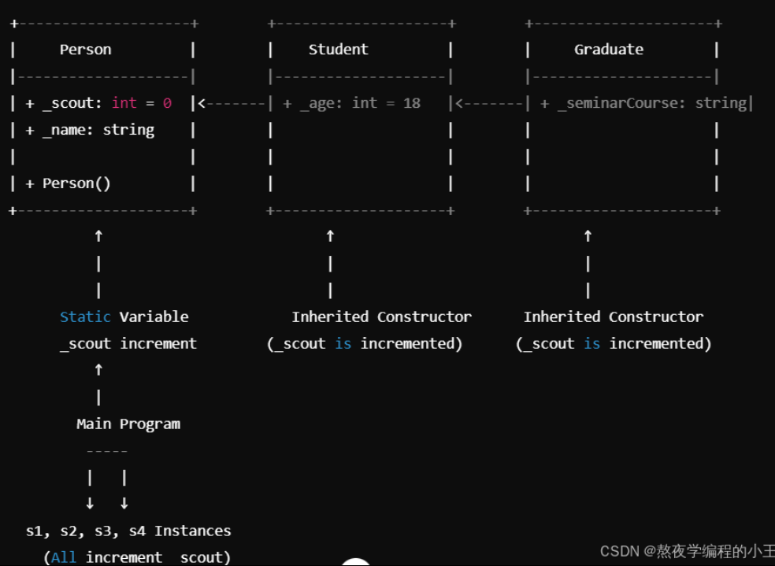
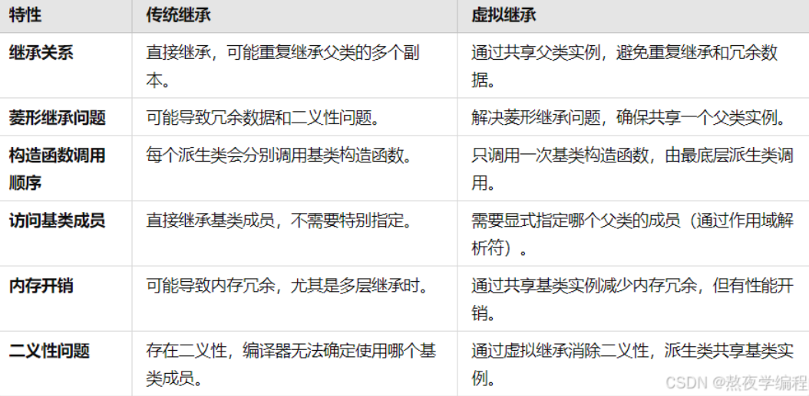
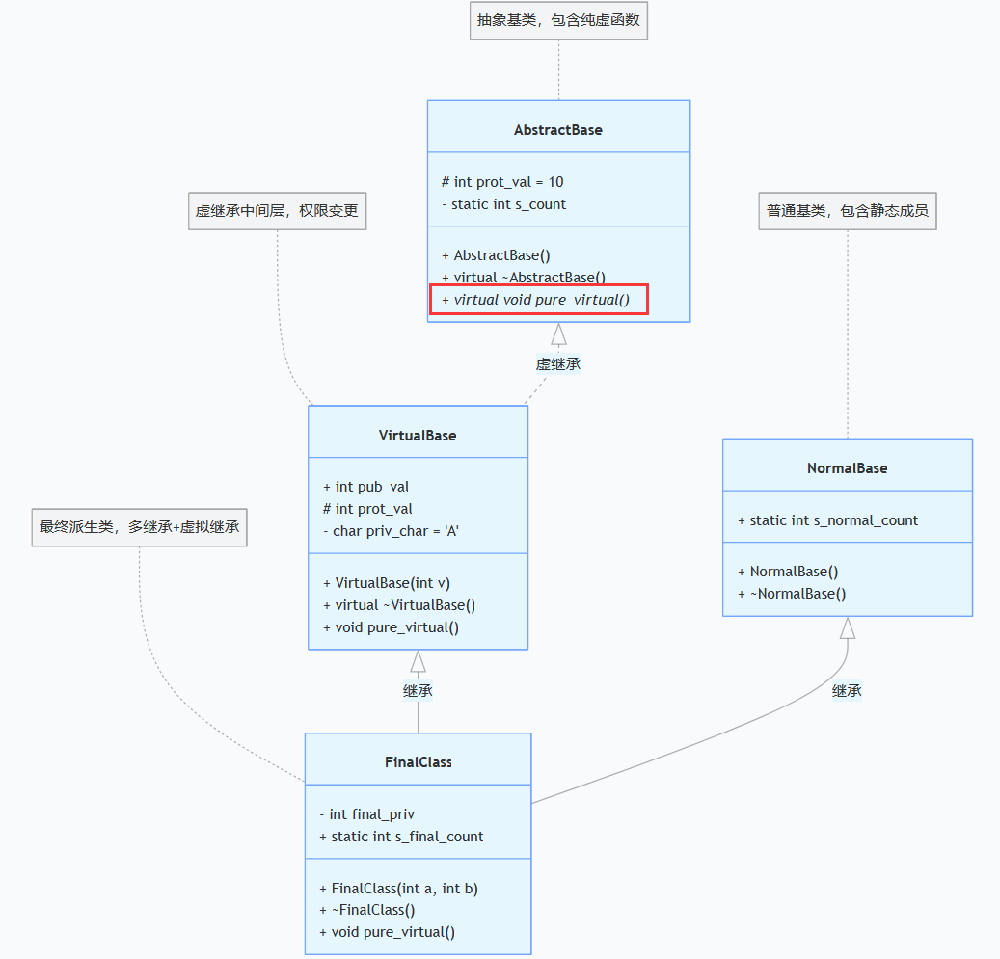

# 一次性看完继承
https://blog.csdn.net/braveact/article/details/144111383?spm=1001.2014.3001.5502

> 要点：传统继承，虚拟继承，虚函数，纯虚函数，继承链（类实例化顺序）

<!-- TOC -->
* [一次性看完继承](#一次性看完继承)
* [1.C++继承前言与背景](#1c继承前言与背景)
  * [1.1 背景与基本概念](#11-背景与基本概念)
    * [实现方式](#实现方式)
    * [优势](#优势)
    * [挑战](#挑战)
    * [关键要点](#关键要点)
* [2.引言：C++继承的核心意义](#2引言c继承的核心意义)
* [3. 继承基本概念](#3-继承基本概念)
    * [示例代码说明](#示例代码说明)
    * [继承的定义与语法](#继承的定义与语法)
* [4.基类和派生类](#4基类和派生类)
  * [4.1 基类成员在派生类中的访问权限](#41-基类成员在派生类中的访问权限)
  * [4.2 基类和派生类对象赋值转换](#42-基类和派生类对象赋值转换)
    * [4.2.1 派生类对象赋值给基类对象](#421-派生类对象赋值给基类对象)
        * [子类对象赋值给父类对象/指针/引用](#子类对象赋值给父类对象指针引用)
        * [基类对象不能赋值给派生类对象](#基类对象不能赋值给派生类对象)
        * [基类指针强制类型转换为派生类指针](#基类指针强制类型转换为派生类指针)
    * [4.2.2 基类指针与引用转换](#422-基类指针与引用转换)
    * [4.2.3 基类和派生类的强制类型转换](#423-基类和派生类的强制类型转换)
      * [1. 向上转型（派生类指针/引用转换为基类指针/引用）](#1-向上转型派生类指针引用转换为基类指针引用)
      * [2. 向下转型（基类指针/引用转换为派生类指针/引用）](#2-向下转型基类指针引用转换为派生类指针引用)
      * [3. 使用 `dynamic_cast` 进行安全的向下转型](#3-使用-dynamic_cast-进行安全的向下转型)
* [5. 继承中的作用域与成员访问](#5-继承中的作用域与成员访问)
  * [5.1 作用域的独立性与同名成员的隐藏](#51-作用域的独立性与同名成员的隐藏)
    * [5.1.1 函数的隐藏](#511-函数的隐藏)
  * [5.2 派生类的默认成员函数](#52-派生类的默认成员函数)
    * [5.2.1 构造函数的调用顺序](#521-构造函数的调用顺序)
    * [5.2.2 拷贝构造函数与赋值运算符的调用](#522-拷贝构造函数与赋值运算符的调用)
    * [5.2.3 析构函数调用顺序](#523-析构函数调用顺序)
    * [5.2.4 虚析构函数](#524-虚析构函数)
* [6. 继承和友元](#6-继承和友元)
  * [6.1 继承与友元](#61-继承与友元)
    * [6.1.1 友元函数定义](#611-友元函数定义)
  * [6.2 继承与静态成员](#62-继承与静态成员)
    * [6.2.1 静态成员的继承与访问](#621-静态成员的继承与访问)
* [7. 复杂的菱形继承及虚拟继承](#7-复杂的菱形继承及虚拟继承)
  * [7.1 菱形继承问题](#71-菱形继承问题)
    * [7.1.1 菱形继承基本结构](#711-菱形继承基本结构)
  * [7.2 菱形继承的二义性问题](#72-菱形继承的二义性问题)
  * [7.3 解决方案：虚拟继承](#73-解决方案虚拟继承)
    * [7.3.1 什么是虚拟继承？](#731-什么是虚拟继承)
  * [7.4 虚基表（VBTable）和虚基类指针（VBPTR）的概念](#74-虚基表vbtable和虚基类指针vbptr的概念)
    * [7.4.1工作机制](#741工作机制)
      * [示例代码](#示例代码)
  * [7.5 虚拟继承优缺点](#75-虚拟继承优缺点)
    * [7.5.1 优点](#751-优点)
    * [7.5.2 缺点](#752-缺点)
* [8. 传统继承和虚拟继承的对比](#8-传统继承和虚拟继承的对比)
  * [8.1 定义和区别](#81-定义和区别)
    * [传统继承（Non - Virtual Inheritance）](#传统继承non---virtual-inheritance)
    * [虚拟继承（Virtual Inheritance）](#虚拟继承virtual-inheritance)
  * [8.2 构造函数和析构函数的差异](#82-构造函数和析构函数的差异)
    * [传统继承](#传统继承)
    * [虚拟继承](#虚拟继承)
  * [8.3 访问基类成员的方式](#83-访问基类成员的方式)
    * [传统继承](#传统继承-1)
    * [虚拟继承](#虚拟继承-1)
  * [8.4 内存和性能影响](#84-内存和性能影响)
    * [传统继承](#传统继承-2)
    * [虚拟继承](#虚拟继承-2)
  * [8.5 二义性问题](#85-二义性问题)
    * [传统继承](#传统继承-3)
    * [虚拟继承](#虚拟继承-3)
  * [8.6 代码示例对比](#86-代码示例对比)
    * [8.6.1 传统继承示例](#861-传统继承示例)
    * [8.6.2 虚拟继承示例](#862-虚拟继承示例)
  * [8.7 虚拟继承最佳实践](#87-虚拟继承最佳实践)
    * [8.7.1 小心使用多层次的虚拟继承](#871-小心使用多层次的虚拟继承)
      * [减少继承层次](#减少继承层次)
      * [使用组合替代继承](#使用组合替代继承)
  * [8.8 实际项目中的案例](#88-实际项目中的案例)
    * [8.8.1 解释和分析](#881-解释和分析)
* [9. 继承的总结与反思](#9-继承的总结与反思)
  * [9.1 继承的最佳实践与建议](#91-继承的最佳实践与建议)
    * [9.1.1 首选组合而非继承](#911-首选组合而非继承)
    * [9.1.2 尽量使用虚拟继承解决菱形继承问题](#912-尽量使用虚拟继承解决菱形继承问题)
    * [9.1.3 避免深层次的继承链](#913-避免深层次的继承链)
    * [9.1.4 适当使用抽象类和纯虚函数](#914-适当使用抽象类和纯虚函数)
    * [9.1.5 清晰的设计与文档](#915-清晰的设计与文档)
  * [9.2 继承的优势与应用](#92-继承的优势与应用)
    * [9.2.1 代码复用](#921-代码复用)
    * [9.2.2 扩展性](#922-扩展性)
    * [9.2.3 多态性](#923-多态性)
  * [9.3 继承的类型和特性](#93-继承的类型和特性)
    * [9.3.1 单继承](#931-单继承)
    * [9.3.2 多重继承](#932-多重继承)
    * [9.3.3 虚拟继承](#933-虚拟继承)
    * [9.3.4 抽象类与纯虚函数](#934-抽象类与纯虚函数)
  * [9.4 继承的常见问题与反思](#94-继承的常见问题与反思)
    * [9.4.1 二义性问题](#941-二义性问题)
    * [9.4.2 构造函数与析构函数的调用顺序](#942-构造函数与析构函数的调用顺序)
    * [9.4.3 父类构造函数的调用](#943-父类构造函数的调用)
    * [9.4.4 访问控制的影响](#944-访问控制的影响)
    * [9.4.5 继承的代码复杂性](#945-继承的代码复杂性)
* [10. 静态绑定和动态绑定（实现多态）](#10-静态绑定和动态绑定实现多态)
  * [**10.1 静态绑定（Static Binding）**](#101-静态绑定static-binding)
  * [**10.2 动态绑定（Dynamic Binding）**](#102-动态绑定dynamic-binding)
  * [10.3 **底层实现机制**](#103-底层实现机制)
      * [**静态绑定的实现**](#静态绑定的实现)
      * [**动态绑定的实现**](#动态绑定的实现)
  * [10.4 **核心对比**](#104-核心对比)
* [11.继承链类构造顺序探究：](#11继承链类构造顺序探究)
  * [复杂的代码：](#复杂的代码)
<!-- TOC -->

这段内容围绕C++继承展开，详细介绍了其背景、实现方式、优势、挑战及关键要点，总结如下：
# 1.C++继承前言与背景

## 1.1 背景与基本概念
继承源自面向对象编程思想，通过类的层次结构模拟现实世界事物关系。C++利用继承机制，让开发者能从基类派生出多个派生类，共享基类行为并按需扩展或修改。

### 实现方式
借助`class`关键字和访问修饰符（`public`、`protected`、`private`）实现。基类提供公有和保护成员供派生类继承，派生类可重写基类方法，结合虚函数还能实现运行时多态。

### 优势
1. **支持多种继承形式**：不仅支持单一继承，还支持多继承以适应复杂类关系；通过虚拟继承避免“钻石继承”问题。
2. **访问控制灵活**：提供`public`、`protected`和`private`三种继承方式，开发者可灵活控制基类成员访问权限，保证类设计和组织结构的灵活性。

### 挑战
多继承和虚继承的使用较为复杂，开发者需合理设计继承关系，避免继承层次过深和滥用继承。

### 关键要点
1. **代码重用**：子类复用父类属性和方法，减少重复代码。
2. **扩展性**：子类可扩展或修改父类行为，实现系统扩展。
3. **多态性**：继承与虚函数结合实现运行时多态，增强代码灵活性和动态性。
4. **多继承与虚继承**：提供强大功能，但增加代码设计复杂度。
5. **访问控制**：不同继承访问权限确保程序封装性和安全性。 

---

# 2.引言：C++继承的核心意义

继承是面向对象编程的一个关键特性，它能够使得代码更加简洁、可扩展和易维护。在C++中，继承不仅仅是类之间的关系，更是构建复杂系统的基石。通过继承，我们可以在一个类中共享另一个类的功能，而不需要重复编写相同的代码。

---


# 3. 继承基本概念
继承机制是面向对象程序设计实现代码复用的重要手段。它允许在保留原有类特性的基础上进行扩展，进而产生新的类，即派生类。继承体现了面向对象程序设计的层次结构，反映了从简单到复杂的认知过程，是类设计层次的复用，区别于以往的函数复用。

```c
#define _CRT_SECURE_NO_WARNINGS 1
#include<iostream>
#include<string>
using namespace std;
class Person
{
public:
	void Print()
	{
		cout << "name:" << _name << endl;
		cout << "age:" << _age << endl;
	}
protected:
	string _name = "peter"; // 姓名
	int _age = 18;//年龄
};
class Student : public Person
{
protected:
	int _stuid; // 学号
};
class Teacher : public Person
{
protected:
	int _jobid; // 工号
};
int main()
{
	Student s;
	Teacher t;
	s.Print();
	t.Print();
	return 0;
}
```

### 示例代码说明
给出了一个简单的继承示例代码，定义了基类`Person`，其中包含`Print`方法用于输出姓名和年龄，姓名和年龄成员变量被声明为`protected`。`Student`类和`Teacher`类都以`public`方式继承自`Person`类，`Student`类新增了`_stuid`（学号）成员，`Teacher`类新增了`_jobid`（工号）成员。在`main`函数中创建了`Student`和`Teacher`对象，并调用它们从`Person`类继承来的`Print`方法，输出结果均为姓名`peter`和年龄`18`。

### 继承的定义与语法
- **定义格式**：在C++中，继承通过`class 子类名 : 继承方式 基类名 { // 子类的成员 };`的格式实现。
- **继承方式及访问权限变化**：
    - **public继承**：基类的公有成员在派生类中仍然保持公有。
    - **protected继承**：基类的公有成员在派生类中变为受保护的。
    - **private继承**：基类的公有成员在派生类中变为私有的。
- **示例验证**：再次给出`Teacher`类以`public`方式继承`Person`类的示例，强调派生类`Student`和`Teacher`能继承基类`Person`的`Print`方法，并通过调用该方法输出相关信息。 


---
# 4.基类和派生类
## 4.1 基类成员在派生类中的访问权限
在C++中，基类成员在派生类中的访问权限取决于继承方式（`public`、`protected`、`private`）和基类成员本身的访问限定符（`public`、`protected`、`private`）。下面是不同继承方式下基类成员访问权限的变化情况：

| 继承方式\基类成员 | public成员 | protected成员 | private成员 |
| --- | --- | --- | --- |
| public继承 | 派生类中为public | 派生类中为protected | 派生类中不可访问 |
| protected继承 | 派生类中为protected | 派生类中为protected | 派生类中不可访问 |
| private继承 | 派生类中为private | 派生类中为private | 派生类中不可访问 |

**示例代码**：
```cpp
#include <iostream>
using namespace std;

// 基类
class Base {
public:
    void publicFunc() {
        cout << "Base::publicFunc()" << endl;
    }
protected:
    void protectedFunc() {
        cout << "Base::protectedFunc()" << endl;
    }
private:
    void privateFunc() {
        cout << "Base::privateFunc()" << endl;
    }
};

// public继承
class PublicDerived : public Base {
public:
    void test() {
        publicFunc();     // 可以访问，public成员
        protectedFunc();  // 可以访问，protected成员
        // privateFunc(); // 不可访问，基类private成员
    }
};

// protected继承
class ProtectedDerived : protected Base {
public:
    void test() {
        publicFunc();     // 可以访问，在派生类中变为protected成员
        protectedFunc();  // 可以访问，protected成员
        // privateFunc(); // 不可访问，基类private成员
    }
};

// private继承
class PrivateDerived : private Base {
public:
    void test() {
        publicFunc();     // 可以访问，在派生类中变为private成员
        protectedFunc();  // 可以访问，在派生类中变为private成员
        // privateFunc(); // 不可访问，基类private成员
    }
};

int main() {
    PublicDerived pub;
    pub.publicFunc();  // 可以访问，因为是public继承，基类public成员在派生类中仍为public

    ProtectedDerived pro;
    // pro.publicFunc(); // 错误，protected继承后，基类public成员在派生类中变为protected

    PrivateDerived pri;
    // pri.publicFunc(); // 错误，private继承后，基类public成员在派生类中变为private

    return 0;
}
```

## 4.2 基类和派生类对象赋值转换
### 4.2.1 派生类对象赋值给基类对象
可以将派生类对象赋值给基类对象，这种操作也被称为“切片”或“切割”，即只把派生类对象中基类部分的数据赋值给基类对象。



**示例代码1**：
```c
#include<iostream>
#include<string>
using namespace std;
 
class Person
{
protected:
	string _name; // 姓名
	string _sex;  // 性别
	int _age; // 年龄
};
class Student : public Person
{
public:
	int _No; // 学号
};
void Test()
{
	Student sobj;
	// 1.子类对象可以赋值给父类对象/指针/引用
	Person pobj = sobj;
	Person* pp = &sobj;
	Person& rp = sobj;
 
	//2.基类对象不能赋值给派生类对象
	sobj = pobj;//error
 
	// 3.基类的指针可以通过强制类型转换赋值给派生类的指针
	pp = &sobj;
		Student * ps1 = (Student*)pp; // 这种情况转换时可以的。
	ps1->_No = 10;
 
	pp = &pobj;
	Student* ps2 = (Student*)pp; // 这种情况转换时虽然可以，但是会存在越界访问的问题
		ps2->_No = 10;
}
```


##### 子类对象赋值给父类对象/指针/引用
```cpp
Person pobj = sobj;
Person* pp = &sobj;
Person& rp = sobj;
```
- `Person pobj = sobj;`：将`Student`类对象`sobj`赋值给`Person`类对象`pobj`，这是合法的，称为“切片”操作，即只把`sobj`中`Person`类部分的数据赋值给`pobj`。
- `Person* pp = &sobj;`：让`Person`类的指针`pp`指向`Student`类对象`sobj`，这是合法的，因为`Student`对象包含`Person`对象的部分。
- `Person& rp = sobj;`：让`Person`类的引用`rp`引用`Student`类对象`sobj`，同样是合法的。

##### 基类对象不能赋值给派生类对象
```cpp
sobj = pobj;//error
```
这行代码是错误的，因为基类对象不包含派生类新增的成员，不能直接赋值给派生类对象。

##### 基类指针强制类型转换为派生类指针
```cpp
pp = &sobj;
Student * ps1 = (Student*)pp; // 这种情况转换时可以的。
ps1->_No = 10;

pp = &pobj;
Student* ps2 = (Student*)pp; // 这种情况转换时虽然可以，但是会存在越界访问的问题
ps2->_No = 10;
```
- `pp = &sobj;`：让`pp`指向`Student`对象`sobj`。
- `Student * ps1 = (Student*)pp;`：将指向`Student`对象的`Person`指针`pp`强制转换为`Student`指针`ps1`，这是合法的，因为`pp`实际指向的就是`Student`对象，之后可以通过`ps1`访问`Student`类的成员。
- `pp = &pobj;`：让`pp`指向`Person`对象`pobj`。
- `Student* ps2 = (Student*)pp;`：将指向`Person`对象的`Person`指针`pp`强制转换为`Student`指针`ps2`，虽然语法上允许，但这是危险的。因为`pobj`本身是`Person`对象，不包含`Student`类的`_No`成员，对`ps2->_No`的访问会导致越界访问，可能会引发未定义行为。


**示例代码2**：
```cpp
#include <iostream>
using namespace std;

class Base {
public:
    int baseData;
    Base(int data) : baseData(data) {}
};

class Derived : public Base {
public:
    int derivedData;
    Derived(int base, int derived) : Base(base), derivedData(derived) {}
};

int main() {
    Derived d(10, 20);
    Base b = d;  // 派生类对象赋值给基类对象，发生切片
    cout << "Base data: " << b.baseData << endl;
    return 0;
}
```

### 4.2.2 基类指针与引用转换
- **基类指针指向派生类对象**：基类指针可以指向派生类对象，通过该指针可以访问派生类对象中基类部分的成员，但不能直接访问派生类新增的成员。
- **基类引用引用派生类对象**：基类引用可以引用派生类对象，同样只能访问派生类对象中基类部分的成员。

**示例代码**：
```cpp
#include <iostream>
using namespace std;

class Base {
public:
    void baseFunc() {
        cout << "Base::baseFunc()" << endl;
    }
};

class Derived : public Base {
public:
    void derivedFunc() {
        cout << "Derived::derivedFunc()" << endl;
    }
};

int main() {
    Derived d;

    // 基类指针指向派生类对象
    Base* ptr = &d;
    ptr->baseFunc();  // 可以调用基类的成员函数
    // ptr->derivedFunc(); // 错误，基类指针不能直接调用派生类的成员函数

    // 基类引用引用派生类对象
    Base& ref = d;
    ref.baseFunc();  // 可以调用基类的成员函数
    // ref.derivedFunc(); // 错误，基类引用不能直接调用派生类的成员函数

    return 0;
}
```

### 4.2.3 基类和派生类的强制类型转换


在 C++ 继承体系中，强制类型转换是一项重要操作，它允许在基类和派生类指针或引用之间进行类型转换，但使用时需要谨慎，因为可能会引发一些问题。下面详细介绍强制类型转换的几种情况及示例。

#### 1. 向上转型（派生类指针/引用转换为基类指针/引用）
- **原理**：向上转型是安全的，它符合“is - a”关系（派生类对象是一种基类对象）。可以隐式转换，也可以使用强制类型转换。实际上，当将派生类指针或引用赋值给基类指针或引用时，编译器会自动进行隐式转换。
- **示例代码**：
```cpp
#include <iostream>
class Base {
public:
    void baseFunction() {
        std::cout << "Base function called" << std::endl;
    }
};

class Derived : public Base {
public:
    void derivedFunction() {
        std::cout << "Derived function called" << std::endl;
    }
};

int main() {
    Derived derivedObj;
    // 隐式向上转型
    Base* basePtr1 = &derivedObj; 
    // 强制向上转型
    Base* basePtr2 = (Base*)&derivedObj; 

    basePtr1->baseFunction();
    basePtr2->baseFunction();

    return 0;
}
```
- **代码解释**：在上述代码中，`Derived` 类继承自 `Base` 类。可以直接将 `Derived` 对象的地址赋值给 `Base` 指针（隐式转换），也可以使用强制类型转换进行赋值。通过这两种方式得到的 `Base` 指针都可以调用 `Base` 类的成员函数。

#### 2. 向下转型（基类指针/引用转换为派生类指针/引用）

使用static_cast进行向下转换

向下转换也可以使用static_cast完成。主要区别是static_cast不进行运行时类型检查。这使得使用static_cast更快，但更危险

- **原理**：向下转型需要显式地使用强制类型转换。但这种转换是不安全的，因为基类对象不一定是派生类对象。如果基类指针实际上指向的是基类对象，而将其强制转换为派生类指针并访问派生类特有的成员，会导致未定义行为（通常是越界访问）。
- **示例代码**：
```cpp
#include <iostream>
class Base {
public:
    void baseFunction() {
        std::cout << "Base function called" << std::endl;
    }
};

class Derived : public Base {
public:
    void derivedFunction() {
        std::cout << "Derived function called" << std::endl;
    }
};

int main() {
    Base baseObj;
    Derived derivedObj;

    // 情况1：基类指针指向派生类对象，向下转型安全
    Base* basePtrToDerived = &derivedObj;
    Derived* derivedPtr1 = (Derived*)basePtrToDerived;
    derivedPtr1->derivedFunction();

    // 情况2：基类指针指向基类对象，向下转型不安全
    Base* basePtrToBase = &baseObj;
    Derived* derivedPtr2 = (Derived*)basePtrToBase;
    // 调用派生类特有的成员，可能导致未定义行为
    derivedPtr2->derivedFunction(); 

    return 0;
}
```
- **代码解释**：
  - 在情况 1 中，`basePtrToDerived` 指向 `Derived` 对象，将其强制转换为 `Derived` 指针是安全的，可以正常调用 `Derived` 类的成员函数。
  - 在情况 2 中，`basePtrToBase` 指向 `Base` 对象，将其强制转换为 `Derived` 指针并调用 `Derived` 类特有的成员函数，会引发未定义行为，因为 `baseObj` 本身不是 `Derived` 对象，没有 `Derived` 类的成员布局。

#### 3. 使用 `dynamic_cast` 进行安全的向下转型
- **原理**：`dynamic_cast` 是 C++ 提供的一种用于安全向下转型的运算符。它在运行时进行类型检查，如果转换不安全，返回空指针（对于指针类型）或抛出 `std::bad_cast` 异常（对于引用类型）。
- **示例代码**：
```cpp
#include <iostream>
class Base {
public:
    virtual void virtualFunction() {} // 必须有虚函数才能使用 dynamic_cast
};

class Derived : public Base {
public:
    void derivedFunction() {
        std::cout << "Derived function called" << std::endl;
    }
};

int main() {
    Base baseObj;
    Derived derivedObj;

    Base* basePtrToDerived = &derivedObj;
    Base* basePtrToBase = &baseObj;

    // 安全的向下转型
    Derived* derivedPtr1 = dynamic_cast<Derived*>(basePtrToDerived);
    if (derivedPtr1) {
        derivedPtr1->derivedFunction();
    }

    // 不安全的向下转型，返回空指针
    Derived* derivedPtr2 = dynamic_cast<Derived*>(basePtrToBase);
    if (!derivedPtr2) {
        std::cout << "Unsafe cast detected" << std::endl;
    }

    return 0;
}
```
- **代码解释**：使用 `dynamic_cast` 进行向下转型时，基类必须有虚函数（通常是虚析构函数），因为 `dynamic_cast` 需要通过虚函数表来进行运行时类型检查。在上述代码中，`dynamic_cast` 会检查指针实际指向的对象类型，如果是正确的派生类类型，则返回有效的指针；否则返回空指针。

综上所述，强制类型转换在 C++ 继承体系中既有用又危险，特别是向下转型时，建议优先使用 `dynamic_cast` 来确保转型的安全性。 

**dynamic_cast与static_cast**

新程序员有时会对何时使用static_cast与dynamic_cast感到困惑。答案很简单：使用static_cast，除非是类型向下转换，在这种情况下，dynamic_cast通常是更好的选择。然而，您还应该考虑完全避免强制转换，只使用虚函数。

**向下转换 vs 虚函数**

有些开发人员认为dynamic_cast是邪恶的，并且表示糟糕的类设计。这些程序员说应该使用虚函数。

通常，应优先使用虚函数而不是类型向下转换。然而，有时向下转换是更好的选择：

    当您不能修改基类以添加虚函数时（例如，因为基类是标准库的一部分）
    当您需要访问特定于派生类的内容（例如，仅存在于派生类中的访问函数）
    当将虚函数添加到基类中没有意义时（例如基类没有适当的返回值）如果不需要实例化基类，则在这里可以选择使用纯虚函数。

关于dynamic_cast和RTTI

运行时类型信息（RTTI，run-time type information）是C++的一项功能，它在运行时暴露有关对象数据类型的信息。dynamic_cast利用了此功能。由于RTTI具有相当大的空间性能开销，因此一些编译器允许您将RTTI关闭。当然，如果这样做，dynamic_cast将无法正常工作。

---

以下将从继承中的作用域与成员访问的各个方面详细介绍C++的继承：

# 5. 继承中的作用域与成员访问
## 5.1 作用域的独立性与同名成员的隐藏
在C++继承体系中，每个类都有自己独立的作用域。当派生类中定义了与基类同名的成员时，会发生成员隐藏现象，即派生类的成员会隐藏基类的同名成员。

### 5.1.1 函数的隐藏
当派生类中定义了与基类同名的函数时，基类的该函数会被隐藏。无论函数的参数列表是否相同，只要名称相同就会发生隐藏。

**示例代码**：
```cpp
#include <iostream>

class Base {
public:
    void func() {
        std::cout << "Base::func()" << std::endl;
    }
};

class Derived : public Base {
public:
    void func(int x) {
        std::cout << "Derived::func(int) with x = " << x << std::endl;
    }
};

int main() {
    Derived d;
    // 调用派生类的func函数
    d.func(10); 
    // 若要调用基类的func函数，需使用作用域解析运算符
    d.Base::func(); 
    return 0;
}
```
**代码解释**：在`Derived`类中定义了`func(int)`函数，这会隐藏基类`Base`中的`func()`函数。在`main`函数中，直接调用`d.func(10)`会调用派生类的函数；若要调用基类的`func()`函数，需要使用`d.Base::func()`。

##  5.2 派生类的默认成员函数
派生类会有一些默认成员函数，如构造函数、拷贝构造函数、赋值运算符重载和析构函数。下面介绍它们在继承中的调用情况。

### 5.2.1 构造函数的调用顺序
在创建派生类对象时，构造函数的调用顺序是先调用基类的构造函数，再调用派生类的构造函数。如果基类有多个，按照继承列表中基类的声明顺序依次调用。

**示例代码**：
```cpp
#include <iostream>

class Base {
public:
    Base() {
        std::cout << "Base constructor" << std::endl;
    }
};

class Derived : public Base {
public:
    Derived() {
        std::cout << "Derived constructor" << std::endl;
    }
};

int main() {
    Derived d;
    return 0;
}
```
**代码解释**：创建`Derived`对象`d`时，会先调用`Base`类的构造函数，输出`Base constructor`，然后调用`Derived`类的构造函数，输出`Derived constructor`。

### 5.2.2 拷贝构造函数与赋值运算符的调用
- **拷贝构造函数**：当用一个已存在的派生类对象初始化另一个派生类对象时，会先调用基类的拷贝构造函数，再调用派生类的拷贝构造函数。
- **赋值运算符**：当进行派生类对象之间的赋值操作时，会先调用基类的赋值运算符，再调用派生类的赋值运算符。

**示例代码**：
```cpp
#include <iostream>

class Base {
public:
    Base() {}
    Base(const Base& other) {
        std::cout << "Base copy constructor" << std::endl;
    }
    Base& operator=(const Base& other) {
        std::cout << "Base assignment operator" << std::endl;
        return *this;
    }
};

class Derived : public Base {
public:
    Derived() {}
    Derived(const Derived& other) : Base(other) {
        std::cout << "Derived copy constructor" << std::endl;
    }
    Derived& operator=(const Derived& other) {
        Base::operator=(other);
        std::cout << "Derived assignment operator" << std::endl;
        return *this;
    }
};

int main() {
    Derived d1;
    Derived d2(d1); // 调用拷贝构造函数
    Derived d3;
    d3 = d1; // 调用赋值运算符
    return 0;
}
```

### 5.2.3 析构函数调用顺序
析构函数的调用顺序与构造函数相反，先调用派生类的析构函数，再调用基类的析构函数。

**示例代码**：
```cpp
#include <iostream>

class Base {
public:
    ~Base() {
        std::cout << "Base destructor" << std::endl;
    }
};

class Derived : public Base {
public:
    ~Derived() {
        std::cout << "Derived destructor" << std::endl;
    }
};

int main() {
    {
        Derived d;
    }
    return 0;
}
```
**代码解释**：当`Derived`对象`d`超出作用域时，先调用`Derived`类的析构函数，输出`Derived destructor`，然后调用`Base`类的析构函数，输出`Base destructor`。

### 5.2.4 虚析构函数
在使用基类指针指向派生类对象时，如果基类的析构函数不是虚函数，当通过基类指针删除派生类对象时，只会调用基类的析构函数，而不会调用派生类的析构函数，这可能会导致内存泄漏。将基类的析构函数声明为虚函数可以解决这个问题。

**示例代码**：
```cpp
#include <iostream>

class Base {
public:
    virtual ~Base() {
        std::cout << "Base virtual destructor" << std::endl;
    }
};

class Derived : public Base {
public:
    ~Derived() {
        std::cout << "Derived destructor" << std::endl;
    }
};

int main() {
    Base* ptr = new Derived();
    delete ptr; // 由于基类析构函数是虚函数，会先调用Derived析构函数，再调用Base析构函数
    return 0;
}
```
**代码解释**：在上述代码中，将`Base`类的析构函数声明为虚函数。当通过`Base`指针`ptr`删除`Derived`对象时，会先调用`Derived`类的析构函数，再调用`Base`类的析构函数，确保资源被正确释放。 



---
# 6. 继承和友元
## 6.1 继承与友元

在 C++ 中，友元是一种特殊机制，它允许指定的非成员函数或者其他类访问类的私有成员和保护成员。然而，友元关系不能继承，也就是说，基类友元不能访问子类私有和保护成员，反之亦然。

### 6.1.1 友元函数定义
在 C++ 中，友元（friend）是一种允许一个类或函数访问另一个类的私有和保护成员的机制。友元关系破坏了类的封装性，但在某些特定场景下能带来便利。当涉及继承时，友元关系并不会被继承，即基类的友元不能自动成为派生类的友元。

**示例代码**：
```cpp
#include <iostream>

// 前向声明
class Derived;

class Base {
private:
  int basePrivateData;
public:
  Base(int data) : basePrivateData(data) {}
  // 声明友元函数
  friend void friendFunction(Base& b);
  friend void friendFunction(Base& b, Derived& d);
};

class Derived : public Base {
private:
  int derivedPrivateData;
public:
  Derived(int baseData, int derivedData) : Base(baseData), derivedPrivateData(derivedData) {};
  friend void friendFunction(Base& b,Derived& d);
};

// 友元函数定义，可访问 Base 类的私有成员
void friendFunction(Base& b) {
  std::cout << "Accessing Base private data from friend function: " << b.basePrivateData << std::endl;
}

// 友元函数定义，可访问 Base 和 Derived 类的私有成员
void friendFunction(Base& b, Derived& d) {
  std::cout << "Accessing Base private data from friend function: " << b.basePrivateData << std::endl;
  // 若要访问 Derived 的私有成员，需额外在 Derived 类中声明此函数为友元
  // 这里只是演示继承与友元关系，暂不考虑 Derived 私有成员访问
  std::cout << "Accessing Derived private data from friend function: " << d.derivedPrivateData << std::endl;
}

int main() {
  Base base(10);
  Derived derived(20, 30);

  friendFunction(base);
  friendFunction(base, derived);
  friendFunction(derived, derived);

  return 0;
}
```

**代码解释**：
- `Base` 类中声明了 `friendFunction` 为友元函数，所以 `friendFunction` 可以访问 `Base` 类的私有成员 `basePrivateData`。
- 虽然 `Derived` 类继承自 `Base` 类，但 `friendFunction` 并不能自动成为 `Derived` 类的友元。如果要让 `friendFunction` 访问 `Derived` 类的私有成员，需要在 `Derived` 类中再次声明该函数为友元。

## 6.2 继承与静态成员

### 6.2.1 静态成员的继承与访问
静态成员（静态数据成员和静态成员函数）属于类本身，而不是某个对象。在继承体系中，静态成员会被所有派生类共享，即基类和派生类使用的是同一个静态成员的实例。

**示例代码**：
```cpp
#include <iostream>

class Base {
public:
    static int staticData;
    static void staticFunction() {
        std::cout << "Base static function called. Static data: " << staticData << std::endl;
    }
};

// 静态数据成员初始化
int Base::staticData = 10;

class Derived : public Base {
public:
    static void derivedStaticFunction() {
        std::cout << "Derived static function called. Static data: " << staticData << std::endl;
    }
};

int main() {
    // 通过基类访问静态成员
    Base::staticFunction();
    // 修改静态数据成员的值
    Base::staticData = 20;

    // 通过派生类访问静态成员
    Derived::derivedStaticFunction();
    Derived::staticFunction();

    return 0;
}
```

**代码解释**：
- `Base` 类中定义了静态数据成员 `staticData` 和静态成员函数 `staticFunction`。
- `Derived` 类继承自 `Base` 类，它可以直接访问 `Base` 类的静态成员，并且使用的是同一个 `staticData` 实例。
- 在 `main` 函数中，通过 `Base::staticFunction()` 调用基类的静态成员函数，修改 `Base::staticData` 的值后，再通过 `Derived` 类访问该静态成员时，得到的是修改后的值，这表明静态成员在继承体系中是共享的。

**代码示例2**

```c++
#include<iostream>
#include<string>
using namespace std;

class Person
{
public:
	Person()//Person类的构造函数
	{
		++_scout;
	}
protected:
	string _name = "";
public:
	static int _scout ;//基类中的静态成员变量
};
int Person::_scout = 0;//所有派生类共享的静态变量

class Student :public Person
{
public:
protected:
	int _age = 18;
};

class Graduate : public Student
{
	protected:
		string _seminarCourse; // 研究科目
};

int main()
{
	Student s1;//派生类实例化出对象时会自动基类的构造函数
	Student s2;
	Student s3;
	Graduate s4;
	cout << " 人数 :" << Person::_scout << endl;
	Student::_scout = 0;//Person::_scout = 0;
	cout << " 人数 :" << Person::_scout << endl;
	return 0;
}
```


图解步骤说明

     类 Person：
     
        Person 类有一个静态变量 _scout，每当 Person 类或派生类的对象被创建时，这个静态变量会增加 1。
     类 Student：
     
        Student 类是 Person 类的派生类。当创建 Student 对象时，Person 类的构造函数被调用，从而导致 _scout 的自增。
     类 Graduate：
     
        Graduate 类继承自 Student 类，因此创建 Graduate 对象时，Person 类的构造函数同样会被调用，使 _scout 继续增加。
     main 函数：
     
        在 main 函数中，我们创建了 3 个 Student 对象（s1, s2, s3）和一个 Graduate 对象（s4）。每个对象的创建都会使 _scout 增加 1。
        然后，通过 Person::_scout 输出 _scout 的值。

综上所述，友元关系在继承中不会自动传递，而静态成员在继承体系中被所有相关类共享。理解这些特性对于正确设计和使用继承体系至关重要。 

---

# 7. 复杂的菱形继承及虚拟继承

## 7.1 菱形继承问题
菱形继承是 C++ 多重继承中的一种特殊情况。当一个类从两个基类继承，而这两个基类又有共同的基类时，就会形成一个菱形结构。菱形继承会导致基类的多次实例化，进而引发数据冗余和二义性问题。

### 7.1.1 菱形继承基本结构
下面是菱形继承的基本类结构示例代码：
```cpp
#include <iostream>

// 共同的基类
class A {
public:
    int data;
    A() : data(10) {}
};

// 中间层的基类，都继承自 A
class B : public A {};
class C : public A {};

// 最终的派生类，继承自 B 和 C
class D : public B, public C {};

int main() {
    D d;
    // 这里会出现二义性问题，因为不知道访问的是 B 中的 A 还是 C 中的 A
    // d.data = 20; // 编译错误
    return 0;
}
```
**图示**：
```plaintext
       A
     /   \
    B     C
     \   /
       D
```
在这个结构中，`D` 类通过 `B` 和 `C` 两条路径继承了 `A` 类，这就导致 `D` 类对象中会有两份 `A` 类的实例，造成数据冗余。

## 7.2 菱形继承的二义性问题
在上述代码中，如果尝试访问 `d.data`，编译器会报错，因为它不知道你要访问的是 `B` 类中继承的 `A` 类实例的 `data` 成员，还是 `C` 类中继承的 `A` 类实例的 `data` 成员，这就是菱形继承的二义性问题。

## 7.3 解决方案：虚拟继承
虚拟继承可以解决菱形继承中的数据冗余和二义性问题。通过虚拟继承，派生类会共享同一个虚基类的实例，从而避免基类被多次实例化。

### 7.3.1 什么是虚拟继承？
虚拟继承是在继承时使用 `virtual` 关键字，让派生类共享同一个虚基类的实例。修改上述代码为虚拟继承的示例：
```cpp
#include <iostream>

// 共同的基类，作为虚基类
class A {
public:
    int data;
    A() : data(10) {}
};

// 中间层的基类，使用虚拟继承自 A
class B : virtual public A {};
class C : virtual public A {};

// 最终的派生类，继承自 B 和 C
class D : public B, public C {};

int main() {
    D d;
    // 现在可以直接访问 data 成员，因为只有一份 A 类实例
    d.data = 20; 
    std::cout << d.data << std::endl;
    return 0;
}
```

## 7.4 虚基表（VBTable）和虚基类指针（VBPTR）的概念
在 C++ 的虚拟继承中，为了解决菱形继承带来的数据冗余和二义性问题，编译器引入了虚基表（Virtual Base Table，VBTable）和虚基类指针（Virtual Base Pointer，VBPTR）。

- **虚基类指针（VBPTR）**：是一个指针，编译器会为每个包含虚基类的对象添加这个指针，它指向对应的虚基表。
- **虚基表（VBTable）**：是一个由编译器生成的数据结构，存储了虚基类相对于派生类对象起始地址的偏移量信息，通过这些偏移量可以在运行时定位虚基类的实例。

### 7.4.1工作机制
当使用虚拟继承时，派生类对象的内存布局会发生变化。每个包含虚基类的派生类对象都会包含**一个或多个虚基类指针**，这些指针指向对应的**虚基表**。虚基表中存储了虚基类相对于派生类对象起始地址的偏移量。当程序需要访问虚基类的成员时，会先通过虚基类指针找到虚基表，再从虚基表中获取虚基类的偏移量，最后根据偏移量计算出虚基类在派生类对象中的实际地址，从而实现对虚基类成员的访问。

#### 示例代码
```cpp
#include <iostream>

// 虚基类
class A {
public:
    int a;
    A() : a(10) {}
};

// 中间层类，虚拟继承自 A
class B : virtual public A {
public:
    int b;
    B() : b(20) {}
};

// 中间层类，虚拟继承自 A
class C : virtual public A {
public:
    int c;
    C() : c(30) {}
};

// 最终派生类，继承自 B 和 C
class D : public B, public C {
public:
    int d;
    D() : d(40) {}
};

int main() {
    D d;
    std::cout << "d.a: " << d.a << std::endl;
    std::cout << "d.b: " << d.b << std::endl;
    std::cout << "d.c: " << d.c << std::endl;
    std::cout << "d.d: " << d.d << std::endl;
    return 0;
}
```


## 7.5 虚拟继承优缺点

### 7.5.1 优点
- **避免冗余**：虚拟继承解决了多重继承中的冗余问题，确保多个派生类共享同一个基类实例。在上述虚拟继承的示例中，`D` 类对象中只有一份 `A` 类的实例，避免了数据冗余。
- **消除二义性**：解决了菱形继承中的二义性问题，使得派生类可以明确继承父类。在虚拟继承后，可以直接访问 `d.data`，而不会出现编译错误。
- **控制构造函数**：通过虚拟继承，派生类避免了多次调用同一基类的构造函数。在菱形继承中，如果不使用虚拟继承，`D` 类对象创建时会调用两次 `A` 类的构造函数；使用虚拟继承后，`A` 类的构造函数只调用一次。
- **更清晰的继承结构**：通过共享基类实例，继承关系变得更加清晰。

### 7.5.2 缺点
- **增加复杂性**：虚拟继承增加了类层次结构的复杂度，使得代码更难理解和维护。例如，虚基表和虚基类指针的引入，让类的内存布局和对象创建过程变得复杂。
- **性能开销**：虚拟继承引入了额外的内存和时间开销，可能影响性能。每个使用虚拟继承的类对象都需要额外的虚基类指针，增加了内存占用；在访问虚基类成员时，需要通过虚基表查找偏移量，增加了时间开销。
- **构造顺序不可控**：虚拟继承的构造顺序是固定的，可能不符合实际需求。虚基类的构造函数总是在非虚基类的构造函数之前调用，并且只有一份虚基类实例，其构造函数只调用一次。
- **成员访问复杂**：通过虚拟继承访问基类成员时可能需要显式指定，增加了访问的复杂性。虽然在上述示例中可以直接访问 `d.data`，但在更复杂的继承结构中，可能需要更明确的访问方式。
- **不必要的共享**：某些情况下虚拟继承可能导致不必要的基类共享，增加了复杂性和开销。如果不需要共享基类实例，使用虚拟继承会带来额外的负担。

---


# 8. 传统继承和虚拟继承的对比

## 8.1 定义和区别

### 传统继承（Non - Virtual Inheritance）
在传统继承里，子类会直接继承父类的成员。当一个类有多个基类时，子类会分别继承每个基类的一个独立实例。这意味着在继承关系中，每个基类在子类里都有自己的一份数据副本。

### 虚拟继承（Virtual Inheritance）
虚拟继承借助 `virtual` 关键字来声明，主要用于解决多重继承中的菱形继承问题。在虚拟继承体系下，子类和其他派生类会共享父类的唯一实例。也就是说，无论有多少条继承路径指向同一个基类，在整个继承链中该基类只有一个实例存在。

## 8.2 构造函数和析构函数的差异

### 传统继承
在传统继承中，基类的构造函数会按照继承顺序依次被调用。假如类 `D` 继承了类 `B` 和类 `C`，而 `B` 和 `C` 又都继承自类 `A`，那么 `B` 和 `C` 在构造时会各自调用一次基类 `A` 的构造函数，这就造成了 `A` 的构造函数被重复调用。析构函数的调用顺序则与构造函数相反。

### 虚拟继承
在虚拟继承中，基类的构造函数只会被调用一次，并且由最底层的派生类（也就是最派生类 `D`）负责调用。这是因为虚拟继承保证了所有派生类共享同一个基类实例，所以只需初始化一次基类。析构函数同样也是由最底层的派生类开始，按相反顺序调用，但基类析构函数也仅调用一次。

## 8.3 访问基类成员的方式

### 传统继承
在传统继承中，派生类直接继承基类的成员，并且每个继承链中的类都拥有独立的基类实例。所以，派生类在访问基类成员时，通常不需要特别指定访问的是哪个基类的成员，编译器会根据继承关系直接确定。

### 虚拟继承
在虚拟继承中，由于派生类共享基类的唯一实例，当访问基类成员时，可能需要显式指定基类。例如，若 `D` 类继承了多个虚拟继承的基类，在访问基类成员时，可能要通过作用域解析符（`::`）来明确指定访问的是哪个基类的成员。

## 8.4 内存和性能影响

### 传统继承
每个派生类都会有自己的基类实例，这就导致在复杂的继承层次中会出现内存冗余的情况。对于多层继承的类，每一层派生类都会复制基类的成员，从而造成不必要的内存浪费。不过，传统继承在访问基类成员时，由于成员位置固定，不需要额外的查找操作，所以访问速度相对较快。

### 虚拟继承
虚拟继承通过共享一个基类实例避免了内存冗余问题。但它引入了性能开销，因为虚拟继承需要使用虚基表（VBTable）和虚基类指针（VBPTR）来管理共享实例。在访问基类成员时，需要通过虚基类指针查找虚基表，再根据表中的偏移量定位基类实例，这增加了额外的内存和运行时开销。

## 8.5 二义性问题

### 传统继承
传统继承容易产生二义性问题，尤其是在多重继承导致多个相同的基类副本时。例如，若派生类 `D` 同时继承自 `B` 和 `C`，而 `B` 和 `C` 都继承自 `A`，那么在访问 `A` 的成员时，编译器无法判断应该访问 `B` 中 `A` 的副本还是 `C` 中 `A` 的副本，从而引发编译错误。

### 虚拟继承
虚拟继承消除了二义性问题。它确保基类实例只有一个，使得子类可以明确地访问共享的父类成员，避免了因多个基类副本而产生的访问歧义。

## 8.6 代码示例对比

### 8.6.1 传统继承示例
```cpp
#include <iostream>

// 基类 A
class A {
public:
    A() { std::cout << "A constructor" << std::endl; }
    void func() { std::cout << "A::func()" << std::endl; }
};

// 类 B 继承自 A
class B : public A {
public:
    B() { std::cout << "B constructor" << std::endl; }
};

// 类 C 继承自 A
class C : public A {
public:
    C() { std::cout << "C constructor" << std::endl; }
};

// 类 D 继承自 B 和 C
class D : public B, public C {
public:
    D() { std::cout << "D constructor" << std::endl; }
};

int main() {
    D d;
    // 下面这行代码会产生二义性错误
    // d.func(); 
    // 需要显式指定调用哪个基类的 func 函数
    d.B::func(); 
    d.C::func();
    return 0;
}
```
在这个传统继承的示例中，`D` 类继承自 `B` 和 `C`，而 `B` 和 `C` 又都继承自 `A`。创建 `D` 对象时，`A` 的构造函数会被调用两次。并且直接调用 `d.func()` 会产生二义性错误，需要通过作用域解析符明确指定调用哪个基类的 `func` 函数。

### 8.6.2 虚拟继承示例
```cpp
#include <iostream>

// 基类 A
class A {
public:
    A() { std::cout << "A constructor" << std::endl; }
    void func() { std::cout << "A::func()" << std::endl; }
};

// 类 B 虚拟继承自 A
class B : virtual public A {
public:
    B() { std::cout << "B constructor" << std::endl; }
};

// 类 C 虚拟继承自 A
class C : virtual public A {
public:
    C() { std::cout << "C constructor" << std::endl; }
};

// 类 D 继承自 B 和 C
class D : public B, public C {
public:
    D() { std::cout << "D constructor" << std::endl; }
};

int main() {
    D d;
    // 可以直接调用，不会产生二义性
    d.func(); 
    return 0;
}
```
在这个虚拟继承的示例中，`B` 和 `C` 都虚拟继承自 `A`，`D` 继承自 `B` 和 `C`。创建 `D` 对象时，`A` 的构造函数只会被调用一次。并且可以直接调用 `d.func()`，不会产生二义性问题，因为 `D` 类共享同一个 `A` 类实例。 


## 8.7 虚拟继承最佳实践

### 8.7.1 小心使用多层次的虚拟继承
虚拟继承虽然能够有效解决菱形继承带来的数据冗余和二义性问题，但如果继承层次过多，会给代码的可读性和维护性带来极大挑战。下面从减少继承层次和使用组合替代继承两个方面详细介绍：

#### 减少继承层次
在设计类层次结构时，应尽可能保持其清晰和简洁，避免使用多层次的虚拟继承。过多的继承层次会使代码变得复杂，难以理解和调试。

**案例**：
假设我们要设计一个图形类的层次结构，最初的设计可能会使用多层次的虚拟继承：
```cpp
#include <iostream>

// 基类
class Shape {
public:
    virtual void draw() = 0;
};

// 第一层派生类，虚拟继承自 Shape
class TwoDShape : virtual public Shape {
public:
    void draw() override {
        std::cout << "Drawing a 2D shape." << std::endl;
    }
};

// 第一层派生类，虚拟继承自 Shape
class ThreeDShape : virtual public Shape {
public:
    void draw() override {
        std::cout << "Drawing a 3D shape." << std::endl;
    }
};

// 第二层派生类，继承自 TwoDShape 和 ThreeDShape
class ComplexShape : public TwoDShape, public ThreeDShape {
public:
    void draw() override {
        std::cout << "Drawing a complex shape." << std::endl;
    }
};

int main() {
    ComplexShape cs;
    cs.draw();
    return 0;
}
```
在这个例子中，继承层次逐渐加深，代码的理解和维护难度也随之增加。更好的做法是简化继承结构，避免不必要的虚拟继承。

#### 使用组合替代继承
如果可以使用对象组合（`has - a` 关系）替代继承（`is - a` 关系），那么优先选择组合。组合可以降低代码的耦合度，使代码更加灵活和易于维护。

**案例**：
还是以图形类为例，我们可以使用组合来实现：
```cpp
#include <iostream>

// 基类
class Shape {
public:
    virtual void draw() = 0;
};

// 2D 形状类
class TwoDShape : public Shape {
public:
    void draw() override {
        std::cout << "Drawing a 2D shape." << std::endl;
    }
};

// 3D 形状类
class ThreeDShape : public Shape {
public:
    void draw() override {
        std::cout << "Drawing a 3D shape." << std::endl;
    }
};

// 复杂形状类，使用组合
class ComplexShape {
private:
    TwoDShape twoD;
    ThreeDShape threeD;
public:
    void drawTwoD() {
        twoD.draw();
    }
    void drawThreeD() {
        threeD.draw();
    }
};

int main() {
    ComplexShape cs;
    cs.drawTwoD();
    cs.drawThreeD();
    return 0;
}
```
在这个例子中，`ComplexShape` 类通过组合 `TwoDShape` 和 `ThreeDShape` 对象来实现功能，避免了复杂的继承关系，降低了代码的耦合度。

## 8.8 实际项目中的案例

### 8.8.1 解释和分析
假设我们正在开发一个多层次的企业管理系统，系统需要表示不同层级的员工（如员工、经理、总经理等），并且系统中有多个部门（如财务、技术等）。这些层级的员工都有一些共同的功能，如工作、考勤等。

**代码示例**：
```cpp
#include <iostream>

// 基类 Person
class Person {
public:
    virtual void work() {
        std::cout << "Person is working." << std::endl;
    }
};

// 员工类，虚拟继承自 Person
class Employee : virtual public Person {
public:
    void work() override {
        std::cout << "Employee is working." << std::endl;
    }
};

// 经理类，虚拟继承自 Person
class Manager : virtual public Person {
public:
    void work() override {
        std::cout << "Manager is working." << std::endl;
    }
};

// 总经理类，继承自 Employee 和 Manager
class Director : public Employee, public Manager {
public:
    void work() override {
        std::cout << "Director is working." << std::endl;
    }
};

int main() {
    Director director;
    director.work();
    return 0;
}
```

**解释**：
- **虚拟继承**：在 `Employee` 和 `Manager` 类中，`Person` 类是虚拟继承的。这意味着 `Employee` 和 `Manager` 共享同一个 `Person` 类的实例。因此，`Director` 类在继承 `Employee` 和 `Manager` 时，只会有一个 `Person` 类实例，避免了数据冗余。
- **避免二义性**：由于虚拟继承确保了 `Person` 类的唯一实例，`Director` 类调用 `work()` 时不再存在二义性问题，编译器明确知道应该调用哪个 `Person` 类的 `work()` 方法。

通过这个实际项目案例，我们可以看到虚拟继承在解决菱形继承问题和避免二义性方面的重要作用。但同时，我们也应该遵循虚拟继承的最佳实践，避免过度使用虚拟继承带来的代码复杂性问题。 



# 9. 继承的总结与反思

## 9.1 继承的最佳实践与建议

### 9.1.1 首选组合而非继承
在软件设计中，组合（`has - a` 关系）是指一个类包含另一个类的对象作为其成员。优先使用组合而非继承，可以避免继承带来的一些复杂问题，如多重继承的二义性和继承层次过深导致的耦合问题。组合提供了更高的灵活性，因为可以在运行时动态改变包含的对象。

**案例**：设计一个游戏角色系统，角色可能持有不同的武器。使用组合实现如下：
```cpp
#include <iostream>

// 武器类
class Weapon {
public:
    virtual void attack() {
        std::cout << "Using a generic weapon to attack." << std::endl;
    }
};

// 剑类，继承自武器
class Sword : public Weapon {
public:
    void attack() override {
        std::cout << "Using a sword to attack." << std::endl;
    }
};

// 角色类，使用组合
class Character {
private:
    Weapon* weapon;
public:
    Character(Weapon* w) : weapon(w) {}
    void performAttack() {
        weapon->attack();
    }
};

int main() {
    Sword sword;
    Character character(&sword);
    character.performAttack();
    return 0;
}
```
在这个例子中，`Character` 类通过组合 `Weapon` 对象来实现攻击功能，而不是通过继承武器类，这样可以在运行时轻松更换武器。

### 9.1.2 尽量使用虚拟继承解决菱形继承问题
在多重继承中，菱形继承会导致基类实例的冗余和二义性问题。虚拟继承通过引入共享基类的机制，确保派生类只会拥有一个基类实例，从而消除这些问题。

**案例**：参考之前提到的员工管理系统的菱形继承案例，通过虚拟继承避免了 `Person` 类实例的重复和访问 `work()` 方法时的二义性。

### 9.1.3 避免深层次的继承链
深层次的继承链会使代码难以理解和维护。修改基类可能会对多个派生类产生影响，增加了代码的耦合度。可以适时考虑使用接口或组合模式来替代。

**案例**：一个图形类的深层次继承结构可能会导致代码混乱，而使用组合可以将不同的图形特性组合在一起，使代码更清晰。

### 9.1.4 适当使用抽象类和纯虚函数
抽象类包含纯虚函数，不能直接实例化，它为派生类提供了一种强制约束，要求派生类实现特定的功能。这有助于确保派生类遵循一定的规范。

**案例**：
```cpp
#include <iostream>

// 抽象类 Shape
class Shape {
public:
    // 纯虚函数
    virtual double area() = 0; 
};

// 圆形类，继承自 Shape
class Circle : public Shape {
private:
    double radius;
public:
    Circle(double r) : radius(r) {}
    double area() override {
        return 3.14 * radius * radius;
    }
};

int main() {
    // Shape s; // 错误，抽象类不能实例化
    Circle c(5);
    std::cout << "Circle area: " << c.area() << std::endl;
    return 0;
}
```

### 9.1.5 清晰的设计与文档
在设计继承关系时，要确保类和方法的职责明确，避免继承结构的模糊性。同时，文档化每个类的职责和继承关系，方便后续开发人员理解和维护代码。

## 9.2 继承的优势与应用

### 9.2.1 代码复用
继承允许派生类复用基类的代码，将公共的功能放在基类中，特有的功能放在派生类中，避免了代码的重复编写。

**案例**：在一个动物类的继承体系中，`Animal` 基类包含所有动物共有的属性和方法，如 `eat()` 和 `sleep()`，而 `Dog` 和 `Cat` 等派生类可以复用这些方法，并添加自己特有的行为。

### 9.2.2 扩展性
继承使得系统能够随着需求变化灵活扩展。当需要增加新的功能或新类型的对象时，可以通过继承新的类并添加额外的功能来实现，而不必修改已有的代码。

**案例**：在一个游戏开发中，最初有一个基本的角色类，随着游戏更新，需要添加新的角色类型，如魔法师、战士等，通过继承基本角色类并添加各自的技能和属性，就可以轻松扩展游戏的角色系统。

### 9.2.3 多态性
继承为多态提供了基础，尤其是当基类指针或引用指向派生类对象时，能够实现运行时动态绑定，根据对象的真实类型调用适当的方法。

**案例**：
```cpp
#include <iostream>

// 基类 Animal
class Animal {
public:
    virtual void makeSound() {
        std::cout << "Animal makes a sound." << std::endl;
    }
};

// 派生类 Dog
class Dog : public Animal {
public:
    void makeSound() override {
        std::cout << "Dog barks." << std::endl;
    }
};

// 派生类 Cat
class Cat : public Animal {
public:
    void makeSound() override {
        std::cout << "Cat meows." << std::endl;
    }
};

void printSound(Animal& animal) {
    animal.makeSound();
}

int main() {
    Dog dog;
    Cat cat;
    printSound(dog);
    printSound(cat);
    return 0;
}
```
在这个例子中，`printSound` 函数接受一个 `Animal` 引用，根据传入的实际对象类型（`Dog` 或 `Cat`）调用相应的 `makeSound` 方法，实现了多态。

## 9.3 继承的类型和特性

### 9.3.1 单继承
单继承是指一个子类从一个父类继承。这种方式结构清晰，容易理解，但在某些复杂场景下可能无法满足需求。

**案例**：`Student` 类继承自 `Person` 类，`Student` 类可以复用 `Person` 类的属性和方法，同时添加自己特有的属性和方法，如 `studentID` 和 `study()` 方法。

### 9.3.2 多重继承
多重继承是一个类继承多个父类，它能提供更丰富的功能，但也带来了二义性问题。派生类可能会从多个父类继承相同的成员，导致编译器无法决定使用哪个成员。

**案例**：`FlyingFish` 类继承自 `Fish` 类和 `Bird` 类，如果 `Fish` 和 `Bird` 都有 `move()` 方法，那么在 `FlyingFish` 中调用 `move()` 就会产生二义性。

### 9.3.3 虚拟继承
虚拟继承通过引入共享基类的机制解决了多重继承中的菱形继承问题，确保派生类只会拥有一个基类实例，消除了冗余和二义性问题。

**案例**：之前的员工管理系统中，`Employee` 和 `Manager` 虚拟继承自 `Person` 类，`Director` 继承自 `Employee` 和 `Manager`，避免了 `Person` 类实例的重复和访问二义性。

### 9.3.4 抽象类与纯虚函数
继承可以与抽象类和纯虚函数一起使用，实现接口和多态行为。抽象类不能直接实例化，只能作为派生类的基类，强制派生类实现特定的行为。

**案例**：前面的 `Shape` 抽象类和 `Circle` 派生类的例子，`Shape` 类的纯虚函数 `area()` 强制 `Circle` 类实现该方法。

## 9.4 继承的常见问题与反思

### 9.4.1 二义性问题
在多重继承中，派生类继承多个父类且父类有相同成员时，编译器无法判断调用哪个父类的成员。可以使用作用域解析符明确指定父类的成员，或使用虚拟继承确保基类的唯一性。

**案例**：在多重继承的 `FlyingFish` 类中，若要调用 `Fish` 类的 `move()` 方法，可以使用 `FlyingFish::Fish::move()`。

### 9.4.2 构造函数与析构函数的调用顺序
构造函数从最基类到最派生类依次调用，析构函数从最派生类到最基类依次调用。这个顺序确保了派生类能正确初始化和释放基类的资源。

**案例**：
```cpp
#include <iostream>

class A {
public:
    A() { std::cout << "A constructor" << std::endl; }
    ~A() { std::cout << "A destructor" << std::endl; }
};

class B : public A {
public:
    B() { std::cout << "B constructor" << std::endl; }
    ~B() { std::cout << "B destructor" << std::endl; }
};

class C : public B {
public:
    C() { std::cout << "C constructor" << std::endl; }
    ~C() { std::cout << "C destructor" << std::endl; }
};

int main() {
    C c;
    return 0;
}
```
输出结果会按照 `A` 构造 -> `B` 构造 -> `C` 构造 -> `C` 析构 -> `B` 析构 -> `A` 析构的顺序。

### 9.4.3 父类构造函数的调用
派生类的构造函数会自动调用父类的构造函数，但如果父类没有默认构造函数，或者需要特殊参数时，派生类的构造函数需要显式调用父类构造函数。

**案例**：
```cpp
#include <iostream>

class A {
private:
    int value;
public:
    A(int v) : value(v) {
        std::cout << "A constructor with value: " << value << std::endl;
    }
};

class B : public A {
public:
    B(int v) : A(v) {
        std::cout << "B constructor" << std::endl;
    }
};

int main() {
    B b(10);
    return 0;
}
```
在这个例子中，`B` 类的构造函数显式调用了 `A` 类的带参数构造函数。

### 9.4.4 访问控制的影响
基类的成员（变量和方法）的访问控制（`public`、`protected`、`private`）会影响派生类的访问权限。如果基类的成员是私有的，派生类无法直接访问。

**案例**：
```cpp
#include <iostream>

class A {
private:
    int privateData;
protected:
    int protectedData;
public:
    int publicData;
};

class B : public A {
public:
    void accessData() {
        // privateData 无法访问
        // std::cout << privateData << std::endl; 
        std::cout << protectedData << std::endl;
        std::cout << publicData << std::endl;
    }
};

int main() {
    B b;
    b.accessData();
    return 0;
}
```

### 9.4.5 继承的代码复杂性
过度使用继承，尤其是多重继承，会使代码变得复杂、难以理解和维护。当继承关系非常深时，可能会出现难以追踪的问题。应尽量避免深层次的继承链条，提倡使用组合和接口代替复杂的继承关系。

**案例**：一个多层级的动物类继承体系，从 `Animal` 类开始，经过 `Mammal`、`Primate` 等多层继承到 `Human` 类，中间层次过多会使代码难以理解和修改。而使用组合可以将不同的动物特性组合在一起，使代码更清晰。 


---

# 10. 静态绑定和动态绑定（实现多态）


## **10.1 静态绑定（Static Binding）**
- **定义**  
  在 **编译期** 确定函数调用的具体实现，绑定关系在代码编译时固定。

- **触发条件**
  - 普通函数（非虚函数）
  - 重载函数（Overloaded Functions）
  - 模板函数
  - 运算符重载（非虚函数版本）

- **特点**
  - **高效**：无运行时开销（直接调用函数地址）。
  - **确定性**：调用的函数在编译时已知。
  - **无法实现运行时多态**。

- **示例**
  ```cpp
  class Base {
  public:
      void nonVirtualFunc() { cout << "Base::nonVirtualFunc" << endl; }
  };

  class Derived : public Base {
  public:
      void nonVirtualFunc() { cout << "Derived::nonVirtualFunc" << endl; }
  };

  int main() {
      Base* obj = new Derived();
      obj->nonVirtualFunc();  // 输出 Base::nonVirtualFunc（静态绑定）
      delete obj;
  }
  ```

---

## **10.2 动态绑定（Dynamic Binding）**
- **定义**  
  在 **运行期** 确定函数调用的具体实现，绑定关系在程序运行时动态解析。

- **触发条件**
  - 虚函数（通过 `virtual` 关键字声明）
  - 纯虚函数（接口类）

- **特点**
  - **灵活**：支持运行时多态（对象行为由实际类型决定）。
  - **开销**：需要虚函数表（vtable）和间接调用，有轻微性能损失。
  - **依赖对象类型**：调用哪个函数由对象的实际类型决定。

- **示例**
  ```cpp
  class Base {
  public:
      virtual void virtualFunc() { cout << "Base::virtualFunc" << endl; }
  };

  class Derived : public Base {
  public:
      void virtualFunc() override { cout << "Derived::virtualFunc" << endl; }
  };

  int main() {
      Base* obj = new Derived();
      obj->virtualFunc();  // 输出 Derived::virtualFunc（动态绑定）
      delete obj;
  }
  ```


## 10.3 **底层实现机制**
#### **静态绑定的实现**
- **直接函数调用**  
  编译器将函数调用替换为固定地址的跳转指令。
  ```asm
  ; 示例：obj->nonVirtualFunc() 的汇编代码
  call Base::nonVirtualFunc  ; 直接调用基类函数
  ```

#### **动态绑定的实现**
- **虚函数表（vtable）**
  - 每个有虚函数的类生成一个虚函数表，存储虚函数地址。
  - 对象内存中包含隐藏指针 `__vptr`，指向所属类的虚函数表。

- **间接调用**  
  运行时通过 `__vptr` 查找虚函数表，再根据偏移量调用具体函数。
  ```asm
  ; 示例：obj->virtualFunc() 的汇编代码
  mov rax, [rax]       ; 获取虚函数表地址
  call [rax]           ; 通过虚函数表调用函数
  ```

---

## 10.4 **核心对比**
| 特性               | 静态绑定                   | 动态绑定                   |
|--------------------|--------------------------|--------------------------|
| **绑定时机**       | 编译期                   | 运行期                   |
| **函数类型**       | 非虚函数                 | 虚函数                   |
| **性能**           | 高效（无额外开销）       | 有轻微性能损失           |
| **多态支持**       | 不支持                   | 支持                     |
| **底层依赖**       | 直接函数地址             | 虚函数表（vtable）       |
| **灵活性**         | 低（行为固定）           | 高（行为动态决定）       |

- **静态绑定**
  - 工具函数、数学计算等无需多态的场景。
  - 需要极致性能的关键代码路径。

- **动态绑定**
  - 实现多态（如不同子类对象统一管理）。
  - 框架设计（如插件系统、回调机制）。
  - 设计模式（工厂模式、策略模式等）。

> 总结
- **静态绑定** 是编译期的确定性行为，适合性能敏感场景。
- **动态绑定** 是运行期的灵活性机制，是实现多态的核心。
- 在 C++ 中，通过 `virtual` 关键字显式启用动态绑定，其他情况下默认使用静态绑定。

---


# 11.继承链类构造顺序探究：
## 复杂的代码：
```c++

 #include <iostream>

 using namespace std;

 class X {
 public:
   X() { cout << "X "; }
 };
 class Y {
 public:
   Y() { cout << "Y "; }
 };
 class Z {
 public:
   Z() { cout << "Z "; }
 };
 class A {
 public:
   A() { cout << "A "; }
 };
 class B {
 public:
   B() { cout << "B "; }
 };
 class C : public B, virtual public A {
 public:
   C() { cout << "C "; }
 };
 class D : public B, virtual public A {
 public:
   D() { cout << "D "; }
 };
 class E : public C, virtual public D, virtual public Z , public X{
 public:
   X objX;
   Y objY;
   E() { cout << "E "; }
 };
 class F : public C, virtual public D, virtual public Z , virtual public X{
 public:
   X objX;
   Y objY;
   F() { cout << "F "; }
 };
 class G : public C, virtual public D, virtual public Z , virtual public F{
 public:
   X objX;
   Y objY;
   G() { cout << "G "; }
 };
int main() {
  E obj;
  std::cout<<"\n";
  F obj1;
  std::cout<<"\n";
  G obj2;
}

```
    1.虚基类优先构造
    虚基类A在D和C之前构造，确保共享基类的唯一性。

    虚基类构造顺序,只构造一次
    A → D → Z 遵循：

        A是D的虚基类，优先构造

        D在继承列表中先于Z声明（virtual public D, virtual public Z）

    2.非虚基类顺序
    C在继承列表中第一个出现（public C），其基类B优先于成员对象构造。

    3.成员初始化顺序
    X先于Y构造（按类中声明顺序）。

```cpp
// 基类
 class Base {
 public:
   Base() { cout << "Base构造函数" << endl; }
   ~Base() { cout << "Base析构函数" << endl; }
 };

// 虚基类
 class VirtualBase {
 public:
   VirtualBase() { cout << "VirtualBase构造函数" << endl; }
   ~VirtualBase() { cout << "VirtualBase析构函数" << endl; }
 };

// 中间类1
 class Mid1 : virtual public VirtualBase {
 public:
   Mid1() { cout << "Mid1构造函数" << endl; }
   ~Mid1() { cout << "Mid1析构函数" << endl; }
 };

// 中间类2
 class Mid2 : virtual public VirtualBase {
 public:
   Mid2() { cout << "Mid2构造函数" << endl; }
   ~Mid2() { cout << "Mid2析构函数" << endl; }
 };

// 成员类
 class Member {
 public:
   Member() { cout << "Member构造函数" << endl; }
   ~Member() { cout << "Member析构函数" << endl; }
 };

// 多重继承类
 class MultiDerived : public Mid1, public Mid2 {
 public:
   Member m_member;
   MultiDerived() { cout << "MultiDerived构造函数" << endl; }
   ~MultiDerived() { cout << "MultiDerived析构函数" << endl; }
 };

// 最终派生类,注意
//虚基类优先构造，这里再统计虚基类时，首先发现MultiDerived类中有继承虚基类VirtualBase，所以首先构建，然后是Base这个虚基类
 class FinalDerived : public MultiDerived, virtual public Base {
 public:
   Member m_final_member;
   FinalDerived() { cout << "FinalDerived构造函数" << endl; }
   ~FinalDerived() { cout << "FinalDerived析构函数" << endl; }
 };
 class FinalDerived2 : virtual public Base, public MultiDerived {
 public:
   Member m_final_member;
   FinalDerived2() { cout << "FinalDerived构造函数" << endl; }
   ~FinalDerived2() { cout << "FinalDerived析构函数" << endl; }
 };
 int main() {
//  cout << "=== 创建FinalDerived对象 ===" << endl;
//  FinalDerived fd;
//  cout << "=== FinalDerived对象销毁 ===" << endl;
  cout << "=== 创建FinalDerived2对象 ===" << endl;
  FinalDerived2 fd2;
  cout << "=== FinalDerived2对象销毁 ===" << endl;
  return 0;
}
```
> 虚基类优先构造，这里再统计虚基类时，首先发现MultiDerived类中有继承虚基类VirtualBase，所以首先构建，然后是Base这个虚基类

---

```c++
#include <iostream>
using namespace std;

// 抽象基类（包含纯虚函数）
class AbstractBase {
protected:
  int prot_val = 10; // 保护成员
private:
  static int s_count; // 静态成员
public:
  AbstractBase() {
    s_count++;
    cout << "AbstractBase构造 | 静态计数: " << s_count << endl;
  }
  virtual ~AbstractBase() {
    s_count--;
    cout << "AbstractBase析构 | 剩余静态计数: " << s_count << endl;
  }
  virtual void pure_virtual() = 0; // 纯虚函数
};
int AbstractBase::s_count = 0;

// 虚继承中间层（权限变更演示）
class VirtualBase : virtual public AbstractBase {
public:
  int pub_val;

protected:
  using AbstractBase::prot_val; // 提升prot_val为protected（原为protected）
private:
  char priv_char = 'A';

public:
  VirtualBase(int v) : pub_val(v) {
    cout << "VirtualBase构造 | pub_val=" << pub_val << endl;
  }
  virtual ~VirtualBase() {
    cout << "VirtualBase析构 | prot_val=" << prot_val << endl;
  }
  void pure_virtual() override {
    cout << "VirtualBase实现pure_virtual | priv_char=" << priv_char << endl;
  }
};

// 普通基类（包含静态成员）
class NormalBase {
public:
  static int s_normal_count;
  NormalBase() {
    s_normal_count++;
    cout << "NormalBase构造 | 静态计数: " << s_normal_count << endl;
  }
  ~NormalBase() {
    s_normal_count--;
    cout << "NormalBase析构 | 剩余静态计数: " << s_normal_count << endl;
  }
};
int NormalBase::s_normal_count = 0;

// 最终派生类（多继承+虚拟继承）
class FinalClass : public VirtualBase, public NormalBase {
private:
  int final_priv;
  static int s_final_count;

public:
  FinalClass(int a, int b) : VirtualBase(a), final_priv(b) {
    s_final_count++;
    prot_val += 5; // 修改继承自AbstractBase的保护成员
    cout << "FinalClass构造 | 静态计数: " << s_final_count
         << " prot_val=" << prot_val << " final_priv=" << final_priv << endl;
  }
  ~FinalClass() {
    s_final_count--;
    cout << "FinalClass析构 | 剩余静态计数: " << s_final_count << endl;
  }
  void pure_virtual() override final {
    cout << "FinalClass实现pure_virtual | pub_val=" << pub_val << endl;
  }
};
int FinalClass::s_final_count = 0;

int main() {
  cout << "----- 实例化开始 -----" << endl;
  FinalClass obj1(100, 200);
  AbstractBase &base_ref = obj1;

  cout << "\n----- 成员访问演示 -----" << endl;
  cout << "通过引用访问pub_val: " << obj1.pub_val << endl;
  base_ref.pure_virtual();

  cout << "\n----- 第二个实例 -----" << endl;
  FinalClass *obj2 = new FinalClass(300, 400);
  obj2->pure_virtual();
  delete obj2;

  cout << "\n----- 程序结束 -----" << endl;
  return 0;
}
```

> 类图

下面是使用 mermaid 语法绘制的类图，它展示了各个类之间的继承关系、成员变量以及成员函数的信息。



> 类图解释
- **类的表示**：每个类用一个矩形框表示，框内包含类名、成员变量和成员函数。成员变量和成员函数前的符号表示其访问权限：`+` 表示公有（`public`），`#` 表示保护（`protected`），`-` 表示私有（`private`）。函数名后面的 `*` 表示该函数是纯虚函数。
- **继承关系**：
  - `VirtualBase` 虚继承自 `AbstractBase`，使用 ` <|.. ` 箭头表示虚继承关系。
  - `FinalClass` 继承自 `VirtualBase` 和 `NormalBase`，使用 ` <|-- ` 箭头表示普通继承关系。
- **注释**：通过 `note for` 语句为每个类添加了简要注释，说明类的特点。


