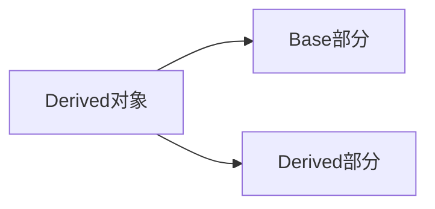

### C++ 派生类构造顺序详解

---

#### 一、构造顺序的核心规则
**构造顺序**：派生类对象的构造遵循 **从基类到派生类** 的顺序。具体流程如下：
1. **初始化基类部分**：从继承链最顶层的基类开始，逐层向下。
2. **初始化派生类部分**：按继承层次依次构造，直到当前派生类。

---

#### 二、单层继承示例分析
##### 1. 基类与派生类定义
```cpp
#include <iostream>

class Base {
public:
    Base() { std::cout << "Base\n"; }
};

class Derived : public Base {
public:
    Derived() { std::cout << "Derived\n"; }
};
```

##### 2. 构造过程验证
```cpp
int main() {
    Derived derived;
    return 0;
}
```
**输出结果**：
```
Base
Derived
```
- **流程解析**：
    1. 先调用 `Base` 的构造函数，初始化基类部分。
    2. 再调用 `Derived` 的构造函数，初始化派生类部分。

---

#### 三、多层继承链的构造顺序
##### 1. 多层继承定义
```cpp
class A { public: A() { std::cout << "A\n"; } };
class B : public A { public: B() { std::cout << "B\n"; } };
class C : public B { public: C() { std::cout << "C\n"; } };
class D : public C { public: D() { std::cout << "D\n"; } };
```

##### 2. 构造顺序验证
```cpp
int main() {
    D d;
    return 0;
}
```
**输出结果**：
```
A
B
C
D
```
- **流程解析**：
    1. 构造顺序从最顶层基类 `A` 开始。
    2. 依次构造 `B`、`C`，最后构造派生类 `D`。

---

#### 四、构造顺序的重要性
##### 1. 依赖关系保证
- **基类成员先初始化**：派生类的构造函数可能依赖基类成员，基类先构造确保派生类访问安全。
- **避免未定义行为**：若基类未初始化，派生类使用其成员会导致未定义行为。

##### 2. 默认构造函数的作用
- **隐式调用基类默认构造函数**：若未显式指定，编译器自动调用基类默认构造函数。
- **显式调用基类构造函数**（预告）：下一课将学习如何通过派生类构造函数显式选择基类构造函数。

---

#### 五、代码示例深入解析
##### 1. 基类与派生类的内存结构

- **内存布局**：派生类对象包含基类子对象和自身成员。

##### 2. 构造顺序的底层逻辑
```cpp
Derived::Derived() : Base() { /* 派生类初始化 */ }
```
- **隐式调用流程**：派生类构造函数隐式调用基类默认构造函数。

---

#### 六、注意事项与常见问题
##### 1. 基类无默认构造函数时的错误
```cpp
class Base {
public:
    Base(int id) {} // 无默认构造函数
};

class Derived : public Base {
public:
    Derived() {} // 错误：未显式调用 Base(int)
};
```
- **解决方法**：在派生类构造函数中显式调用基类构造函数。
  ```cpp
  Derived() : Base(42) {} // 正确
  ```

##### 2. 成员初始化顺序
- **基类构造先于成员变量初始化**：即使派生类成员在初始化列表中排在基类前面。
  ```cpp
  Derived() : m_member(0), Base() {} // Base() 仍先执行
  ```

---

#### 七、总结与预告
##### 1. 核心总结
- **构造顺序**：基类 → 派生类，继承链中从上到下。
- **安全性**：确保基类资源就绪后，派生类再初始化。

##### 2. 下节预告
- **显式调用基类构造函数**：如何通过派生类构造函数选择特定基类构造函数。
- **构造函数的链式调用**：多层继承中构造函数的参数传递。

---

通过掌握派生类的构造顺序，能够更好地设计类的层次结构，确保资源初始化的正确性和安全性。理解这一机制是构建健壮面向对象程序的关键基础。