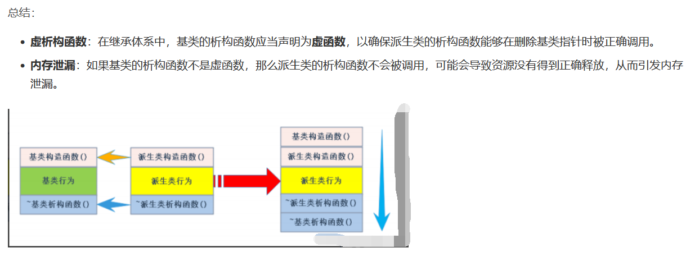

# 要点总结


### 继承的优点

1. **代码重用**：子类复用父类属性和方法，减少重复代码。
2. **扩展性**：子类可扩展或修改父类行为，实现系统扩展。
3. **多态性**：继承与虚函数结合实现运行时多态，增强代码灵活性和动态性。
4. **多继承与虚继承**：提供强大功能，但增加代码设计复杂度。
5. **访问控制**：不同继承访问权限确保程序封装性和安全性。 

### 基类成员再派生类中的访问权限

| 子类继承方式\基类成员-> | public成员 | protected成员 | private成员 |
|---------------| --- | --- | --- |
| public继承      | 派生类中为public | 派生类中为protected | 派生类中不可访问 |
| protected继承   | 派生类中为protected | 派生类中为protected | 派生类中不可访问 |
| private继承     | 派生类中为private | 派生类中为private | 派生类中不可访问 |


---

### **对象赋值（切片）**  

| **操作**                | **行为**                                                                 | **安全性** | **示例**                                                                 |
|-------------------------|-------------------------------------------------------------------------|------------|-------------------------------------------------------------------------|
| **派生类对象→基类对象** | 仅复制基类部分数据，派生类新增成员被丢弃（对象切片）。                   | 安全       | `Base b = derived_obj;`                                                |
| **基类对象→派生类对象** | 非法操作，编译错误（基类不包含派生类成员）。                             | 不安全     | `Derived d = base_obj; // 错误`                                       |


### **指针/引用操作与类型转换对比**

| **分类**               | **操作**                | **行为**                                                                 | **安全性**             | **访问权限**           | **使用条件**                              | **示例**                                                                 |
|------------------------|-------------------------|-------------------------------------------------------------------------|------------------------|------------------------|------------------------------------------|-------------------------------------------------------------------------|
| **指向对象**           | 基类指针→派生类对象     | 合法，静态类型为基类，只能访问基类成员。                                 | 安全                   | 仅基类成员              | 隐式向上转型（无需转换）                 | `Base* pb = &derived_obj; pb->baseFunc();`                             |
|                        | 基类引用→派生类对象     | 合法，静态类型为基类，只能访问基类成员。                                 | 安全                   | 仅基类成员              | 隐式向上转型（无需转换）                 | `Base& rb = derived_obj; rb.baseFunc();`                              |
| **强制类型转换**       | 向上转型                | 派生类指针/引用隐式或显式转为基类类型（符合“is-a”关系）。                 | 安全                   | 仅基类成员              | 隐式或显式（`static_cast`）              | `Base* pb = static_cast<Base*>(&derived_obj);`                       |
|                        | 向下转型（static_cast） | 强制将基类指针/引用转为派生类类型，不检查实际对象类型。                     | 不安全（依赖程序员保证）| 可访问派生类成员        | 已知实际对象类型时使用                    | `Derived* pd = static_cast<Derived*>(pb); pd->derivedFunc();`         |
|                        | 向下转型（dynamic_cast）| 运行时检查基类指针/引用是否实际指向派生类对象，失败返回 `nullptr` 或抛出异常。 | 安全                   | 可访问派生类成员        | 基类必须有虚函数（RTTI 支持）             | `if (Derived* pd = dynamic_cast<Derived*>(pb)) { pd->derivedFunc(); }` |
| **非法操作**           | 派生类指针→基类对象     | 直接赋值非法；强制转换后访问派生类成员会导致未定义行为。                   | 危险                   | 无效访问                | 无                                       | `Derived* pd = &base_obj; // 编译错误`                               |
|                        |                         |                                                                         |                        |                        | `static_cast` 强制转换（危险）           | `Derived* pd = static_cast<Derived*>(&base_obj); pd->derivedFunc(); // 未定义行为` |


> 口诀
谁在赋值号左边，以谁为对象，它处于什么位置：
【赋值左，为对象，判转向】【向上安全，向下险】


---

### **作用域与成员隐藏**
| **知识点**           | **说明**                                                                 | **示例代码**                                                                 | **易混淆点/区分角度**                                                                 |
|----------------------|-------------------------------------------------------------------------|------------------------------------------------------------------------------|---------------------------------------------------------------------------------------|
| **同名成员隐藏**      | 派生类定义与基类同名的成员（函数或变量）时，**无论参数是否相同**，基类成员被隐藏。 | ```cpp<br>class Base { void func(); };<br>class Derived { void func(int); };<br>d.func(); // 错误，需用 d.Base::func();<br>``` | **隐藏 vs 重载**：<br>- 重载：同一作用域内，函数名相同，参数不同。<br>- 隐藏：不同作用域（基类与派生类），名称相同即隐藏，与参数无关。 |
| **访问被隐藏的成员**  | 必须通过作用域解析符 `基类名::成员` 访问基类被隐藏的成员。                | ```cpp<br>d.Base::func(); // 正确调用基类 func()<br>```                       | 易忽略作用域解析符，误以为派生类成员覆盖（实际是隐藏）。                                |


### **默认成员函数调用顺序**

1. **构造函数**：基类->派生类。
2. **拷贝构造函数**：当用一个已存在的派生类对象初始化另一个派生类对象时，会先调用基类的拷贝构造函数，再调用派生类的拷贝构造函数。
3. **赋值运算符**：当进行派生类对象之间的赋值操作时，会先调用基类的赋值运算符，再调用派生类的赋值运算符。
4. **析构函数**：派生类->基类
5. **虚析构函数**：防止内存泄露



| **对比项**               | **关键区别**                                                                 |
|--------------------------|-----------------------------------------------------------------------------|
| **隐藏 vs 重载**         | - 隐藏：跨作用域（基类与派生类），仅名称相同。<br>- 重载：同一作用域，名称和参数不同。 |
| **构造 vs 析构顺序**     | - 构造：基类 → 派生类。<br>- 析构：派生类 → 基类。                           |
| **虚析构函数 vs 普通析构** | - 虚析构函数：通过基类指针删除派生类对象时，正确调用派生类析构函数。<br>- 普通析构函数：仅处理基类资源，可能导致派生类资源泄漏。 |

---


### **继承与友元**
| **知识点**               | **说明**                                                                 | **示例代码**                                                                 | **关键区别**                                                                 |
|--------------------------|-------------------------------------------------------------------------|------------------------------------------------------------------------------|--------------------------------------------------------------------------------|
| **友元函数的声明**       | 基类中声明的友元函数无法自动继承到派生类，需在派生类中重新声明才能访问其私有成员。 | ```cpp<br>class Base { friend void f(Base&); };<br>class Derived : Base { friend void f(Derived&); };``` | 友元关系不具备继承性，需显式声明。                                               |
| **友元函数的访问权限**   | 友元函数可直接访问类的私有和保护成员，但破坏封装性。                          | ```cpp<br>friend void f(Base& b) { cout << b.privateDataMember; }```          | 友元权限仅作用于声明它的类，不影响其他类。                                       |
| **派生类声明友元**       | 若需让基类的友元函数访问派生类私有成员，必须在派生类中重新声明该友元函数。      | ```cpp<br>class Derived : Base {<br>    friend void f(Base&, Derived&);<br>};``` | 派生类需显式授权友元函数访问自己的私有成员。                                     |


### **继承与静态成员**
| **知识点**               | **说明**                                                                 | **示例代码**                                                                 | **关键区别**                                                                 |
|--------------------------|-------------------------------------------------------------------------|------------------------------------------------------------------------------|--------------------------------------------------------------------------------|
| **静态成员的共享性**     | 静态成员属于类本身而非对象，所有派生类共享同一实例。                        | ```cpp<br>class Base { static int count; };<br>class Derived : Base {};<br>Base::count++; // 所有派生类共用``` | 静态数据成员在继承体系中是全局唯一的，派生类修改后所有对象可见。                                           |
| **静态成员的访问方式**   | 派生类可通过类名直接访问基类的静态成员，无需对象实例。                        | ```cpp<br>Base::staticFunc(); // 通过基类名调用<br>Derived::staticFunc(); // 通过派生类名调用``` | 静态成员函数不依赖对象，派生类可直接调用基类静态成员。                         |
| **静态成员的初始化**     | 静态数据成员需在类外定义并初始化。                                          | ```cpp<br>class Base { static int data; };<br>int Base::data = 10;```           | 初始化必须在类外完成，且只能定义一次。                                           |


### **易混淆点总结**
| **对比项**               | **关键区别**                                                                 |
|--------------------------|-----------------------------------------------------------------------------|
| **友元继承性**           | 基类的友元函数不能访问派生类成员，需派生类重新声明。                           |
| **静态成员共享性**       | 所有派生类共享基类的静态成员，修改后全局生效。                                |
| **友元与成员函数**       | 友元函数独立于类的继承体系，而成员函数受继承规则约束。                          |

---


### **菱形继承问题**
| **知识点**               | **说明**                                                                 | **关键区别/特点**                                                                 |
|--------------------------|-------------------------------------------------------------------------|----------------------------------------------------------------------------------|
| **基本结构**             | 派生类通过两条路径继承同一个基类，形成菱形结构（如 `D → B → A` 和 `D → C → A`）。 | 导致基类 `A` 被多次实例化，数据冗余。                                               |
| **二义性问题**           | 访问共享基类的成员时（如 `data`），编译器无法确定具体路径（`B→A` 或 `C→A`）。 | 需显式指定路径（如 `d.B::data`）或通过虚继承解决。                                |
| **数据冗余**             | 每个派生类路径独立持有基类实例，导致同一基类成员被多次存储。                 | 如菱形结构中，派生类对象包含多个基类副本。                                            |


### **虚拟继承解决方案**
| **知识点**               | **说明**                                                                 | **关键区别/特点**                                                                 |
|--------------------------|-------------------------------------------------------------------------|----------------------------------------------------------------------------------|
| **虚继承语法**           | 使用 `virtual` 关键字声明基类继承关系（如 `class B : virtual public A`）。       | 确保所有派生类共享同一个虚基类实例。                                                |
| **解决的问题**           | 消除数据冗余和二义性，保证基类仅被实例化一次。                                 | 虚基类成员通过虚基表（VBTable）和虚基类指针（VBPTR）间接访问。                         |
| **内存布局变化**         | 虚基类成员仅存储一次，派生类对象通过虚基类指针和虚基表定位成员地址。             | 虚基表存储虚基类相对于派生类的偏移量，访问需额外间接跳转。                            |

### **易混淆点总结**
| **对比项**          | **关键区别**                                           |
|------------------|----------------------------------------------------|
| **菱形继承 vs 虚继承**  | - 菱形继承导致数据冗余和二义性；<br> - 虚继承通过虚基表共享基类实例，解决上述问题。     |
| **虚基表 vs 普通基类表** | - 虚基表存储虚基类偏移量，支持动态地址计算；<br> - 普通基类表直接存储成员地址。       |
| **虚继承构造顺序**      | - 虚基类构造先于非虚基类，且仅调用一次。    <br> - 非虚继承按声明顺序调用基类构造函数。 |

---


### **传统继承 vs 虚拟继承核心对比**
| **对比项**               | **传统继承**                                                                 | **虚拟继承**                                                                 |
|--------------------------|-------------------------------------------------------------------------|-------------------------------------------------------------------------|
| **定义**                 | 直接继承，派生类独立持有基类的所有实例（每个基类路径独立）。                                | 使用 `virtual` 关键字，派生类共享基类唯一实例（菱形继承的唯一解）。                                           |
| **构造函数调用**         | - 每个基类路径独立调用基类构造函数（如菱形继承中基类被多次初始化）。<br>- 构造顺序按继承列表顺序。 | - 基类构造函数仅调用一次，由最派生类统一调用。<br>- 构造顺序：虚基类先于非虚基类。                              |
| **内存占用**             | - 内存冗余：每个派生类对象包含所有基类的副本（如菱形继承中基类 `A` 被多次存储）。<br>- 对象大小随继承层次线性增长。 | - 内存共享：所有派生类共享基类实例，减少冗余。<br>- 额外开销：需虚基表（VBTable）和虚基类指针（VBPTR）。                    |
| **访问基类成员**         | - 可能需要显式指定路径（如 `d.B::func()`）。<br>- 多个基类副本时易引发二义性错误。                            | - 直接访问共享实例（如 `d.func()`）。<br>- 消除二义性，成员唯一。                                               |
| **二义性问题**           | - 存在菱形继承时，访问共享基类成员会产生编译错误（如 `d.data` 无法确定路径）。                                | - 通过虚基表机制消除二义性，确保成员唯一访问。                                                                 |
| **性能开销**             | - 无额外间接访问开销，成员访问直接高效。                                      | - 需通过虚基表间接寻址（两次跳转：对象 → VBPTR → VBTable → 偏移量），增加运行时开销。                              |
| **析构函数调用**         | - 调用顺序：派生类 → 基类，每个基类实例调用一次。                                | - 调用顺序：派生类 → 基类，基类仅调用一次。                                                                      |
| **适用场景**             | - 简单继承层次，无需共享基类实例的场景。                                        | - 菱形继承或多重继承导致基类重复的场景（需共享实例）。                                                          |


### **最佳实践建议**
1. **优先使用组合替代继承**：如 `ComplexShape` 组合 `TwoDShape` 和 `ThreeDShape`，避免复杂继承层次（降低耦合性）。
2. **谨慎使用虚拟继承**：仅在必须解决菱形继承或共享基类实例时使用，避免不必要的性能开销。
3. **减少继承层级**：多层虚拟继承会增加代码复杂度，尽量保持类层次扁平化。

---

### 抽象类和接口


#### **抽象类（Abstract Class）**

- **抽象类** 是一种不能被实例化的类，必须通过派生类来实现具体功能。
- **C++ 中**：至少包含一个纯虚函数（`virtual void func() = 0;`）。
- **用途**：表示“is-a”关系，提供通用的基类框架。

#### **核心特性**
| **特性**               | **说明**                                                                 |
|--------------------------|-------------------------------------------------------------------------|
| **纯虚函数**             | 至少一个纯虚函数，强制派生类重写。                                           |
| **成员变量**             | 可包含普通成员变量（如 `int prot_val`）。                                     |
| **构造函数/析构函数**    | 可定义构造函数和析构函数（如 `AbstractBase()`）。                              |
| **非虚函数**             | 可包含具体实现的成员函数（如 `virtual ~AbstractBase()`）。                     |


#### **接口（Interface）**

- **接口** 是一种完全抽象的类，仅包含纯虚函数和常量成员，用于定义“can-do”契约。
- **C++ 中**：通常用纯虚类（所有成员均为纯虚函数）模拟接口。
- **用途**：实现多态和解耦设计（如插件系统）。

#### **核心特性**
| **特性**               | **说明**                                                                 |
|--------------------------|-------------------------------------------------------------------------|
| **纯虚函数**             | 所有成员函数均为纯虚函数（C++11 支持 `= default` 或 `= delete`）。              |
| **无成员变量**           | 不允许定义普通成员变量（可定义静态常量）。                                  |
| **无构造函数/析构函数**  | 无法定义构造函数或析构函数（C++ 允许空类定义）。                              |
| **多重继承**             | 支持一个类继承多个接口（如 `class C : public I1, I2`）。                       |


#### **抽象类 vs 接口**
| **对比项**               | **抽象类**                                                                 | **接口**                                                                 |
|--------------------------|-------------------------------------------------------------------------|-------------------------------------------------------------------------|
| **目的**                 | 提供通用基类框架，“is-a”关系。                                            | 定义功能契约，“can-do”关系。                                               |
| **成员函数**             | 可包含纯虚函数和非虚函数。                                                 | 仅含纯虚函数（C++ 中允许静态常量）。                                         |
| **成员变量**             | 可定义普通成员变量（如 `protected int prot_val`）。                          | 不允许定义普通成员变量（仅静态常量）。                                       |
| **构造函数**             | 可定义构造函数。                                                          | 无法定义构造函数（C++ 中纯虚类可为空，但无法实例化）。                         |
| **继承方式**             | 单继承（需虚继承解决菱形问题）。                                            | 多重继承（直接支持）。                                                      |
| **访问权限**             | 可控制成员访问级别（`public`/`protected`）。                              | 所有成员默认为 `public`（C++ 中需显式声明 `public`）。                        |


#### **设计原则**
- **优先使用接口**：当需要定义功能契约且不关心具体实现时（如插件系统）。
- **使用抽象类**：当需要共享代码或状态时（如通用的基类框架）。
- **组合优于继承**：复杂功能优先通过组合（`has-a` 关系）而非多重继承实现。

---

### 继承链构造顺序探究

> 多跑代码

#### **虚继承与构造顺序**
| **知识点**               | **说明**                                                                 |
|--------------------------|-------------------------------------------------------------------------|
| **虚基类优先构造**         | 虚基类的构造函数在非虚基类和成员对象之前调用，且仅构造一次。                   | 
| **非虚基类构造顺序**       | 非虚基类按继承列表顺序调用构造函数（如 `public C` 在 `virtual public D` 前声明，则先构造 `C`）。 | 
| **成员对象初始化顺序**     | 成员对象的构造函数按类中**声明顺序**调用（如 `X objX; Y objY;` 则先构造 `X`）。       | 

> 注意： 声明顺序，是类定义的成员函数的声明顺序，不是构造函数中形参的定义顺序


### **构造与析构机制**
| **知识点**               | **说明**                                                                 |
|--------------------------|-------------------------------------------------------------------------|
| **虚析构函数的作用**         | 确保通过基类指针删除派生类对象时，正确调用派生类析构函数。                       | 
| **构造顺序规则**           | 1. 虚基类构造 → 2. 非虚基类构造（按继承列表顺序） → 3. 成员对象构造 → 4. 派生类构造。 |
| **析构顺序规则**           | 1. 派生类析构 → 2. 成员对象析构（按反向声明顺序） → 3. 非虚基类析构（按反向继承列表顺序） → 4. 虚基类析构。 |


### 虚函数的内存模型

https://blog.csdn.net/zxxkkkk/article/details/109363441

> 虚函数表和虚基表不一样
1. 每个有虚函数的类都会为该类创建一个**虚函数表**，且在编译时已经决定了；
2. **虚函数表属于类**而不属于对象；
3. 只要父类中有虚函数，子类就会有虚函数表，且父类虚函数表和子类虚函数表不同。

虚函数
https://blog.csdn.net/weixin_43798887/article/details/118196343?spm=1001.2014.3001.5502


### 虚继承的内存模型

虚继承
https://blog.csdn.net/weixin_43798887/article/details/118369498