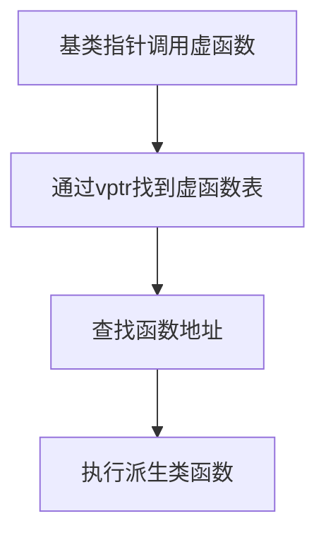

在C++中，函数调用的绑定方式分为**静态绑定（Static Binding）**和**动态绑定（Dynamic Binding）**，它们的核心区别在于函数地址的确定时机和灵活性。

---

### 一、静态绑定（Static Binding）
**定义**：在编译时确定函数调用的具体地址，所有信息在编译阶段解析完毕。

#### 特点：
1. **编译时决策**：编译器根据函数名和参数类型直接确定调用的函数。
2. **高效但不灵活**：直接跳转到函数地址，无运行时开销，但无法根据运行时状态调整行为。
3. **适用场景**：
    - 普通函数调用（非虚函数）。
    - 函数模板和重载函数。

#### 示例：
```cpp
#include <iostream>

void print(int x) { std::cout << x << std::endl; }
void print(double x) { std::cout << x << std::endl; } // 重载函数

int main() {
    print(5);    // 编译时确定调用 print(int)
    print(3.14); // 编译时确定调用 print(double)
    return 0;
}
```
- 编译器根据参数类型直接选择正确的重载函数。

---

### 二、动态绑定（Dynamic Binding）
**定义**：在运行时确定函数调用的具体地址，允许根据实际对象类型选择函数。

#### 特点：
1. **运行时决策**：通过指针或引用在运行时解析函数地址。
2. **灵活但有开销**：支持多态，但需额外的间接寻址（如虚函数表）。
3. **适用场景**：
    - 虚函数（实现多态）。
    - 函数指针或回调机制。

#### 示例：
1. **函数指针实现动态绑定**：
```cpp
#include <iostream>

int add(int a, int b) { return a + b; }
int subtract(int a, int b) { return a - b; }

int main() {
    int (*funcPtr)(int, int) = nullptr; // 函数指针
    int op = 0;
    std::cin >> op;

    if (op == 0) 
        funcPtr = add;
    else 
        funcPtr = subtract;

    std::cout << funcPtr(5, 3); // 运行时决定调用 add 或 subtract
    return 0;
}
```

2. **虚函数实现多态**：
```cpp
#include <iostream>

class Animal {
public:
    virtual void speak() { std::cout << "???" << std::endl; }
};

class Dog : public Animal {
public:
    void speak() override { std::cout << "Woof!" << std::endl; }
};

int main() {
    Animal* animal = new Dog();
    animal->speak(); // 动态调用 Dog::speak()
    delete animal;
    return 0;
}
```
- 虚函数通过虚函数表（vtable）在运行时解析函数地址。

---

### 三、虚函数与动态绑定机制
#### 1. 虚函数表（vtable）
- 每个包含虚函数的类有一个虚函数表，存储虚函数地址。
- 对象实例包含指向该表的指针（vptr）。

#### 2. 动态绑定流程


#### 3. 示例分析
```cpp
class Base {
public:
    virtual void func() { std::cout << "Base"; }
};

class Derived : public Base {
public:
    void func() override { std::cout << "Derived"; }
};

int main() {
    Base* obj = new Derived();
    obj->func(); // 输出 "Derived"
    delete obj;
    return 0;
}
```
- 编译器为`Base`和`Derived`生成各自的虚函数表。
- `obj`的vptr指向`Derived`的虚函数表，运行时调用`Derived::func()`。

---

### 四、静态绑定 vs 动态绑定
| 特性                | 静态绑定                     | 动态绑定                     |
|---------------------|-----------------------------|------------------------------|
| **确定时机**         | 编译时                       | 运行时                       |
| **性能**             | 高效（无额外开销）           | 较低效（需间接寻址）         |
| **灵活性**           | 不支持多态                   | 支持多态                     |
| **适用场景**         | 普通函数、模板、重载         | 虚函数、函数指针、回调        |
| **代码修改影响**     | 需重新编译                   | 运行时动态调整               |

---

### 五、总结
- **静态绑定**：适用于简单、确定的函数调用，编译器直接优化，效率高。
- **动态绑定**：用于需要多态或运行时决策的场景，如虚函数和回调，牺牲部分性能换取灵活性。

#### 关键点：
- **虚函数是实现多态的核心**：通过动态绑定支持运行时类型决策。
- **函数指针提供灵活回调机制**：但需手动管理，不如虚函数安全。
- **性能权衡**：在需要扩展性时使用动态绑定，在性能敏感场景优先静态绑定。

通过合理选择绑定方式，可以编写出高效且易于扩展的C++代码。